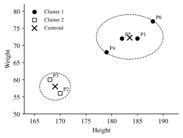
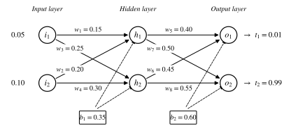
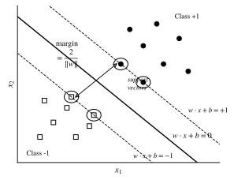
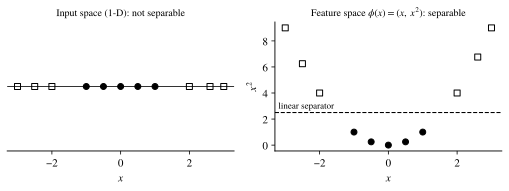
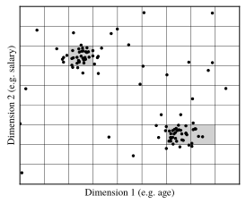
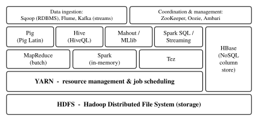
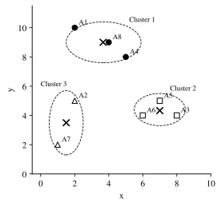

# Database Management System (BCS-501)

*AKTU B.Tech CSE, 3rd Year, Odd Semester - Revision Notebook*
*Compiled for: Harsh Katiyar, PSIT Kanpur*

---

## Unit 1: Architecture & ER Modeling

### Q1. Explain the three-schema architecture (Internal, Conceptual, External) and how it achieves physical and logical data independence. (7 Marks)

**1. Introduction / Definition**

The **three-schema architecture** (ANSI/SPARC architecture) separates a database into three levels of abstraction: the **external**, **conceptual** and **internal** level. Its main goal is to separate the user's view of the data from the way it is physically stored. This separation gives us **data independence**.

**2. Block Diagram**

```
   +-----------+     +-----------+     +-----------+
   |  User 1   |     |  User 2   |     |  User n   |
   +-----+-----+     +-----+-----+     +-----+-----+
         |                 |                 |
   +-----v-----+     +-----v-----+     +-----v-----+
   | External  |     | External  |     | External  |    EXTERNAL LEVEL
   |  View 1   |     |  View 2   |     |  View n   |    (User views)
   +-----+-----+     +-----+-----+     +-----+-----+
         |                 |                 |
         +-----------------+-----------------+
                           |
            External / Conceptual Mapping   <-- Logical Data Independence
                           |
               +-----------v-----------+
               |   Conceptual Schema   |              CONCEPTUAL LEVEL
               | (Entities, Relations, |              (Community view)
               |  Constraints, Types)  |
               +-----------+-----------+
                           |
            Conceptual / Internal Mapping   <-- Physical Data Independence
                           |
               +-----------v-----------+
               |    Internal Schema    |              INTERNAL LEVEL
               | (Files, Indexes, Data |              (Physical storage)
               |  structures, Paths)   |
               +-----------+-----------+
                           |
                   +-------v-------+
                   | Stored Database|
                   |    (Disk)      |
                   +---------------+
```

**3. Core Explanation / Working**

*(a) Internal Level (Physical Level)*

- Lowest level of abstraction. Describes **how** data is actually stored on disk.
- Covers storage structures, file organization, indexes, hashing, compression, record placement and access paths.
- Example: `STUDENT` records stored in a B+ tree file indexed on `Roll_No`.

*(b) Conceptual Level (Logical Level)*

- Describes **what** data is stored in the whole database and the relationships among the data.
- Hides physical storage details. Covers entities, attributes, data types, relationships, constraints and security.
- Designed and managed by the **DBA**.
- Example: `STUDENT(Roll_No, Name, DOB, Dept_ID)`, `DEPARTMENT(Dept_ID, DName)`.

*(c) External Level (View Level)*

- Highest level. Describes only the **part** of the database that a particular user group needs.
- Many external views can exist for one conceptual schema.
- Example: the Accounts section sees `(Roll_No, Name, Fee_Status)`. The Exam cell sees `(Roll_No, Name, Marks)`.

*(d) Mappings*

- **External/Conceptual mapping:** translates a request on a user view into a request on the conceptual schema.
- **Conceptual/Internal mapping:** translates conceptual records into stored records and access paths.

*(e) Data Independence*

- **Physical data independence:** the internal schema can change without changing the conceptual schema or application programs. Only the conceptual/internal mapping is updated.
  - Example: adding an index, moving to a new disk, or changing a file from heap to hashed organization.
- **Logical data independence:** the conceptual schema can change without changing external views or application programs. Only the external/conceptual mapping is updated.
  - Example: adding a new attribute `Email` to `STUDENT`, or splitting one table into two.
  - It is harder to achieve than physical independence, because applications depend directly on the logical structure.

**4. Key Characteristics - Physical vs. Logical Data Independence**

| Basis | Physical Data Independence | Logical Data Independence |
|---|---|---|
| Change made at | Internal level | Conceptual level |
| Protected level | Conceptual schema | External schemas / views |
| Mapping updated | Conceptual / Internal | External / Conceptual |
| Example change | New index, new storage device | Add/remove attribute or table |
| Ease of achieving | Easy | Difficult |
| Concerned with | Storage efficiency | Structure of data |

**5. Advantages & Disadvantages**

*Advantages*

- Gives data independence, which lowers application maintenance cost.
- Each user gets a customised view, which improves **security** by hiding unrelated data.
- The DBA can tune physical storage without affecting users.
- Supports many users with different needs on one shared database.

*Disadvantages*

- Mapping between levels adds **processing overhead** and can slow queries.
- More complex to design and to implement in the DBMS.
- Full logical independence is hard to achieve in practice.

**6. Conclusion / Application**

The three-schema architecture is the basis of all modern RDBMSs, such as Oracle, MySQL and PostgreSQL, where SQL **views** are the external level and **tablespaces/indexes** are the internal level.

---

### Q2. Differentiate between Generalization, Specialization and Aggregation using concrete examples. (7 Marks)

**1. Introduction / Definition**

Generalization, specialization and aggregation are **Enhanced ER (EER)** concepts that model **class hierarchies** and **relationships among relationships**. Generalization and specialization use the **IS-A** relationship (inheritance). Aggregation treats a relationship set as a higher-level entity.

**2. Diagrams**

*(a) Generalization (Bottom-Up)*

```
     +--------+          +--------+
     |  CAR   |          | TRUCK  |       Lower-level entities
     +---+----+          +----+---+       (common attributes found)
         |                    |
         +---------+----------+
                   |
                  / \
                 /ISA\                    Triangle = IS-A
                /_____\
                   |
              +----v----+
              | VEHICLE |                 Higher-level entity (created)
              +---------+
     Common attrs moved up: Reg_No, Model, Price
```

*(b) Specialization (Top-Down)*

```
              +----------+
              | EMPLOYEE |                Higher-level entity
              +----+-----+  (Emp_ID, Name, Salary)
                   |
                  / \
                 /ISA\
                /_____\
                   |
         +---------+----------+
         |                    |
   +-----v-----+       +------v-----+
   | ENGINEER  |       |  MANAGER   |     Sub-classes created
   +-----------+       +------------+
   (Skill)             (Allowance)        Specific attributes added
```

*(c) Aggregation*

```
     +-----------------------------------------------+
     |                 (Aggregated Entity)           |
     |  +----------+     /---------\    +---------+  |
     |  | EMPLOYEE |----< WORKS_ON  >---| PROJECT |  |
     |  +----------+     \---------/    +---------+  |
     +-----------------------+-----------------------+
                             |
                        /---------\
                       < MONITORS  >
                        \---------/
                             |
                       +-----+-----+
                       |  MANAGER  |
                       +-----------+
   MANAGER monitors the whole (EMPLOYEE works on PROJECT) relationship.
```

**3. Core Explanation / Working**

*(a) Generalization*

- A **bottom-up** process: two or more lower-level entities with common attributes are combined into a **single higher-level entity**.
- Common attributes move to the super-class. Distinct attributes stay in the sub-classes.
- Example: `CAR (Reg_No, Model, Seats)` and `TRUCK (Reg_No, Model, Load_Capacity)` are generalized into `VEHICLE (Reg_No, Model)`.

*(b) Specialization*

- A **top-down** process: a higher-level entity is divided into **sub-classes** based on a distinguishing feature.
- Sub-classes **inherit** all attributes and relationships of the super-class and add their own.
- Example: `EMPLOYEE` is specialized into `ENGINEER (Skill)` and `MANAGER (Allowance)`.

*(c) Constraints on Generalization/Specialization*

- **Disjoint:** an entity belongs to at most one sub-class (an employee is either an Engineer or a Manager).
- **Overlapping:** an entity may belong to more than one sub-class (a person can be both a Student and an Employee).
- **Total participation:** every super-class entity must belong to some sub-class.
- **Partial participation:** some super-class entities may belong to no sub-class.

*(d) Aggregation*

- The ER model **cannot express relationships between relationships**.
- Aggregation is an **abstraction** in which a relationship set, together with its participating entity sets, is treated as **one higher-level entity**.
- Example: `EMPLOYEE --WORKS_ON-- PROJECT` is aggregated, and `MANAGER` then has a `MONITORS` relationship with this aggregate.
- Without aggregation we would need a ternary relationship, which causes **redundancy**.

**4. Key Characteristics - Comparison Table**

| Basis | Generalization | Specialization | Aggregation |
|---|---|---|---|
| Approach | Bottom-up | Top-down | Abstraction of a relationship |
| Process | Combines entities into a super-class | Splits an entity into sub-classes | Treats a relationship as an entity |
| Relationship type | IS-A | IS-A | HAS-A / Part-of |
| Size of schema | Reduces | Increases | Avoids redundant ternary relationships |
| Inheritance | Sub-class attributes move up | Sub-classes inherit from super-class | No inheritance |
| Example | Car, Truck -> Vehicle | Employee -> Engineer, Manager | (Employee-Works_On-Project) monitored by Manager |

**5. Advantages & Disadvantages**

*Advantages*

- Generalization removes **redundancy** of common attributes.
- Specialization models real-world **sub-types** precisely, with their own attributes.
- Aggregation can model **relationships among relationships** without redundant ternary sets.
- Together they make the ER diagram closer to object-oriented design.

*Disadvantages*

- They make the ER diagram more **complex** to read and draw.
- Mapping these hierarchies to tables needs extra design choices (one table per class, or one table for the whole hierarchy), which can cause **NULL values** or extra joins.

**6. Conclusion / Application**

These EER concepts are used to design databases for **ERP, banking and university systems**, where entity hierarchies (Employee types, Account types) and monitored relationships (Project supervision) are common.

---

### Q3. List and explain E.F. Codd's 12 rules that define a fully relational database system. (7 Marks)

**1. Introduction / Definition**

In 1985 **Dr. E.F. Codd**, the father of the relational model, proposed **13 rules (Rule 0 to Rule 12)**. A DBMS must satisfy them to be called a **fully relational DBMS**. They make sure the system manages data **only through its relational capabilities**.

**2. Block Diagram - Classification of Codd's Rules**

```
                      +----------------------------+
                      |  Rule 0: Foundation Rule   |
                      +-------------+--------------+
                                    |
     +------------------+-----------+-----------+--------------------+
     |                  |                       |                    |
+----v------+   +-------v-------+     +---------v--------+   +-------v-------+
| STRUCTURE |   | DATA HANDLING |     |  INDEPENDENCE    |   |   INTEGRITY   |
|  RULES    |   |    RULES      |     |     RULES        |   |  & SECURITY   |
+-----------+   +---------------+     +------------------+   +---------------+
| R1 Info   |   | R5 Sublanguage|     | R8 Physical DI   |   | R10 Integrity |
| R2 Access |   | R6 View update|     | R9 Logical DI    |   |     indep.    |
| R3 NULLs  |   | R7 Set-level  |     | R11 Distribution |   | R12 Non-      |
| R4 Catalog|   |    ops        |     |     indep.       |   |   subversion  |
+-----------+   +---------------+     +------------------+   +---------------+
```

**3. Core Explanation - The Rules**

- **Rule 0 - Foundation Rule:** the system must manage databases **entirely** through its relational capabilities.
- **Rule 1 - Information Rule:** all information, including metadata, is represented **only as values in tables** (rows and columns).
- **Rule 2 - Guaranteed Access Rule:** every value must be reachable by the combination **Table name + Primary key value + Column name**, without using pointers.
- **Rule 3 - Systematic Treatment of NULL Values:** NULL must be handled consistently as **missing or inapplicable** information, distinct from zero or a blank string.
- **Rule 4 - Active Online Catalog (Data Dictionary):** the database description (metadata) is stored **in tables** and can be queried with the same language used for data.
- **Rule 5 - Comprehensive Data Sub-language Rule:** at least one language (like **SQL**) must support data definition, data manipulation, views, integrity constraints, authorization and transaction control.
- **Rule 6 - View Updating Rule:** every view that is **theoretically updatable** must be updatable by the system.
- **Rule 7 - High-Level Insert, Update, Delete:** insert, update and delete must work on **sets of rows** at a time, not only on a single row.
- **Rule 8 - Physical Data Independence:** changes to storage or access methods must **not affect** application programs.
- **Rule 9 - Logical Data Independence:** changes to the logical structure (such as adding a column or splitting a table) must **not affect** applications or views.
- **Rule 10 - Integrity Independence:** integrity constraints are defined in the sub-language and **stored in the catalog**, not in application programs.
- **Rule 11 - Distribution Independence:** users must not be aware whether data is **distributed** across sites. Applications keep working when data is distributed.
- **Rule 12 - Non-Subversion Rule:** if a low-level (record-at-a-time) interface exists, it must **not bypass** the integrity and security rules of the relational language.

**4. Key Characteristics - Rule Summary Table**

| Rule | Name | Key Idea |
|---|---|---|
| 0 | Foundation | Fully relational management |
| 1 | Information | Everything stored in tables |
| 2 | Guaranteed Access | Table + PK + Column |
| 3 | NULL Treatment | Uniform handling of missing values |
| 4 | Online Catalog | Metadata stored as tables |
| 5 | Data Sub-language | One complete language (SQL) |
| 6 | View Updating | Updatable views are updatable |
| 7 | Set-level Operations | Insert/Update/Delete on sets |
| 8 | Physical DI | Storage changes are invisible |
| 9 | Logical DI | Schema changes are invisible |
| 10 | Integrity Independence | Constraints stored in catalog |
| 11 | Distribution Independence | Location transparency |
| 12 | Non-subversion | No bypassing of constraints |

*Note:* no commercial RDBMS (Oracle, MySQL, SQL Server) satisfies **all 12 rules fully**. Most satisfy about 8-10 rules. Rules 6, 9 and 11 are the ones most often only partly met.

**5. Advantages & Disadvantages**

*Advantages (of following Codd's rules)*

- They give a **standard benchmark** for judging whether a DBMS is truly relational.
- They ensure **data independence, integrity and security**.
- They promote set-based processing, which makes queries **simpler and more powerful**.

*Disadvantages*

- Strict compliance is **hard to implement**, and no commercial product achieves it fully.
- Some rules, like full view updatability, are **theoretically complex** and can reduce performance.

**6. Conclusion / Application**

Codd's rules are the **yardstick used by vendors and academics** to rate RDBMS products such as Oracle, DB2 and PostgreSQL on how relational they are.

---

### Q4. Short Definitions (2 Marks Each)

**(a) Data Dictionary**

- A **data dictionary** is a centralized repository of **metadata** ("data about data").
- It stores table names, attribute names, data types, constraints, indexes, views, users and access rights.
- An **active** data dictionary is updated automatically by the DBMS. A **passive** one is maintained manually.
- Example: `INFORMATION_SCHEMA` in MySQL.

**(b) Database Schema vs. Instance**

| Schema | Instance |
|---|---|
| The **logical design / structure** of the database | The **actual data** stored at a particular moment |
| Defined once using DDL, rarely changes | Changes frequently with every insert/update/delete |
| Like a variable's type declaration | Like a variable's value |
| Example: `STUDENT(Roll, Name, Age)` | Example: `(101, 'Harsh', 21)` |

**(c) Responsibilities of a DBA (Database Administrator)**

- **Schema definition:** creates the conceptual schema using DDL.
- **Storage structure and access method definition:** chooses file organization and indexes.
- **Granting authorization:** controls user access and privileges (GRANT/REVOKE).
- **Backup and recovery:** takes periodic backups and restores after failures.
- **Integrity constraint specification:** defines rules to keep data consistent.
- **Performance tuning and monitoring:** monitors performance and tunes queries.

---


## Unit 2: Relational Algebra & Calculus

### Q1. Explain fundamental and derived relational algebra operators, with focus on Natural Join, Outer Joins and the Division operator. (7 Marks)

**1. Introduction / Definition**

**Relational algebra** is a **procedural** query language. It takes one or more relations as input and produces a new relation as output. Its operators are divided into **fundamental** (basic) operators and **derived** operators, which can be expressed using the basic ones.

**2. Block Diagram - Classification of Operators**

```
                        +----------------------+
                        |  Relational Algebra  |
                        |      Operators       |
                        +----------+-----------+
                                   |
             +---------------------+----------------------+
             |                                            |
   +---------v----------+                     +-----------v-----------+
   |    FUNDAMENTAL     |                     |        DERIVED        |
   +--------------------+                     +-----------------------+
   | Select      (σ)    |                     | Intersection   (∩)    |
   | Project     (π)    |                     | Natural Join   (⋈)    |
   | Union       (∪)    |                     | Theta Join     (⋈θ)   |
   | Set Diff.   (−)    |                     | Outer Joins (⟕ ⟖ ⟗)   |
   | Cartesian   (×)    |                     | Division       (÷)    |
   | Rename      (ρ)    |                     | Assignment     (←)    |
   +--------------------+                     +-----------------------+
```

**3. Core Explanation / Working**

*(a) Fundamental Operators*

- **Select (σ):** chooses **rows** that satisfy a predicate. `σ Dept='CSE' (STUDENT)`
- **Project (π):** chooses **columns** and removes duplicates. `π Name, Dept (STUDENT)`
- **Union (∪):** all tuples in R or S. R and S must be **union compatible** (same degree and domains).
- **Set Difference (−):** tuples in R but not in S.
- **Cartesian Product (×):** every tuple of R combined with every tuple of S. Result size is |R| x |S|.
- **Rename (ρ):** renames a relation or its attributes. `ρ S(STUDENT)`

*(b) Derived Operators*

- **Intersection:** `R ∩ S = R − (R − S)`
- **Theta Join:** `R ⋈θ S = σθ (R × S)`

**Sample relations used below**

```
 EMP                          DEPT
 +-----+-------+-----+        +-----+-------+
 | EID | Name  | DID |        | DID | DName |
 +-----+-------+-----+        +-----+-------+
 |  1  | Amit  | 10  |        | 10  | CSE   |
 |  2  | Riya  | 20  |        | 20  | IT    |
 |  3  | Karan | 40  |        | 30  | ECE   |
 +-----+-------+-----+        +-----+-------+
```

*(c) Natural Join (EMP ⋈ DEPT)*

- Joins on **all common attributes** (here `DID`) with an equality condition and keeps **one copy** of each common column.
- Formula: `R ⋈ S = π (R ∪ S attrs) ( σ R.A = S.A (R × S) )`

```
 +-----+-------+-----+-------+
 | EID | Name  | DID | DName |
 +-----+-------+-----+-------+
 |  1  | Amit  | 10  | CSE   |
 |  2  | Riya  | 20  | IT    |
 +-----+-------+-----+-------+
```

*(d) Outer Joins*

- They keep **unmatched tuples** as well, filling the missing values with **NULL**. This avoids the information loss of a natural join.
- **Left Outer Join (EMP ⟕ DEPT):** all EMP tuples are kept.
- **Right Outer Join (EMP ⟖ DEPT):** all DEPT tuples are kept.
- **Full Outer Join (EMP ⟗ DEPT):** all tuples of both relations are kept.

```
 LEFT OUTER JOIN                 RIGHT OUTER JOIN
 +---+-------+----+-------+      +------+------+----+-------+
 |EID| Name  |DID | DName |      | EID  | Name |DID | DName |
 +---+-------+----+-------+      +------+------+----+-------+
 | 1 | Amit  | 10 | CSE   |      |  1   | Amit | 10 | CSE   |
 | 2 | Riya  | 20 | IT    |      |  2   | Riya | 20 | IT    |
 | 3 | Karan | 40 | NULL  |      | NULL | NULL | 30 | ECE   |
 +---+-------+----+-------+      +------+------+----+-------+

 FULL OUTER JOIN = rows of both tables above (Amit, Riya, Karan + ECE)
```

*(e) Division Operator (R ÷ S)*

- Used for **"for all"** queries, for example "find students who are enrolled in **all** courses".
- If R(A, B) and S(B), then R ÷ S gives every A value that is paired with **every** B value in S.
- Formula: `R ÷ S = π A (R) − π A ( (π A (R) × S) − R )`

```
 ENROLLED (R)          COURSE (S)        R ÷ S
 +---------+--------+   +--------+        +---------+
 | Student | Course |   | Course |        | Student |
 +---------+--------+   +--------+        +---------+
 |    A    |   C1   |   |   C1   |        |    A    |
 |    A    |   C2   |   |   C2   |        |    C    |
 |    B    |   C1   |   +--------+        +---------+
 |    C    |   C1   |
 |    C    |   C2   |
 |    C    |   C3   |
 +---------+--------+
```

- *Step-by-step:*
  1. `π Student (R)` = {A, B, C}
  2. `π Student (R) × S` = {AC1, AC2, BC1, BC2, CC1, CC2}
  3. Subtract R: {BC2}. These are the missing pairs.
  4. `π Student` of step 3 = {B}
  5. {A, B, C} − {B} = **{A, C}**

**4. Key Characteristics - Join Comparison**

| Join Type | Condition | Unmatched Tuples | Duplicate Columns |
|---|---|---|---|
| Theta Join | Any condition (<, >, =, etc.) | Discarded | Kept |
| Equi Join | Only equality (=) | Discarded | Kept |
| Natural Join | Equality on common attributes | Discarded | Removed |
| Left Outer | Equality | Left side kept (NULL padding) | Removed |
| Right Outer | Equality | Right side kept (NULL padding) | Removed |
| Full Outer | Equality | Both sides kept | Removed |

**5. Advantages & Disadvantages**

*Advantages*

- It is the **formal foundation** of SQL and of query optimization.
- Operators are **closed**: the output is always a relation, so operations can be **nested**.
- Derived operators like join and division make complex queries **shorter**.

*Disadvantages*

- It is **procedural**: the user must specify *how* to get the result.
- It lacks aggregation, sorting and recursion in its basic form.
- Cartesian products and joins on large tables can be very **costly**.

**6. Conclusion / Application**

Relational algebra is used **internally by the query optimizer** of every RDBMS to turn SQL into efficient execution plans, for example by pushing selections before joins.

---

### Q2. Differentiate between Tuple Relational Calculus (TRC) and Domain Relational Calculus (DRC) with syntax. (7 Marks)

**1. Introduction / Definition**

**Relational calculus** is a **non-procedural (declarative)** query language based on first-order predicate logic. The user states *what* data is required, not *how* to get it. It has two forms: **Tuple Relational Calculus (TRC)**, where variables range over **tuples**, and **Domain Relational Calculus (DRC)**, where variables range over **attribute values (domains)**.

**2. Block Diagram**

```
                     +---------------------------+
                     |  Formal Query Languages   |
                     +-------------+-------------+
                                   |
              +--------------------+--------------------+
              |                                         |
   +----------v-----------+                 +-----------v------------+
   |  Procedural          |                 |  Non-Procedural        |
   |  Relational Algebra  |                 |  Relational Calculus   |
   +----------------------+                 +-----------+------------+
                                                        |
                                    +-------------------+------------------+
                                    |                                      |
                         +----------v-----------+               +----------v-----------+
                         |   Tuple RC (TRC)     |               |  Domain RC (DRC)     |
                         |  var = whole tuple   |               |  var = column value  |
                         |  {t | P(t)}          |               |  {<x1..xn>|P(x1..xn)}|
                         |  Basis of: SQL, QUEL |               |  Basis of: QBE       |
                         +----------------------+               +----------------------+
```

**3. Core Explanation / Working**

*Sample relation:* `STUDENT(Roll, Name, Age, Dept)`

*(a) Tuple Relational Calculus (TRC)*

- **General form:** `{ t | P(t) }`, read as "the set of all tuples t for which predicate P is true".
- `t.A` means the value of attribute A in tuple t.
- Uses `∈`, comparison operators (`<, >, =, ≠, ≤, ≥`), connectives (`∧, ∨, ¬, ⇒`) and quantifiers (`∃` there exists, `∀` for all).
- *Example 1:* names of students older than 20:
  `{ t.Name | t ∈ STUDENT ∧ t.Age > 20 }`
- *Example 2 (with a join):* names of students in the 'CSE' department, using `DEPT(Dept, HOD)`:
  `{ t.Name | t ∈ STUDENT ∧ ∃ d ∈ DEPT ( d.Dept = t.Dept ∧ d.Dept = 'CSE' ) }`

*(b) Domain Relational Calculus (DRC)*

- **General form:** `{ <x1, x2, ..., xn> | P(x1, x2, ..., xn) }`
- Each `xi` is a **domain variable** that stands for a single attribute value.
- `<r, n, a, d> ∈ STUDENT` means a tuple with those values exists in STUDENT.
- *Example 1:* names of students older than 20:
  `{ <n> | ∃ r, a, d ( <r, n, a, d> ∈ STUDENT ∧ a > 20 ) }`
- *Example 2:* roll number and name of CSE students:
  `{ <r, n> | ∃ a ( <r, n, a, 'CSE'> ∈ STUDENT ) }`

*(c) Safety of Expressions*

- An expression like `{ t | ¬(t ∈ STUDENT) }` is **unsafe** because it produces an infinite result.
- A **safe** expression only returns values from the **domain of the expression**, meaning values that appear in the relations or constants used in the query.
- Safe TRC, safe DRC and relational algebra have **equal expressive power**. This property is called **relational completeness**.

**4. Key Characteristics - TRC vs. DRC**

| Basis | Tuple Relational Calculus (TRC) | Domain Relational Calculus (DRC) |
|---|---|---|
| Variable represents | An entire **tuple** (row) | A single **attribute value** (column) |
| General syntax | `{ t \| P(t) }` | `{ <x1,...,xn> \| P(x1,...,xn) }` |
| Attribute access | Dot notation `t.Name` | Positional `<r, n, a, d>` |
| Membership test | `t ∈ R` | `<x1,...,xn> ∈ R` |
| Query language based on it | SQL, QUEL (Ingres) | QBE (Query-By-Example) |
| Readability | Easier for multi-attribute relations | Lengthy, since all columns must be listed |
| Expressive power | Same as relational algebra (safe expressions) | Same as relational algebra (safe expressions) |

**5. Advantages & Disadvantages**

*Advantages*

- It is **declarative**: users state *what* they want, which is close to natural logic.
- It allows **query optimization freedom**, because the DBMS chooses the execution strategy.
- It is **relationally complete**, with the same power as relational algebra.

*Disadvantages*

- Unsafe expressions can give **infinite results**, so safety checks are needed.
- Quantifiers (`∀`, `∃`) make complex queries **hard to write and understand** for beginners.
- Like basic algebra, it does not support aggregation directly.

**6. Conclusion / Application**

TRC is the theoretical basis of **SQL's** `SELECT ... FROM ... WHERE` and DRC is the basis of **QBE** interfaces like the MS Access query designer.

---

### Q3. Explain Domain constraints, Entity Integrity and Referential Integrity with table examples. (7 Marks)

**1. Introduction / Definition**

**Integrity constraints** are rules applied to a database to keep its data **accurate, valid and consistent**. They are defined in the schema (using DDL) and the DBMS **enforces them automatically** on every insert, update and delete.

**2. Block Diagram**

```
                   +------------------------------+
                   |     Integrity Constraints    |
                   +---------------+--------------+
                                   |
      +---------------+------------+-------------+------------------+
      |               |                          |                  |
+-----v------+  +-----v-------+        +---------v--------+  +------v------+
|  DOMAIN    |  |    KEY      |        |  ENTITY          |  | REFERENTIAL |
| Constraint |  | Constraint  |        |  INTEGRITY       |  |  INTEGRITY  |
+------------+  +-------------+        +------------------+  +-------------+
| Data type, |  | Uniqueness  |        | Primary key can  |  | FK value must|
| range,     |  | of candidate|        | never be NULL    |  | match a PK or|
| CHECK      |  | keys        |        |                  |  | be NULL      |
+------------+  +-------------+        +------------------+  +-------------+

   Referential link:
   STUDENT.Dept_ID (Foreign Key) ------references-----> DEPARTMENT.Dept_ID (Primary Key)
      (Referencing / Child)                               (Referenced / Parent)
```

**3. Core Explanation / Working**

*(a) Domain Constraint*

- Each attribute value must be an **atomic** value from its defined **domain** (data type, length, range, format).
- Defined using data types, `NOT NULL`, `DEFAULT` and `CHECK`.
- SQL: `Age INT CHECK (Age BETWEEN 17 AND 30)`

```
 STUDENT
 +------+-------+-------+
 | Roll | Name  |  Age  |
 +------+-------+-------+
 | 101  | Harsh |  21   |  <- Valid
 | 102  | Neha  | 'abc' |  <- VIOLATION: Age must be INT
 | 103  | Ravi  |  45   |  <- VIOLATION: CHECK (17-30) fails
 +------+-------+-------+
```

*(b) Key Constraint*

- Every candidate key must be **unique**. No two tuples may have the same key value.

*(c) Entity Integrity Constraint*

- **No primary key attribute may be NULL.** The primary key identifies each tuple uniquely, and NULL cannot identify anything.
- SQL: `Roll INT PRIMARY KEY` (this implies `NOT NULL` and `UNIQUE`).

```
 STUDENT
 +------+-------+
 | Roll | Name  |
 +------+-------+
 | 101  | Harsh |   <- Valid
 | NULL | Aman  |   <- VIOLATION: PK cannot be NULL
 | 101  | Priya |   <- VIOLATION: duplicate PK (key constraint)
 +------+-------+
```

*(d) Referential Integrity Constraint*

- A **foreign key (FK)** value in the referencing (child) table must either **match an existing primary key** value in the referenced (parent) table or be **NULL**.
- SQL: `Dept_ID INT REFERENCES DEPARTMENT(Dept_ID)`

```
 DEPARTMENT (Parent)          STUDENT (Child)
 +---------+-------+          +------+-------+---------+
 | Dept_ID | DName |          | Roll | Name  | Dept_ID |
 +---------+-------+          +------+-------+---------+
 |   10    | CSE   |<---------| 101  | Harsh |   10    |  Valid
 |   20    | IT    |<---------| 102  | Neha  |   20    |  Valid
 +---------+-------+          | 103  | Ravi  |  NULL   |  Valid (not assigned)
                              | 104  | Mohit |   50    |  VIOLATION: 50 not in parent
                              +------+-------+---------+
```

*(e) How operations can violate constraints*

- **Insert:** can violate domain, key, entity and referential integrity (child insert with a non-existent FK).
- **Delete:** can violate referential integrity only (deleting a parent row that child rows still reference).
- **Update:** can violate all of them.
- *Actions on violation:* `RESTRICT/NO ACTION` (reject), `CASCADE` (propagate), `SET NULL`, `SET DEFAULT`.

**4. Key Characteristics - Comparison**

| Basis | Domain Constraint | Entity Integrity | Referential Integrity |
|---|---|---|---|
| Applies to | Every attribute | Primary key attributes | Foreign key attributes |
| Rule | Value from valid domain | PK ≠ NULL | FK = some PK value or NULL |
| Scope | Single attribute | Single relation | Two relations |
| SQL syntax | Data type, CHECK, NOT NULL | PRIMARY KEY | FOREIGN KEY ... REFERENCES |
| Violated by | Insert, Update | Insert, Update | Insert (child), Delete (parent), Update |

**5. Advantages & Disadvantages**

*Advantages*

- They keep the database **accurate and consistent** by preventing invalid data.
- Enforcement is **centralised** in the DBMS, so each application does not need validation code.
- Referential integrity prevents **orphan records** (dangling references).

*Disadvantages*

- Checking constraints on every operation adds **performance overhead**, especially on bulk loads.
- `CASCADE` actions can **unintentionally delete** large amounts of related data.

**6. Conclusion / Application**

Integrity constraints are used in every **banking, e-commerce and university ERP** system. For example, an order row can never refer to a non-existent customer.

---

### Q4. Short Definitions (2 Marks Each)

**(a) Cartesian Product (×)**

- A binary operation that combines **every tuple of R with every tuple of S**.
- If R has m tuples and n1 attributes, and S has p tuples and n2 attributes, then R × S has **m x p tuples** and **n1 + n2 attributes**.
- Example: R with 3 rows × S with 4 rows = 12 rows.

**(b) Theta Join (⋈θ)**

- A join that combines tuples from two relations that satisfy a **general condition θ**, which can use any of `=, <, >, ≤, ≥, ≠`.
- `R ⋈θ S = σθ (R × S)`
- Example: `EMP ⋈ (EMP.Salary > MGR.Salary) MGR`. When θ uses only `=`, it is called an **Equi Join**.

**(c) Foreign Key and Cascading Deletes**

- When a foreign key is declared with **`ON DELETE CASCADE`**, deleting a parent (referenced) row **automatically deletes all child rows** that refer to it. This keeps referential integrity without leaving orphan rows.
- SQL: `FOREIGN KEY (Dept_ID) REFERENCES DEPARTMENT(Dept_ID) ON DELETE CASCADE`
- Example: deleting `Dept_ID = 10` from DEPARTMENT also deletes every STUDENT row with `Dept_ID = 10`.

---


## Unit 3: Database Design & Normalization

### Q1. Prove whether a given database decomposition is lossless or lossy, and explain dependency preservation. (7 Marks)

**1. Introduction / Definition**

A decomposition of relation R into R1 and R2 is **lossless (non-additive) join** if joining R1 and R2 gives back **exactly** the original R, with no extra (spurious) tuples: `R1 ⋈ R2 = R`. If the join produces spurious tuples, the decomposition is **lossy**. A decomposition is **dependency preserving** if every functional dependency of R can be checked using the decomposed relations alone.

**2. Flowchart - Lossless Join Test (Binary Decomposition)**

```
            +-----------------------------------+
            |  Given R, F and R1, R2            |
            +-----------------+-----------------+
                              |
            +-----------------v-----------------+
            | Cond 1: R1 ∪ R2 = R ?             |---- No ---> LOSSY
            +-----------------+-----------------+
                              | Yes
            +-----------------v-----------------+
            | Cond 2: R1 ∩ R2 ≠ ∅ ?             |---- No ---> LOSSY
            +-----------------+-----------------+
                              | Yes
            +-----------------v-----------------+
            | Compute (R1 ∩ R2)+ using F        |
            +-----------------+-----------------+
                              |
            +-----------------v-----------------+
            | Cond 3: (R1 ∩ R2) -> R1  OR       |---- No ---> LOSSY
            |         (R1 ∩ R2) -> R2 ?         |
            |  (common attr is a key of R1/R2)  |
            +-----------------+-----------------+
                              | Yes
                       +------v------+
                       |  LOSSLESS   |
                       +-------------+
```

**3. Core Explanation / Working**

*(a) Conditions for a lossless join (R into R1, R2)*

1. `Attr(R1) ∪ Attr(R2) = Attr(R)`
2. `Attr(R1) ∩ Attr(R2) ≠ ∅`
3. `R1 ∩ R2 → R1` **or** `R1 ∩ R2 → R2` must hold in F+. In other words, the common attribute(s) must be a **superkey** of at least one of the two relations.

*(b) Solved Example 1 - LOSSLESS*

`R(A, B, C, D, E)`, `F = { A → BC, CD → E, B → D, E → A }`
Decomposition: `R1(A, B, C)` and `R2(A, D, E)`

- Cond 1: {A,B,C} ∪ {A,D,E} = {A,B,C,D,E} = R. **Satisfied.**
- Cond 2: R1 ∩ R2 = {A} ≠ ∅. **Satisfied.**
- Cond 3: compute A+.
  - Start: A+ = {A}
  - A → BC gives {A, B, C}
  - B → D gives {A, B, C, D}
  - CD → E gives {A, B, C, D, E}
  - So A+ = ABCDE, and A → ABC (= R1) holds. **Satisfied.**
- **Result: the decomposition is LOSSLESS.**

*(c) Solved Example 2 - LOSSY (shown with data)*

`R(A, B, C)`, `F = { A → B }`, decomposed into `R1(A, B)` and `R2(B, C)`.

- R1 ∩ R2 = {B}, and B+ = {B}. B is a key of neither R1 nor R2, so the decomposition is **LOSSY**.

```
     R                  R1           R2           R1 ⋈ R2
 +---+---+---+       +---+---+    +---+---+    +---+---+---+
 | A | B | C |       | A | B |    | B | C |    | A | B | C |
 +---+---+---+       +---+---+    +---+---+    +---+---+---+
 | 1 | x | p |  -->  | 1 | x |    | x | p |    | 1 | x | p |
 | 2 | x | q |       | 2 | x |    | x | q |    | 1 | x | q | <- spurious
 +---+---+---+       +---+---+    +---+---+    | 2 | x | p | <- spurious
                                               | 2 | x | q |
                                               +---+---+---+
```

The join gives 4 tuples instead of 2. The extra tuples make information **ambiguous**, which is why the decomposition is called "lossy".

*(d) Decomposition into more than two relations (successive joins)*

- `R(A,B,C,D)`, `F = {A → B, B → C, C → D}`, decomposition `R1(A,B), R2(B,C), R3(C,D)`.
- R1 ⋈ R2: common attribute B, and B → C, so B is a key of R2. Lossless, giving `R12(A,B,C)`.
- R12 ⋈ R3: common attribute C, and C → D, so C is a key of R3. Lossless, giving `R(A,B,C,D)`.
- **Result: LOSSLESS.** For harder cases, use the **Chase (Tableau) matrix method**.

*(e) Dependency Preservation*

- Let Fi be the set of FDs in F+ that contain **only attributes of Ri** (the projection of F onto Ri).
- The decomposition is **dependency preserving** if `(F1 ∪ F2 ∪ ... ∪ Fn)+ = F+`.
- *Checking Example 1:*
  - F1 on R1(A,B,C): `A → BC` and `BC → A`. BC → A holds because BC+ = BCDEA.
  - F2 on R2(A,D,E): `A → DE` and `E → A`.
  - Is `B → D` implied by F1 ∪ F2? B+ = {B}, which does not contain D. **Not preserved.**
  - Is `CD → E` implied? CD+ = {C, D}, which does not contain E. **Not preserved.**
  - **Conclusion:** the decomposition in Example 1 is **lossless but NOT dependency preserving**.

**4. Key Characteristics - Lossless vs. Lossy / Dependency Preservation**

| Basis | Lossless Join | Lossy Join | Dependency Preservation |
|---|---|---|---|
| Join result | Exactly the original R | R plus spurious tuples | Not about the join |
| Test | Common attr is a key of R1 or R2 | Test fails | (∪ Fi)+ = F+ |
| Necessity | **Mandatory** | Never acceptable | Desirable (may be given up for BCNF) |
| Guaranteed by | 3NF and BCNF algorithms | - | 3NF synthesis (not always BCNF) |

**5. Advantages & Disadvantages**

*Advantages*

- A lossless decomposition **removes redundancy** without losing information.
- Dependency preservation lets constraints be **checked locally** on single tables without costly joins.
- Together they guarantee a **correct normalization** (3NF gives both properties).

*Disadvantages*

- A lossless decomposition still needs **joins** at query time, which costs performance.
- **BCNF may not preserve dependencies**, so a designer sometimes has to accept 3NF.

**6. Conclusion / Application**

The lossless-join test is used in **schema normalization tools** and by database designers to make sure that splitting tables (for example in an ERP schema) never corrupts the stored information.

---

### Q2. Calculate the minimal cover (canonical cover) for a given set of functional dependencies. (7 Marks)

**1. Introduction / Definition**

A **canonical (minimal) cover Fc** of an FD set F is the **smallest equivalent set** of FDs such that: (i) every FD has a **single attribute on the RHS**, (ii) no FD has an **extraneous attribute** on its LHS, and (iii) no FD is **redundant**. Fc has the same closure as F (`Fc+ = F+`).

**2. Flowchart - Algorithm**

```
        +-------------------------------------------+
        |              Given FD set F               |
        +---------------------+---------------------+
                              |
        +---------------------v---------------------+
        | STEP 1: Decompose RHS (singleton RHS)     |
        |   A -> BC  ==>  A -> B ,  A -> C          |
        +---------------------+---------------------+
                              |
        +---------------------v---------------------+
        | STEP 2: Remove extraneous LHS attributes  |
        |   For XY -> Z: if X+ contains Z, drop Y   |
        +---------------------+---------------------+
                              |
        +---------------------v---------------------+
        | STEP 3: Remove redundant FDs              |
        |   For X -> A: drop it, compute X+ with    |
        |   the rest; if A is in X+, it's redundant |
        +---------------------+---------------------+
                              |
        +---------------------v---------------------+
        | STEP 4: Union rule - combine same LHS     |
        |   A -> B , A -> C  ==>  A -> BC           |
        +---------------------+---------------------+
                              |
                     +--------v--------+
                     | Canonical Cover |
                     |       Fc        |
                     +-----------------+
```

**3. Core Explanation / Working - Solved Example 1**

**Given:** `F = { A → B, C → B, D → ABC, AC → D }`

*Step 1: Make every RHS a single attribute*

```
 F1 = { A → B,  C → B,  D → A,  D → B,  D → C,  AC → D }
```

*Step 2: Remove extraneous attributes from LHS* (only `AC → D` has a composite LHS)

- Is A extraneous? Check C+ = {C, B}. D is not in it, so **A is needed**.
- Is C extraneous? Check A+ = {A, B}. D is not in it, so **C is needed**.
- `AC → D` stays as it is.

*Step 3: Remove redundant FDs* (for each FD, compute the LHS closure without that FD)

| FD tested | Closure using the remaining FDs | RHS found? | Decision |
|---|---|---|---|
| A → B | A+ = {A} | No | Keep |
| C → B | C+ = {C} | No | Keep |
| D → A | D+ = {D, B, C} | No | Keep |
| D → B | D+ = {D, A, C, B} (via D→A, A→B) | **Yes** | **Remove** |
| D → C | D+ = {D, A, B} | No | Keep |
| AC → D | AC+ = {A, C, B} | No | Keep |

*Step 4: Combine FDs with the same LHS*

- `D → A` and `D → C` combine to give `D → AC`.

**Answer:**

```
   Fc = { A → B,  C → B,  D → AC,  AC → D }
```

**Solved Example 2 (Korth)**

**Given:** `F = { A → BC, B → C, A → B, AB → C }`

- *Step 1:* `{ A → B, A → C, B → C, A → B, AB → C }`. Remove the duplicate to get `{ A → B, A → C, B → C, AB → C }`.
- *Step 2:* in `AB → C`, A+ = {A, B, C} already contains C, so **B is extraneous**. `AB → C` becomes `A → C`, which is a duplicate.
- *Step 3:* `A → C` is redundant, because A → B and B → C give A → C by transitivity. Remove it.
- **Answer: `Fc = { A → B, B → C }`**

**4. Key Characteristics - F vs. Fc**

| Property | Original F | Canonical Cover Fc |
|---|---|---|
| RHS | May be composite | Single attribute (combined only at the end) |
| Extraneous attributes | May exist | None |
| Redundant FDs | May exist | None |
| Closure | F+ | Fc+ = F+ (equivalent) |
| Uniqueness | - | **Not unique**, since several minimal covers may exist |

**5. Advantages & Disadvantages**

*Advantages*

- It **reduces the cost of checking** FDs on every database update.
- It is the **input to the 3NF synthesis algorithm**, which gives a lossless and dependency-preserving design.
- It removes redundancy in the constraint set, making the design **simpler to analyse**.

*Disadvantages*

- Computing closures repeatedly is **time-consuming by hand** for large FD sets.
- The result is **not unique**: a different processing order may give a different (but equivalent) cover.

**6. Conclusion / Application**

The canonical cover is used by **database design tools** and in the **3NF decomposition algorithm** to produce optimal table structures with the fewest constraints to enforce.

---

### Q3. Explain Multivalued Dependency (MVD) leading to 4NF, followed by Join Dependency leading to 5NF. (7 Marks)

**1. Introduction / Definition**

A **Multivalued Dependency (MVD)** `X →→ Y` exists when, for one value of X, there is a **set of Y values that is independent** of the other attributes. **4NF** removes non-trivial MVDs. A **Join Dependency (JD)** exists when a relation can be rebuilt losslessly **only by joining three or more** of its projections. **5NF (PJNF)** removes such join dependencies.

**2. Block Diagram - Normal Form Hierarchy**

```
  +-----------------+
  | Unnormalized    |
  +--------+--------+
           | remove multi-valued / repeating attributes
  +--------v--------+
  |      1NF        |
  +--------+--------+
           | remove partial dependencies
  +--------v--------+
  |      2NF        |
  +--------+--------+
           | remove transitive dependencies
  +--------v--------+
  |      3NF        |
  +--------+--------+
           | every determinant must be a superkey
  +--------v--------+
  |      BCNF       |
  +--------+--------+
           | remove non-trivial MVDs           <-- Topic of this answer
  +--------v--------+
  |      4NF        |
  +--------+--------+
           | remove JDs not implied by keys    <-- Topic of this answer
  +--------v--------+
  |   5NF / PJNF    |
  +-----------------+
```

**3. Core Explanation / Working**

*(a) Multivalued Dependency (MVD)*

- **Definition:** in R, `X →→ Y` holds if whenever two tuples t1 and t2 agree on X, there exist tuples t3 and t4 such that:
  - t3[X] = t4[X] = t1[X] = t2[X]
  - t3[Y] = t1[Y] and t3[R−X−Y] = t2[R−X−Y]
  - t4[Y] = t2[Y] and t4[R−X−Y] = t1[R−X−Y]
- **Trivial MVD:** Y ⊆ X, or X ∪ Y = R.
- MVDs always occur in pairs: if `X →→ Y` then `X →→ (R − X − Y)` (the complementation rule).
- Every FD is also an MVD (if X → Y then X →→ Y).

*(b) Example - Relation with an MVD (in BCNF, but not 4NF)*

A student takes several courses and has several hobbies, and the two are **independent** of each other.

```
 STUDENT_INFO  (Key = {SID, Course, Hobby})
 +-----+--------+---------+
 | SID | Course |  Hobby  |
 +-----+--------+---------+
 | S1  | DBMS   | Cricket |
 | S1  | DBMS   | Music   |
 | S1  | OS     | Cricket |
 | S1  | OS     | Music   |
 +-----+--------+---------+
   MVDs:  SID →→ Course   and   SID →→ Hobby
```

- Problem: adding one new hobby for S1 requires **2 new rows** (one per course). This is redundancy and an update anomaly.

*(c) Fourth Normal Form (4NF)*

- **Definition:** R is in 4NF if it is in **BCNF** and, for every **non-trivial MVD** `X →→ Y`, **X is a superkey**.
- In the example, SID is not a superkey, so the relation is **not in 4NF**.
- **Decomposition:** for X →→ Y, split into R1(X ∪ Y) and R2(R − Y).

```
 STUDENT_COURSE              STUDENT_HOBBY
 +-----+--------+            +-----+---------+
 | SID | Course |            | SID |  Hobby  |
 +-----+--------+            +-----+---------+
 | S1  | DBMS   |            | S1  | Cricket |
 | S1  | OS     |            | S1  | Music   |
 +-----+--------+            +-----+---------+
   Both now in 4NF (only trivial MVDs remain). The decomposition is lossless.
```

*(d) Join Dependency (JD)*

- **Definition:** R satisfies the join dependency `*(R1, R2, ..., Rn)` if R is always equal to the natural join of its projections: `R = π R1 (R) ⋈ π R2 (R) ⋈ ... ⋈ π Rn (R)`.
- An MVD is a special case of a JD with n = 2.
- A JD is **trivial** if one of the Ri equals R.

*(e) Example - Relation with a JD (in 4NF, but not 5NF)*

Rule (cyclic constraint): if a Supplier supplies Part P, the Supplier supplies to Project J, and Project J uses Part P, then the Supplier supplies P to J.

```
 SPJ (all attributes form the key; no MVD exists)
 +----------+------+---------+
 | Supplier | Part | Project |
 +----------+------+---------+
 |    S1    |  P1  |   J2    |
 |    S1    |  P2  |   J1    |
 |    S2    |  P1  |   J1    |
 |    S1    |  P1  |   J1    |
 +----------+------+---------+
```

- Projections: `SP = {S1P1, S1P2, S2P1}`, `PJ = {P1J2, P2J1, P1J1}`, `JS = {J2S1, J1S1, J1S2}`.
- `SP ⋈ PJ` = {S1P1J2, S1P1J1, S1P2J1, **S2P1J2**, S2P1J1}. The tuple S2P1J2 is **spurious**, so 2 projections are not enough.
- `(SP ⋈ PJ) ⋈ JS` removes S2P1J2, because (J2, S2) is not in JS. The result is exactly SPJ.
- So `*(SP, PJ, JS)` holds and is **not implied by the candidate key**.

*(f) Fifth Normal Form (5NF / Project-Join Normal Form)*

- **Definition:** R is in 5NF if it is in 4NF and **every non-trivial join dependency is implied by the candidate keys**.
- **Decomposition:** replace SPJ with the three tables `SP(Supplier, Part)`, `PJ(Part, Project)` and `JS(Project, Supplier)`. Each one is in 5NF.

**4. Key Characteristics - 4NF vs. 5NF**

| Basis | 4NF | 5NF (PJNF) |
|---|---|---|
| Dependency removed | Multivalued dependency (MVD) | Join dependency (JD) |
| Pre-condition | Must be in BCNF | Must be in 4NF |
| Condition | For every non-trivial X →→ Y, X is a superkey | Every JD is implied by candidate keys |
| Decomposed into | 2 relations | 3 or more relations |
| Typical cause | Independent multi-valued facts | Cyclic constraint among 3+ entities |
| Example | SID, Course, Hobby | Supplier, Part, Project |

**5. Advantages & Disadvantages**

*Advantages*

- They **remove the redundancy** caused by independent multi-valued facts, which BCNF cannot remove.
- They eliminate **insertion, deletion and update anomalies** completely.
- 5NF is the **ultimate normal form** for project-join decomposition: the data cannot be decomposed any further without loss.

*Disadvantages*

- More tables means **more joins** and slower query performance.
- JDs are **hard to identify** in real schemas, so 5NF is rarely applied in practice.

**6. Conclusion / Application**

4NF and 5NF are applied in **data-warehouse staging and complex supply-chain systems**, where independent multi-valued facts (Supplier-Part-Project) would otherwise create huge redundancy.

---

### Q4. Short Definitions (2 Marks Each)

**(a) Update / Insertion Anomalies**

- **Insertion anomaly:** a fact cannot be inserted without inserting other, unrelated facts. Example: a new department cannot be added until at least one student joins it, if both are stored in one table.
- **Update anomaly:** a change to one fact must be repeated in many rows. If one row is missed, the data becomes **inconsistent**. Example: a department's HOD name stored in every student row.
- (**Deletion anomaly:** deleting one fact unintentionally deletes another, for example deleting the last student also deletes the department details.)

**(b) Trivial vs. Non-Trivial Functional Dependency**

| Trivial FD | Non-Trivial FD |
|---|---|
| `X → Y` where **Y ⊆ X** | `X → Y` where **Y ⊄ X** |
| Always holds, so it carries no information | Gives real information about the data |
| Example: `{Roll, Name} → Name` | Example: `Roll → Name` |

- *Completely non-trivial:* `X ∩ Y = ∅`.

**(c) Armstrong's Axioms** (sound and complete inference rules for FDs)

- **Reflexivity:** if Y ⊆ X, then X → Y.
- **Augmentation:** if X → Y, then XZ → YZ.
- **Transitivity:** if X → Y and Y → Z, then X → Z.
- *Derived rules:* **Union** (X → Y, X → Z gives X → YZ), **Decomposition** (X → YZ gives X → Y and X → Z), **Pseudo-transitivity** (X → Y, WY → Z gives WX → Z).

---


## Unit 4: Transactions & Concurrency Control

### Q1. Differentiate between conflict and view serializability, and test a given schedule for view serializability. (7 Marks)

**1. Introduction / Definition**

A schedule is **serializable** if its effect is equivalent to some **serial schedule**. **Conflict serializability** requires that the schedule can be turned into a serial one by **swapping non-conflicting operations**. **View serializability** only requires that the schedule gives every transaction the **same "view"** (the same reads and the same final writes) as a serial schedule.

**2. Flowchart - Testing a Schedule**

```
            +-----------------------------------+
            |          Given Schedule S         |
            +-----------------+-----------------+
                              |
            +-----------------v-----------------+
            | Draw precedence graph (conflicts: |
            |   R-W, W-R, W-W on same item)     |
            +-----------------+-----------------+
                              |
                    +---------v---------+
                    |  Cycle in graph?  |
                    +----+---------+----+
                      No |         | Yes
          +--------------v--+   +--v-------------------------+
          | CONFLICT        |   | Not conflict serializable. |
          | SERIALIZABLE    |   | Any BLIND WRITE in S?      |
          | => also VIEW    |   +--+----------------------+--+
          | SERIALIZABLE    |      | No                   | Yes
          +-----------------+   +--v--------------+   +---v-----------------------+
                                | NOT VIEW        |   | Check view equivalence    |
                                | SERIALIZABLE    |   | with each serial order:   |
                                +-----------------+   | 1. Initial read           |
                                                      | 2. Updated (W-R) read     |
                                                      | 3. Final write            |
                                                      +---+-----------------------+
                                                          |
                                                 Match found => VIEW SERIALIZABLE
```

**3. Core Explanation / Working**

*(a) Conflict Serializability*

- Two operations **conflict** if they belong to **different transactions**, act on the **same data item**, and **at least one is a write**: R-W, W-R or W-W.
- **Test:** build a **precedence graph**. Draw an edge Ti → Tj if an operation of Ti conflicts with, and comes before, an operation of Tj.
- If the graph is **acyclic**, the schedule is conflict serializable. A topological sort gives the equivalent serial order.

*(b) View Serializability*

- Schedules S and S' are **view equivalent** if, for each data item Q:
  1. **Initial read:** if Ti reads the initial value of Q in S, it also reads the initial value in S'.
  2. **Updated read (reads-from):** if Ti reads a value of Q written by Tj in S, it does so in S' as well.
  3. **Final write:** the transaction that performs the last write on Q in S also does so in S'.
- S is **view serializable** if it is view equivalent to some serial schedule.
- Every conflict-serializable schedule is view serializable, but **not the other way round**. The extra view-serializable schedules always contain **blind writes** (writes without a preceding read).
- Testing view serializability is **NP-complete**.

*(c) Solved Example - Test for View Serializability*

```
 Schedule S:
 +---------+---------+---------+
 |   T1    |   T2    |   T3    |
 +---------+---------+---------+
 | R(A)    |         |         |
 |         | W(A)    |         |
 | W(A)    |         |         |
 |         |         | W(A)    |
 +---------+---------+---------+
```

*Step 1: Conflict test with a precedence graph*

- R1(A) before W2(A) gives T1 → T2.
- W2(A) before W1(A) gives T2 → T1.
- W1(A) before W3(A) gives T1 → T3. W2(A) before W3(A) gives T2 → T3.

```
         +------+   T1 -> T2   +------+
         |  T1  |------------->|  T2  |
         |      |<-------------|      |
         +--+---+   T2 -> T1   +--+---+
            |                     |
            +--------+   +--------+
                     v   v
                   +------+
                   |  T3  |
                   +------+
   Cycle T1 -> T2 -> T1 exists  ==>  NOT conflict serializable
```

*Step 2: View test.* W2(A) and W3(A) are **blind writes**, so check against the serial order T1 → T2 → T3.

| Condition | Schedule S | Serial T1 → T2 → T3 | Match? |
|---|---|---|---|
| Initial read of A | T1 | T1 | Yes |
| Updated (W-R) reads | None | None | Yes |
| Final write of A | T3 | T3 | Yes |

- **Result:** S is view equivalent to T1 → T2 → T3, so S is **VIEW SERIALIZABLE** but **not conflict serializable**.

**4. Key Characteristics - Conflict vs. View Serializability**

| Basis | Conflict Serializability | View Serializability |
|---|---|---|
| Based on | Order of conflicting operations | Initial read, reads-from, final write |
| Test | Precedence graph (acyclic) | View equivalence with serial schedules |
| Complexity | Polynomial (easy) | **NP-complete** (hard) |
| Blind writes | Not considered specially | Allow extra schedules with blind writes |
| Relationship | Subset (stricter) | Superset (more permissive) |
| Used in practice | Yes (2PL, timestamps) | Mostly theoretical |

**5. Advantages & Disadvantages**

*Advantages*

- Both guarantee **database consistency** while still allowing **concurrent execution**.
- The conflict test is **efficient** and is the basis of practical protocols like 2PL.
- View serializability **accepts more schedules**, which allows more concurrency in theory.

*Disadvantages*

- Testing view serializability is **NP-complete**, so it is not practical for a real DBMS.
- Conflict serializability **rejects some correct schedules** (those with blind writes).

**6. Conclusion / Application**

Serializability theory is the **correctness criterion** behind every concurrency-control protocol used in RDBMSs like Oracle and PostgreSQL. Conflict serializability is the form actually enforced.

---

### Q2. Explain the Timestamp Ordering Protocol and how the Thomas Write Rule handles obsolete write operations. (7 Marks)

**1. Introduction / Definition**

The **Timestamp Ordering (TO) Protocol** is a **non-lock-based** concurrency control method. It gives each transaction a unique **timestamp TS(Ti)** when it starts, and makes sure conflicting operations run in **timestamp order**, so the schedule is equivalent to the serial order of the timestamps. The **Thomas Write Rule** is a modification that **ignores obsolete writes** instead of rolling the transaction back.

**2. Flowchart - Basic TO Protocol with Thomas Write Rule**

```
                       +------------------------+
                       | Ti issues an operation |
                       |      on item Q         |
                       +-----------+------------+
                                   |
                 +-----------------+------------------+
                 |                                    |
          +------v------+                      +------v------+
          |   READ(Q)   |                      |  WRITE(Q)   |
          +------+------+                      +------+------+
                 |                                    |
     +-----------v-----------+           +------------v-----------+
     | TS(Ti) < W-TS(Q) ?    |           | TS(Ti) < R-TS(Q) ?     |
     +----+-------------+----+           +----+--------------+----+
      Yes |             | No              Yes |              | No
   +------v-----+  +----v-----------+  +------v-----+  +-----v-----------------+
   | REJECT,    |  | EXECUTE read;  |  | REJECT,    |  | TS(Ti) < W-TS(Q) ?    |
   | rollback Ti|  | R-TS(Q) =      |  | rollback Ti|  +----+-------------+----+
   +------------+  | max(R-TS,TS(Ti)|  +------------+   Yes |             | No
                   +----------------+          +----------v--------+ +--v-------------+
                                               | Basic TO: ROLLBACK| | EXECUTE write; |
                                               | Thomas: IGNORE    | | W-TS(Q)=TS(Ti) |
                                               | write (obsolete)  | +----------------+
                                               +-------------------+
```

**3. Core Explanation / Working**

*(a) Timestamps*

- **TS(Ti):** a unique timestamp given when Ti starts (from the system clock or a logical counter). If Ti starts before Tj, then TS(Ti) < TS(Tj).
- **W-timestamp(Q):** the largest timestamp of any transaction that **wrote** Q successfully.
- **R-timestamp(Q):** the largest timestamp of any transaction that **read** Q successfully.

*(b) Rules of the Basic Timestamp Ordering Protocol*

- **When Ti issues READ(Q):**
  - If `TS(Ti) < W-TS(Q)`, Ti wants a value that has already been overwritten by a younger transaction. **Reject and roll back Ti.**
  - Otherwise, **execute** the read and set `R-TS(Q) = max(R-TS(Q), TS(Ti))`.
- **When Ti issues WRITE(Q):**
  - If `TS(Ti) < R-TS(Q)`, a younger transaction has already read the old value. **Reject and roll back Ti.**
  - If `TS(Ti) < W-TS(Q)`, Ti is trying to write an **obsolete** value. **Reject and roll back Ti.**
  - Otherwise, **execute** the write and set `W-TS(Q) = TS(Ti)`.
- A rolled-back transaction restarts with a **new, larger timestamp**.

*(c) Thomas Write Rule*

- It changes **only the second write check**.
- If `TS(Ti) < W-TS(Q)`, the write is **obsolete**, because a younger transaction has already written Q and nobody will ever read Ti's value. So the write is simply **ignored** and Ti continues, with no rollback.
- This allows some **view-serializable schedules that are not conflict serializable**, which increases concurrency.

*(d) Solved Example*

TS(T1) = 10, TS(T2) = 20, and initially R-TS(Q) = W-TS(Q) = 0.

| Step | Operation | Check | Basic TO | Thomas Write Rule |
|---|---|---|---|---|
| 1 | R1(Q) | 10 ≥ W-TS = 0 | Execute, R-TS(Q) = 10 | Execute, R-TS(Q) = 10 |
| 2 | W2(Q) | 20 ≥ R-TS = 10, 20 ≥ W-TS = 0 | Execute, W-TS(Q) = 20 | Execute, W-TS(Q) = 20 |
| 3 | W1(Q) | 10 ≥ R-TS = 10, but 10 < W-TS = 20 | **Rollback T1** | **Ignore W1(Q)**, T1 continues |

**4. Key Characteristics - Basic TO vs. Thomas Write Rule**

| Basis | Basic Timestamp Ordering | Thomas Write Rule |
|---|---|---|
| Obsolete write (TS(Ti) < W-TS(Q)) | Rollback Ti | Ignore the write |
| Schedules allowed | Conflict serializable only | Also some view serializable |
| Concurrency | Lower | Higher |
| Number of rollbacks | More | Fewer |
| Deadlock | Free (no locks) | Free (no locks) |

**5. Advantages & Disadvantages**

*Advantages*

- It is **deadlock-free**, because no transaction ever waits for a lock.
- It guarantees **serializability** in timestamp order.
- The Thomas Write Rule **reduces unnecessary rollbacks**, which improves throughput.

*Disadvantages*

- **Starvation** is possible, because a long transaction may be rolled back again and again.
- The schedules may be **non-recoverable** or cause **cascading rollbacks** unless strict TO is used.
- Storing R-TS and W-TS for every data item and updating them on each access adds **overhead**.

**6. Conclusion / Application**

Timestamp-based concurrency control is the basis of **MVCC (Multi-Version Concurrency Control)** used in PostgreSQL, Oracle and distributed databases like Google Spanner.

---

### Q3. Explain multiple granularity locking, lock escalation and the purpose of intention lock modes. (7 Marks)

**1. Introduction / Definition**

**Multiple granularity locking (MGL)** lets a transaction lock data items of **different sizes** (database, area, file, record), arranged as a **tree hierarchy**. A lock on a node **implicitly locks all its descendants**. **Intention locks** (IS, IX, SIX) are placed on ancestor nodes to show that **finer-level locks are held** below them.

**2. Block Diagram - Granularity Hierarchy Tree**

```
                              +------+
   Level 0 (Coarsest)         |  DB  |
                              +--+---+
                    +------------+-------------+
                 +--v--+                    +--v--+
   Level 1       | A1  |    (Areas)         | A2  |
                 +--+--+                    +--+--+
             +------+-----+              +-----+------+
          +--v--+      +--v--+        +--v--+      +--v--+
   Level 2|Fa   |      |Fb   |        |Fc   |      |Fd   |  (Files/Tables)
          +--+--+      +--+--+        +--+--+      +--+--+
           /   \        /   \          /   \        /   \
   Level 3 ra1 ra2    rb1  rb2       rc1  rc2     rd1  rd2  (Records / Rows)
   (Finest)

   Locking: TOP-DOWN (root first)      Unlocking: BOTTOM-UP (leaf first)
```

**3. Core Explanation / Working**

*(a) Lock Modes*

- **S (Shared):** read access to the node and all its descendants.
- **X (Exclusive):** read/write access to the node and all its descendants.
- **IS (Intention-Shared):** explicit S locks will be taken at a **lower level**.
- **IX (Intention-Exclusive):** explicit X or S locks will be taken at a **lower level**.
- **SIX (Shared + Intention-Exclusive):** the whole subtree is locked in S mode, and some lower nodes will get X locks. Example: read a whole table and update a few rows.

*(b) Compatibility Matrix* (Y = compatible, N = conflict)

```
 +---------+------+------+------+------+------+
 | Held -> |  IS  |  IX  |  S   | SIX  |  X   |
 +---------+------+------+------+------+------+
 |   IS    |  Y   |  Y   |  Y   |  Y   |  N   |
 |   IX    |  Y   |  Y   |  N   |  N   |  N   |
 |   S     |  Y   |  N   |  Y   |  N   |  N   |
 |   SIX   |  Y   |  N   |  N   |  N   |  N   |
 |   X     |  N   |  N   |  N   |  N   |  N   |
 +---------+------+------+------+------+------+
```

*(c) Rules of the Multiple Granularity Locking Protocol* (for transaction Ti)

1. Ti must follow the **compatibility matrix**.
2. The **root** must be locked first, in any mode.
3. Ti can lock node Q in **S or IS** mode only if it holds the **parent** in **IX or IS** mode.
4. Ti can lock node Q in **X, SIX or IX** mode only if it holds the **parent** in **IX or SIX** mode.
5. Ti follows **two-phase locking**: it cannot lock any node after it has unlocked one.
6. Ti can **unlock** Q only if it holds **no locks on any child** of Q.

*Example:* T1 wants to update record `ra1`. It takes **IX** on DB, **IX** on A1, **IX** on Fa and then **X** on ra1. At the same time, T2 can read `rb1` by taking IS on DB, IS on A1, IS on Fb and S on rb1. Both run in parallel because IX and IS are compatible.

*(d) Purpose of Intention Locks*

- Without them, to lock a whole file the DBMS would have to **search every descendant** to check for conflicting locks, which is very slow.
- With intention locks, the DBMS only checks the **node and its ancestors**. If any ancestor shows a conflicting intention, the request waits.
- This lets **coarse and fine locks coexist** safely and efficiently.

*(e) Lock Escalation*

- When a transaction holds **too many fine-grained locks** (for example more than 5000 row locks on one table), the DBMS **replaces them with one coarser lock** (a table lock).
- **Why:** it reduces **memory use** for the lock table and the **overhead of lock management**.
- **Cost:** concurrency drops, because other transactions are now blocked from the whole table.
- Used in **SQL Server and DB2** (escalation from row to page to table).

**4. Key Characteristics - Fine vs. Coarse Granularity**

| Basis | Fine Granularity (Record) | Coarse Granularity (Table/DB) |
|---|---|---|
| Concurrency | **High** | Low |
| Locking overhead | High (many locks) | **Low** (few locks) |
| Lock table memory | Large | Small |
| Best for | Short transactions on few rows | Long transactions scanning whole tables |
| Deadlock chance | Higher | Lower |

**5. Advantages & Disadvantages**

*Advantages*

- It **balances concurrency and overhead** by choosing the right lock size for each transaction.
- Intention locks make conflict detection **fast**, since there is no need to scan the subtree.
- It ensures **serializability**, because it is based on two-phase locking.

*Disadvantages*

- It is **complex to implement**, with five lock modes and hierarchical rules.
- **Deadlocks are still possible**, because the protocol is lock-based.
- Lock escalation can suddenly **reduce concurrency** and cause blocking.

**6. Conclusion / Application**

Multiple granularity locking with intention locks is implemented in **Microsoft SQL Server, IBM DB2 and MySQL InnoDB** (IS/IX table-level intention locks with row locks).

---

### Q4. Short Definitions (2 Marks Each)

**(a) Dirty Read Problem (Temporary Update / W-R Conflict)**

- Happens when a transaction **reads data written by another transaction that has not yet committed**. If that transaction then **aborts**, the first transaction has used an invalid value.
- Example: T1 writes A = 500 (uncommitted), T2 reads A = 500, then T1 rolls back, so T2 holds a "dirty" value.

**(b) Unrepeatable Read Problem (R-W Conflict)**

- Happens when a transaction **reads the same item twice and gets different values**, because another transaction **modified and committed** it between the two reads.
- Example: T1 reads A = 100, T2 updates A = 200 and commits, then T1 reads A again and gets 200.

**(c) Starvation vs. Deadlock**

| Starvation | Deadlock |
|---|---|
| A transaction **waits indefinitely** while others keep proceeding | Two or more transactions **wait for each other in a cycle**, so none can proceed |
| Caused by an unfair scheduling or victim-selection policy | Caused by circular wait on locks |
| Other transactions are progressing | The involved transactions are all blocked |
| Fix: aging, FIFO lock queue | Fix: prevention (wait-die, wound-wait), detection (wait-for graph) and recovery |

---


## Unit 5: Recovery & File Organization

### Q1. Explain the shadow paging database recovery technique along with its primary advantages and disadvantages. (7 Marks)

**1. Introduction / Definition**

**Shadow paging** is a recovery technique that **does not need a log** (in a single-user environment). The database is divided into fixed-size **pages**, and two page tables are kept during a transaction: the **current page table** and the **shadow page table**. The shadow table is never changed during the transaction, so it always points to the last consistent state.

**2. Block Diagram**

```
   +----------------------+                      +----------------------+
   |  SHADOW PAGE TABLE   |                      |  CURRENT PAGE TABLE  |
   |  (on disk, frozen)   |                      |  (in memory, live)   |
   +------+---------------+     DISK PAGES       +------+---------------+
   | Page | Points to     |   +--------------+   | Page | Points to     |
   +------+---------------+   | P1  (old)    |   +------+---------------+
   |  1   | P1            |   | P2  (old)    |   |  1   | P1   (shared) |
   |  2   | P2            |   | P3  (old)    |   |  2   | P2'  (NEW)    |
   |  3   | P3            |   | P4  (old)    |   |  3   | P3   (shared) |
   |  4   | P4            |   | P2' (copy)   |   |  4   | P4'  (NEW)    |
   +------+---------------+   | P4' (copy)   |   +------+---------------+
              ^               +--------------+              ^
              |                                             |
              |     +----------------------------------+    |
              +-----|  DB ROOT POINTER (fixed address) |----+
           (before  +----------------------------------+  (after commit:
            commit)                                        atomic switch)

   Abort / crash  -> root still points to SHADOW table -> old consistent state
   Commit         -> root switched to CURRENT table   -> new state is durable
```

**3. Core Explanation / Working**

- **Step 1 - Start of transaction:** the current page table is **copied** to make the shadow page table, which is saved to stable storage. Both point to the same disk pages.
- **Step 2 - Read operation:** pages are found through the **current page table**.
- **Step 3 - Write operation (copy-on-write):**
  - Find a **free page** on disk.
  - Copy the old page into the free page and apply the update to this **new copy**.
  - Change the **current page table** entry to point to the new page.
  - The shadow page table still points to the **old, unchanged** page.
- **Step 4 - Commit:**
  1. Write all modified data pages to disk.
  2. Write the current page table to disk.
  3. **Atomically** change the fixed **DB root pointer** from the shadow table to the current table. This single disk write is the commit point.
- **Step 5 - Abort / crash recovery:**
  - Discard the current page table and the new pages.
  - The root pointer still points to the **shadow table**, which reflects the consistent state from before the transaction.
  - **No UNDO and no REDO** is needed. Free the unused pages (garbage collection).

**4. Key Characteristics - Shadow Paging vs. Log-Based Recovery**

| Basis | Shadow Paging | Log-Based Recovery |
|---|---|---|
| Log required | No (single user) | Yes |
| Recovery operations | None (NO-UNDO / NO-REDO) | UNDO and/or REDO |
| Recovery speed | Very fast | Slower (log scanning) |
| Commit overhead | High (copy page table, flush pages) | Low (flush log records) |
| Data locality | Destroyed (pages scattered) | Preserved |
| Concurrency support | Difficult | Easy |

**5. Advantages & Disadvantages**

*Advantages*

- **No log overhead** in a single-user environment.
- **Very fast recovery**, because no undo or redo is needed. Reverting to the shadow table is enough.
- Simple **atomic commit** using a single pointer switch.

*Disadvantages*

- **Commit overhead:** the entire page table must be written at commit, which is costly for large databases.
- **Data fragmentation:** updated pages move to new locations, so related pages are no longer **contiguous**.
- **Garbage collection** is needed to reclaim old pages after commit.
- Hard to extend to **concurrent transactions**, where logs and checkpoints are still needed.

**6. Conclusion / Application**

Shadow paging is used in **System R (early IBM RDBMS)**, the **SQLite rollback journal concept**, and modern **copy-on-write file systems** like ZFS and Btrfs.

---

### Q2. Explain Checkpointing. Differentiate between deferred and immediate database modification with log records. (7 Marks)

**1. Introduction / Definition**

**Log-based recovery** keeps a **log** (a sequential file in stable storage) of every database modification, so the system can **UNDO** or **REDO** transactions after a failure. A **checkpoint** is a point at which the DBMS writes all buffers to disk and records `<checkpoint>` in the log. This limits how much of the log must be scanned during recovery.

**2. Block Diagram - Checkpoint Recovery Timeline**

```
  Time ------------------------------------------------------------------->
                           Tc (Checkpoint)                 Tf (Crash)
                                 |                              |
  T1  |=========|                |                              |  -> Ignore (done before Tc)
  T2        |====================|=========|                    |  -> REDO (committed after Tc)
  T3              |==============|==============================X  -> UNDO (not committed)
  T4                             |  |==============|            |  -> REDO (committed)
  T5                             |          |===================X  -> UNDO (not committed)
                                 |                              |
            |=====| = transaction duration     X = still active at crash
```

**3. Core Explanation / Working**

*(a) Log Record Types*

- `<Ti start>`: transaction Ti has started.
- `<Ti, X, V_old, V_new>`: Ti changed item X from V_old to V_new.
- `<Ti commit>`: Ti has committed.
- `<Ti abort>`: Ti has aborted.

*(b) Deferred Database Modification (NO-UNDO / REDO)*

- All writes are **postponed until the transaction commits**. They are recorded only in the log and a local buffer.
- Log records hold **only the new value**: `<Ti, X, V_new>`.
- After `<Ti commit>` is written to the log, the updates are applied to the database.
- **Recovery:** REDO(Ti) if the log has both `<Ti start>` and `<Ti commit>`. Otherwise ignore Ti. **UNDO is never needed.**

*(c) Immediate Database Modification (UNDO / REDO)*

- Writes may be applied to the database **before the transaction commits**, as long as the log record is written first (the WAL rule).
- Log records hold **both old and new values**: `<Ti, X, V_old, V_new>`.
- **Recovery:**
  - **UNDO(Ti)** if the log has `<Ti start>` but no `<Ti commit>`. Restore the old values, scanning **backward**.
  - **REDO(Ti)** if the log has both `<Ti start>` and `<Ti commit>`. Reapply the new values, scanning **forward**.

*(d) Example* - T0: A = 1000 to 950, B = 2000 to 2050. T1: C = 700 to 600.

```
   DEFERRED MODIFICATION LOG         IMMEDIATE MODIFICATION LOG
   +--------------------------+      +------------------------------+
   | <T0 start>               |      | <T0 start>                   |
   | <T0, A, 950>             |      | <T0, A, 1000, 950>           |
   | <T0, B, 2050>            |      | <T0, B, 2000, 2050>          |
   | <T0 commit>              |      | <T0 commit>                  |
   | <T1 start>               |      | <T1 start>                   |
   | <T1, C, 600>             |      | <T1, C, 700, 600>            |
   |   --- CRASH ---          |      |   --- CRASH ---              |
   +--------------------------+      +------------------------------+
   Recovery: REDO(T0);               Recovery: REDO(T0);
             ignore T1                         UNDO(T1) -> C = 700
```

*(e) Checkpointing*

- **Problem without checkpoints:** the whole log must be scanned, and many already-saved transactions get redone needlessly.
- **Steps to take a checkpoint:**
  1. Write all log records in main memory to **stable storage**.
  2. Write all **modified buffer blocks** to disk.
  3. Write a `<checkpoint L>` record to the log, where L is the list of active transactions.
- **Recovery using a checkpoint:**
  - Scan backward to the last `<checkpoint L>`.
  - Only transactions in L, or those that started after the checkpoint, are considered.
  - Committed ones go into the **redo-list**. Uncommitted ones go into the **undo-list**.
  - Transactions that committed **before** the checkpoint are **ignored** (T1 in the diagram).

**4. Key Characteristics - Deferred vs. Immediate Modification**

| Basis | Deferred Modification | Immediate Modification |
|---|---|---|
| When DB is updated | Only after commit | Before or after commit |
| Log record format | `<Ti, X, V_new>` | `<Ti, X, V_old, V_new>` |
| Recovery operations | **REDO only** (NO-UNDO) | **UNDO and REDO** |
| Old value needed | No | Yes |
| Buffer requirement | Large (holds all updates) | Small |
| Concurrency | Lower | Higher |
| Commit speed | Slower (all writes happen at commit) | Faster |

**5. Advantages & Disadvantages**

*Advantages*

- Logs make sure the **Atomicity and Durability** properties of ACID survive crashes.
- Checkpoints **reduce recovery time** sharply by limiting the log scan.
- Deferred modification is **simple** (no undo). Immediate modification gives **better performance** and concurrency.

*Disadvantages*

- Log writing adds **I/O overhead** to every update.
- Taking a checkpoint **briefly pauses** transaction processing (unless fuzzy checkpoints are used).
- Deferred modification needs **large buffers** for long transactions.

**6. Conclusion / Application**

Immediate modification with checkpoints is the basis of **ARIES**, the recovery algorithm used in **IBM DB2, SQL Server and PostgreSQL (WAL)**.

---

### Q3. Compare B-Trees and B+ Trees. Demonstrate step-by-step insertion in a B-Tree of order m. (7 Marks)

**1. Introduction / Definition**

A **B-Tree of order m** is a **self-balancing multi-way search tree** in which every node has at most **m children** and **m − 1 keys**, every non-root node has at least **⌈m/2⌉ children**, and **all leaves are at the same level**. A **B+ Tree** is a variant in which **all data records are stored only in leaf nodes**, internal nodes hold only index keys, and the leaves are **linked sequentially**.

**2. Block Diagram - Structure Comparison**

```
  B-TREE (order 3): data pointers in ALL nodes

                     +---------+
                     |   40*   |            * = key + data pointer
                     +--+---+--+
                +-------+   +-------+
           +----v----+         +----v----+
           |   20*   |         |   60*   |
           +-+-----+-+         +-+-----+-+
             |     |             |     |
          +--v-+ +-v--+       +--v-+ +-v--+
          |10* | |30* |       |50* | |70* |
          +----+ +----+       +----+ +----+

  B+ TREE (order 3): data only at LEAVES, leaves linked

                         +---------+
                         |   40    |        (index keys only)
                         +--+---+--+
                  +---------+   +---------+
             +----v----+           +----v----+
             |   20    |           |   60    |
             +--+---+--+           +--+---+--+
          +-----+   +----+       +----+   +----+
       +--v--+     +-----v-+  +--v----+  +----v--+
       | 10* |---->| 20*30*|->| 40*50*|->| 60*70*|-> NULL
       +-----+     +-------+  +-------+  +-------+
                 (sequential linked list of leaves)
```

**3. Core Explanation / Working**

*(a) Properties of a B-Tree of order m*

- Every node has at most **m children** and **m − 1 keys**.
- Every internal node (except the root) has at least **⌈m/2⌉ children**, that is **⌈m/2⌉ − 1 keys**.
- The root has at least **2 children** (if it is not a leaf).
- All leaves are at the **same depth**, so the tree is perfectly balanced.
- The keys in each node are kept in **sorted order**.

*(b) Insertion Algorithm*

1. Search for the correct **leaf** node for the new key.
2. If the leaf has fewer than m − 1 keys, **insert in sorted order**. Done.
3. If the leaf **overflows** (it now has m keys), **split** it:
   - The **median key moves up** to the parent.
   - The left half and the right half become two separate nodes.
4. If the parent overflows too, split it recursively. If the **root splits**, a new root is created and the **height increases by 1**.

*(c) Solved Example - Insert 10, 20, 30, 40, 50, 60, 70 into a B-Tree of order m = 3* (max 2 keys per node)

```
 Step 1: Insert 10            Step 2: Insert 20
         [10]                         [10 | 20]

 Step 3: Insert 30  -> [10 | 20 | 30] OVERFLOW -> split, median 20 goes up
                 [20]
                /    \
             [10]    [30]

 Step 4: Insert 40  -> goes to leaf [30]
                 [20]
                /    \
             [10]    [30 | 40]

 Step 5: Insert 50  -> [30 | 40 | 50] OVERFLOW -> split, median 40 goes up
                 [20 | 40]
                /    |    \
             [10]  [30]   [50]

 Step 6: Insert 60  -> goes to leaf [50]
                 [20 | 40]
                /    |    \
             [10]  [30]   [50 | 60]

 Step 7: Insert 70  -> [50 | 60 | 70] OVERFLOW -> 60 goes up
         Root becomes [20 | 40 | 60] OVERFLOW -> split root, 40 goes up

                       [40]                 <- New root (height +1)
                     /      \
                 [20]        [60]
                /    \      /    \
             [10]   [30]  [50]   [70]
```

*Final tree:* height = 3, all leaves at the same level, and every node has between 1 and 2 keys.

**4. Key Characteristics - B-Tree vs. B+ Tree**

| Basis | B-Tree | B+ Tree |
|---|---|---|
| Data pointers stored in | All nodes (internal + leaf) | **Leaf nodes only** |
| Duplicate keys | No, each key appears once | Yes, keys repeat in internal nodes |
| Leaf linking | Leaves not linked | Leaves form a **linked list** |
| Search time | Variable (may end at an internal node) | Uniform (always reaches a leaf) |
| Range / sequential queries | Slow (tree traversal) | **Fast** (follow leaf links) |
| Fan-out of internal nodes | Lower (data pointers take space) | **Higher**, so the tree is shorter |
| Deletion | Complex (from internal nodes) | Simpler (always from a leaf) |
| Usage | Some file systems | **Almost all DBMS indexes** |

**5. Advantages & Disadvantages**

*Advantages*

- **Balanced height**, so search, insert and delete take **O(log n)** time.
- **Few disk I/Os**, because large nodes match disk block size.
- The B+ Tree supports **efficient range queries and sequential access**.

*Disadvantages*

- Insertions and deletions need **splits and merges**, which are complex to implement.
- Nodes may be only **half full**, which wastes space.
- The B+ Tree stores keys **twice** (in internal nodes and leaves).

**6. Conclusion / Application**

B+ Trees are the **default index structure** in MySQL InnoDB, Oracle, PostgreSQL and SQL Server. B-Trees are used in file systems like NTFS and HFS+.

---

### Q4. Short Definitions (2 Marks Each)

**(a) Write-Ahead Logging (WAL)**

- A rule that says **the log record for a change must be written to stable storage before** the changed data page is written to disk.
- In addition, all log records of a transaction, including `<Ti commit>`, must be on stable storage **before the transaction is declared committed**.
- This makes **UNDO and REDO** possible after a crash. It is used in PostgreSQL, SQLite and others.

**(b) Static vs. Dynamic Hashing**

| Static Hashing | Dynamic Hashing |
|---|---|
| The **number of buckets is fixed** in advance | Buckets **grow and shrink** as data changes |
| Overflow is handled by **overflow chains** | Overflow is handled by **splitting buckets** |
| Performance falls as the database grows | Performance stays stable |
| Example: `h(K) = K mod 10` | Example: **Extendible hashing**, Linear hashing |

**(c) Primary vs. Clustering vs. Secondary Index**

- **Primary index:** built on the **ordering key field** (primary key) of a **sorted** file. It is **sparse**, with one entry per block. There is only one per file.
- **Clustering index:** built on an **ordering non-key field** (which can repeat) of a sorted file. There is one entry per **distinct value**.
- **Secondary index:** built on a **non-ordering field**. The file is not sorted on this field, so the index must be **dense**. A file can have **many** secondary indexes.

---


# Web Technology (BCS-502)

---

## Unit 1: Web Foundations, HTML & XML

### Q1. Short Definitions (2 Marks Each)

**(a) Define HTTP and mention its three basic features.**

- **HTTP (HyperText Transfer Protocol)** is an **application-layer, request-response protocol** used to transfer hypertext (HTML, images, data) between a web **client (browser)** and a **web server**. It runs over TCP, on **port 80** by default (HTTPS uses port 443).
- **Three basic features:**
  1. **Connectionless:** the client sends a request, the server responds, and the connection is closed. A new connection is used for the next request (in HTTP/1.0).
  2. **Stateless:** the server keeps **no memory** of previous requests. Each request is independent, so cookies and sessions are used to keep state.
  3. **Media independent:** any type of data (text, image, video, JSON) can be sent, as long as both sides understand the **MIME type** given in the `Content-Type` header.

**(b) Differentiate between HTML and XML.**

| Basis | HTML | XML |
|---|---|---|
| Full form | HyperText Markup Language | eXtensible Markup Language |
| Purpose | **Displays** data (presentation) | **Stores and transports** data |
| Tags | **Predefined** (`<p>`, `<h1>`) | **User-defined** (`<book>`, `<author>`) |
| Case sensitivity | Not case sensitive | **Case sensitive** |
| Closing tags | Some optional (`<br>`, `<li>`) | **Mandatory** for every element |
| Error handling | Lenient (browser ignores errors) | **Strict** (must be well-formed) |
| Whitespace | Not preserved | Preserved |

**(c) Difference between Client-Server and Peer-to-Peer paradigms.**

| Client-Server | Peer-to-Peer (P2P) |
|---|---|
| A **dedicated server** provides services and clients request them | **Every node (peer)** acts as both client and server |
| **Centralised** control and data | **Decentralised**, with data distributed among peers |
| The server is a **single point of failure** | **No single point of failure** |
| Easy to secure and back up | Hard to secure and manage |
| Costly (needs server hardware) | Cheap (uses peers' resources) |
| Example: Web (browser to Apache), email | Example: BitTorrent, blockchain, Skype (early) |

---

### Q2. Explain web development strategies and the web development process using a block diagram. (7 Marks)

**1. Introduction / Definition**

**Web development** is the process of building, testing and maintaining websites and web applications. A **web development strategy** is the planned approach (goals, audience, technology and methodology) followed to deliver a site that is **usable, scalable and secure**. The **web development process** is the step-by-step life cycle from planning to maintenance.

**2. Block Diagram - Web Development Life Cycle**

```
   +------------------------------+
   | 1. Information Gathering /   |  Goals, target audience, purpose
   |    Requirement Analysis      |
   +--------------+---------------+
                  |
   +--------------v---------------+
   | 2. Planning                  |  Sitemap, technology stack,
   |    (Sitemap & Wireframe)     |  wireframes, timeline
   +--------------+---------------+
                  |
   +--------------v---------------+
   | 3. Design                    |  UI/UX, layout, colour,
   |    (Mock-ups / Prototype)    |  typography, client review
   +--------------+---------------+
                  |
   +--------------v---------------+
   | 4. Content Writing &         |  Text, images, SEO keywords
   |    Assembly                  |
   +--------------+---------------+
                  |
   +--------------v---------------+       +---------------------+
   | 5. Development (Coding)      |<----->| Front end: HTML,    |
   |                              |       | CSS, JavaScript     |
   +--------------+---------------+       | Back end: Node/JSP, |
                  |                       | DB: MySQL/MongoDB   |
   +--------------v---------------+       +---------------------+
   | 6. Testing & Review          |  Functional, cross-browser,
   |                              |  performance, security tests
   +--------------+---------------+
                  |       ^  bugs found
                  |       +-------------- back to step 5
   +--------------v---------------+
   | 7. Deployment / Launch       |  Hosting, domain, upload (FTP/CI)
   +--------------+---------------+
                  |
   +--------------v---------------+
   | 8. Maintenance & Updates     |  Monitoring, backups, new features
   +------------------------------+
```

**3. Core Explanation / Working**

*(a) Web Development Strategies*

- **Define goals and audience:** decide what the site must achieve (sales, information, service) and for whom.
- **Choose an architecture:** a static site, a dynamic site (server-side rendering), or a **single-page application (SPA)**.
- **Mobile-first / responsive design:** design for small screens first, then scale up with CSS media queries.
- **Choose a methodology:**
  - **Waterfall:** sequential phases, suited to fixed requirements.
  - **Agile / Scrum:** short iterative sprints with frequent client feedback.
  - **Rapid prototyping:** build a quick model, take feedback, refine.
- **Technology stack selection:** for example **MERN** (MongoDB, Express, React, Node) or **LAMP** (Linux, Apache, MySQL, PHP).
- **SEO, accessibility and security** are planned from the start, not added at the end.

*(b) Web Development Process (as in the diagram)*

1. **Information gathering:** understand the purpose, the audience and the content needed.
2. **Planning:** build a **sitemap** (page hierarchy) and **wireframes** (page skeletons). Choose tools.
3. **Design:** create the visual layout and UI mock-ups, and get approval.
4. **Content creation:** write text, collect media, optimise for SEO.
5. **Development:** code the front end (HTML, CSS, JS) and the back end (server logic, database, APIs).
6. **Testing:** check links, forms, browser compatibility, responsiveness, load and security.
7. **Deployment:** upload to a web server or cloud, and configure the domain and SSL.
8. **Maintenance:** fix bugs, update content and monitor performance.

**4. Key Characteristics - Waterfall vs. Agile Strategy**

| Basis | Waterfall | Agile |
|---|---|---|
| Flow | Linear, sequential | Iterative, incremental |
| Client feedback | At the end | After every sprint |
| Change handling | Difficult and costly | Easy |
| Delivery | One final release | Frequent working releases |
| Best for | Small, fixed-scope sites | Large, evolving web apps |

**5. Advantages & Disadvantages** (of following a structured process)

*Advantages*

- **Clear planning** reduces cost overruns and missed deadlines.
- Early testing gives a **higher-quality**, bug-free product.
- A responsive, SEO-friendly design improves **user reach**.

*Disadvantages*

- A structured process takes **more time** at the start (planning, documentation).
- With Waterfall, **late requirement changes** are expensive.

**6. Conclusion / Application**

This process is followed by every web agency and product team, for example when building an **e-commerce site like Flipkart** or a **college ERP portal**.

---

### Q3. Write the HTML code to create a comprehensive user registration form (using various input types and action attributes). (7 Marks)

**1. Introduction / Definition**

An **HTML form** collects user input and sends it to a server for processing. It is created with the `<form>` element. The **`action`** attribute gives the **URL** that will process the data, and the **`method`** attribute (`GET` or `POST`) decides **how** the data is sent.

**2. Block Diagram - Form Layout and Data Flow**

```
  +-----------------------------------------------+
  |           USER REGISTRATION FORM              |
  +-----------------------------------------------+
  | Full Name     : [ text            ]           |
  | Email         : [ email           ]           |
  | Password      : [ password        ]           |
  | Date of Birth : [ date            ]           |
  | Mobile        : [ tel             ]           |
  | Gender        : (o) Male  ( ) Female ( ) Other|  <- radio
  | Course        : [ B.Tech CSE   v ]            |  <- select
  | Skills        : [x] HTML [ ] CSS [x] JS       |  <- checkbox
  | Photo         : [ Choose File ]               |  <- file
  | Address       : [ textarea               ]    |
  |                 [                        ]    |
  | [x] I agree to the terms                      |
  |          [ Register ]   [ Reset ]             |  <- submit / reset
  +-----------------------+-----------------------+
                          | method="POST"
                          v action="/register"
             +--------------------------+
             |  Web Server (Servlet/    |
             |  Node.js) processes data |
             +--------------------------+
```

**3. Core Explanation / Working - HTML Code**

```html
<!DOCTYPE html>
<html lang="en">
<head>
  <meta charset="UTF-8">
  <title>User Registration</title>
</head>
<body>
  <h2>User Registration Form</h2>

  <form action="/register" method="post" enctype="multipart/form-data">
    <fieldset>
      <legend>Personal Details</legend>

      <label for="name">Full Name:</label>
      <input type="text" id="name" name="fullname"
             placeholder="Enter full name" maxlength="50" required><br><br>

      <label for="email">Email:</label>
      <input type="email" id="email" name="email" required><br><br>

      <label for="pwd">Password:</label>
      <input type="password" id="pwd" name="password"
             minlength="8" required><br><br>

      <label for="dob">Date of Birth:</label>
      <input type="date" id="dob" name="dob"><br><br>

      <label for="mob">Mobile:</label>
      <input type="tel" id="mob" name="mobile"
             pattern="[0-9]{10}" title="10-digit number"><br><br>

      <label for="age">Age:</label>
      <input type="number" id="age" name="age" min="17" max="60"><br><br>

      Gender:
      <input type="radio" id="m" name="gender" value="male" checked>
      <label for="m">Male</label>
      <input type="radio" id="f" name="gender" value="female">
      <label for="f">Female</label>
      <input type="radio" id="o" name="gender" value="other">
      <label for="o">Other</label><br><br>
    </fieldset>

    <fieldset>
      <legend>Academic Details</legend>

      <label for="course">Course:</label>
      <select id="course" name="course">
        <option value="cse">B.Tech CSE</option>
        <option value="it">B.Tech IT</option>
        <option value="ece">B.Tech ECE</option>
      </select><br><br>

      Skills:
      <input type="checkbox" name="skills" value="html"> HTML
      <input type="checkbox" name="skills" value="css"> CSS
      <input type="checkbox" name="skills" value="js"> JavaScript<br><br>

      <label for="photo">Upload Photo:</label>
      <input type="file" id="photo" name="photo" accept="image/*"><br><br>

      <label for="site">Portfolio URL:</label>
      <input type="url" id="site" name="website"><br><br>

      <label for="addr">Address:</label><br>
      <textarea id="addr" name="address" rows="4" cols="40"></textarea><br><br>

      <input type="hidden" name="source" value="college_portal">
      <input type="checkbox" id="agree" name="agree" required>
      <label for="agree">I agree to the terms and conditions</label><br><br>
    </fieldset>

    <input type="submit" value="Register">
    <input type="reset" value="Reset">
  </form>
</body>
</html>
```

*Explanation of the key attributes*

- `action="/register"`: the server URL that receives the form data.
- `method="post"`: sends the data in the **request body**, which is secure for passwords. `get` would append it to the URL.
- `enctype="multipart/form-data"`: **required** for file uploads.
- `name`: the key under which each value is sent (for example `email=abc@x.com`).
- `required`, `pattern`, `min`, `max`, `maxlength`: built-in **HTML5 validation**.
- `<fieldset>` and `<legend>` group related fields. `<label for>` links a label to its input.

**4. Key Characteristics - Input Types Used**

| Input Type | Purpose | Built-in Validation |
|---|---|---|
| `text` | Single-line text | maxlength, pattern |
| `email` | Email address | Checks the @ format |
| `password` | Hidden characters | minlength |
| `date` | Date picker | Valid date |
| `tel` | Phone number | pattern |
| `number` | Numeric input | min, max |
| `radio` | Choose one option | Same `name` groups them |
| `checkbox` | Choose many options | - |
| `file` | Upload file | accept |
| `url` | Web address | Checks URL format |
| `hidden` | Value sent without display | - |
| `submit` / `reset` | Send / clear the form | - |

**5. Advantages & Disadvantages**

*Advantages*

- HTML5 input types give **built-in validation** and suitable keyboards on mobile.
- Forms are a **standard, browser-independent** way to collect user data.
- `POST` with `multipart/form-data` supports **secure and binary (file)** submissions.

*Disadvantages*

- Client-side validation can be **bypassed**, so server-side validation is still required.
- Older browsers may **not support** newer input types like `date`.

**6. Conclusion / Application**

Registration forms like this are used on every **sign-up page**, for example college admission portals, Gmail sign-up and e-commerce account creation.

---

### Q4. Write an XML file to store library book information and design a valid XML DTD or XML Schema for it. (7 Marks)

**1. Introduction / Definition**

**XML (eXtensible Markup Language)** stores and transports data in a **self-describing, hierarchical** format with user-defined tags. A **DTD (Document Type Definition)** or an **XML Schema (XSD)** defines the **legal structure** of an XML document: its elements, attributes, order and data types. A document that follows its DTD or XSD is called **valid**.

**2. Block Diagram - XML Tree Structure**

```
                      +-----------+
                      |  library  |   (root element)
                      +-----+-----+
               +------------+-------------+
          +----v----+                +----v----+
          |  book   | id="B101"      |  book   | id="B102"
          +----+----+ category=...   +----+----+
     +-------+-+------+------+--------+
     |       |        |      |        |
  +--v--+ +--v---+ +--v--+ +-v---+ +--v-----+
  |title| |author| |isbn | |year | | price  |
  +-----+ +------+ +-----+ +-----+ +--------+

   XML file ---> validated against ---> DTD / XSD ---> "Valid XML"
```

**3. Core Explanation / Working**

*(a) XML File: `library.xml`* (with an internal DTD)

```xml
<?xml version="1.0" encoding="UTF-8"?>
<!DOCTYPE library [
  <!ELEMENT library (book+)>
  <!ELEMENT book (title, author+, publisher, isbn, year, price, copies)>
  <!ELEMENT title     (#PCDATA)>
  <!ELEMENT author    (#PCDATA)>
  <!ELEMENT publisher (#PCDATA)>
  <!ELEMENT isbn      (#PCDATA)>
  <!ELEMENT year      (#PCDATA)>
  <!ELEMENT price     (#PCDATA)>
  <!ELEMENT copies    (#PCDATA)>
  <!ATTLIST book id       ID    #REQUIRED
                 category CDATA #IMPLIED>
  <!ATTLIST price currency CDATA "INR">
]>
<library>
  <book id="B101" category="Database">
    <title>Database System Concepts</title>
    <author>Abraham Silberschatz</author>
    <author>Henry F. Korth</author>
    <publisher>McGraw Hill</publisher>
    <isbn>9780073523323</isbn>
    <year>2019</year>
    <price currency="INR">850</price>
    <copies>12</copies>
  </book>
  <book id="B102" category="Web">
    <title>Web Technologies</title>
    <author>Uttam K. Roy</author>
    <publisher>Oxford</publisher>
    <isbn>9780198066224</isbn>
    <year>2018</year>
    <price currency="INR">560</price>
    <copies>8</copies>
  </book>
</library>
```

*DTD symbols used*

- `book+`: one or more book elements. (`*` means zero or more, `?` means zero or one.)
- `#PCDATA`: parsed character data (text).
- `ID #REQUIRED`: a unique, mandatory attribute. `#IMPLIED` means optional. `"INR"` is the default value.

*(b) Equivalent XML Schema: `library.xsd`*

```xml
<?xml version="1.0" encoding="UTF-8"?>
<xs:schema xmlns:xs="http://www.w3.org/2001/XMLSchema">
  <xs:element name="library">
    <xs:complexType>
      <xs:sequence>
        <xs:element name="book" maxOccurs="unbounded">
          <xs:complexType>
            <xs:sequence>
              <xs:element name="title"     type="xs:string"/>
              <xs:element name="author"    type="xs:string" maxOccurs="unbounded"/>
              <xs:element name="publisher" type="xs:string"/>
              <xs:element name="isbn"      type="xs:string"/>
              <xs:element name="year"      type="xs:gYear"/>
              <xs:element name="price">
                <xs:complexType>
                  <xs:simpleContent>
                    <xs:extension base="xs:decimal">
                      <xs:attribute name="currency" type="xs:string" default="INR"/>
                    </xs:extension>
                  </xs:simpleContent>
                </xs:complexType>
              </xs:element>
              <xs:element name="copies" type="xs:nonNegativeInteger"/>
            </xs:sequence>
            <xs:attribute name="id"       type="xs:ID"     use="required"/>
            <xs:attribute name="category" type="xs:string" use="optional"/>
          </xs:complexType>
        </xs:element>
      </xs:sequence>
    </xs:complexType>
  </xs:element>
</xs:schema>
```

*Linking the XSD to the XML file (instead of the internal DTD):*

```xml
<library xmlns:xsi="http://www.w3.org/2001/XMLSchema-instance"
         xsi:noNamespaceSchemaLocation="library.xsd">
```

**4. Key Characteristics - DTD vs. XML Schema**

| Basis | DTD | XML Schema (XSD) |
|---|---|---|
| Syntax | Non-XML (special syntax) | Written **in XML** itself |
| Data types | Only text (#PCDATA, CDATA) | **44+ built-in types** (int, date, decimal) |
| Namespaces | Not supported | Supported |
| Occurrence control | `?`, `*`, `+` only | `minOccurs`, `maxOccurs` (exact numbers) |
| Extensibility | Not extensible | Extensible (inheritance of types) |
| Complexity | Simple | More verbose and complex |

**5. Advantages & Disadvantages**

*Advantages (of XML with DTD/XSD)*

- **Platform independent**, so data can be exchanged between different systems.
- **Validation** catches structural errors before processing.
- **Self-describing** and human readable.

*Disadvantages*

- **Verbose**: the tags make files large compared with JSON.
- Parsing and validation need **extra processing time**.

**6. Conclusion / Application**

XML with schemas is used in **library management systems, SOAP web services, Android layouts and configuration files** (for example `web.xml` in Java web applications).

---


## Unit 2: Cascading Style Sheets (CSS)

### Q1. Short Definitions (2 Marks Each)

**(a) Three different ways to integrate CSS**

1. **Inline CSS:** written in the `style` attribute of an individual HTML element. It has the **highest priority**.
   `<p style="color: blue; font-size: 16px;">Hello</p>`
2. **Internal (Embedded) CSS:** written inside a `<style>` tag in the `<head>` section. It applies to **one page**.
   ```html
   <head>
     <style> p { color: blue; } </style>
   </head>
   ```
3. **External CSS:** written in a separate `.css` file and linked with `<link>`. It applies to **many pages** and is the best for maintenance.
   `<link rel="stylesheet" href="style.css">`
- **Priority (cascade):** Inline > Internal / External (whichever comes later in the code) > Browser default.

**(b) CSS syntax to remove the underline from a hyperlink**

```css
a {
    text-decoration: none;
}
/* Optional: show the underline again only on hover */
a:hover {
    text-decoration: underline;
}
```

---

### Q2. Illustrate the CSS Box Model with a proper block diagram, explaining margins, borders, padding and content. (7 Marks)

**1. Introduction / Definition**

The **CSS Box Model** says that **every HTML element is a rectangular box** made of four layers: **content, padding, border and margin**, from the inside out. It decides the **size, spacing and layout** of elements on a web page.

**2. Block Diagram**

```
 +-------------------------------------------------------------+
 |                        MARGIN (transparent)                 |
 |     +-----------------------------------------------+       |
 |     |                BORDER (visible line)          |       |
 |     |     +-----------------------------------+     |       |
 |     |     |      PADDING (takes background)   |     |       |
 |     |     |     +-----------------------+     |     |       |
 |     |     |     |                       |     |     |       |
 |     |     |     |        CONTENT        |     |     |       |
 |     |     |     |   (text / image)      |     |     |       |
 |     |     |     |   width x height      |     |     |       |
 |     |     |     |                       |     |     |       |
 |     |     |     +-----------------------+     |     |       |
 |     |     |                                   |     |       |
 |     |     +-----------------------------------+     |       |
 |     |                                               |       |
 |     +-----------------------------------------------+       |
 |                                                             |
 +-------------------------------------------------------------+
   Outside  <------------------------------------------>  Inside
   Margin  ->  Border  ->  Padding  ->  Content
```

**3. Core Explanation / Working**

- **Content:**
  - The innermost area, where text, images or child elements are shown.
  - Its size is set by `width` and `height`.
- **Padding:**
  - The space **between the content and the border**.
  - It is **transparent but shows the element's background colour**.
  - Properties: `padding-top`, `padding-right`, `padding-bottom`, `padding-left`, or the shorthand `padding: 10px 20px;`.
- **Border:**
  - The line that wraps around the padding and content.
  - Properties: `border-width`, `border-style` (solid, dashed, dotted), `border-color`, or the shorthand `border: 2px solid black;`.
- **Margin:**
  - The outermost space, **between this element and its neighbours**.
  - It is **fully transparent** (no background).
  - It can be **negative**, and `margin: auto` centres a block horizontally.
  - **Margin collapsing:** the vertical margins of adjacent block elements merge into the larger of the two.

*Example and size calculation*

```css
div {
    width: 300px;
    height: 100px;
    padding: 20px;
    border: 5px solid black;
    margin: 30px;
}
```

- **Total width** = width + left/right padding + left/right border + left/right margin
  = 300 + 2(20) + 2(5) + 2(30) = **410 px**
- **Total height** = 100 + 2(20) + 2(5) + 2(30) = **210 px**

*The `box-sizing` property*

- `box-sizing: content-box` (default): `width` covers the content only.
- `box-sizing: border-box`: `width` includes **content + padding + border**, so the box stays at the declared width. This makes responsive layouts easier.

**4. Key Characteristics - Padding vs. Margin**

| Basis | Padding | Margin |
|---|---|---|
| Position | Inside the border | Outside the border |
| Background | Shows element background | Always transparent |
| Negative values | Not allowed | Allowed |
| Collapsing | Never collapses | Vertical margins collapse |
| Click area | Part of the element | Not part of the element |
| Use | Space inside the box | Space between boxes |

**5. Advantages & Disadvantages**

*Advantages*

- Gives **precise control** over element size and spacing.
- Applies **uniformly to all elements**, so layouts are predictable.
- `border-box` makes **responsive design** simpler.

*Disadvantages*

- With the default `content-box`, total size calculations can **confuse beginners** (the declared width is not the real width).
- **Margin collapsing** can cause unexpected gaps.

**6. Conclusion / Application**

The box model is the **foundation of every CSS layout**, including Flexbox and Grid, and is used to design cards, buttons and page sections on all websites.

---

### Q3. Explain CSS positioning properties (static, relative, absolute, fixed) in detail. (7 Marks)

**1. Introduction / Definition**

The CSS **`position`** property decides **how an element is placed** in the document. It works together with the **offset properties** `top`, `right`, `bottom` and `left`. The main values are **static, relative, absolute and fixed** (and `sticky` in CSS3).

**2. Block Diagram**

```
 VIEWPORT (browser window)
 +-------------------------------------------------------------+
 |  [FIXED]  <- stays here even when the page scrolls          |
 |                                                             |
 |  +------------- Parent (position: relative) -------------+  |
 |  |                                                       |  |
 |  |  [ static box 1 ]   <- normal flow                    |  |
 |  |                                                       |  |
 |  |  [ static box 2 ]                                     |  |
 |  |         [ RELATIVE box ]  <- moved from its own       |  |
 |  |  .....  (gap left where it originally was)            |  |
 |  |                                       +------------+  |  |
 |  |  [ static box 3 ]                     | ABSOLUTE   |  |  |
 |  |                                       | top:10px;  |  |  |
 |  |                                       | right:10px |  |  |
 |  |                                       +------------+  |  |
 |  |       ^ removed from flow, placed relative to parent  |  |
 |  +-------------------------------------------------------+  |
 +-------------------------------------------------------------+
```

**3. Core Explanation / Working**

*(a) `position: static`* (default)

- The element follows the **normal document flow** (top to bottom, left to right).
- `top`, `left`, `right`, `bottom` and `z-index` have **no effect**.

```css
p { position: static; }
```

*(b) `position: relative`*

- The element is positioned **relative to its own normal position**.
- The offset moves the element, but its **original space is kept** (other elements do not move into the gap).
- Often used as a **container (reference point)** for absolutely positioned children.

```css
.box { position: relative; top: 20px; left: 30px; }
/* moves 20px down and 30px right from where it would normally be */
```

*(c) `position: absolute`*

- The element is **removed from the normal flow**. Other elements act as if it does not exist.
- It is placed relative to its **nearest positioned ancestor** (an ancestor that is not static). If there is none, it is placed relative to the `<html>` element (initial containing block).
- It **scrolls with the page**.

```css
.parent { position: relative; }
.badge  { position: absolute; top: 10px; right: 10px; }
```

*(d) `position: fixed`*

- **Removed from the normal flow** and positioned relative to the **browser viewport**.
- It **does not move** when the page is scrolled.
- Used for sticky headers, "back to top" buttons and chat widgets.

```css
.navbar { position: fixed; top: 0; left: 0; width: 100%; }
```

*(e) `position: sticky`* (CSS3, extra marks)

- Acts as **relative** until a scroll threshold is reached, then acts as **fixed**.
  `th { position: sticky; top: 0; }`

*(f) `z-index`*

- Controls the **stacking order** of positioned elements. A higher value appears in front.

**4. Key Characteristics - Comparison**

| Property | In normal flow? | Positioned relative to | Scrolls with page? | Offsets work? |
|---|---|---|---|---|
| static | Yes | Normal flow | Yes | No |
| relative | Yes (space kept) | Its own normal position | Yes | Yes |
| absolute | **No** | Nearest positioned ancestor | Yes | Yes |
| fixed | **No** | **Viewport** | **No** | Yes |
| sticky | Yes | Scroll container (threshold) | Until threshold | Yes |

**5. Advantages & Disadvantages**

*Advantages*

- Gives **precise placement** of elements like tooltips, badges and modals.
- `fixed` keeps **important navigation always visible**.
- `relative` combined with `absolute` makes building **overlay components** easy.

*Disadvantages*

- Absolute and fixed elements are **removed from the flow**, so they can **overlap** other content.
- Too much positioning makes layouts **hard to keep responsive**. Flexbox and Grid are better for page layout.

**6. Conclusion / Application**

Positioning is used for **fixed navigation bars, dropdown menus, notification badges, modal pop-ups and sticky table headers** on modern websites.

---

### Q4. Discuss different types of CSS selectors and pseudo-classes with examples. (7 Marks)

**1. Introduction / Definition**

A **CSS selector** is a pattern that **selects the HTML elements** to which a style rule applies. A **pseudo-class** is a keyword added to a selector (with a single colon `:`) that selects elements in a **special state** (like `:hover`) or **position** (like `:first-child`).

**2. Block Diagram - Classification of Selectors**

```
                         +------------------+
                         |  CSS SELECTORS   |
                         +--------+---------+
        +-----------+-----------+-+---------+-------------+--------------+
        |           |           |           |             |              |
   +----v----+ +----v----+ +----v----+ +----v-----+ +-----v-----+ +------v------+
   | Simple  | |Combinator| |Attribute| | Pseudo-  | |  Pseudo-  | |  Grouping / |
   |         | |          | |         | | class    | |  element  | |  Universal  |
   +---------+ +----------+ +---------+ +----------+ +-----------+ +-------------+
   | element | | A B      | | [type]  | | :hover   | | ::before  | |  *          |
   | .class  | | A > B    | | [a="v"] | | :focus   | | ::after   | |  h1, h2, p  |
   | #id     | | A + B    | | [a^="v"]| | :nth-    | | ::first-  | |             |
   |         | | A ~ B    | |         | |  child() | |   letter  | |             |
   +---------+ +----------+ +---------+ +----------+ +-----------+ +-------------+
```

**3. Core Explanation / Working**

*(a) Simple (Basic) Selectors*

- **Universal selector (`*`):** selects all elements.
  `* { margin: 0; padding: 0; }`
- **Element (type) selector:** selects all elements of one type.
  `p { color: gray; }`
- **Class selector (`.`):** selects elements with a given class. It can be reused on many elements.
  `.highlight { background: yellow; }`, used as `<p class="highlight">`
- **ID selector (`#`):** selects the **one unique** element with that id.
  `#header { height: 60px; }`, used as `<div id="header">`
- **Grouping selector (`,`):** applies the same style to several selectors.
  `h1, h2, h3 { font-family: Arial; }`

*(b) Combinator Selectors*

- **Descendant (`A B`):** any B inside A. `div p { color: blue; }`
- **Child (`A > B`):** only direct children. `ul > li { list-style: square; }`
- **Adjacent sibling (`A + B`):** the B immediately after A. `h1 + p { font-weight: bold; }`
- **General sibling (`A ~ B`):** every B after A with the same parent. `h1 ~ p { color: green; }`

*(c) Attribute Selectors*

- `[type]`: elements that have the attribute.
- `input[type="text"]`: the attribute equals a value.
- `a[href^="https"]`: the value **starts with**.
- `a[href$=".pdf"]`: the value **ends with**.
- `img[alt*="logo"]`: the value **contains**.

*(d) Pseudo-classes (single colon `:`)*

| Pseudo-class | Selects | Example |
|---|---|---|
| `:link` | Unvisited link | `a:link { color: blue; }` |
| `:visited` | Visited link | `a:visited { color: purple; }` |
| `:hover` | Element under the mouse | `a:hover { color: red; }` |
| `:active` | Element being clicked | `a:active { color: orange; }` |
| `:focus` | Element with keyboard focus | `input:focus { border: 2px solid blue; }` |
| `:first-child` | First child of its parent | `li:first-child { font-weight: bold; }` |
| `:last-child` | Last child | `li:last-child { border: none; }` |
| `:nth-child(n)` | The nth child | `tr:nth-child(even) { background: #eee; }` |
| `:not(sel)` | Elements not matching sel | `p:not(.intro) { font-size: 14px; }` |
| `:checked` | Checked checkbox/radio | `input:checked + label { color: green; }` |

- **LVHA order rule:** link styles must be written in the order `:link`, `:visited`, `:hover`, `:active`, or they will override each other.

*(e) Pseudo-elements (double colon `::`)*

- `p::first-letter { font-size: 200%; }`
- `p::first-line { font-weight: bold; }`
- `h2::before { content: "> "; }` and `h2::after { content: " <"; }`
- `::selection { background: yellow; }`

*(f) Specificity (which rule wins)*

- **Inline (1000) > ID (100) > Class / attribute / pseudo-class (10) > Element / pseudo-element (1)**. `!important` overrides all of these.

**4. Key Characteristics - Class vs. ID Selector, Pseudo-class vs. Pseudo-element**

| Basis | Class Selector | ID Selector |
|---|---|---|
| Symbol | `.` | `#` |
| Reusability | Many elements | One element per page |
| Specificity | 10 | 100 |

| Basis | Pseudo-class | Pseudo-element |
|---|---|---|
| Syntax | Single colon `:hover` | Double colon `::before` |
| Targets | A **state** of an existing element | A **part** of an element, or generated content |
| Example | `:focus`, `:nth-child()` | `::first-letter`, `::after` |

**5. Advantages & Disadvantages**

*Advantages*

- Selectors give **fine-grained targeting** without adding classes to every element.
- Pseudo-classes add **interactivity** (hover, focus) **without JavaScript**.
- Grouping and reusable classes **reduce code repetition**.

*Disadvantages*

- Complex selectors and specificity conflicts make CSS **hard to debug**.
- Deep descendant selectors are **slower to match** and fragile when the HTML structure changes.

**6. Conclusion / Application**

Selectors and pseudo-classes are used in every stylesheet, for example **zebra-striped tables (`:nth-child`), hover effects on navigation menus, and focus highlights on form fields**.

---


## Unit 3: JavaScript, AJAX & Networking

### Q1. Short Definitions (2 Marks Each)

**(a) What is AJAX and what is its primary advantage for dynamic webpages?**

- **AJAX (Asynchronous JavaScript And XML)** is a technique that uses the **`XMLHttpRequest` object (or the `fetch()` API)** to exchange data with the server **in the background**, without reloading the whole web page. The data can be XML, JSON or plain text.
- **Primary advantage:** **partial page update**. Only the needed part of the page is refreshed, so the page is **faster, uses less bandwidth and gives a smoother user experience**.
- Example: Google search suggestions, the Gmail inbox refresh, and "like" buttons.

**(b) Differentiate between Java and JavaScript.**

| Basis | Java | JavaScript |
|---|---|---|
| Type | Object-oriented **programming language** | Object-based **scripting language** |
| Execution | Compiled to bytecode and run on the **JVM** | **Interpreted / JIT** in the browser (or Node.js) |
| Typing | **Statically typed** (`int x`) | **Dynamically typed** (`let x`) |
| Developer | Sun Microsystems (James Gosling) | Netscape (Brendan Eich) |
| Used for | Desktop, Android, enterprise back end | Web front end, Node.js back end |
| Concurrency | Multi-threaded | Single-threaded event loop |
| File extension | `.java` / `.class` | `.js` |

**(c) Define a Datagram and its characteristics.**

- A **datagram** is an **independent, self-contained packet** of data sent over a network **without first setting up a connection**. It carries the full source and destination address. In Java it is used through the `DatagramPacket` and `DatagramSocket` classes (UDP).
- **Characteristics:**
  - **Connectionless:** no handshake is needed before sending.
  - **Unreliable:** delivery, order and duplicate removal are **not guaranteed**.
  - **Fast with low overhead:** no acknowledgements or retransmission.
  - **Fixed maximum size:** each packet is limited (about 64 KB for UDP).

---

### Q2. Explain the JavaScript Document Object Model (DOM). (7 Marks)

**1. Introduction / Definition**

The **Document Object Model (DOM)** is a **W3C standard, platform- and language-independent programming interface** that represents an HTML or XML document as a **tree of objects (nodes)**. JavaScript uses the DOM to **access, change, add or delete** elements, attributes, styles and content **dynamically**, without reloading the page.

**2. Block Diagram - DOM Tree**

```
   HTML source:
   <html>
     <head><title>My Page</title></head>
     <body>
       <h1 id="head">Hello</h1>
       <a href="x.html">Link</a>
     </body>
   </html>

                     +----------------+
                     |    document    |   (root object)
                     +-------+--------+
                             |
                     +-------v--------+
                     |    <html>      |   Element node
                     +---+--------+---+
                +--------+        +---------+
          +-----v-----+                +----v-----+
          |  <head>   |                |  <body>  |
          +-----+-----+                +--+----+--+
                |                   +-----+    +-----+
          +-----v-----+        +----v-----+   +------v------+
          |  <title>  |        |   <h1>   |   |    <a>      |
          +-----+-----+        | id="head"|   | href="x..." | <- Attribute node
                |              +----+-----+   +------+------+
          +-----v-----+        +----v-----+   +------v------+
          | "My Page" |        | "Hello"  |   |   "Link"    |  <- Text nodes
          +-----------+        +----------+   +-------------+
```

**3. Core Explanation / Working**

*(a) Types of DOM Nodes*

- **Document node:** the entire document (`document` object).
- **Element nodes:** HTML tags like `<body>` and `<p>`.
- **Attribute nodes:** attributes like `id` and `href`.
- **Text nodes:** the text inside elements.
- **Comment nodes:** `<!-- -->` comments.

*(b) Accessing (Selecting) Elements*

```javascript
document.getElementById("head");          // single element by id
document.getElementsByClassName("item");  // HTMLCollection
document.getElementsByTagName("p");       // HTMLCollection
document.querySelector(".item");          // first CSS-selector match
document.querySelectorAll("ul > li");     // NodeList of all matches
```

*(c) Modifying Content, Attributes and Styles*

```javascript
let h = document.getElementById("head");
h.innerHTML = "<i>Welcome</i>";           // change HTML content
h.textContent = "Welcome";                // change text only
h.setAttribute("class", "title");         // change attribute
h.style.color = "blue";                   // change CSS style
```

*(d) Creating and Deleting Nodes*

```javascript
let p = document.createElement("p");      // create element
p.textContent = "New paragraph";
document.body.appendChild(p);             // add to the tree
document.body.removeChild(p);             // remove from the tree
```

*(e) Traversing the Tree*

- `parentNode`, `childNodes`, `children`, `firstChild`, `lastChild`, `nextSibling`, `previousSibling`.

*(f) DOM Events (Event Handling)*

```javascript
let btn = document.getElementById("btn");
btn.addEventListener("click", function () {
    alert("Button clicked!");
});
```

- Common events: `click`, `submit`, `load`, `change`, `keyup`, `mouseover`.
- **Event propagation:** capturing (top-down), then target, then **bubbling** (bottom-up).

*(g) DOM Levels*

- **Level 0:** the original browser-specific model.
- **Level 1:** the core and HTML DOM.
- **Level 2:** events, styles, traversal.
- **Level 3:** keyboard events, XPath, load/save.

**4. Key Characteristics - `innerHTML` vs. `textContent`, HTML DOM vs. BOM**

| Basis | `innerHTML` | `textContent` |
|---|---|---|
| Reads / writes | HTML markup | Plain text only |
| Parses tags | Yes | No (tags shown as text) |
| Security | Risk of **XSS** with user input | Safe |
| Speed | Slower | Faster |

| Basis | DOM (Document Object Model) | BOM (Browser Object Model) |
|---|---|---|
| Represents | The **page content** | The **browser window** |
| Root object | `document` | `window` |
| Standard | W3C standard | No formal standard |
| Examples | `getElementById`, `createElement` | `alert()`, `location`, `history`, `navigator` |

**5. Advantages & Disadvantages**

*Advantages*

- Makes web pages **dynamic and interactive** without reloading.
- **Language and platform independent** (usable from JavaScript, Python, Java).
- It is the basis of **AJAX, SPAs and frameworks** (React uses a virtual DOM).

*Disadvantages*

- Frequent DOM changes cause **reflow and repaint**, which is **slow** for large documents.
- Careless use of `innerHTML` with user input leads to **XSS vulnerabilities**.

**6. Conclusion / Application**

The DOM powers every interactive web feature, such as **live form validation, image sliders, dropdown menus and dynamic content loading** on sites like YouTube and Gmail.

---

### Q3. Write a JavaScript program for client-side form validation (e.g., verifying a password field or empty inputs). (7 Marks)

**1. Introduction / Definition**

**Client-side form validation** means checking user input **in the browser, using JavaScript, before the form is sent** to the server. It gives users **instant feedback** and reduces needless server requests. Validation is attached to the form's **`onsubmit`** event, and returning `false` stops the submission.

**2. Flowchart - Validation Logic**

```
               +---------------------------+
               |  User clicks "Register"   |
               +-------------+-------------+
                             | onsubmit = validateForm()
               +-------------v-------------+
               |  Name field empty?        |--- Yes --> Show error, return false
               +-------------+-------------+
                             | No
               +-------------v-------------+
               |  Email format valid?      |--- No  --> Show error, return false
               |  (regex test)             |
               +-------------+-------------+
                             | Yes
               +-------------v-------------+
               |  Password >= 8 chars,     |--- No  --> Show error, return false
               |  has digit + uppercase +  |
               |  special character?       |
               +-------------+-------------+
                             | Yes
               +-------------v-------------+
               | Password == Confirm Pwd?  |--- No  --> Show error, return false
               +-------------+-------------+
                             | Yes
               +-------------v-------------+
               | Mobile = 10 digits?       |--- No  --> Show error, return false
               +-------------+-------------+
                             | Yes
               +-------------v-------------+
               |  return true              |
               |  -> Form sent to server   |
               +---------------------------+
```

**3. Core Explanation / Working - Program**

```html
<!DOCTYPE html>
<html>
<head>
  <title>Form Validation</title>
  <style>
    .error { color: red; font-size: 13px; }
  </style>
</head>
<body>
  <h2>Registration</h2>
  <form name="regForm" action="/register" method="post"
        onsubmit="return validateForm()">
    Name: <input type="text" id="name">
    <span class="error" id="nameErr"></span><br><br>

    Email: <input type="text" id="email">
    <span class="error" id="emailErr"></span><br><br>

    Password: <input type="password" id="pwd">
    <span class="error" id="pwdErr"></span><br><br>

    Confirm Password: <input type="password" id="cpwd">
    <span class="error" id="cpwdErr"></span><br><br>

    Mobile: <input type="text" id="mobile">
    <span class="error" id="mobErr"></span><br><br>

    <input type="submit" value="Register">
  </form>

  <script>
    function validateForm() {
      // Read and trim the values
      let name   = document.getElementById("name").value.trim();
      let email  = document.getElementById("email").value.trim();
      let pwd    = document.getElementById("pwd").value;
      let cpwd   = document.getElementById("cpwd").value;
      let mobile = document.getElementById("mobile").value.trim();
      let valid  = true;

      // Clear old error messages
      document.querySelectorAll(".error")
              .forEach(function (e) { e.textContent = ""; });

      // 1. Empty-field check
      if (name === "") {
        document.getElementById("nameErr").textContent = "Name is required";
        valid = false;
      }

      // 2. Email format check
      let emailPattern = /^[a-zA-Z0-9._%+-]+@[a-zA-Z0-9.-]+\.[a-zA-Z]{2,}$/;
      if (!emailPattern.test(email)) {
        document.getElementById("emailErr").textContent = "Enter a valid email";
        valid = false;
      }

      // 3. Password strength check: min 8 chars, 1 uppercase,
      //    1 digit, 1 special character
      let pwdPattern = /^(?=.*[A-Z])(?=.*[0-9])(?=.*[!@#$%^&*]).{8,}$/;
      if (!pwdPattern.test(pwd)) {
        document.getElementById("pwdErr").textContent =
          "Min 8 chars with 1 uppercase, 1 digit and 1 special char";
        valid = false;
      }

      // 4. Confirm password check
      if (pwd !== cpwd) {
        document.getElementById("cpwdErr").textContent = "Passwords do not match";
        valid = false;
      }

      // 5. Mobile number check (exactly 10 digits)
      if (!/^[0-9]{10}$/.test(mobile)) {
        document.getElementById("mobErr").textContent = "Enter a 10-digit number";
        valid = false;
      }

      return valid;   // false stops the form submission
    }
  </script>
</body>
</html>
```

*Working*

- `onsubmit="return validateForm()"` runs the function **before** the form is sent.
- `.value.trim()` reads the input and removes extra spaces.
- `RegExp.test()` checks the format (email, password strength, mobile).
- Error messages appear in `<span>` elements through `textContent`, next to the wrong field.
- If any check fails, the function returns **`false`** and the submission is **cancelled**.

**4. Key Characteristics - Client-side vs. Server-side Validation**

| Basis | Client-side Validation | Server-side Validation |
|---|---|---|
| Runs on | Browser (JavaScript) | Web server (Servlet, Node.js) |
| Speed | **Instant** feedback | Needs a round trip |
| Security | **Can be bypassed** (JS can be disabled) | **Secure** and mandatory |
| Server load | Reduced | Increased |
| Purpose | User convenience | Data integrity and security |

**5. Advantages & Disadvantages**

*Advantages*

- **Immediate feedback** improves the user experience.
- **Reduces server load** and network traffic by catching errors early.
- Regular expressions allow **flexible format checks**.

*Disadvantages*

- It can be **bypassed** by disabling JavaScript or editing requests, so server checks are still needed.
- Validation logic is **visible** in the page source.

**6. Conclusion / Application**

Client-side validation is used on every **login, sign-up, payment and contact form**, for example checking the password strength on a Gmail or bank account registration page.

---

### Q4. Explain TCP/IP client sockets and write the constructor and methods used to create a client socket. (7 Marks)

**1. Introduction / Definition**

A **socket** is one **endpoint of a two-way communication link** between two programs on a network, identified by an **IP address and a port number**. A **TCP/IP client socket** (Java class **`java.net.Socket`**) connects to a server socket and gives a **reliable, connection-oriented, stream-based** link using TCP.

**2. Block Diagram - TCP Client-Server Socket Communication**

```
          CLIENT                                        SERVER
  +------------------------+                  +------------------------+
  |                        |                  | ServerSocket ss =      |
  |                        |                  |  new ServerSocket(5000)|
  |                        |                  +-----------+------------+
  |                        |                              |
  |                        |                  +-----------v------------+
  |                        |                  | Socket s = ss.accept() |
  |                        |                  |   (waits / blocks)     |
  +-----------+------------+                  +-----------+------------+
              |                                           ^
  +-----------v------------+   1. Connection request      |
  | Socket s = new Socket( |------ (3-way handshake) -----+
  |  "localhost", 5000)    |
  +-----------+------------+
              |
  +-----------v------------+   2. Request data            +------------------------+
  | s.getOutputStream()    |----------------------------->| s.getInputStream()     |
  |   write request        |                              |   read request         |
  +-----------+------------+                              +-----------+------------+
              |                                                       |
  +-----------v------------+   3. Response data           +-----------v------------+
  | s.getInputStream()     |<-----------------------------| s.getOutputStream()    |
  |   read response        |                              |   write response       |
  +-----------+------------+                              +-----------+------------+
              |                                                       |
  +-----------v------------+   4. Connection close        +-----------v------------+
  |      s.close()         |<---------------------------->|      s.close()         |
  +------------------------+                              +------------------------+
```

**3. Core Explanation / Working**

*(a) Steps to Create a TCP Client*

1. Create a `Socket` object with the server's **host name or IP** and **port**. This starts the TCP connection (three-way handshake).
2. Get the **input and output streams** from the socket.
3. **Send** a request through the output stream and **receive** the response through the input stream.
4. **Close** the streams and the socket.

*(b) Constructors of the `Socket` Class*

| Constructor | Description |
|---|---|
| `Socket(String host, int port)` | Connects to the given host name and port. Throws `UnknownHostException` or `IOException`. |
| `Socket(InetAddress address, int port)` | Connects using an `InetAddress` object and port. |
| `Socket(String host, int port, InetAddress localAddr, int localPort)` | Connects and also binds to a given **local** address and port. |
| `Socket(InetAddress addr, int port, InetAddress localAddr, int localPort)` | Same, using an InetAddress for the server. |
| `Socket()` | Creates an **unconnected** socket. Call `connect()` later. |

*(c) Important Methods of the `Socket` Class*

| Method | Purpose |
|---|---|
| `InputStream getInputStream()` | Returns the stream for **reading** data from the server |
| `OutputStream getOutputStream()` | Returns the stream for **writing** data to the server |
| `InetAddress getInetAddress()` | IP address of the **remote** host |
| `int getPort()` | Remote port number |
| `int getLocalPort()` | Local port the socket is bound to |
| `InetAddress getLocalAddress()` | Local IP address |
| `void connect(SocketAddress ep, int timeout)` | Connects an unconnected socket, with a timeout |
| `void setSoTimeout(int ms)` | Sets the read timeout |
| `boolean isConnected()` / `isClosed()` | Checks the connection state |
| `void close()` | Closes the socket and releases resources |

*(d) Program - TCP Client in Java*

```java
import java.io.*;
import java.net.*;

public class TCPClient {
    public static void main(String[] args) {
        try {
            // 1. Create the client socket (connects to the server)
            Socket s = new Socket("localhost", 5000);
            System.out.println("Connected to " + s.getInetAddress()
                               + " on port " + s.getPort());

            // 2. Get the I/O streams
            PrintWriter out = new PrintWriter(s.getOutputStream(), true);
            BufferedReader in = new BufferedReader(
                                new InputStreamReader(s.getInputStream()));

            // 3. Send a request and read the response
            out.println("Hello Server");
            String reply = in.readLine();
            System.out.println("Server says: " + reply);

            // 4. Close the resources
            in.close();
            out.close();
            s.close();
        } catch (UnknownHostException e) {
            System.out.println("Host not found: " + e.getMessage());
        } catch (IOException e) {
            System.out.println("I/O error: " + e.getMessage());
        }
    }
}
```

*Matching server, in short:* `ServerSocket ss = new ServerSocket(5000); Socket s = ss.accept();`, then read with `s.getInputStream()` and reply with `s.getOutputStream()`.

**4. Key Characteristics - TCP Socket vs. UDP Datagram Socket**

| Basis | TCP (`Socket`, `ServerSocket`) | UDP (`DatagramSocket`, `DatagramPacket`) |
|---|---|---|
| Connection | **Connection-oriented** | **Connectionless** |
| Reliability | Guaranteed delivery and order | Not guaranteed |
| Data unit | Continuous byte **stream** | Independent **packets** |
| Speed | Slower (handshake, ACKs) | Faster |
| Header size | 20 bytes | 8 bytes |
| Use case | HTTP, FTP, email, chat | Video streaming, DNS, online games |

**5. Advantages & Disadvantages**

*Advantages*

- **Reliable, ordered** delivery with error checking (TCP).
- The **stream-based API** makes reading and writing as easy as file I/O.
- **Platform independent** in Java.

*Disadvantages*

- **Connection set-up overhead** (three-way handshake) makes it slower than UDP.
- `accept()` and `read()` **block**, so threads are needed for many clients.

**6. Conclusion / Application**

TCP client sockets are the basis of **web browsers, chat applications, FTP clients and database drivers (JDBC)**, which all open a socket to talk to their servers.

---


## Unit 4: Java Beans & Enterprise Java Beans (EJB)

### Q1. Short Definitions (2 Marks Each)

**(a) What exactly is a Java Bean?**

- A **Java Bean** is a **reusable software component** written in Java that can be **visually manipulated in builder tools** (such as NetBeans). It follows the JavaBeans API conventions.
- **Rules (conventions) a class must follow:**
  1. It must have a **public no-argument constructor**.
  2. Its properties must be **private**, accessed through public **getter/setter** methods (`getName()`, `setName()`, and `isActive()` for booleans).
  3. It should implement **`java.io.Serializable`**, so its state can be saved and restored.

```java
public class Student implements java.io.Serializable {
    private String name;
    public Student() { }                          // no-arg constructor
    public String getName() { return name; }      // getter
    public void setName(String n) { name = n; }   // setter
}
```

**(b) What is the role of introspection in a Java Bean?**

- **Introspection** is the process by which a builder tool **automatically discovers a bean's properties, methods and events at run time**, without seeing its source code.
- It is done with the **`java.beans.Introspector`** class, which uses **Java Reflection** and the **naming conventions** (get/set/is), or an explicit **`BeanInfo`** class supplied by the developer.
- Role: it lets IDEs **show and edit bean properties visually** and **connect events**, which makes beans truly reusable "plug-and-play" components.
  `BeanInfo info = Introspector.getBeanInfo(Student.class);`

---

### Q2. Explain the complete EJB Architecture. (7 Marks)

**1. Introduction / Definition**

**Enterprise JavaBeans (EJB)** is a **server-side, component-based architecture** (part of Jakarta EE / Java EE) for building **distributed, transactional, secure and scalable** business applications. Business logic is written in **enterprise beans**, and these run inside an **EJB container**. The container automatically provides system-level services like transactions, security and persistence.

**2. Block Diagram - EJB Architecture**

```
  +-----------------+        +-------------------------------------------------+
  |    CLIENTS      |        |              EJB SERVER (App Server)            |
  |                 |        |      e.g. GlassFish, WildFly, WebLogic          |
  | +-------------+ |  RMI/  |  +-------------------------------------------+  |
  | | Web Client  | |  IIOP  |  |               EJB CONTAINER               |  |
  | |(Servlet/JSP)| +------->|  |                                           |  |
  | +-------------+ |  JNDI  |  |  +---------------+   +-----------------+  |  |
  | +-------------+ | lookup |  |  | Remote/Local  |-->|  Session Bean   |  |  |
  | | Java App    | +------->|  |  |  Interface    |   | (Business logic)|  |  |
  | | Client      | |        |  |  +---------------+   +-----------------+  |  |
  | +-------------+ |        |  |                      +-----------------+  |  |
  | +-------------+ |  JMS   |  |  JMS Queue/Topic --->| Message-Driven  |  |  |
  | | Messaging   | +------->|  |                      | Bean (MDB)      |  |  |
  | | Client      | |        |  |                      +-----------------+  |  |
  | +-------------+ |        |  |                      +-----------------+  |  |
  +-----------------+        |  |                      | Entity (JPA)    |  |  |
                             |  |                      +--------+--------+  |  |
                             |  |  Container Services:          |           |  |
                             |  |  Transactions (JTA) |Security |           |  |
                             |  |  Life cycle |Pooling|JNDI|    |           |  |
                             |  |  Concurrency | Persistence    |           |  |
                             |  +-------------------------------+-----------+  |
                             +----------------------------------+--------------+
                                                                |  JDBC
                                                       +--------v--------+
                                                       |    DATABASE     |
                                                       +-----------------+
```

**3. Core Explanation / Working**

*(a) Components of the EJB Architecture*

- **EJB Server:** the application server that provides the **run-time environment** and hosts one or more containers. Examples: GlassFish, JBoss/WildFly, WebLogic.
- **EJB Container:** a layer inside the server that **manages enterprise beans**. The client never talks to the bean directly. Every call goes **through the container**, which adds its services.
- **Enterprise Beans:** the components that hold the **business logic**.
  - **Session Beans:** do tasks for a client (stateless, stateful, singleton).
  - **Message-Driven Beans (MDB):** process **asynchronous JMS messages**.
  - **Entity Beans:** represent persistent data. In EJB 3.x they are replaced by **JPA entities**.
- **Interfaces:**
  - **Remote interface (`@Remote`):** for clients in **another JVM**, using RMI-IIOP.
  - **Local interface (`@Local`):** for clients in the **same JVM**, which is faster.
  - **Home interface** (EJB 2.x): a factory for creating and finding beans. It is no longer needed in EJB 3.x.
- **Deployment Descriptor (`ejb-jar.xml`) or annotations:** configure transactions, security and resources.
- **JNDI (Java Naming and Directory Interface):** clients **look up** beans by name.

*(b) Services Provided by the Container*

- **Transaction management (JTA):** automatic commit/rollback (`@TransactionAttribute`).
- **Security:** role-based access control (`@RolesAllowed`).
- **Life-cycle management and instance pooling:** creates, pools and destroys beans.
- **Concurrency control:** thread safety.
- **Persistence:** through JPA.
- **Remote access and location transparency.**

*(c) Working (request flow)*

1. The client **looks up** the bean through **JNDI**, or gets it through `@EJB` injection.
2. The container returns a **proxy (stub)** that implements the business interface.
3. The client calls a business method on the proxy.
4. The container **intercepts** the call, starts a transaction, checks security and gets a bean instance from the **pool**.
5. The bean runs the logic (and may use the database through JPA/JDBC).
6. The container **commits** the transaction and returns the result to the client.

*(d) Example (EJB 3.x)*

```java
@Stateless
public class BankBean implements BankRemote {
    public double getBalance(int accNo) { /* business logic */ return 5000.0; }
}

@Remote
public interface BankRemote { double getBalance(int accNo); }
```

**4. Key Characteristics - Types of Enterprise Beans**

| Basis | Session Bean | Message-Driven Bean | Entity (JPA) |
|---|---|---|---|
| Purpose | Business logic / tasks | Asynchronous message processing | Persistent data |
| Invocation | Synchronous (method call) | Asynchronous (JMS message) | Through EntityManager |
| Client state | Stateful or stateless | Stateless | Represents a DB row |
| Annotation | `@Stateless`, `@Stateful`, `@Singleton` | `@MessageDriven` | `@Entity` |
| Survives server crash | No | No | **Yes** (stored in DB) |

**5. Advantages & Disadvantages**

*Advantages*

- The developer writes **only business logic**. The container handles transactions, security and pooling.
- **Scalable and distributed**: beans can be accessed remotely and clustered.
- **Portable** across any Java EE-compliant application server.

*Disadvantages*

- Needs a **heavyweight application server**, which uses more resources.
- **Complex** compared with lightweight frameworks like Spring Boot, with a steeper learning curve.
- Remote calls add **network overhead**.

**6. Conclusion / Application**

EJB is used in **banking, insurance, airline reservation and large enterprise ERP systems**, which need distributed transactions and high security.

---

### Q3. Differentiate between a Java Bean and an Enterprise Java Bean (EJB). (7 Marks)

**1. Introduction / Definition**

A **Java Bean** is a simple, **client-side or general-purpose reusable component** that follows naming conventions and is used mainly in builder tools and for data transfer. An **Enterprise Java Bean (EJB)** is a **server-side, distributed business component** that runs inside an **EJB container**, which provides transaction, security and life-cycle services.

**2. Block Diagram - Where Each Runs**

```
   JAVA BEAN                                ENTERPRISE JAVA BEAN
   +------------------------------+         +----------------------------------+
   |  Any JVM (Desktop / Web app) |         |   Application Server (JVM)       |
   |  +------------------------+  |         |  +----------------------------+  |
   |  |  Student Bean          |  |         |  |       EJB CONTAINER        |  |
   |  |  - private fields      |  |         |  |  +----------------------+  |  |
   |  |  - get/set methods     |  |         |  |  | BankBean (@Stateless)|  |  |
   |  |  - no-arg constructor  |  |         |  |  +----------------------+  |  |
   |  |  - Serializable        |  |         |  |  Transactions | Security   |  |
   |  +------------------------+  |         |  |  Pooling | JNDI | Remote   |  |
   |   Used directly with `new`   |         |  +----------------------------+  |
   +------------------------------+         +---------------^------------------+
                                                            | RMI-IIOP / JNDI
                                                    +-------+--------+
                                                    | Remote Clients |
                                                    +----------------+
```

**3. Core Explanation / Working**

*Java Bean*

- A **plain Java class** that follows conventions: a no-arg constructor, private properties with getters/setters, and `Serializable`.
- Created directly with `new`, or with `<jsp:useBean>` in JSP.
- Used for **GUI components (Swing/AWT)**, **data holders (DTOs)** and **JSP form beans**.
- Supports **properties, events, introspection, customization and persistence**.

*Enterprise Java Bean*

- A **managed component**. It is **never created with `new`** by the client. The **container** creates, pools and destroys it.
- It is accessed through **business interfaces** (local or remote) using **JNDI lookup** or `@EJB` injection.
- Types: **Session beans** (stateless, stateful, singleton) and **Message-Driven beans**.
- Gets **declarative services**: transactions, security, concurrency and remoting.

**4. Key Characteristics - Comparison Table**

| Basis | Java Bean | Enterprise Java Bean (EJB) |
|---|---|---|
| Nature | Simple reusable component | Distributed **server-side** business component |
| Runs in | Any JVM (no container needed) | Only inside an **EJB container** (application server) |
| Created by | Programmer (`new`) or builder tool | **Container** |
| API / package | `java.beans` | `javax.ejb` / `jakarta.ejb` |
| Interfaces needed | None | Business interface (`@Local` / `@Remote`) |
| Remote access | Not supported | Supported (RMI-IIOP) |
| Transactions and security | Must be coded manually | **Provided by the container** (declarative) |
| Persistence | Through serialization | Through JPA / database |
| Visual (GUI) use | Yes (builder tools) | No visual representation |
| Examples | Swing button, Student DTO | Banking service bean, order-processing bean |
| Complexity | Low | High |

**5. Advantages & Disadvantages**

*Java Bean*

- *Advantages:* **simple and lightweight**; reusable in any Java application; easy to use in JSP and IDEs.
- *Disadvantages:* **no built-in enterprise services** (transactions, security); cannot be called remotely.

*EJB*

- *Advantages:* **container-managed services**; supports **distributed and scalable** applications.
- *Disadvantages:* needs a **heavy application server**; **more complex** to develop and deploy.

**6. Conclusion / Application**

Java Beans are used as **data and UI components in desktop and JSP applications**, while EJBs implement **core business services in enterprise banking and e-commerce back ends**.

---

### Q4. Explain session beans and detail their various types (Stateful vs. Stateless). (7 Marks)

**1. Introduction / Definition**

A **session bean** is an enterprise bean that **performs business tasks for a client** during a session, such as calculations, bank transfers or order processing. It is **not persistent**: it does not represent data in the database and it is lost when the server shuts down. There are three types: **Stateless, Stateful and Singleton**.

**2. Block Diagram - Session Bean Types**

```
   STATELESS (@Stateless)              STATEFUL (@Stateful)             SINGLETON (@Singleton)
   +-----------------------+           +----------------------+         +----------------------+
   |   Instance POOL       |           | Client A -> Bean A   |         | Client A --+         |
   | +----+ +----+ +----+  |           |   (cart: 3 items)    |         | Client B --+--> ONE  |
   | | B1 | | B2 | | B3 |  |           | Client B -> Bean B   |         | Client C --+   Bean  |
   | +----+ +----+ +----+  |           |   (cart: 1 item)     |         |  (shared state,      |
   |   ^      ^      ^     |           |                      |         |   one per app)       |
   +---+------+------+-----+           | One bean per client, |         +----------------------+
       |      |      |                 | keeps conversational |
    Any client gets any free           | state across calls   |
    instance; no state kept            +----------------------+
    between calls
```

*Life cycle of a Stateful Session Bean*

```
                     @PostConstruct
 +----------------+ -----------------> +---------+   @PrePassivate    +-----------+
 | Does Not Exist |                    |  READY  | -----------------> |  PASSIVE  |
 +----------------+ <----------------- +---------+ <----------------- | (on disk) |
                  @Remove / @PreDestroy                @PostActivate  +-----------+

 Stateless bean: only "Does Not Exist" <-> "Ready (pooled)"; there is no Passive state.
```

**3. Core Explanation / Working**

*(a) Stateless Session Bean (`@Stateless`)*

- Keeps **no conversational state** for the client between method calls.
- Any free instance from the **pool** can serve any client, so instances are **shared**.
- **Highly scalable**, because a few instances serve thousands of clients.
- Life cycle: Does Not Exist, then Method-Ready Pool. Callbacks: `@PostConstruct`, `@PreDestroy`.
- Example: currency converter, tax calculator, sending email.

```java
@Stateless
public class CalculatorBean {
    public int add(int a, int b) { return a + b; }
}
```

*(b) Stateful Session Bean (`@Stateful`)*

- Keeps **conversational state** for **one specific client** across many method calls.
- There is **one instance per client**, and the instances are not shared.
- If the bean is idle, the container can **passivate** it (save its state to disk) and **activate** it later.
- It ends when the client calls a method marked `@Remove`, or after a timeout.
- Callbacks: `@PostConstruct`, `@PrePassivate`, `@PostActivate`, `@PreDestroy`.
- Example: **shopping cart**, online exam session, multi-step booking.

```java
@Stateful
public class CartBean {
    private List<String> items = new ArrayList<>();
    public void addItem(String item) { items.add(item); }
    public List<String> getItems() { return items; }
    @Remove
    public void checkout() { /* place order, bean is removed */ }
}
```

*(c) Singleton Session Bean (`@Singleton`)* (EJB 3.1)

- **Only one instance per application**, shared by all clients.
- Used for **shared application state**: cache, configuration, counters.
- Concurrency is controlled with `@Lock(READ)` and `@Lock(WRITE)`. With `@Startup` it is created when the application starts.

**4. Key Characteristics - Stateful vs. Stateless**

| Basis | Stateless Session Bean | Stateful Session Bean |
|---|---|---|
| Conversational state | **Not kept** between calls | **Kept** for one client |
| Instance-to-client | Shared from a pool | **One instance per client** |
| Scalability | **Very high** | Lower (more memory) |
| Passivation / activation | Not needed | Supported |
| Life-cycle states | Does Not Exist, Ready | Does Not Exist, Ready, **Passive** |
| Annotation | `@Stateless` | `@Stateful` (+ `@Remove`) |
| Performance | Faster | Slower |
| Example | Tax calculator, email sender | Shopping cart, booking wizard |

**5. Advantages & Disadvantages**

*Advantages*

- Business logic is **separated** from the presentation layer.
- The container provides **transactions, security and pooling** automatically.
- **Stateless beans scale** very well. **Stateful beans make multi-step workflows simple**.

*Disadvantages*

- Stateful beans use **more memory** and passivation adds **I/O overhead**.
- Session beans are **not persistent**, so their data is lost on a crash unless it is saved to a database.

**6. Conclusion / Application**

Stateless beans implement **payment and calculation services**, while stateful beans implement **shopping carts on e-commerce sites and step-by-step ticket booking** in reservation systems.

---


## Unit 5: Modern Backend (Servlets, JSP, Node.js & MongoDB)

### Q1. Short Definitions (2 Marks Each)

**(a) What is Node.js and what is its primary use case?**

- **Node.js** is an **open-source, cross-platform JavaScript run-time environment** built on Google Chrome's **V8 engine**. It lets JavaScript run **on the server**, outside the browser. It uses a **single-threaded, event-driven, non-blocking I/O** model.
- **Primary use case:** building **fast, scalable network applications that handle many requests at once and spend most of their time on I/O**, such as **REST APIs, real-time chat apps (Socket.io), streaming services and microservices**.

**(b) What is the purpose of the `HttpServletRequest` interface?**

- `javax.servlet.http.HttpServletRequest` (it extends `ServletRequest`) **represents the client's HTTP request**. The servlet container creates it and passes it to the servlet's `service()` / `doGet()` / `doPost()` methods.
- **Purpose:** it lets the servlet **read everything the client sent**:
  - Form parameters: `getParameter("name")`, `getParameterValues()`
  - Headers: `getHeader("User-Agent")`
  - Cookies and session: `getCookies()`, `getSession()`
  - Request information: `getMethod()`, `getRequestURI()`, `getRemoteAddr()`
  - Request attributes for forwarding: `setAttribute()`, `getAttribute()`

---

### Q2. Discuss the compilation process of JSP files into Servlets and how they are executed by the container. (7 Marks)

**1. Introduction / Definition**

**JSP (JavaServer Pages)** is a server-side technology for creating dynamic web pages by **embedding Java code in HTML**. A JSP page is **not run directly**. The **JSP container (for example Tomcat's Jasper engine)** first **translates it into a Java Servlet**, **compiles** that servlet into bytecode, and then **runs** it like any other servlet.

**2. Block Diagram - JSP Processing / Life Cycle**

```
  +-----------+  1. HTTP Request (hello.jsp)   +--------------------------------------+
  |  Browser  |------------------------------->|        WEB SERVER / CONTAINER        |
  |  (Client) |                                |             (Tomcat)                 |
  +-----^-----+                                |                                      |
        |                                      |   +------------------------------+   |
        |                                      |   | First request or JSP changed?|   |
        |                                      |   +-------+--------------+-------+   |
        |                                      |       Yes |              | No        |
        |                                      |   +-------v-------+      |           |
        |                                      |   | 2. TRANSLATION|      |           |
        |                                      |   | hello.jsp ->  |      |           |
        |                                      |   | hello_jsp.java|      |           |
        |                                      |   +-------+-------+      |           |
        |                                      |   +-------v-------+      |           |
        |                                      |   | 3. COMPILATION|      |           |
        |                                      |   | -> hello_jsp  |      |           |
        |                                      |   |    .class     |      |           |
        |                                      |   +-------+-------+      |           |
        |                                      |   +-------v-------+      |           |
        |                                      |   | 4. LOADING &  |      |           |
        |                                      |   | INSTANTIATION |      |           |
        |                                      |   +-------+-------+      |           |
        |                                      |   +-------v-------+      |           |
        |                                      |   | 5. jspInit()  |      |           |
        |                                      |   +-------+-------+      |           |
        |                                      |   +-------v--------------v-------+   |
        |     7. HTTP Response (HTML)          |   | 6. _jspService(req, res)     |   |
        +--------------------------------------+---|  (runs on EVERY request)     |   |
                                               |   +------------------------------+   |
                                               |   | 8. jspDestroy() (on undeploy)|   |
                                               |   +------------------------------+   |
                                               +--------------------------------------+
```

**3. Core Explanation / Working**

*Phase 1 - Translation*

- On the **first request** (or after the JSP file changes), the JSP engine **parses** `hello.jsp` and creates the Java source file `hello_jsp.java`.
- The generated class extends `HttpJspBase`, which implements the `HttpJspPage` interface.
- Mapping of JSP elements to servlet code:
  - Static HTML becomes `out.write("...")` statements.
  - Scriptlet `<% code %>` is copied into `_jspService()`.
  - Expression `<%= expr %>` becomes `out.print(expr)`.
  - Declaration `<%! int x; %>` becomes a class-level field or method.
  - Directive `<%@ page import="java.util.*" %>` becomes `import` statements and settings.

*Phase 2 - Compilation*

- The container compiles `hello_jsp.java` with the Java compiler into **`hello_jsp.class`** (bytecode).
- Syntax errors in the JSP appear at this stage as compilation errors.

*Phase 3 - Class Loading and Instantiation*

- The class loader **loads** `hello_jsp.class`, and the container creates **one instance** of it.

*Phase 4 - Initialization: `jspInit()`*

- Called **once**, to set up resources like database connections. It can be overridden in a declaration.

*Phase 5 - Request Processing: `_jspService(request, response)`*

- Called for **every request**, each in a **separate thread**. It produces the dynamic HTML response.
- **Implicit objects** are available here: `request`, `response`, `out`, `session`, `application`, `config`, `pageContext`, `page`, `exception`.
- It **cannot be overridden** (the underscore marks it as container-generated).

*Phase 6 - Destruction: `jspDestroy()`*

- Called **once** when the JSP is removed or the server shuts down, to release resources.

*Example*

```jsp
<%@ page contentType="text/html" %>
<html><body>
  <% String user = request.getParameter("name"); %>
  <h2>Welcome, <%= user %>!</h2>
</body></html>
```

*The generated servlet (simplified):*

```java
public final class hello_jsp extends HttpJspBase {
  public void _jspService(HttpServletRequest request, HttpServletResponse response)
        throws IOException, ServletException {
    JspWriter out = pageContext.getOut();
    out.write("<html><body>\n");
    String user = request.getParameter("name");
    out.write("<h2>Welcome, ");
    out.print(user);
    out.write("!</h2>\n</body></html>");
  }
}
```

- **Later requests skip translation and compilation.** The already-loaded instance runs `_jspService()` directly, so only the first request is slow.

**4. Key Characteristics - JSP vs. Servlet**

| Basis | JSP | Servlet |
|---|---|---|
| Code style | Java inside HTML | HTML inside Java (`out.println`) |
| Best for | **Presentation (View)** | **Business logic (Controller)** |
| Translation step | Yes (JSP to Servlet) | No |
| First request | Slower (translate + compile) | Faster |
| Recompile on change | **Automatic** | Manual recompile and redeploy |
| Implicit objects | Available (`request`, `out`, `session`) | Must be obtained manually |
| Life-cycle methods | `jspInit`, `_jspService`, `jspDestroy` | `init`, `service`, `destroy` |

**5. Advantages & Disadvantages**

*Advantages*

- **Easier to write and maintain** than servlets for HTML-heavy pages.
- **Automatic recompilation** when the JSP changes.
- Supports **tag libraries (JSTL)** and Expression Language, which reduce Java code in pages.

*Disadvantages*

- The **first request is slow**, because of translation and compilation.
- Mixing Java and HTML makes pages **hard to debug and maintain** if scriptlets are overused.

**6. Conclusion / Application**

JSP is used as the **View layer in MVC web applications** (with servlets as controllers), for example in **online banking portals and college result systems** running on Apache Tomcat.

---

### Q3. Explain the Servlet lifecycle methods (`init`, `service`, `destroy`). (7 Marks)

**1. Introduction / Definition**

A **Servlet** is a server-side Java class that **handles HTTP requests and generates dynamic responses** inside a **servlet container** (for example Apache Tomcat). The **servlet life cycle** is the sequence of stages from the servlet's **creation to its destruction**. The container controls it through the three methods of the `javax.servlet.Servlet` interface: **`init()`, `service()` and `destroy()`**.

**2. Block Diagram - Servlet Life Cycle**

```
                   +-------------------------------------+
                   |  1. LOADING the servlet class       |   (first request or
                   |     (Class.forName by container)    |    load-on-startup)
                   +------------------+------------------+
                                      |
                   +------------------v------------------+
                   |  2. INSTANTIATION                   |   Only ONE object
                   |     (no-arg constructor called)     |
                   +------------------+------------------+
                                      |
                   +------------------v------------------+
                   |  3. init(ServletConfig config)      |   Called ONCE
                   |     - read config, open DB conn     |
                   +------------------+------------------+
                                      |
                                      v
                   +-------------------------------------+
     Request 1 --->|  4. service(ServletRequest,         |   Called for EVERY
     Request 2 --->|            ServletResponse)         |   request, each in
     Request n --->|     -> doGet() / doPost() /         |   a NEW THREAD
                   |        doPut() / doDelete()         |
                   +------------------+------------------+
                                      |  (server shutdown /
                                      |   undeploy / reload)
                   +------------------v------------------+
                   |  5. destroy()                       |   Called ONCE
                   |     - close DB conn, release memory |
                   +------------------+------------------+
                                      |
                   +------------------v------------------+
                   |  6. Garbage Collection              |
                   +-------------------------------------+
```

**3. Core Explanation / Working**

*Step 1 & 2 - Loading and Instantiation*

- The container **loads** the servlet class when the **first request** arrives, or at **server start-up** if `<load-on-startup>` is set in `web.xml`.
- It creates **exactly one instance** using the public no-arg constructor.

*Step 3 - `init()` Method*

- Signature: `public void init(ServletConfig config) throws ServletException`
- Called **only once**, right after instantiation and **before any request** is handled.
- Used for **one-time set-up**: reading init parameters, opening database connections, loading configuration.
- If it throws `ServletException`, the servlet is not put into service.

*Step 4 - `service()` Method*

- Signature: `public void service(ServletRequest req, ServletResponse res) throws ServletException, IOException`
- Called **for every client request**. The container creates a **new thread** for each request, all on the **same instance**, so shared fields must be thread-safe.
- In `HttpServlet`, `service()` checks the HTTP method and **dispatches** to `doGet()`, `doPost()`, `doPut()`, `doDelete()` and so on.
- Developers usually override `doGet()` and `doPost()`, not `service()`.

*Step 5 - `destroy()` Method*

- Signature: `public void destroy()`
- Called **only once**, when the servlet is taken out of service (server shutdown, application undeploy or reload).
- Used to **release resources**: close connections, stop threads, save state.
- After this, the instance is **garbage-collected**.

*Example Program*

```java
import java.io.*;
import javax.servlet.*;
import javax.servlet.http.*;

public class LifeCycleServlet extends HttpServlet {

    public void init(ServletConfig config) throws ServletException {
        super.init(config);
        System.out.println("init(): servlet initialized (called once)");
    }

    protected void doGet(HttpServletRequest req, HttpServletResponse res)
            throws ServletException, IOException {
        res.setContentType("text/html");
        PrintWriter out = res.getWriter();
        String name = req.getParameter("name");
        out.println("<h2>Hello, " + name + "</h2>");   // runs per request
    }

    public void destroy() {
        System.out.println("destroy(): servlet destroyed (called once)");
    }
}
```

*Deployment descriptor (`web.xml`)*

```xml
<servlet>
  <servlet-name>life</servlet-name>
  <servlet-class>LifeCycleServlet</servlet-class>
  <load-on-startup>1</load-on-startup>
</servlet>
<servlet-mapping>
  <servlet-name>life</servlet-name>
  <url-pattern>/hello</url-pattern>
</servlet-mapping>
```

(Alternatively, use the annotation `@WebServlet("/hello")` in Servlet 3.0+.)

**4. Key Characteristics - Life-Cycle Methods**

| Basis | `init()` | `service()` | `destroy()` |
|---|---|---|---|
| Called by | Container | Container | Container |
| How many times | **Once** | **Once per request** | **Once** |
| When | After instantiation | On each client request | Before removal |
| Parameters | `ServletConfig` | `ServletRequest`, `ServletResponse` | None |
| Purpose | Initialize resources | Process the request, build the response | Release resources |
| Threading | Single thread | **Multi-threaded** | Single thread |

**5. Advantages & Disadvantages** (of the servlet life-cycle model)

*Advantages*

- **One instance, many threads**: much faster and lighter than CGI, which starts a new process per request.
- **One-time initialization** in `init()` avoids repeated costly set-up.
- **Clean resource release** in `destroy()` prevents memory leaks.

*Disadvantages*

- Instance variables are shared by all threads, so **thread-safety problems** (race conditions) must be handled.
- The **first request is slower** (loading and `init()`) unless `load-on-startup` is used.

**6. Conclusion / Application**

The servlet life cycle is the basis of **every Java web framework (Spring MVC's DispatcherServlet, Struts)** and of login handlers, form processors and REST endpoints on Apache Tomcat.

---

### Q4. Outline the step-by-step process to set up Node.js in Windows and create a MongoDB database connection. (7 Marks)

**1. Introduction / Definition**

**Node.js** is a JavaScript run time for building server-side applications, and **MongoDB** is a **NoSQL, document-oriented database** that stores data as **JSON-like BSON documents** in **collections**. Node.js connects to MongoDB using the official **`mongodb` driver** or the **Mongoose ODM** library.

**2. Block Diagram - Set-up and Connection Flow**

```
  +-------------------------------+      +-------------------------------+
  | 1. Download Node.js LTS (.msi)|      | 5. Install MongoDB Community  |
  |    from nodejs.org            |      |    Server (.msi) + Compass    |
  +---------------+---------------+      |    (or use MongoDB Atlas)     |
                  |                      +---------------+---------------+
  +---------------v---------------+                      |
  | 2. Run installer (adds node + |      +---------------v---------------+
  |    npm to PATH)               |      | 6. Start the service: mongod  |
  +---------------+---------------+      |    on localhost:27017         |
                  |                      +---------------+---------------+
  +---------------v---------------+                      |
  | 3. Verify: node -v , npm -v   |                      |
  +---------------+---------------+                      |
                  |                                      |
  +---------------v---------------+                      |
  | 4. mkdir project; npm init -y;|                      |
  |    npm install mongodb        |                      |
  +---------------+---------------+                      |
                  |                                      |
  +---------------v--------------------------------------v---------------+
  | 7. app.js:  MongoClient.connect("mongodb://localhost:27017")         |
  +----------------------------------+-----------------------------------+
                                     |
  +----------------------------------v-----------------------------------+
  |   NODE.JS APP  <------ MongoDB Driver (TCP) ------>  MONGODB SERVER   |
  |   (app.js)                                          DB -> Collection |
  |                                                        -> Documents  |
  +----------------------------------------------------------------------+
```

**3. Core Explanation / Working**

*Part A - Installing Node.js on Windows*

1. Open **https://nodejs.org** and download the **LTS (Long Term Support)** Windows Installer (`.msi`, 64-bit).
2. Run the installer and accept the licence. Keep the default path `C:\Program Files\nodejs\`. Make sure **"Add to PATH"** and the **npm package manager** are selected. Click **Install**.
3. Open **Command Prompt** and check the installation:

```bash
node -v      # e.g. v20.x.x
npm -v       # e.g. 10.x.x
```

4. Create a project folder and initialise it:

```bash
mkdir myapp
cd myapp
npm init -y               # creates package.json
npm install mongodb       # official MongoDB driver
```

*Part B - Installing and Starting MongoDB*

5. Download **MongoDB Community Server** (`.msi`) from **mongodb.com**. Choose **"Complete"** set-up and **"Install MongoDB as a Service"**. Optionally install **MongoDB Compass** (GUI).
6. The MongoDB service starts automatically and listens on **`localhost:27017`**. Check it with `mongosh` in the terminal.
   - *Alternative:* create a free cloud cluster on **MongoDB Atlas** and copy its connection string (`mongodb+srv://...`).

*Part C - Creating the Database Connection (`app.js`)*

```javascript
// app.js
const { MongoClient } = require("mongodb");

const url = "mongodb://127.0.0.1:27017";   // connection string
const client = new MongoClient(url);
const dbName = "collegeDB";

async function main() {
    try {
        // 1. Connect to the MongoDB server
        await client.connect();
        console.log("Connected successfully to MongoDB");

        // 2. Select the database (created automatically on first insert)
        const db = client.db(dbName);
        const students = db.collection("students");

        // 3. Insert a document
        const result = await students.insertOne(
            { roll: 101, name: "Harsh", branch: "CSE", year: 3 });
        console.log("Inserted id:", result.insertedId);

        // 4. Read documents
        const data = await students.find({ branch: "CSE" }).toArray();
        console.log(data);
    } catch (err) {
        console.error("Connection error:", err);
    } finally {
        // 5. Close the connection
        await client.close();
    }
}

main();
```

7. Run the program:

```bash
node app.js
```

*Output:*

```
Connected successfully to MongoDB
Inserted id: 6650f1c2a4...
[ { _id: ..., roll: 101, name: 'Harsh', branch: 'CSE', year: 3 } ]
```

*Alternative using Mongoose (schema-based ODM)*

```javascript
const mongoose = require("mongoose");          // npm install mongoose
mongoose.connect("mongodb://127.0.0.1:27017/collegeDB")
        .then(() => console.log("Mongoose connected"))
        .catch(err => console.log(err));
const Student = mongoose.model("Student",
        new mongoose.Schema({ roll: Number, name: String }));
```

**4. Key Characteristics - MongoDB (NoSQL) vs. MySQL (SQL)**

| Basis | MongoDB | MySQL |
|---|---|---|
| Data model | **Documents** (JSON/BSON) | **Tables** (rows and columns) |
| Schema | **Flexible / schema-less** | Fixed schema |
| Query language | JavaScript-like methods (`find`, `insertOne`) | SQL |
| Scaling | **Horizontal** (sharding) | Mainly vertical |
| Joins | Limited (`$lookup`) | Full support |
| Best with | Node.js (MERN / MEAN stack) | PHP, Java (LAMP) |

**5. Advantages & Disadvantages**

*Advantages*

- **JavaScript end to end**: Node.js and MongoDB both use JSON, so no data conversion is needed.
- **Non-blocking async I/O** handles many concurrent database requests efficiently.
- **Flexible schema** speeds up development, and data scales horizontally.

*Disadvantages*

- No full **ACID joins** like SQL. Complex relational queries are harder.
- Node.js is **not suited to CPU-heavy tasks**, which block its single thread.
- The flexible schema can lead to **inconsistent data** without validation (Mongoose helps).

**6. Conclusion / Application**

Node.js with MongoDB forms the back end of the **MERN/MEAN stack**, used in **real-time chat apps, e-commerce sites and social media platforms** (for example parts of Netflix, Uber and LinkedIn).

---


# Design and Analysis of Algorithms (BCS-503)

---

## Unit 1: Complexity, Recurrences & Sorting

### Q1. Short Definitions (2 Marks Each)

**(a) Define Big-O, Big-Omega and Big-Theta asymptotic notations.**

- **Big-O (O) - Upper bound (worst case):**
  `f(n) = O(g(n))` if there exist positive constants **c** and **n0** such that **0 ≤ f(n) ≤ c·g(n) for all n ≥ n0**.
  Example: 3n + 2 = O(n), with c = 4 and n0 = 2.
- **Big-Omega (Ω) - Lower bound (best case):**
  `f(n) = Ω(g(n))` if there exist positive constants **c** and **n0** such that **0 ≤ c·g(n) ≤ f(n) for all n ≥ n0**.
  Example: 3n + 2 = Ω(n), with c = 3.
- **Big-Theta (Θ) - Tight bound:**
  `f(n) = Θ(g(n))` if there exist positive constants **c1, c2, n0** such that **0 ≤ c1·g(n) ≤ f(n) ≤ c2·g(n) for all n ≥ n0**.
  Example: 3n + 2 = Θ(n). Also, f(n) = Θ(g(n)) if and only if f(n) = O(g(n)) and f(n) = Ω(g(n)).

```
      f(n) = O(g(n))          f(n) = Ω(g(n))            f(n) = Θ(g(n))
   |        c.g(n)         |        f(n)           |       c2.g(n)
   |      /  ___f(n)       |      /  ___c.g(n)     |      /  __f(n)
   |    /  _/              |    /  _/              |    /  _/ __c1.g(n)
   |  / _/                 |  / _/                 |  / _/ _/
   |/_/                    |/_/                    |/_/_/
   +--+------------> n     +--+------------> n     +--+------------> n
      n0                      n0                      n0
```

**(b) Differentiate between stable and unstable sorting algorithms.**

| Stable Sorting | Unstable Sorting |
|---|---|
| Keeps the **relative order of equal keys** as in the input | May **change the relative order** of equal keys |
| Example: (5a, 3, 5b) gives (3, 5a, 5b) | Example: (5a, 3, 5b) may give (3, 5b, 5a) |
| **Algorithms:** Bubble, Insertion, Merge, Counting, Radix sort | **Algorithms:** Quick, Heap, Selection, Shell sort |
| Needed for multi-key sorting (sort by name, then by marks) | Fine when equal keys need not keep their order |

---

### Q2. Solve recurrence relations using the Master Theorem or Recursion Tree method (e.g., T(n) = 2T(n/2) + n and T(n) = 3T(n/9) + n). (7 Marks)

**1. Introduction / Definition**

A **recurrence relation** expresses the running time T(n) of a recursive algorithm in terms of its running time on **smaller inputs**. The **Master Theorem** gives a direct solution for **divide-and-conquer recurrences** of the form `T(n) = a·T(n/b) + f(n)`, where a ≥ 1 and b > 1. The **Recursion Tree method** draws the recursive calls as a tree and **adds the cost of every level**.

**2. Flowchart - Master Theorem Decision**

```
          +-----------------------------------------------+
          |  T(n) = a T(n/b) + f(n),   a >= 1, b > 1      |
          +-----------------------+-----------------------+
                                  |
          +-----------------------v-----------------------+
          |   Compute  n^(log_b a)   and compare to f(n)  |
          +---+-------------------+-------------------+---+
              |                   |                   |
   f(n) smaller polynomially  f(n) equal         f(n) larger polynomially
   f(n)=O(n^(log_b a - e))    f(n)=Θ(n^log_b a)  f(n)=Ω(n^(log_b a + e))
              |                   |              AND a f(n/b) <= c f(n), c<1
     +--------v--------+  +-------v-----------+  +--------v--------+
     |     CASE 1      |  |      CASE 2       |  |     CASE 3      |
     | T(n) =          |  | T(n) =            |  | T(n) =          |
     | Θ(n^(log_b a))  |  | Θ(n^(log_b a)logn)|  |   Θ(f(n))       |
     +-----------------+  +-------------------+  +-----------------+
```

**3. Core Explanation / Working**

*Master Theorem (statement):* for `T(n) = a·T(n/b) + f(n)`:

- **Case 1:** if f(n) = O(n^(log_b a − ε)) for some ε > 0, then **T(n) = Θ(n^(log_b a))**.
- **Case 2:** if f(n) = Θ(n^(log_b a)), then **T(n) = Θ(n^(log_b a) · log n)**.
- **Case 3:** if f(n) = Ω(n^(log_b a + ε)) for some ε > 0, **and** a·f(n/b) ≤ c·f(n) for some c < 1 (the regularity condition), then **T(n) = Θ(f(n))**.

**Example 1:** `T(n) = 2T(n/2) + n`

*(i) Master Theorem*

- a = 2, b = 2, f(n) = n.
- n^(log_b a) = n^(log_2 2) = n^1 = **n**.
- f(n) = n = Θ(n^(log_b a)), so this is **Case 2**.
- **T(n) = Θ(n log n)** (the Merge Sort recurrence).

*(ii) Recursion Tree*

```
 Level                     Tree                               Cost of level
   0                         n                                     n
                          /     \
   1                   n/2       n/2                     n/2 + n/2 = n
                      /   \     /   \
   2               n/4   n/4  n/4   n/4                  4 x n/4   = n
                   ...   ...  ...   ...                       ...
  log n         1  1  1  1 ............ 1  1   (n leaves)   n x 1  = n
                                                       ----------------
          Height = log2 n,  number of levels = log2 n + 1
          Total = n x (log2 n + 1) = n log n + n  =  Θ(n log n)
```

- At level i there are 2^i nodes, each costing n/2^i, so **each level costs n**.
- The recursion stops when n/2^i = 1, that is i = log2 n.
- **T(n) = n(log2 n + 1) = Θ(n log n)**

**Example 2:** `T(n) = 3T(n/9) + n`

*(i) Master Theorem*

- a = 3, b = 9, f(n) = n.
- n^(log_b a) = n^(log_9 3) = n^(1/2) = **√n** (since 9^(1/2) = 3).
- f(n) = n = Ω(n^(1/2 + ε)) with ε = 1/2, so f(n) is polynomially larger. Check Case 3.
- *Regularity:* a·f(n/b) = 3·(n/9) = n/3 ≤ c·n with **c = 1/3 < 1**. Satisfied.
- **T(n) = Θ(f(n)) = Θ(n)**

*(ii) Recursion Tree (verification)*

```
 Level              Tree                                  Cost of level
   0                  n                                        n
                   /  |  \
   1           n/9   n/9   n/9                         3(n/9)  = n/3
              / | \  ...   / | \
   2       n/81 ... (9 nodes) ... n/81                 9(n/81) = n/9
                     ...                                     ...
   i                                                   n / 3^i
                                                     -----------------
   Total <= n (1 + 1/3 + 1/9 + ...) = n x 1/(1 - 1/3) = 1.5 n  =  Θ(n)
```

- Level costs form a **decreasing geometric series** (ratio 1/3), so the **root dominates**.
- **T(n) = Θ(n)**

**Example 3 (Case 1, extra practice):** `T(n) = 9T(n/3) + n`

- n^(log_3 9) = n². f(n) = n = O(n^(2 − ε)) with ε = 1, so this is **Case 1**.
- **T(n) = Θ(n²)**

**4. Key Characteristics - Methods of Solving Recurrences**

| Method | Idea | Best For | Limitation |
|---|---|---|---|
| Substitution | Guess the answer, prove by induction | Any recurrence | Needs a good guess |
| Recursion Tree | Sum the cost level by level | Visualising, making a guess | Can be lengthy |
| Master Theorem | Compare f(n) with n^(log_b a) | `aT(n/b) + f(n)` form | Gaps between cases; not for T(n−1) forms |
| Iteration | Expand repeatedly | Simple linear recurrences | Algebra can be heavy |

**5. Advantages & Disadvantages**

*Advantages*

- The Master Theorem gives a **quick, direct answer** for divide-and-conquer algorithms.
- The Recursion Tree gives an **intuitive picture** of where the work is done.
- Both help in **comparing algorithms** (Merge Sort Θ(n log n) vs Bubble Sort Θ(n²)).

*Disadvantages*

- The Master Theorem **does not apply** when f(n) falls in the gaps (for example `T(n) = 2T(n/2) + n/log n`) or to **subtract-type** recurrences like T(n) = T(n−1) + n.
- Recursion trees for **unbalanced** splits are tedious to sum.

**6. Conclusion / Application**

These methods are used to analyse **Merge Sort, Binary Search, Strassen's matrix multiplication and Karatsuba multiplication**.

---

### Q3. Explain the Quick Sort algorithm, trace it on a given array, and justify why it is often preferred over Merge Sort. (7 Marks)

**1. Introduction / Definition**

**Quick Sort** is a **divide-and-conquer, in-place** sorting algorithm developed by **C.A.R. Hoare**. It picks a **pivot** element and **partitions** the array so that all smaller elements are on its left and all larger elements are on its right. It then sorts the two parts **recursively**. Its average time is **O(n log n)**.

**2. Flowchart - Quick Sort**

```
              +--------------------------------+
              |     QUICKSORT(A, p, r)         |
              +---------------+----------------+
                              |
                     +--------v--------+
                     |    p < r ?      |---- No ----> Return (0 or 1 element)
                     +--------+--------+
                              | Yes
              +---------------v----------------+
              | q = PARTITION(A, p, r)         |   pivot x = A[r]
              |  - elements <= x go left       |
              |  - elements >  x go right      |
              |  - pivot placed at index q     |
              +---------------+----------------+
                              |
             +----------------+----------------+
             |                                 |
   +---------v----------+           +----------v---------+
   | QUICKSORT(A,p,q-1) |           | QUICKSORT(A,q+1,r) |
   |  (left part)       |           |  (right part)      |
   +--------------------+           +--------------------+
```

**3. Core Explanation / Working**

*Algorithm (Lomuto partition, CLRS)*

```
QUICKSORT(A, p, r)
1. if p < r
2.     q = PARTITION(A, p, r)
3.     QUICKSORT(A, p, q - 1)
4.     QUICKSORT(A, q + 1, r)

PARTITION(A, p, r)
1. x = A[r]                 // pivot = last element
2. i = p - 1
3. for j = p to r - 1
4.     if A[j] <= x
5.         i = i + 1
6.         swap A[i] and A[j]
7. swap A[i + 1] and A[r]
8. return i + 1
```

*Trace on A = [2, 8, 7, 1, 3, 5, 6, 4]* (indices 1 to 8, pivot = 4)

| Step | j | A[j] | A[j] ≤ 4? | i | Array after step |
|---|---|---|---|---|---|
| Start | - | - | - | 0 | 2 8 7 1 3 5 6 **4** |
| 1 | 1 | 2 | Yes, swap A1,A1 | 1 | 2 8 7 1 3 5 6 4 |
| 2 | 2 | 8 | No | 1 | 2 8 7 1 3 5 6 4 |
| 3 | 3 | 7 | No | 1 | 2 8 7 1 3 5 6 4 |
| 4 | 4 | 1 | Yes, swap A2,A4 | 2 | 2 1 7 8 3 5 6 4 |
| 5 | 5 | 3 | Yes, swap A3,A5 | 3 | 2 1 3 8 7 5 6 4 |
| 6 | 6 | 5 | No | 3 | 2 1 3 8 7 5 6 4 |
| 7 | 7 | 6 | No | 3 | 2 1 3 8 7 5 6 4 |
| End | - | - | swap A4, A8 | - | 2 1 3 **[4]** 7 5 6 8 |

*Recursive calls*

```
                     [2 8 7 1 3 5 6 4]          pivot 4
                    /                  \
             [2 1 3]   (4)    [7 5 6 8]
             pivot 3          pivot 8
            /       \         /       \
        [2 1] (3)   []    [7 5 6] (8)  []
        pivot 1           pivot 6
       /      \          /      \
     []  (1)  [2]     [5]  (6)  [7]

   Sorted:  1  2  3  4  5  6  7  8
```

*Complexity*

- **Best / average case:** the pivot splits the array roughly in half: T(n) = 2T(n/2) + n = **Θ(n log n)**.
- **Worst case:** the pivot is always the smallest or largest element (an already-sorted array): T(n) = T(n−1) + n = **Θ(n²)**.
- **Space:** O(log n) for the recursion stack on average. The sort is **in-place**.
- **Avoiding the worst case:** **randomized pivot** or **median-of-three** pivot selection.

*Why Quick Sort is often preferred over Merge Sort*

1. **In-place:** it needs only O(log n) extra stack space, while Merge Sort needs an **O(n) auxiliary array**.
2. **Better cache performance:** it works on contiguous memory, so it has good **locality of reference**.
3. **Smaller constant factors:** the inner loop is very simple (one comparison, occasional swap), so it is faster in practice.
4. **The worst case is rare:** with a randomized pivot, the expected time is O(n log n) for every input.
5. It is used in standard libraries (C `qsort`, and Java's `Arrays.sort()` for primitive types uses dual-pivot Quick Sort).

**4. Key Characteristics - Quick Sort vs. Merge Sort**

| Basis | Quick Sort | Merge Sort |
|---|---|---|
| Strategy | Partition, then recurse (work done **before** recursion) | Recurse, then merge (work done **after** recursion) |
| Best / average time | O(n log n) | O(n log n) |
| Worst time | **O(n²)** | **O(n log n)** |
| Extra space | **O(log n)**, in-place | O(n) |
| Stable | No | **Yes** |
| Cache performance | **Excellent** | Moderate |
| Best for | Arrays in RAM | Linked lists, external sorting |

**5. Advantages & Disadvantages**

*Advantages*

- **Fastest in practice** for large in-memory arrays.
- **In-place**: very little extra memory.
- Average case is **O(n log n)**, and randomization makes the worst case unlikely.

*Disadvantages*

- **Worst case O(n²)** on sorted or reverse-sorted input when the pivot is chosen badly.
- **Not stable**: the order of equal elements may change.
- Its recursive nature can cause **stack overflow** on bad inputs.

**6. Conclusion / Application**

Quick Sort is the basis of **C's `qsort()`, C++ `std::sort` (introsort) and Java's primitive-array sort**, and it is used widely in database query processing.

---

### Q4. Trace Counting Sort and Heap Sort on a given array of numbers. (7 Marks)

**1. Introduction / Definition**

**Counting Sort** is a **non-comparison, stable** sorting algorithm for integers in the range 0 to k. It **counts the occurrences** of each value and uses cumulative counts to place elements, in **O(n + k)** time. **Heap Sort** is a **comparison-based, in-place** algorithm. It builds a **max-heap** and then repeatedly moves the maximum to the end, in **O(n log n)** time.

**2. Block Diagram**

```
   COUNTING SORT                              HEAP SORT
   +---------------------------+              +-----------------------------+
   | 1. Count each key -> C[]  |              | 1. BUILD-MAX-HEAP(A)        |
   +-------------+-------------+              +--------------+--------------+
                 |                                           |
   +-------------v-------------+              +--------------v--------------+
   | 2. Cumulative sum of C[]  |              | 2. Swap A[1] (max) with     |
   |   C[i] = C[i] + C[i-1]    |              |    A[heap-size]             |
   +-------------+-------------+              +--------------+--------------+
                 |                                           |
   +-------------v-------------+              +--------------v--------------+
   | 3. Scan A from RIGHT:     |              | 3. heap-size = heap-size - 1|
   |   B[C[A[j]]] = A[j]       |              |    MAX-HEAPIFY(A, 1)        |
   |   C[A[j]] = C[A[j]] - 1   |              +--------------+--------------+
   +-------------+-------------+                             |
                 |                               repeat until heap-size = 1
   +-------------v-------------+              +--------------v--------------+
   | 4. Output array B[]       |              |      Sorted array A         |
   +---------------------------+              +-----------------------------+
```

**3. Core Explanation / Working**

**(A) Counting Sort trace:** `A = [2, 5, 3, 0, 2, 3, 0, 3]`, n = 8, k = 5

*Step 1 - Count the occurrences, C[0..5]*

| Index i | 0 | 1 | 2 | 3 | 4 | 5 |
|---|---|---|---|---|---|---|
| C[i] (count) | 2 | 0 | 2 | 3 | 0 | 1 |

*Step 2 - Cumulative count* (C[i] = number of elements ≤ i)

| Index i | 0 | 1 | 2 | 3 | 4 | 5 |
|---|---|---|---|---|---|---|
| C[i] (cumulative) | 2 | 2 | 4 | 7 | 7 | 8 |

*Step 3 - Place elements, scanning A from right to left (this keeps the sort stable)*

| j | A[j] | C[A[j]] → position in B | B after placing (positions 1-8) | C[A[j]] after decrement |
|---|---|---|---|---|
| 8 | 3 | 7 | _ _ _ _ _ _ 3 _ | C[3] = 6 |
| 7 | 0 | 2 | _ 0 _ _ _ _ 3 _ | C[0] = 1 |
| 6 | 3 | 6 | _ 0 _ _ _ 3 3 _ | C[3] = 5 |
| 5 | 2 | 4 | _ 0 _ 2 _ 3 3 _ | C[2] = 3 |
| 4 | 0 | 1 | 0 0 _ 2 _ 3 3 _ | C[0] = 0 |
| 3 | 3 | 5 | 0 0 _ 2 3 3 3 _ | C[3] = 4 |
| 2 | 5 | 8 | 0 0 _ 2 3 3 3 5 | C[5] = 7 |
| 1 | 2 | 3 | 0 0 2 2 3 3 3 5 | C[2] = 2 |

**Sorted output: B = [0, 0, 2, 2, 3, 3, 3, 5]**. Time **O(n + k)**, space **O(n + k)**.

**(B) Heap Sort trace:** `A = [4, 10, 3, 5, 1]`

*Step 1 - BUILD-MAX-HEAP* (heapify from i = ⌊n/2⌋ = 2 down to 1)

```
  Initial tree           i = 2 (10): children 5, 1     i = 1 (4): children 10, 3
                         10 >= both, no change          swap 4 <-> 10, then
                                                        4 vs children 5, 1: swap 4 <-> 5
        4                        4                              10
      /   \                    /   \                          /    \
    10     3                 10     3                        5      3
   /  \                     /  \                            / \
  5    1                   5    1                          4   1

                                         Max-Heap: A = [10, 5, 3, 4, 1]
```

*Step 2 - Repeatedly extract the maximum*

| Pass | Swap root with last | After swap | Heapify result (heap part / sorted part) |
|---|---|---|---|
| 1 | 10 ↔ 1 | [1, 5, 3, 4 / 10] | 1 ↔ 5, then 1 ↔ 4: **[5, 4, 3, 1 / 10]** |
| 2 | 5 ↔ 1 | [1, 4, 3 / 5, 10] | 1 ↔ 4: **[4, 1, 3 / 5, 10]** |
| 3 | 4 ↔ 3 | [3, 1 / 4, 5, 10] | 3 ≥ 1, no change: **[3, 1 / 4, 5, 10]** |
| 4 | 3 ↔ 1 | [1 / 3, 4, 5, 10] | Single element |

**Sorted output: A = [1, 3, 4, 5, 10]**. Time **O(n log n)** in all cases, space **O(1)**.

**4. Key Characteristics - Counting Sort vs. Heap Sort**

| Basis | Counting Sort | Heap Sort |
|---|---|---|
| Type | Non-comparison | Comparison-based |
| Time complexity | **O(n + k)** | **O(n log n)** (all cases) |
| Extra space | O(n + k) | **O(1)**, in-place |
| Stable | **Yes** | No |
| Input restriction | Integers in a small range 0..k | Any comparable keys |
| Data structure | Count array | Binary max-heap |

**5. Advantages & Disadvantages**

*Counting Sort*

- *Advantages:* **linear time** when k = O(n); **stable**, so it is used inside Radix Sort.
- *Disadvantages:* **impractical for a large range** k (huge count array); works only for integers or discrete keys.

*Heap Sort*

- *Advantages:* a **guaranteed O(n log n)** worst case; **in-place**, with O(1) space.
- *Disadvantages:* **not stable**; **poor cache performance**, so it is slower than Quick Sort in practice.

**6. Conclusion / Application**

Counting Sort is used for **sorting exam marks or ages and inside Radix Sort**. Heap Sort and heaps are used in **priority queues, OS job scheduling and the introsort fallback** of C++ `std::sort`.

---


## Unit 2: Advanced Data Structures

### Q1. Short Definitions (2 Marks Each)

**(a) Properties of a Red-Black Tree**

A Red-Black Tree is a self-balancing binary search tree that satisfies these **five properties**:

1. Every node is either **RED or BLACK**.
2. The **root is always BLACK**.
3. Every leaf (**NIL / external node**) is **BLACK**.
4. If a node is **RED**, **both its children are BLACK**. There are no two consecutive red nodes on any path.
5. For every node, **all simple paths from that node down to its descendant leaves contain the same number of BLACK nodes** (the **black-height**).

- *Consequence:* the height is at most **2 log2(n + 1)**, so search, insert and delete take **O(log n)** time.

**(b) Define a B-Tree of order m**

A **B-Tree of order m** is a self-balancing **m-way search tree** in which:

1. Every node has **at most m children** and **at most m − 1 keys**.
2. Every internal node except the root has **at least ⌈m/2⌉ children**, that is at least ⌈m/2⌉ − 1 keys.
3. The root has **at least 2 children** if it is not a leaf.
4. **All leaves are at the same level.**
5. The keys in each node are in **sorted order**, and a node with k keys has **k + 1 children**.

- (In CLRS notation with **minimum degree t**, each non-root node has between **t − 1 and 2t − 1 keys**.)

---

### Q2. Perform step-by-step insertions into an empty B-Tree of a given degree (e.g., minimum degree t = 3). (7 Marks)

**1. Introduction / Definition**

A **B-Tree of minimum degree t** is a balanced multi-way search tree in which every node except the root has **at least t − 1 and at most 2t − 1 keys**, and **all leaves have the same depth**. For **t = 3**, each node holds **2 to 5 keys** (the root holds 1 to 5) and has up to **6 children**. Insertion always happens at a **leaf**, and **full nodes are split** to keep the tree balanced.

**2. Flowchart - B-Tree Insertion (CLRS, proactive splitting)**

```
             +-------------------------------+
             |      B-TREE-INSERT(T, k)      |
             +---------------+---------------+
                             |
             +---------------v---------------+
             |  Is root full (2t-1 = 5 keys)?|---- Yes ---+
             +---------------+---------------+            |
                             | No             +-----------v-----------+
                             |                | Create new root s;    |
                             |                | SPLIT old root:       |
                             |                | median key moves up   |
                             |                | (height increases +1) |
                             |                +-----------+-----------+
                             |<---------------------------+
             +---------------v---------------+
             |  INSERT-NONFULL(node, k)      |
             +---------------+---------------+
                             |
                 +-----------v-----------+
                 |   Is node a leaf?     |--- Yes ---> Insert k in sorted
                 +-----------+-----------+             position. DONE.
                             | No
             +---------------v---------------+
             | Find child c where k belongs  |
             | If c is FULL -> SPLIT c,      |
             |   median goes up to node      |
             +---------------+---------------+
                             |
                   Recurse on the correct child
```

**3. Core Explanation / Working**

*Split operation:* a full node with 2t − 1 = 5 keys `[k1 k2 k3 k4 k5]` is split into `[k1 k2]` and `[k4 k5]`, and the **median k3 moves up** to the parent.

*Example:* insert **10, 20, 30, 40, 50, 60, 70, 80, 90, 100, 110, 120** into an empty B-Tree with **t = 3** (max 5 keys per node).

```
 Step 1-5: Insert 10, 20, 30, 40, 50 into the root (it now holds 5 keys = FULL)

           [10 | 20 | 30 | 40 | 50]


 Step 6: Insert 60. The root is FULL, so SPLIT it first: median 30 moves up.
         Then 60 goes into the right leaf.

                     [30]
                    /    \
             [10 | 20]   [40 | 50 | 60]


 Step 7-8: Insert 70, 80 into the right leaf (now FULL with 5 keys)

                     [30]
                    /    \
             [10 | 20]   [40 | 50 | 60 | 70 | 80]


 Step 9: Insert 90. On the way down the child is FULL, so SPLIT it: median 60
         moves up. Then 90 goes into the rightmost leaf.

                         [30 | 60]
                       /     |     \
               [10 | 20] [40 | 50] [70 | 80 | 90]


 Step 10-11: Insert 100, 110 (the rightmost leaf becomes FULL)

                         [30 | 60]
                       /     |     \
               [10 | 20] [40 | 50] [70 | 80 | 90 | 100 | 110]


 Step 12: Insert 120. The child is FULL, so SPLIT it: median 90 moves up.
          Then 120 is inserted.

                         [30 | 60 | 90]
                      /     |     |      \
             [10 | 20] [40 | 50] [70 | 80] [100 | 110 | 120]
```

*Final tree check:*

- The root has 3 keys and 4 children.
- Every leaf has 2 to 3 keys, which is ≥ t − 1 = 2 and ≤ 2t − 1 = 5.
- All leaves are at the **same depth (1)**.

*Note:* CLRS splits a full node **on the way down, before inserting** (proactive splitting), so a split never has to travel back up the tree.

**4. Key Characteristics - Parameters for t = 3**

| Parameter | Formula | Value for t = 3 |
|---|---|---|
| Max keys per node | 2t − 1 | 5 |
| Min keys (non-root) | t − 1 | 2 |
| Max children | 2t | 6 |
| Min children (non-root internal) | t | 3 |
| Max height for n keys | log_t ((n + 1)/2) | O(log n) |
| Insert / search time | O(t · log_t n) | O(log n) |

**5. Advantages & Disadvantages**

*Advantages*

- **Always balanced**: all leaves at the same level guarantee **O(log n)** operations.
- **Few disk accesses**: one node equals one disk block, which is ideal for databases.
- Proactive splitting makes insertion a **single top-down pass**.

*Disadvantages*

- Nodes may be **only half full**, which wastes space.
- Split and merge logic is **complex** to implement.

**6. Conclusion / Application**

B-Trees are used for **database indexing (MySQL, Oracle) and file systems (NTFS, HFS+, ext4 directories)**, where data lives on disk.

---

### Q3. Demonstrate key insertions and rotations in a Red-Black Tree. (7 Marks)

**1. Introduction / Definition**

A **Red-Black Tree** is a **self-balancing binary search tree** in which every node is coloured **red or black**. The colouring rules keep the height **O(log n)**. A new node is always inserted as **RED**. If this breaks a property (two reds in a row), the tree is fixed by **recolouring and rotations** (left or right).

**2. Diagram - Rotations**

```
           LEFT-ROTATE(T, x)                     RIGHT-ROTATE(T, y)

         x                    y                   y                   x
        / \                  / \                 / \                 / \
       a   y      ==>       x   c               x   c      ==>      a   y
          / \              / \                 / \                     / \
         b   c            a   b               a   b                   b   c

   - y moves up, x becomes y's left child      - x moves up, y becomes x's right child
   - y's left subtree b becomes x's right      - x's right subtree b becomes y's left
   - In-order (a x b y c) is unchanged; O(1) time
```

**3. Core Explanation / Working**

*Insertion Fix-up Cases* (z = new red node, p = parent, u = uncle, g = grandparent)

| Case | Condition | Action |
|---|---|---|
| 0 | z is the root | Colour z BLACK |
| - | p is BLACK | No violation, done |
| 1 | p is RED and **uncle u is RED** | **Recolour:** p and u BLACK, g RED. Repeat the check at g |
| 2 | p RED, u BLACK, z is an **inner** child (triangle: LR or RL) | **Rotate at p** to turn it into Case 3 |
| 3 | p RED, u BLACK, z is an **outer** child (line: LL or RR) | **Rotate at g**, swap the colours of p and g |

*Example:* insert **10, 20, 30, 15, 12** into an empty Red-Black Tree (R = red, B = black)

```
 Insert 10: the root is coloured BLACK (Case 0)

        10B

 Insert 20: parent 10 is BLACK, no violation

        10B
          \
          20R

 Insert 30: parent 20 RED, uncle NIL (BLACK), and 30 is the RIGHT child of the
            RIGHT child (RR line) -> Case 3: LEFT-ROTATE at 10, swap colours of 20 and 10

        10B                              20B
          \                             /   \
          20R        ==>             10R     30R
            \
            30R

 Insert 15: 15 < 20 -> left, > 10 -> right. Parent 10 RED, uncle 30 RED
            -> Case 1: RECOLOUR 10 and 30 BLACK, 20 RED; 20 is the root -> BLACK

          20B                              20B
         /   \                            /   \
      10R     30R        ==>           10B     30B
        \                                \
        15R                              15R

 Insert 12: 12 < 20 -> left, > 10 -> right, < 15 -> left. Parent 15 RED,
            uncle (left child of 10) NIL = BLACK. 15 is the RIGHT child of 10 and
            12 is the LEFT child of 15 (RL triangle)
            -> Case 2: RIGHT-ROTATE at 15
            -> Case 3: LEFT-ROTATE at 10, recolour 12 BLACK and 10 RED

          20B                   20B                         20B
         /   \                 /   \                       /   \
      10B     30B           10B     30B                 12B     30B
        \          ==>        \            ==>          /  \
        15R                   12R                     10R   15R
        /                       \
      12R                       15R
```

*Final tree verification:*

- The root 20 is BLACK.
- No red node has a red child (10R and 15R have NIL children).
- Black-height from the root is 2 on every path: 20-12-NIL, 20-12-10-NIL, 20-30-NIL.

**4. Key Characteristics - Red-Black Tree vs. AVL Tree**

| Basis | Red-Black Tree | AVL Tree |
|---|---|---|
| Balance criterion | Colour rules (black-height) | Height difference ≤ 1 |
| Max height | 2 log2(n + 1) | about 1.44 log2 n |
| Rotations per insert | **At most 2** | Up to 2 (but more rebalancing checks) |
| Rotations per delete | **At most 3** | O(log n) |
| Search speed | Slightly slower | **Faster** (more strictly balanced) |
| Best for | **Insert/delete-heavy** workloads | **Search-heavy** workloads |
| Used in | Java TreeMap, C++ `std::map`, Linux CFS | Databases needing fast lookups |

**5. Advantages & Disadvantages**

*Advantages*

- **Guaranteed O(log n)** for search, insert and delete.
- **Few rotations** (at most 2 per insertion), so updates are fast.
- Only **one extra bit** (the colour) is stored per node.

*Disadvantages*

- **Complex** implementation, with many fix-up cases, especially for deletion.
- Less strictly balanced than an AVL tree, so **lookups are slightly slower**.

**6. Conclusion / Application**

Red-Black Trees are used in **Java's TreeMap and TreeSet, C++ STL `map`/`set`, and the Linux kernel's Completely Fair Scheduler (CFS)**.

---

### Q4. Explain the structure, properties and merge (union) operation of a Binomial Heap. (7 Marks)

**1. Introduction / Definition**

A **Binomial Heap** is a **mergeable heap**: a collection of **binomial trees** in which each tree is **min-heap ordered** and there is **at most one binomial tree of each degree**. It supports **Union (merge) in O(log n)** time, compared with O(n) for a binary heap.

**2. Diagram - Binomial Trees B0 to B3**

```
  B0       B1        B2                 B3
                                   
  o        o         o                  o
           |        / \             /   |   \
           o       o   o           o    o    o
                   |              / \   |
                   o             o   o  o
                                 |
                                 o
  nodes:   1        2         4                  8      (= 2^k)
  height:  0        1         2                  3      (= k)

  LINKING two B(k-1) trees gives Bk:

        z (smaller key)        y                       z
        |                +     |          ==>        /   \
     B(k-2)...              B(k-2)...               y    (old children of z)
                                                    |
                                                 (y's children)
     The root y becomes the LEFTMOST child of root z.
```

**3. Core Explanation / Working**

*(a) Properties of a Binomial Tree Bk*

1. It has exactly **2^k nodes**.
2. Its **height is k**.
3. There are exactly **C(k, i)** (the binomial coefficient) nodes at **depth i**. This is where the name comes from.
4. The **root has degree k**, which is the largest degree in the tree. Its children, from left to right, are the roots of **B(k−1), B(k−2), ..., B1, B0**.

*(b) Properties of a Binomial Heap H*

1. Every binomial tree in H is **min-heap ordered** (key of a node ≥ key of its parent).
2. For each degree k, there is **at most one** binomial tree in H.
3. An n-node heap has at most **⌊log2 n⌋ + 1** trees, matching the **1-bits of n in binary**.
   Example: n = 13 = 1101 (binary), so H has trees **B3, B2 and B0**.
4. The roots are kept in a **root list** (a linked list), sorted by **increasing degree**.

*(c) Node Structure*

```
     +--------+--------+---------+--------+---------+
     | parent |  key   | degree  | child  | sibling |
     +--------+--------+---------+--------+---------+
```

*(d) BINOMIAL-LINK(y, z)*: makes y a child of z, when both are roots of B(k−1) trees and z.key ≤ y.key

```
     y.parent  = z
     y.sibling = z.child
     z.child   = y
     z.degree  = z.degree + 1          // O(1)
```

*(e) Union (Merge) Operation, BINOMIAL-HEAP-UNION(H1, H2)*

1. **Merge** the root lists of H1 and H2 into one list **sorted by degree**, as in merge sort.
2. Scan the list and **link trees of equal degree**. This works like **binary addition with carry**:
   - If the degrees of x and next-x differ, move on.
   - If three trees in a row have the same degree, move on (link the last two).
   - If x.degree = next-x.degree, **link** them, so the root with the **smaller key** becomes the parent.

*(f) Worked Example*

```
 H1 (n=3 = 011):   12(B0)   7(B1)          H2 (n=5 = 101):   18(B0)   3(B2)
                            |                                         / \
                            25                                       6   37
                                                                     |
                                                                     8

 Step 1 - Merge root lists by degree:   12(B0) -> 18(B0) -> 7(B1) -> 3(B2)

 Step 2 - Link 12 & 18 (both B0); 12 < 18 so 12 becomes root -> B1
          12(B1) -> 7(B1) -> 3(B2)
           |
           18

 Step 3 - Link 12 & 7 (both B1); 7 < 12 so 7 becomes root -> B2
          7(B2) -> 3(B2)
         /  \
        12   25
        |
        18

 Step 4 - Link 7 & 3 (both B2); 3 < 7 so 3 becomes root -> B3 (8 nodes)

                       3
                    /  |  \
                   7   6   37
                  / \  |
                12  25 8
                 |
                18

 Result: H = { B3 } with 8 = 1000 (binary) nodes  [ 3 + 5 = 8 ]
```

**4. Key Characteristics - Binary Heap vs. Binomial Heap (Time Complexities)**

| Operation | Binary Heap | Binomial Heap |
|---|---|---|
| Make-Heap | O(1) | O(1) |
| Insert | O(log n) | O(log n) (O(1) amortized) |
| Find Minimum | **O(1)** | O(log n) |
| Extract-Min | O(log n) | O(log n) |
| **Union (Merge)** | **O(n)** | **O(log n)** |
| Decrease-Key | O(log n) | O(log n) |
| Delete | O(log n) | O(log n) |

**5. Advantages & Disadvantages**

*Advantages*

- **Fast union in O(log n)**, which makes it ideal as a mergeable priority queue.
- Its structure relates directly to **binary numbers**, so operations are easy to analyse.
- Insert takes **O(1) amortized** time.

*Disadvantages*

- **Find-min takes O(log n)** (the whole root list is scanned) unless a min pointer is kept.
- **Complex pointer structure** (parent, child, sibling) and more memory per node.

**6. Conclusion / Application**

Binomial heaps are used as **mergeable priority queues** in **graph algorithms (Prim's, Dijkstra's), OS process scheduling and discrete-event simulation**, and they are the basis of Fibonacci heaps.

---

### Q5. Construct a compressed Trie for a given set of strings. (7 Marks)

**1. Introduction / Definition**

A **Trie (prefix tree)** is a tree-based data structure for storing a set of strings, where **each edge is labelled with a character** and each path from the root spells a string. A **Compressed Trie (Radix / Patricia Trie)** is a trie in which **every chain of nodes with a single child is merged into one edge** labelled with a **substring**. As a result, every internal node has **at least 2 children**.

**2. Diagram - Standard Trie for S = {bear, bell, bid, bull, buy, sell, stock, stop}**

```
                               (root)
                          /              \
                        b                  s
                    /   |   \            /    \
                   e    i    u          e      t
                  / \   |   / \         |      |
                 a   l  d  l   y        l      o
                 |   |     |            |     / \
                 r   l     l            l    c   p
                                             |
                                             k
     Many nodes have a single child (for example a->r, l->l, s-e-l-l)
```

**3. Core Explanation / Working**

*Steps to build the compressed trie*

1. **Build the standard trie:** insert every string character by character, sharing common prefixes.
2. **Find redundant chains:** look for internal nodes that have **exactly one child** and are not the end of a word.
3. **Compress:** merge each such chain into **one edge**, labelled with the **concatenated substring**.
4. **Check:** every internal node now has **at least 2 children**, and the number of nodes is **O(s)**, where s is the number of strings.

*Compressed Trie for S = {bear, bell, bid, bull, buy, sell, stock, stop}*

```
                                (root)
                         /                \
                       b                    s
                  /    |     \           /      \
                e      id     u        ell       to
               / \           / \                /  \
             ar   ll       ll    y            ck     p

   Words read from root to leaf:
   b+e+ar = bear     b+e+ll = bell     b+id = bid      b+u+ll = bull
   b+u+y  = buy      s+ell  = sell     s+to+ck = stock s+to+p = stop
```

*Compression actions taken*

- `a → r` became **"ar"**, and `l → l` (under e) became **"ll"**.
- `i → d` became **"id"**. `l → l` (under u) became **"ll"**.
- `e → l → l` (under s) became **"ell"**.
- `t → o` became **"to"**, and `c → k` became **"ck"**.

*Node count:* standard trie = **22 nodes** (including the root), compressed trie = **14 nodes**.

*Compact representation (to save space):* each edge label is stored as a triple **(i, j, k)**, meaning the substring `S[i][j..k]`, instead of storing the characters.

**4. Key Characteristics - Standard Trie vs. Compressed Trie**

| Basis | Standard Trie | Compressed Trie |
|---|---|---|
| Edge label | Single character | **Substring** |
| Internal node degree | Can be 1 | **At least 2** |
| Number of nodes | O(total length of all strings) | **O(s)** (s = number of strings) |
| Space | High | **Low** |
| Search time | O(m) (m = pattern length) | O(m) |
| Insertion | Simple | More complex (edge splitting) |

**5. Advantages & Disadvantages**

*Advantages*

- **Saves memory** by removing single-child chains.
- **Fast prefix search** in O(m), independent of the number of stored strings.
- It is the basis of **suffix trees** for advanced pattern matching.

*Disadvantages*

- **Insertion and deletion are more complex**, because edges must be split or merged.
- Edge labels store substrings, which adds **implementation complexity**.

**6. Conclusion / Application**

Compressed tries are used in **autocomplete and spell checkers, IP routing tables (longest prefix match), and suffix trees** for DNA sequence analysis.

---


## Unit 3: Greedy Algorithms & Graph Theory

### Q1. Short Definitions (2 Marks Each)

**(a) What is the greedy choice property?**

- The **greedy choice property** means that a **globally optimal solution can be reached by making a locally optimal (greedy) choice** at each step, without reconsidering earlier choices.
- Together with **optimal substructure**, it guarantees that a greedy algorithm gives the correct answer.
- *Example:* in the **Activity Selection** problem, always choosing the activity that **finishes earliest** leaves the most time for the rest, and this leads to the optimal solution. (Counter-example: greedy coin change with coins {1, 3, 4} for amount 6 gives 4+1+1 = 3 coins, but the optimum is 3+3 = 2 coins. The property does not hold there.)

**(b) When does Dijkstra's algorithm fail to find the shortest path?**

- Dijkstra's algorithm **fails when the graph has negative-weight edges**. It **finalizes** a vertex as soon as it is extracted from the priority queue, assuming its distance can never decrease later. A negative edge breaks this assumption.

```
      S -------(1)-------> A        Dijkstra: d(A) = 1 is finalized first.
       \                   ^                  d(B) = 2; then edge B->A gives 0,
       (2)               (-2)                 but A is already final.
         \               /
          +----> B -----+           Output : d(A) = 1   (WRONG)
                                    Correct: S -> B -> A = 2 + (-2) = 0
```

- **Solution:** use the **Bellman-Ford algorithm**, which handles negative edges and also detects negative cycles.

---

### Q2. Trace Kruskal's and Prim's algorithms to generate a Minimum Spanning Tree (MST) for a given weighted graph. (7 Marks)

**1. Introduction / Definition**

A **Minimum Spanning Tree (MST)** of a connected, weighted, undirected graph G(V, E) is a **spanning tree** (it connects all V vertices with exactly V − 1 edges and has no cycles) whose **total edge weight is minimum**. **Kruskal's** and **Prim's** are **greedy algorithms** for finding the MST.

**2. Block Diagram - Given Graph and Algorithm Flow**

```
   GIVEN GRAPH (6 vertices, 9 edges)

                A
              /   \
           3 /     \ 4
            /       \
           C ---1--- B
           | \       |
         5 |  \ 7    | 2
           |   \     |
           E ---6--- D
            \       /
           8 \     / 9
              \   /
                F

   Edges: A-B 4, A-C 3, B-C 1, B-D 2, C-D 7, C-E 5, D-E 6, D-F 9, E-F 8


   KRUSKAL                                   PRIM
   +--------------------------------+        +--------------------------------+
   | Sort all edges by weight       |        | Start from any vertex (A)      |
   +---------------+----------------+        +---------------+----------------+
   +---------------v----------------+        +---------------v----------------+
   | Pick the smallest edge; add it |        | Pick the minimum edge joining  |
   | if it does NOT form a cycle    |        | the tree to a NON-tree vertex  |
   | (Union-Find check)             |        | (priority queue)               |
   +---------------+----------------+        +---------------+----------------+
                   | repeat until V-1 edges                  | repeat until all V included
```

**3. Core Explanation / Working**

**(A) Kruskal's Algorithm**

*Algorithm*

1. Sort all edges in **non-decreasing order** of weight.
2. Make each vertex a **separate set** (Union-Find).
3. For each edge (u, v) in sorted order: if **FIND(u) ≠ FIND(v)**, add the edge to the MST and **UNION(u, v)**. Otherwise **reject** it, because it would form a cycle.
4. Stop when the MST has **V − 1 edges**.

*Trace*

| Step | Edge | Weight | Cycle? | Action | Components after the step |
|---|---|---|---|---|---|
| 1 | B-C | 1 | No | **Accept** | {B,C} {A} {D} {E} {F} |
| 2 | B-D | 2 | No | **Accept** | {B,C,D} {A} {E} {F} |
| 3 | A-C | 3 | No | **Accept** | {A,B,C,D} {E} {F} |
| 4 | A-B | 4 | Yes (A, B same set) | Reject | - |
| 5 | C-E | 5 | No | **Accept** | {A,B,C,D,E} {F} |
| 6 | D-E | 6 | Yes | Reject | - |
| 7 | C-D | 7 | Yes | Reject | - |
| 8 | E-F | 8 | No | **Accept** | {A,B,C,D,E,F} (5 edges, stop) |

**(B) Prim's Algorithm** (starting from vertex A)

*Algorithm*

1. Start with any vertex, and set key[start] = 0 and every other key[v] = ∞.
2. Repeatedly pick the **non-tree vertex with the minimum key** (the cheapest edge connecting it to the tree).
3. Add it to the tree and **update the keys** of its neighbours.
4. Stop when all vertices are in the tree.

*Trace*

| Step | Tree vertices | Candidate edges (crossing the cut) | Selected edge |
|---|---|---|---|
| 1 | {A} | A-B 4, **A-C 3** | **A-C (3)** |
| 2 | {A, C} | A-B 4, **C-B 1**, C-D 7, C-E 5 | **C-B (1)** |
| 3 | {A, C, B} | **B-D 2**, C-D 7, C-E 5 | **B-D (2)** |
| 4 | {A, C, B, D} | **C-E 5**, D-E 6, D-F 9 | **C-E (5)** |
| 5 | {A, C, B, D, E} | **E-F 8**, D-F 9 | **E-F (8)** |
| 6 | {A, B, C, D, E, F} | - | Done |

*Resulting MST (same from both algorithms)*

```
                A
              /
           3 /
            /
           C ---1--- B
           |         |
         5 |         | 2
           |         |
           E         D
            \
           8 \
              \
                F

   MST edges: B-C(1), B-D(2), A-C(3), C-E(5), E-F(8)
   Total weight = 1 + 2 + 3 + 5 + 8 = 19
```

**4. Key Characteristics - Kruskal vs. Prim**

| Basis | Kruskal's Algorithm | Prim's Algorithm |
|---|---|---|
| Approach | **Edge-based**: picks the globally smallest safe edge | **Vertex-based**: grows one tree from a start vertex |
| Intermediate result | A **forest** (several trees) | Always **one connected tree** |
| Data structure | Sorting + **Union-Find (disjoint set)** | **Min-priority queue** (binary/Fibonacci heap) |
| Time complexity | **O(E log E)** = O(E log V) | O(E log V) with binary heap; O(E + V log V) with Fibonacci heap |
| Best for | **Sparse** graphs | **Dense** graphs |
| Start vertex | Not needed | Needed |

**5. Advantages & Disadvantages**

*Advantages*

- Both **always give an optimal MST** (proved by the cut property).
- Kruskal is **simple to implement** with Union-Find, and Prim is **efficient on dense graphs**.
- Both run in **polynomial time**.

*Disadvantages*

- Kruskal needs **all edges sorted first**, which is slow for very dense graphs.
- Prim needs a **priority queue** with decrease-key, which is more complex to code.
- Both work only on **undirected, connected** graphs. For directed graphs, Edmonds' algorithm is needed.

**6. Conclusion / Application**

MST algorithms are used to design **minimum-cost networks: laying telephone or fibre cables, electrical grids and road networks**, and in **cluster analysis**.

---

### Q3. Find the shortest path using Dijkstra's algorithm on a given graph. (7 Marks)

**1. Introduction / Definition**

**Dijkstra's algorithm** is a **greedy single-source shortest path** algorithm. It finds the shortest distance from a source vertex to **all other vertices** in a weighted graph with **non-negative edge weights**. It repeatedly selects the unvisited vertex with the **smallest tentative distance** and **relaxes** its outgoing edges.

**2. Flowchart and Graph**

```
   GRAPH (undirected; same graph as the MST question)

                A  (source)
              /   \
           3 /     \ 4
            /       \
           C ---1--- B
           | \       |
         5 |  \ 7    | 2
           |   \     |
           E ---6--- D
            \       /
           8 \     / 9
              \   /
                F

        +-----------------------------------------+
        | d[source] = 0;  d[v] = INF for all v    |
        | Q = all vertices (min-priority queue)   |
        +--------------------+--------------------+
                             |
        +--------------------v--------------------+
        |  u = EXTRACT-MIN(Q)   (finalize u)      |<-----+
        +--------------------+--------------------+      |
                             |                           |
        +--------------------v--------------------+      |
        | For each neighbour v of u:  RELAX(u,v)  |      |
        | if d[u] + w(u,v) < d[v]:                |      |
        |     d[v] = d[u] + w(u,v); parent[v] = u |      |
        +--------------------+--------------------+      |
                             |                           |
                    +--------v--------+   No             |
                    |   Q empty ?     |------------------+
                    +--------+--------+
                             | Yes
                       Shortest paths found
```

**3. Core Explanation / Working**

*Algorithm*

```
DIJKSTRA(G, w, s)
1. for each vertex v:  d[v] = INF,  parent[v] = NIL
2. d[s] = 0
3. S = EMPTY ;  Q = V            // min-priority queue on d
4. while Q is not empty
5.     u = EXTRACT-MIN(Q)
6.     S = S U {u}
7.     for each vertex v adjacent to u
8.         if d[v] > d[u] + w(u, v)          // RELAX
9.             d[v] = d[u] + w(u, v)
10.            parent[v] = u
```

*Trace (source = A).* Bold = vertex selected (finalized) in that iteration.

| Iteration | Selected u | d[A] | d[B] | d[C] | d[D] | d[E] | d[F] | Relaxations done |
|---|---|---|---|---|---|---|---|---|
| Init | - | 0 | ∞ | ∞ | ∞ | ∞ | ∞ | - |
| 1 | **A** (0) | **0** | 4 | 3 | ∞ | ∞ | ∞ | B = 0+4, C = 0+3 |
| 2 | **C** (3) | 0 | 4 | **3** | 10 | 8 | ∞ | B: 3+1 = 4 (no change), D = 3+7, E = 3+5 |
| 3 | **B** (4) | 0 | **4** | 3 | 6 | 8 | ∞ | D: 4+2 = 6 < 10, update |
| 4 | **D** (6) | 0 | 4 | 3 | **6** | 8 | 15 | E: 6+6 = 12 > 8 (no change), F = 6+9 |
| 5 | **E** (8) | 0 | 4 | 3 | 6 | **8** | 15 | F: 8+8 = 16 > 15 (no change) |
| 6 | **F** (15) | 0 | 4 | 3 | 6 | 8 | **15** | - |

*Final shortest paths from A*

| Vertex | Distance | Path (from the parent pointers) |
|---|---|---|
| A | 0 | A |
| B | 4 | A → B (A → C → B is also 4) |
| C | 3 | A → C |
| D | 6 | A → B → D |
| E | 8 | A → C → E |
| F | 15 | A → B → D → F |

```
   SHORTEST PATH TREE (from A)

                A
              /   \
           3 /     \ 4
            /       \
           C         B
           |         |
         5 |         | 2
           |         |
           E         D
                    /
                 9 /
                  /
                F
```

*Complexity*

- With an array: **O(V²)**.
- With a binary heap: **O((V + E) log V)**.
- With a Fibonacci heap: **O(E + V log V)**.

**4. Key Characteristics - Dijkstra vs. Bellman-Ford**

| Basis | Dijkstra | Bellman-Ford |
|---|---|---|
| Strategy | **Greedy** | **Dynamic programming** (relax all edges V − 1 times) |
| Negative edge weights | **Not allowed** | Allowed |
| Negative cycle detection | No | **Yes** |
| Time complexity | O((V + E) log V) | O(V · E) |
| Speed | **Faster** | Slower |

**5. Advantages & Disadvantages**

*Advantages*

- **Efficient**, especially with a heap, and finds paths to **all vertices** in one run.
- Simple greedy logic that is **guaranteed optimal** for non-negative weights.
- Works on both directed and undirected graphs.

*Disadvantages*

- **Fails with negative edge weights.**
- Explores in all directions (it is "blind"), so A* search is faster for a single target.

**6. Conclusion / Application**

Dijkstra's algorithm is used in **Google Maps and GPS navigation, network routing protocols like OSPF, and flight-route planning**.

---

### Q4. Prove that if the edge weights of a connected undirected graph are distinct, it has a unique MST. (7 Marks)

**1. Introduction / Definition**

**Theorem:** if G = (V, E) is a **connected, undirected, weighted graph** in which **all edge weights are distinct**, then G has **exactly one Minimum Spanning Tree**.
The proof is **by contradiction**, using the **cycle property** and an **exchange argument**.

**2. Diagram - Exchange Argument**

```
   Assume two different MSTs T1 and T2.
   e = minimum-weight edge in  T1 XOR T2  (in one tree but not the other); say e is in T1.

        T2 + e  creates a CYCLE C:

             u  o--------- e (in T1, not in T2) ---------o  v
                 \                                      /
                  o -- ... -- o ---- f ---- o -- ... --o
                         (path in T2 from u to v)
                   f is on the cycle, f in T2 but NOT in T1

        Since e is the minimum edge of T1 XOR T2 and weights are distinct:
                         w(e) < w(f)

        T2' = T2 + e - f   is a spanning tree with
        w(T2') = w(T2) + w(e) - w(f)  <  w(T2)      ==> CONTRADICTION
```

**3. Core Explanation / Working - The Proof**

*Step 1 - Assumption*

- Suppose, for contradiction, that G has **two different MSTs, T1 and T2**, with **w(T1) = w(T2)** (both minimum).

*Step 2 - Choose the critical edge*

- Since T1 ≠ T2 and both have V − 1 edges, the **symmetric difference T1 ⊕ T2** (edges in exactly one of the two trees) is **non-empty**.
- Let **e = (u, v)** be the edge with the **minimum weight** in T1 ⊕ T2. This edge is **unique** because the weights are distinct.
- Without loss of generality, assume **e ∈ T1 and e ∉ T2**.

*Step 3 - Add e to T2*

- T2 is a spanning tree, so it already contains a **unique path from u to v**.
- Adding e to T2 creates **exactly one cycle C**.

*Step 4 - Find an edge f on the cycle that is not in T1*

- The cycle C cannot be **entirely inside T1**, because T1 is a tree and has no cycles.
- So C contains at least one edge **f ≠ e** with **f ∈ T2 and f ∉ T1**.
- Therefore f ∈ T1 ⊕ T2.

*Step 5 - Compare weights*

- e is the **minimum** edge in T1 ⊕ T2, and f is also in T1 ⊕ T2.
- The weights are **distinct**, so **w(e) < w(f)** (strictly).

*Step 6 - Build a lighter tree*

- Let **T2' = T2 ∪ {e} − {f}**.
- Removing f breaks the only cycle C, so T2' is **connected and acyclic with V − 1 edges**. It is a **spanning tree**.
- **w(T2') = w(T2) + w(e) − w(f) < w(T2)**

*Step 7 - Contradiction*

- T2' has **smaller weight than T2**, which contradicts the assumption that T2 is a **minimum** spanning tree.
- So the assumption was false, and **T1 = T2**.
- **Hence, the MST is unique when all edge weights are distinct. (Proved)**

*Note (the converse is false):* a graph with repeated weights **may still have a unique MST**, but uniqueness is then not guaranteed. For example, a triangle with all edges of weight 1 has **3 different MSTs**.

```
        A                 MST 1: A-B, A-C       (each has total weight 2)
      1/ \1               MST 2: A-B, B-C
      B---C               MST 3: A-C, B-C
        1                 Equal weights ==> MST not unique
```

**4. Key Characteristics - Properties Used in the Proof**

| Property | Statement | Role in the Proof |
|---|---|---|
| Tree property | A spanning tree has V − 1 edges and a unique path between any two vertices | Adding e creates exactly one cycle |
| Cycle property | The heaviest edge on a cycle is not in any MST (with distinct weights) | f is heavier than e, so it can be swapped out |
| Cut property | The lightest edge crossing any cut is in every MST | Alternative proof method |
| Exchange argument | Replace one edge with a lighter one, keeping the tree structure | Gives the lighter tree T2' |

**5. Advantages & Disadvantages** (of the result)

*Advantages*

- **Guarantees** that Kruskal's and Prim's algorithms give the **same MST** whatever the tie-breaking or start vertex.
- Gives a **simple test**: if the weights are distinct, there is no need to search for other MSTs.
- The exchange argument is a **general proof technique** for greedy algorithms.

*Disadvantages / Limitations*

- The condition is **sufficient but not necessary**: graphs with repeated weights may also have unique MSTs.
- It applies only to **connected, undirected** graphs.

**6. Conclusion / Application**

This theorem ensures **deterministic network design**: in cable or road planning with distinct costs, every correct MST algorithm gives the **same optimal layout**.

---


## Unit 4: Dynamic Programming

### Q1. Short Definitions (2 Marks Each)

**(a) State the Principle of Optimality.**

- **Bellman's Principle of Optimality:** *"An optimal sequence of decisions has the property that, whatever the initial state and first decision are, the remaining decisions must form an optimal sequence with respect to the state that results from the first decision."*
- In simple words: **an optimal solution to a problem contains optimal solutions to its sub-problems** (optimal substructure).
- *Example:* if the shortest path from A to C passes through B, then the A-to-B part and the B-to-C part must **also be shortest paths**.

**(b) Contrast Divide and Conquer with Dynamic Programming.**

| Basis | Divide and Conquer | Dynamic Programming |
|---|---|---|
| Sub-problems | **Independent** (do not overlap) | **Overlapping** (the same sub-problem repeats) |
| Re-computation | The same sub-problem may be solved again and again | Each sub-problem is solved **once** and stored (table / memoization) |
| Approach | Top-down (recursive) | Bottom-up (tabulation) or top-down with memoization |
| Memory | Less (no table) | More (DP table) |
| Efficiency on overlapping problems | Exponential (for example naive Fibonacci O(2^n)) | Polynomial (Fibonacci O(n)) |
| Examples | Merge Sort, Quick Sort, Binary Search | 0/1 Knapsack, LCS, Matrix Chain, Floyd-Warshall |

---

### Q2. Solve the 0/1 Knapsack problem using the DP table method. (7 Marks)

**1. Introduction / Definition**

In the **0/1 Knapsack problem**, we have n items, each with a **weight wi** and a **value vi**, and a knapsack of **capacity W**. We must choose items to **maximise the total value** while the total weight stays **≤ W**. Each item is either **taken completely (1) or left (0)**. Fractions are not allowed. Dynamic programming solves it in **O(n·W)** time.

**2. Flowchart - DP Recurrence**

```
                  +-------------------------------------+
                  |     Compute V[i][w] for item i,     |
                  |     capacity w                      |
                  +------------------+------------------+
                                     |
                  +------------------v------------------+
                  |  i = 0  or  w = 0 ?                 |--- Yes ---> V[i][w] = 0
                  +------------------+------------------+
                                     | No
                  +------------------v------------------+
                  |  wi > w ?  (item does not fit)      |--- Yes ---> V[i][w] = V[i-1][w]
                  +------------------+------------------+             (exclude item)
                                     | No
                  +------------------v------------------+
                  | V[i][w] = max( V[i-1][w],           |  <- exclude item i
                  |                vi + V[i-1][w - wi]) |  <- include item i
                  +-------------------------------------+
```

**3. Core Explanation / Working**

*Recurrence*

```
               | 0                                          if i = 0 or w = 0
   V[i][w]  =  | V[i-1][w]                                  if wi > w
               | max( V[i-1][w],  vi + V[i-1][w - wi] )     otherwise
```

*Problem:* capacity **W = 5**, n = 4 items.

| Item | 1 | 2 | 3 | 4 |
|---|---|---|---|---|
| Weight (wi) | 2 | 3 | 4 | 5 |
| Value (vi) | 3 | 4 | 5 | 6 |

*DP Table V[i][w]*

| i \ w | 0 | 1 | 2 | 3 | 4 | 5 |
|---|---|---|---|---|---|---|
| 0 (no item) | 0 | 0 | 0 | 0 | 0 | 0 |
| 1 (w=2, v=3) | 0 | 0 | 3 | 3 | 3 | 3 |
| 2 (w=3, v=4) | 0 | 0 | 3 | 4 | 4 | **7** |
| 3 (w=4, v=5) | 0 | 0 | 3 | 4 | 5 | 7 |
| 4 (w=5, v=6) | 0 | 0 | 3 | 4 | 5 | **7** |

*Sample calculations*

- V[1][2] = max(V[0][2], 3 + V[0][0]) = max(0, 3) = **3**
- V[2][3] = max(V[1][3], 4 + V[1][0]) = max(3, 4) = **4**
- V[2][5] = max(V[1][5], 4 + V[1][2]) = max(3, 4 + 3) = **7**
- V[3][4] = max(V[2][4], 5 + V[2][0]) = max(4, 5) = **5**
- V[3][5] = max(V[2][5], 5 + V[2][1]) = max(7, 5) = **7**
- V[4][5] = max(V[3][5], 6 + V[3][0]) = max(7, 6) = **7**

*Traceback (which items were chosen?)* Start at V[4][5] = 7 and move up.

| Check | Comparison | Decision | Remaining capacity |
|---|---|---|---|
| i = 4 | V[4][5] = 7 = V[3][5] = 7 | Item 4 **not taken** | 5 |
| i = 3 | V[3][5] = 7 = V[2][5] = 7 | Item 3 **not taken** | 5 |
| i = 2 | V[2][5] = 7 ≠ V[1][5] = 3 | Item 2 **TAKEN** | 5 − 3 = 2 |
| i = 1 | V[1][2] = 3 ≠ V[0][2] = 0 | Item 1 **TAKEN** | 2 − 2 = 0 |

**Answer:** take **items 1 and 2**. Total weight = 2 + 3 = 5, **maximum value = 3 + 4 = 7**. Solution vector **x = (1, 1, 0, 0)**.

*Complexity:* time **O(n·W)**, space **O(n·W)** (this can be reduced to O(W) with a 1-D array). This is **pseudo-polynomial**, because it depends on the numeric value of W.

**4. Key Characteristics - 0/1 Knapsack vs. Fractional Knapsack**

| Basis | 0/1 Knapsack | Fractional Knapsack |
|---|---|---|
| Item division | Not allowed (take all or none) | Allowed (take fractions) |
| Technique | **Dynamic Programming** | **Greedy** (by value/weight ratio) |
| Greedy works? | No | Yes |
| Time complexity | O(n·W) | O(n log n) |
| Problem class | NP-complete (decision version) | Polynomial (P) |

**5. Advantages & Disadvantages**

*Advantages*

- **Guarantees the optimal solution**, unlike greedy.
- **Avoids recomputation** of overlapping sub-problems.
- The table also lets us **trace back the chosen items**.

*Disadvantages*

- **Pseudo-polynomial**: it is impractical when W is very large (for example 10^9).
- Needs **O(n·W) memory** for the full table.
- Works only with **integer weights**.

**6. Conclusion / Application**

0/1 Knapsack is used in **resource allocation, cargo loading, investment portfolio selection and budget-constrained project selection**.

---

### Q3. Trace the Matrix Chain Multiplication algorithm to find the optimal parenthesization. (7 Marks)

**1. Introduction / Definition**

The **Matrix Chain Multiplication (MCM)** problem: given a chain of matrices A1, A2, ..., An, where Ai has dimension **p(i−1) × p(i)**, find the **parenthesization** that **minimises the number of scalar multiplications**. Matrix multiplication is **associative**, so every order gives the same product but a different cost. DP solves this in **O(n³)** time.

**2. Flowchart - Algorithm**

```
        +--------------------------------------------------+
        |  Input: dimension sequence p0, p1, ..., pn       |
        +-------------------------+------------------------+
                                  |
        +-------------------------v------------------------+
        |  m[i][i] = 0  for all i  (single matrix = 0 cost)|
        +-------------------------+------------------------+
                                  |
        +-------------------------v------------------------+
        |  for chain length L = 2 to n                     |
        |    for i = 1 to n-L+1 ;  j = i+L-1               |
        |      m[i][j] = min over i<=k<j of                |
        |        m[i][k] + m[k+1][j] + p(i-1) p(k) p(j)    |
        |      s[i][j] = the k giving the minimum          |
        +-------------------------+------------------------+
                                  |
        +-------------------------v------------------------+
        | Answer = m[1][n];  build brackets from s[ ][ ]   |
        +--------------------------------------------------+
```

**3. Core Explanation / Working**

*Recurrence*

```
   m[i][j] = 0                                                    if i = j
   m[i][j] = min { m[i][k] + m[k+1][j] + p(i-1).p(k).p(j) }       if i < j
            i<=k<j
```

*Problem:* 4 matrices

| Matrix | A1 | A2 | A3 | A4 |
|---|---|---|---|---|
| Dimension | 5 × 4 | 4 × 6 | 6 × 2 | 2 × 7 |

The dimension sequence is **p = <p0, p1, p2, p3, p4> = <5, 4, 6, 2, 7>**.

*Step 1 - Chain length L = 1:* m[1][1] = m[2][2] = m[3][3] = m[4][4] = 0

*Step 2 - Chain length L = 2*

- m[1][2] = p0·p1·p2 = 5·4·6 = **120** (s = 1)
- m[2][3] = p1·p2·p3 = 4·6·2 = **48** (s = 2)
- m[3][4] = p2·p3·p4 = 6·2·7 = **84** (s = 3)

*Step 3 - Chain length L = 3*

- **m[1][3]:**
  - k = 1: m[1][1] + m[2][3] + p0·p1·p3 = 0 + 48 + 5·4·2 = **88**
  - k = 2: m[1][2] + m[3][3] + p0·p2·p3 = 120 + 0 + 5·6·2 = 180
  - m[1][3] = **88**, s[1][3] = **1**
- **m[2][4]:**
  - k = 2: m[2][2] + m[3][4] + p1·p2·p4 = 0 + 84 + 4·6·7 = 252
  - k = 3: m[2][3] + m[4][4] + p1·p3·p4 = 48 + 0 + 4·2·7 = **104**
  - m[2][4] = **104**, s[2][4] = **3**

*Step 4 - Chain length L = 4*

- **m[1][4]:**
  - k = 1: m[1][1] + m[2][4] + p0·p1·p4 = 0 + 104 + 5·4·7 = 244
  - k = 2: m[1][2] + m[3][4] + p0·p2·p4 = 120 + 84 + 5·6·7 = 414
  - k = 3: m[1][3] + m[4][4] + p0·p3·p4 = 88 + 0 + 5·2·7 = **158**
  - m[1][4] = **158**, s[1][4] = **3**

*Final Tables*

```
      m[i][j] (cost table)                    s[i][j] (split table)
   +-----+-----+-----+-----+-----+         +-----+-----+-----+-----+
   | i\j |  1  |  2  |  3  |  4  |         | i\j |  2  |  3  |  4  |
   +-----+-----+-----+-----+-----+         +-----+-----+-----+-----+
   |  1  |  0  | 120 |  88 | 158 |         |  1  |  1  |  1  |  3  |
   |  2  |     |  0  |  48 | 104 |         |  2  |     |  2  |  3  |
   |  3  |     |     |  0  |  84 |         |  3  |     |     |  3  |
   |  4  |     |     |     |  0  |         +-----+-----+-----+-----+
   +-----+-----+-----+-----+-----+
```

*Step 5 - Building the optimal parenthesization from s*

```
   PRINT-OPTIMAL-PARENS(s, 1, 4):  s[1][4] = 3   ==>  ( A1 A2 A3 ) ( A4 )
   PRINT-OPTIMAL-PARENS(s, 1, 3):  s[1][3] = 1   ==>  ( A1 ) ( A2 A3 )

                     (1..4)  split at k = 3
                    /      \
              (1..3) k=1    A4
              /     \
            A1    (2..3) k=2
                  /    \
                A2      A3
```

**Optimal parenthesization: ((A1 (A2 A3)) A4)** with **minimum cost = 158** scalar multiplications.
(For comparison, the left-to-right order ((A1 A2) A3) A4 costs 120 + 60 + 70 = 250.)

*Complexity:* time **O(n³)**, space **O(n²)**.

**4. Key Characteristics - Brute Force vs. DP for MCM**

| Basis | Brute Force (try all parenthesizations) | Dynamic Programming |
|---|---|---|
| Number of orders checked | Catalan number C(n−1) = Ω(4^n / n^1.5) | Each sub-chain computed once |
| Time complexity | **Exponential** | **O(n³)** |
| Space | O(n) recursion | O(n²) tables |
| Overlapping sub-problems | Recomputed | Stored in m[ ][ ] |

**5. Advantages & Disadvantages**

*Advantages*

- Reduces exponential work to **polynomial O(n³)**.
- Gives both the **minimum cost** and the **actual bracket order** (through the s table).
- The same DP pattern ("interval DP") solves **optimal BST and polygon triangulation**.

*Disadvantages*

- **O(n²) memory** for the tables.
- **O(n³)** is slow for very long chains (although faster O(n log n) algorithms exist, they are complex).

**6. Conclusion / Application**

MCM optimization is used in **compilers and query optimizers (join ordering), computer graphics transformation pipelines and scientific computing libraries**.

---

### Q4. Solve the Longest Common Subsequence (LCS) problem for two given strings. (7 Marks)

**1. Introduction / Definition**

A **subsequence** is a sequence obtained by deleting zero or more characters **without changing the order** of the remaining ones. The **Longest Common Subsequence (LCS)** of two strings X and Y is the **longest sequence that is a subsequence of both**. DP solves it in **O(m·n)** time, where m and n are the string lengths.

**2. Flowchart - LCS Recurrence**

```
              +------------------------------------+
              |       Compute c[i][j]              |
              +-----------------+------------------+
                                |
              +-----------------v------------------+
              |    i = 0  or  j = 0 ?              |--- Yes ---> c[i][j] = 0
              +-----------------+------------------+
                                | No
              +-----------------v------------------+
              |     X[i] = Y[j] ?                  |--- Yes ---> c[i][j] = c[i-1][j-1] + 1
              +-----------------+------------------+             arrow = DIAGONAL
                                | No
              +-----------------v------------------+
              | c[i][j] = max(c[i-1][j], c[i][j-1])|
              | arrow = UP (if c[i-1][j] >= c[i][j-1])
              |         else LEFT                  |
              +------------------------------------+
```

**3. Core Explanation / Working**

*Recurrence*

```
              | 0                                if i = 0 or j = 0
   c[i][j] =  | c[i-1][j-1] + 1                  if X[i] = Y[j]
              | max( c[i-1][j], c[i][j-1] )      if X[i] != Y[j]
```

*Problem:* **X = A B C B D A B** (m = 7), **Y = B D C A B A** (n = 6)

*DP Table c[i][j]* (D = diagonal, U = up, L = left)

| i \ j | 0 | 1: B | 2: D | 3: C | 4: A | 5: B | 6: A |
|---|---|---|---|---|---|---|---|
| **0** | 0 | 0 | 0 | 0 | 0 | 0 | 0 |
| **A** (1) | 0 | 0 U | 0 U | 0 U | **1 D** | 1 L | 1 D |
| **B** (2) | 0 | **1 D** | 1 L | 1 L | 1 U | 2 D | 2 L |
| **C** (3) | 0 | 1 U | 1 U | **2 D** | 2 L | 2 U | 2 U |
| **B** (4) | 0 | 1 D | 1 U | 2 U | 2 U | **3 D** | 3 L |
| **D** (5) | 0 | 1 U | 2 D | 2 U | 2 U | 3 U | 3 U |
| **A** (6) | 0 | 1 U | 2 U | 2 U | 3 D | 3 U | **4 D** |
| **B** (7) | 0 | 1 D | 2 U | 2 U | 3 U | 4 D | **4 U** |

*Sample calculations*

- c[1][4]: X1 = A = Y4 = A, so c[0][3] + 1 = **1**
- c[2][5]: X2 = B = Y5 = B, so c[1][4] + 1 = **2**
- c[3][3]: X3 = C = Y3 = C, so c[2][2] + 1 = **2**
- c[4][5]: X4 = B = Y5 = B, so c[3][4] + 1 = **3**
- c[6][6]: X6 = A = Y6 = A, so c[5][5] + 1 = **4**
- c[7][6]: B ≠ A, so max(c[6][6], c[7][5]) = max(4, 4) = **4** (UP)

*Traceback from c[7][6]* (follow the arrows; every D arrow adds a character)

| Cell | X[i], Y[j] | Arrow | Action |
|---|---|---|---|
| (7, 6) | B, A | U | Move up |
| (6, 6) | A, A | **D** | Output **A** |
| (5, 5) | D, B | U | Move up |
| (4, 5) | B, B | **D** | Output **B** |
| (3, 4) | C, A | L | Move left |
| (3, 3) | C, C | **D** | Output **C** |
| (2, 2) | B, D | L | Move left |
| (2, 1) | B, B | **D** | Output **B** |
| (1, 0) | - | - | Stop |

- Reading the output characters in reverse order gives the LCS **"B C B A"**.

**Answer: LCS = "BCBA", length = 4.**
(Other LCSs of length 4, such as "BDAB" and "BCAB", also exist. Different tie-breaking gives a different one.)

*Complexity:* time **O(m·n)**, space **O(m·n)**. The traceback takes O(m + n).

**4. Key Characteristics - LCS vs. Longest Common Substring**

| Basis | Longest Common Subsequence | Longest Common Substring |
|---|---|---|
| Contiguous characters? | **Not required** | **Required** |
| On mismatch | c[i][j] = max(up, left) | c[i][j] = 0 (reset) |
| Answer location | c[m][n] | Maximum value anywhere in the table |
| Example (ABCBDAB, BDCABA) | "BCBA" (length 4) | "AB" / "BD" / "CA" (length 2) |

**5. Advantages & Disadvantages**

*Advantages*

- Reduces the brute-force **O(2^m · n)** to **O(m·n)**.
- The table gives the **length and the actual subsequence**.
- The **same technique** solves edit distance and sequence alignment.

*Disadvantages*

- **O(m·n) memory** is large for long strings (Hirschberg's algorithm reduces it to O(min(m, n))).
- It finds **one** LCS. Listing all of them needs extra work.

**6. Conclusion / Application**

LCS is used in the **`diff` utility and Git (file comparison), DNA and protein sequence alignment in bioinformatics, and plagiarism detection**.

---


## Unit 5: Backtracking & Complexity Classes

### Q1. Short Definitions (2 Marks Each)

**(a) Briefly explain the backtracking approach.**

- **Backtracking** is a systematic, **depth-first search** of the **state-space tree** of a problem. A solution is built **one component at a time**, and a partial solution is **abandoned (backtracked)** as soon as it is found that it **cannot lead to a valid solution** (it fails a **bounding function**, or constraint).
- Steps: **choose** an option, **check** the constraints, **recurse** if valid, otherwise **undo the choice and try the next option**.
- *Examples:* N-Queens, Sum of Subsets, Graph Colouring, Hamiltonian Cycle, Sudoku.

**(b) Define the N-Queens problem.**

- The **N-Queens problem** is to place **N queens on an N × N chessboard** so that **no two queens attack each other**. That means no two queens share the **same row, the same column or the same diagonal**.
- Queens Qi and Qj (in rows i and j, columns xi and xj) attack each other if **xi = xj** (same column) or **|xi − xj| = |i − j|** (same diagonal).
- *Solutions:* 4-Queens has **2 solutions**, (2, 4, 1, 3) and (3, 1, 4, 2). 8-Queens has **92 solutions**. There is **no solution for N = 2 and N = 3**.

---

### Q2. Explain P, NP, NP-Complete and NP-Hard complexity classes and draw the diagram showing how they are related. (7 Marks)

**1. Introduction / Definition**

**Complexity classes** group **decision problems** by the computational resources (time) needed to **solve** or **verify** them. **P** is the class of problems **solvable** in polynomial time. **NP** is the class of problems whose solutions can be **verified** in polynomial time. **NP-Complete** problems are the **hardest problems in NP**. **NP-Hard** problems are **at least as hard as every NP problem**, but they need not be in NP.

**2. Diagram - Relationship Between the Classes (assuming P ≠ NP)**

```
                 +-------------------------------------------+
                 |                 NP-HARD                   |
                 |   (Halting Problem, TSP-optimization)     |
                 |     -> NOT necessarily in NP              |
        +--------+-------------------------------------------+--------+
        |        |              NP-COMPLETE                  |        |
        |        |      = NP  ∩  NP-HARD                     |        |
        |        |   (SAT, 3-SAT, Clique, Vertex Cover,      |        |
        |        |    Hamiltonian Cycle, TSP-decision)       |        |
        |        +-------------------------------------------+        |
        |                                                             |
        |                    +----------------------+                 |
        |                    |          P           |                 |
        |                    |  (Sorting, MST,      |                 |
        |                    |   Dijkstra, Search)  |                 |
        |                    +----------------------+                 |
        |                                                             |
        |  NP  (solution VERIFIABLE in polynomial time)               |
        +-------------------------------------------------------------+

     Relations:   P ⊆ NP ,   NP-Complete ⊆ NP ,   NP-Complete ⊆ NP-Hard

     If P = NP (unproven):  P = NP = NP-Complete  (inside NP-Hard)
```

**3. Core Explanation / Working**

*(a) Class P (Polynomial time)*

- The set of **decision problems solvable by a deterministic algorithm in O(n^k)** time, for some constant k.
- These are considered **"tractable" (efficiently solvable)**.
- *Examples:* sorting O(n log n), binary search O(log n), shortest path, MST, primality testing (AKS).

*(b) Class NP (Non-deterministic Polynomial time)*

- The set of decision problems whose **"Yes" answer can be verified in polynomial time**, given a **certificate (proposed solution)**.
- Equivalently, the problems solvable in polynomial time by a **non-deterministic** machine (one that "guesses" the right choice).
- **P ⊆ NP**, because if we can solve a problem quickly, we can also verify it quickly.
- *Example:* **Sudoku**. Checking a filled grid is fast, but solving a blank one is hard.

*(c) Polynomial-time Reduction (≤p)*

- **A ≤p B** means problem A can be **transformed into B in polynomial time**, so that a solution to B gives a solution to A.
- Then **B is at least as hard as A**.

*(d) Class NP-Hard*

- A problem **H is NP-Hard** if **every problem in NP reduces to H** in polynomial time (L ≤p H for all L ∈ NP).
- It **need not be in NP**: it may not even be a decision problem, and it may be undecidable.
- *Examples:* the **Halting Problem** (undecidable), **TSP optimization**, generalized chess.

*(e) Class NP-Complete (NPC)*

- A problem **C is NP-Complete** if:
  1. **C ∈ NP** (the solution is verifiable in polynomial time), **and**
  2. **C is NP-Hard** (every NP problem reduces to C).
- So **NPC = NP ∩ NP-Hard**.
- **Cook-Levin Theorem (1971):** **SAT (Boolean Satisfiability) was the first problem proved NP-Complete.**
- *Proving a new problem X is NPC:* (i) show X ∈ NP, and (ii) reduce a **known NPC problem** to X (for example 3-SAT ≤p Clique ≤p Vertex Cover).
- *Key consequence:* if **any one NPC problem is solved in polynomial time, then P = NP**.

*(f) Chain of reductions (standard NPC problems)*

```
                 SAT  (Cook-Levin)
                  |
                3-SAT
               /     \
          CLIQUE    3-COLOURING
             |
       VERTEX COVER  ------>  SET COVER
             |
     HAMILTONIAN CYCLE
             |
      TSP (decision)
```

*(g) The P vs NP question*

- It is **unknown whether P = NP**. This is one of the seven **Millennium Prize Problems** (with a US $1 million prize).
- Most computer scientists believe **P ≠ NP**.

**4. Key Characteristics - Comparison of Classes**

| Basis | P | NP | NP-Complete | NP-Hard |
|---|---|---|---|---|
| Solvable in polynomial time | **Yes** | Unknown | Unknown (no known algorithm) | Unknown / maybe never |
| Verifiable in polynomial time | Yes | **Yes** | **Yes** | Not necessarily |
| Must be a decision problem | Yes | Yes | Yes | **No** (can be optimization or undecidable) |
| Belongs to NP | Yes | Yes | **Yes** | Not necessarily |
| Every NP problem reduces to it | No (unless P = NP) | No | **Yes** | **Yes** |
| Examples | Sorting, MST, Dijkstra | Sudoku, Factoring, all of P | SAT, 3-SAT, Clique, Vertex Cover | Halting Problem, TSP-optimization |

**5. Advantages & Disadvantages** (of complexity classification)

*Advantages*

- Tells developers **when to stop looking for an exact efficient algorithm** and use **approximation, heuristics or randomization** instead.
- **Reductions** let one result (for example SAT being NPC) prove the hardness of thousands of problems.
- It is the basis of **modern cryptography**, which relies on some problems being hard.

*Disadvantages / Limitations*

- **P vs NP is unsolved**, so the classification depends on an unproven assumption.
- Worst-case classification **ignores average-case behaviour**. Many NPC instances are easy in practice (for example SAT solvers).

**6. Conclusion / Application**

NP-Completeness theory guides real problems like **vehicle routing (TSP), timetable scheduling, VLSI circuit design and RSA cryptography**, where heuristic or approximation algorithms are used.

---

### Q3. Apply the backtracking technique to solve the 4-Queens problem (and its extension to 8-Queens). (7 Marks)

**1. Introduction / Definition**

The **N-Queens problem** asks us to place N queens on an N × N chessboard so that **no two queens share a row, column or diagonal**. **Backtracking** solves it by placing queens **row by row**. For each row it tries columns 1 to N, keeps a column only if it is **safe**, and **backtracks** to the previous row when no column in the current row is safe.

**2. Flowchart and Algorithm**

```
              +-----------------------------------+
              |       NQUEENS(k, n)  (row k)      |
              +-----------------+-----------------+
                                |
              +-----------------v-----------------+
              |  for column i = 1 to n            |<-------------+
              +-----------------+-----------------+              |
                                |                                |
              +-----------------v-----------------+   No         |
              |  PLACE(k, i) safe?                |------------> next i
              |  (no same column, no diagonal)    |              ^
              +-----------------+-----------------+              |
                                | Yes                            |
              +-----------------v-----------------+              |
              |  x[k] = i                         |              |
              +-----------------+-----------------+              |
                                |                                |
                    +-----------v-----------+                    |
                    |    k == n ?           |--- Yes --> PRINT solution x[1..n]
                    +-----------+-----------+                    |
                                | No                             |
              +-----------------v-----------------+              |
              |  NQUEENS(k+1, n)  (next row)      |--------------+
              +-----------------------------------+  (returns = BACKTRACK)
```

```
PLACE(k, i)                         // can queen k go in column i?
1. for j = 1 to k - 1
2.     if x[j] == i                         // same column
3.        or |x[j] - i| == |j - k|          // same diagonal
4.         return false
5. return true

NQUEENS(k, n)
1. for i = 1 to n
2.     if PLACE(k, i)
3.         x[k] = i
4.         if k == n:  print x[1..n]
5.         else:       NQUEENS(k + 1, n)
```

**3. Core Explanation / Working - 4-Queens Trace**

*Step-by-step search* (x = (Q1, Q2, Q3, Q4) gives the column of the queen in each row)

| Step | Partial solution | Action | Reason |
|---|---|---|---|
| 1 | (1) | Q1 at column 1 | Empty board, safe |
| 2 | (1, 1), (1, 2) | Rejected | Same column / diagonal as Q1 |
| 3 | (1, 3) | Q2 at column 3 | Safe |
| 4 | (1, 3, 1..4) | **All rejected** | Col 1, 3 taken; col 2, 4 diagonal with Q2, so **BACKTRACK** |
| 5 | (1, 4) | Q2 moved to column 4 | Safe |
| 6 | (1, 4, 2) | Q3 at column 2 | Safe |
| 7 | (1, 4, 2, 1..4) | **All rejected** | Col 1, 2, 4 taken; col 3 diagonal with Q3, so **BACKTRACK** |
| 8 | (1, 4, 3), (1, 4, 4) | Rejected | Diagonal with Q2 / same column, so **BACKTRACK** to Q1 |
| 9 | (2) | Q1 moved to column 2 | Safe |
| 10 | (2, 1..3) | Rejected | Diagonal / column conflict with Q1 |
| 11 | (2, 4) | Q2 at column 4 | Safe |
| 12 | (2, 4, 1) | Q3 at column 1 | Safe |
| 13 | (2, 4, 1, 3) | Q4 at column 3 | Safe, **SOLUTION FOUND** |

*State-space tree (pruned).* X = node killed by the bounding function.

```
                                   (root)
                  +------------------+-------------------+
                Q1=1                                   Q1=2
       +------+------+------+                 +------+------+------+
     Q2=1   Q2=2   Q2=3   Q2=4              Q2=1   Q2=2   Q2=3   Q2=4
       X      X      |      |                 X      X      X      |
                     |      |                                    Q3=1
              Q3: 1,2,3,4   |                                      |
              all X         |                                    Q4=3
              (backtrack)   |                                 * SOLUTION *
                  +------+--+---+------+                       (2,4,1,3)
                Q3=1   Q3=2   Q3=3   Q3=4
                  X      |      X      X
                         |
                  Q4: 1,2,3,4 all X
                  (backtrack to Q1)
```

*Solution boards*

```
     Solution 1: (2, 4, 1, 3)              Solution 2: (3, 1, 4, 2)  (mirror image)

        1   2   3   4                         1   2   3   4
      +---+---+---+---+                     +---+---+---+---+
   1  |   | Q |   |   |                  1  |   |   | Q |   |
      +---+---+---+---+                     +---+---+---+---+
   2  |   |   |   | Q |                  2  | Q |   |   |   |
      +---+---+---+---+                     +---+---+---+---+
   3  | Q |   |   |   |                  3  |   |   |   | Q |
      +---+---+---+---+                     +---+---+---+---+
   4  |   |   | Q |   |                  4  |   | Q |   |   |
      +---+---+---+---+                     +---+---+---+---+
```

*Extension to 8-Queens*

- The same algorithm with n = 8 finds **92 solutions** (12 distinct ones, ignoring rotations and reflections).
- **First solution found: (1, 5, 8, 6, 3, 7, 2, 4).**
- Backtracking explores only a **tiny fraction** of the 8^8 = 16,777,216 possible placements, because invalid partial boards are pruned early.

**4. Key Characteristics - Backtracking vs. Brute Force vs. Branch & Bound**

| Basis | Brute Force | Backtracking | Branch and Bound |
|---|---|---|---|
| Search strategy | Generate all candidates | **DFS with pruning** | BFS / Least-cost search with bounds |
| Pruning | None | Using a **feasibility (bounding) function** | Using a **cost bound** |
| Typical use | Small inputs | **Constraint satisfaction** (N-Queens, Sudoku) | **Optimization** (TSP, 0/1 Knapsack) |
| Nodes explored for 4-Queens | 4^4 = 256 boards | **Small pruned tree** | - |
| Memory | High | **Low** (only the recursion stack) | High (queue of live nodes) |

**5. Advantages & Disadvantages**

*Advantages*

- **Prunes large parts** of the search space early, which is far faster than brute force.
- **Simple recursive implementation**, needing only O(n) extra space.
- Can find **one solution or all solutions**.

*Disadvantages*

- The **worst case is still exponential** (O(n!) for N-Queens).
- Performance **depends heavily on the order** in which choices are tried.
- It is impractical for very large N without heuristics.

**6. Conclusion / Application**

Backtracking, as used for N-Queens, is applied in **Sudoku and crossword solvers, constraint-satisfaction problems (timetabling), VLSI layout and AI game playing**.

---


# Machine Learning Techniques (BCS-055)

---

## Unit 1: Introduction & Learning Systems

### Q1. Short Definitions (2 Marks Each)

**(a) Define a well-posed learning problem.**

- **Tom Mitchell's definition:** *"A computer program is said to **learn from experience E** with respect to some **class of tasks T** and **performance measure P**, if its performance at tasks in T, as measured by P, **improves with experience E**."*
- A learning problem is **well-posed** when **T, P and E are all clearly specified**.
- *Example (Checkers):* **T** = playing checkers, **P** = percentage of games won against opponents, **E** = playing practice games against itself.

**(b) Differentiate between Machine Learning and Deep Learning.**

| Basis | Machine Learning (ML) | Deep Learning (DL) |
|---|---|---|
| Definition | Algorithms that learn patterns from data | A subset of ML using **multi-layer neural networks** |
| Feature extraction | **Manual** (by domain experts) | **Automatic** (learned by the network) |
| Data requirement | Works with **small or medium** data | Needs **large** datasets |
| Hardware | Runs on a CPU | Needs a **GPU or TPU** |
| Training time | Short | Long |
| Interpretability | High (for example decision trees) | Low ("black box") |
| Examples | SVM, Decision Tree, k-NN, Naive Bayes | CNN, RNN, LSTM, Transformers |

**(c) What is Occam's Razor in ML?**

- **Occam's Razor** says: *"Prefer the **simplest hypothesis** that fits the data."*
- Among several models with similar training accuracy, choose the one with the **fewest assumptions or parameters**, because simpler models **generalize better** and are **less likely to overfit**.
- *Example:* ID3 prefers **shorter decision trees** over longer ones. Regularization (L1/L2) penalizes complex models.

---

### Q2. Compare supervised, unsupervised and reinforcement learning with real-life examples. (7 Marks)

**1. Introduction / Definition**

Machine learning is divided into three main paradigms according to the **type of feedback** available. **Supervised learning** learns from **labelled data** (input-output pairs). **Unsupervised learning** finds **hidden patterns in unlabelled data**. **Reinforcement learning** learns by **interacting with an environment** and receiving **rewards or penalties**.

**2. Block Diagram**

```
                         +-------------------------+
                         |    MACHINE LEARNING     |
                         +------------+------------+
          +---------------------------+----------------------------+
          |                           |                            |
+---------v----------+    +-----------v----------+    +------------v-----------+
|    SUPERVISED      |    |    UNSUPERVISED      |    |    REINFORCEMENT       |
+--------------------+    +----------------------+    +------------------------+
| Labelled data      |    | Unlabelled data      |    | No dataset; agent      |
| (X, Y) pairs       |    | X only               |    | interacts with env.    |
+---------+----------+    +-----------+----------+    +------------+-----------+
          |                           |                            |
   +------+------+             +------+------+          +----------+---------+
   |             |             |             |          |                    |
Classification Regression  Clustering  Association   Model-based      Model-free
(Spam/Not)   (House price) (K-Means)   (Apriori)     (Value Iter.)   (Q-Learning)


  SUPERVISED:      Data + Labels --> [ Model ] --> Prediction --> compare with label --> error
  UNSUPERVISED:    Data ----------> [ Model ] --> Groups / Patterns
  REINFORCEMENT:   Agent --action--> Environment --reward + new state--> Agent  (loop)
```

**3. Core Explanation / Working**

*(a) Supervised Learning*

- The model is trained on a **labelled dataset**, in which every input x has a known output y. It learns a mapping **f: X → Y**.
- Training **minimizes the error** between the predicted and actual outputs.
- **Types:**
  - **Classification:** the output is a category. Example: email spam or not spam.
  - **Regression:** the output is a continuous value. Example: house price prediction.
- **Algorithms:** Linear/Logistic Regression, Decision Trees, SVM, k-NN, Naive Bayes.
- **Real-life examples:** spam filtering in Gmail, disease diagnosis from X-rays, credit-score prediction.

*(b) Unsupervised Learning*

- The model gets **only inputs, with no labels**, and must discover **structure** on its own.
- **Types:**
  - **Clustering:** groups similar items together.
  - **Association:** finds rules like "people who buy bread also buy butter".
  - **Dimensionality reduction:** PCA.
- **Algorithms:** K-Means, Hierarchical Clustering, DBSCAN, Apriori, PCA.
- **Real-life examples:** **customer segmentation** in marketing, **market-basket analysis** in supermarkets, anomaly (fraud) detection.

*(c) Reinforcement Learning*

- An **agent** takes **actions** in an **environment**, receives a **reward** (feedback), and learns a **policy** that **maximizes cumulative reward**.
- It learns by **trial and error**. The feedback is **delayed** and not given for each action.
- It must balance **exploration** (trying new actions) with **exploitation** (using the best known action).
- **Algorithms:** Q-Learning, SARSA, Deep Q-Networks (DQN), Policy Gradients.
- **Real-life examples:** **AlphaGo** (game playing), **self-driving cars**, robot navigation, recommendation systems.

**4. Key Characteristics - Comparison Table**

| Basis | Supervised | Unsupervised | Reinforcement |
|---|---|---|---|
| Input data | Labelled (X, Y) | Unlabelled (X) | No fixed dataset; states and rewards |
| Feedback | **Direct** (correct answer given) | **None** | **Delayed reward / penalty** |
| Goal | Predict outputs for new inputs | Discover hidden structure | Learn the best policy (actions) |
| Problem types | Classification, Regression | Clustering, Association | Control, Decision-making |
| Algorithms | SVM, Decision Tree, Linear Regression | K-Means, Apriori, PCA | Q-Learning, SARSA, DQN |
| Human supervision | High | Low | Low (only the reward design) |
| Real-life example | Spam detection | Customer segmentation | Self-driving car, AlphaGo |

**5. Advantages & Disadvantages**

*Supervised:* **high accuracy** and easy evaluation, *but* needs **costly labelled data**.
*Unsupervised:* **no labelling needed** and finds unknown patterns, *but* results are **hard to evaluate** and interpret.
*Reinforcement:* learns **complex sequential behaviour** without a dataset, *but* needs **many trials** (slow training) and careful **reward design**.

**6. Conclusion / Application**

Real systems often combine all three. For example, **ChatGPT** uses supervised pre-training, unsupervised (self-supervised) learning on text, and **reinforcement learning from human feedback (RLHF)**.

---

### Q3. Explain the steps to design a learning system using the Checkers learning program as a case study. (7 Marks)

**1. Introduction / Definition**

Designing a learning system means choosing **how the program will gain experience, what exactly it will learn, how that knowledge is represented, and which algorithm will learn it**. Tom Mitchell explains these design steps using a program that **learns to play checkers**. Its well-posed problem is: **T** = play checkers, **P** = percentage of games won, **E** = games played against itself.

**2. Block Diagram - Design Choices and Final Design**

```
   DESIGN CHOICES (step by step)

   +-----------------------------+     Games against experts?
   | 1. Choose TRAINING          |---> Games against itself?   <== chosen
   |    EXPERIENCE               |     Table of correct moves?
   +--------------+--------------+
                  |
   +--------------v--------------+     Board -> Move ?
   | 2. Choose TARGET FUNCTION   |---> Board -> Value  V: B -> R   <== chosen
   +--------------+--------------+
                  |
   +--------------v--------------+     Polynomial? Neural net? Table?
   | 3. Choose REPRESENTATION    |---> Linear function of 6 features <== chosen
   |    of target function       |
   +--------------+--------------+
                  |
   +--------------v--------------+     Gradient descent?
   | 4. Choose FUNCTION APPROX.  |---> LMS weight-update rule  <== chosen
   |    ALGORITHM                |
   +--------------+--------------+
                  |
   +--------------v--------------+
   | 5. FINAL DESIGN             |
   +-----------------------------+


   FINAL DESIGN (four modules working in a loop)

        +---------------------+    New problem      +---------------------+
        | EXPERIMENT          |  (initial board)    | PERFORMANCE         |
        | GENERATOR           |-------------------->| SYSTEM              |
        +----------^----------+                     | (plays the game     |
                   |                                |  using V-hat)       |
                   | Hypothesis                     +----------+----------+
                   | (V-hat)                                   |
                   |                                           | Solution trace
        +----------+----------+    Training examples+----------v----------+
        | GENERALIZER         |<--------------------| CRITIC              |
        | (LMS learns new     |  {<b1, Vtrain(b1)>, | (produces training  |
        |  weights)           |   <b2, Vtrain(b2)>} |  examples)          |
        +---------------------+                     +---------------------+
```

**3. Core Explanation / Working**

*Step 1 - Choosing the Training Experience*

- **Direct or indirect feedback:** direct feedback gives individual board states with the correct move. Indirect feedback gives only the **final result** (win or loss) of a game, which raises the **credit assignment problem**.
- **Degree of control:** the learner can depend on a teacher, or it can **propose its own board states**.
- **Distribution of examples:** the training games should resemble the games that will be tested.
- **Choice:** the program **plays games against itself**, which gives unlimited training data.

*Step 2 - Choosing the Target Function*

- `ChooseMove: B → M` (board to best move) is hard to learn directly.
- Instead, learn an **evaluation function V: B → R**, which gives a **numeric score to every board state**:
  - V(b) = **+100** if b is a final board state that is **won**.
  - V(b) = **−100** if b is a final board state that is **lost**.
  - V(b) = **0** if b is a final board state that is **drawn**.
  - Otherwise, V(b) = V(b'), where b' is the best final state reachable from b with optimal play. This ideal definition **cannot be computed efficiently**, so we learn an **approximation V̂**.

*Step 3 - Choosing a Representation*

- V̂ is represented as a **linear combination of 6 board features**:

```
   V^(b) = w0 + w1.x1 + w2.x2 + w3.x3 + w4.x4 + w5.x5 + w6.x6
```

| Feature | Meaning |
|---|---|
| x1 | Number of black pieces on the board |
| x2 | Number of red pieces |
| x3 | Number of black kings |
| x4 | Number of red kings |
| x5 | Number of black pieces threatened by red (can be captured next turn) |
| x6 | Number of red pieces threatened by black |

- **Learning V̂ is now reduced to learning the weights w0 to w6.**

*Step 4 - Choosing a Function Approximation Algorithm*

- **Estimating training values:** only the final outcome is known, so intermediate board values are estimated as
  `Vtrain(b) ← V̂(Successor(b))`
  where Successor(b) is the next board state at which it is the program's turn to move again.
- **Adjusting the weights: the LMS (Least Mean Squares) rule.** For each training example `<b, Vtrain(b)>`:
  1. Compute the error: `error(b) = Vtrain(b) − V̂(b)`
  2. Update each weight: **`wi ← wi + η · (Vtrain(b) − V̂(b)) · xi`**
  - η is a small **learning rate** (for example 0.1).
- LMS minimizes the squared error `E = Σ (Vtrain(b) − V̂(b))²`.

*Step 5 - The Final Design (four modules)*

1. **Performance System:** plays a new game using the current V̂, and outputs the **game history (trace)**.
2. **Critic:** takes the trace and produces **training examples** `<b, Vtrain(b)>`.
3. **Generalizer:** uses LMS on the training examples to produce a **new hypothesis V̂** (new weights).
4. **Experiment Generator:** takes the current hypothesis and proposes a **new problem** (an initial board) to explore.

**4. Key Characteristics - Design Choices Summary**

| Design Step | Options Considered | Choice in Checkers |
|---|---|---|
| Training experience | Expert games, self-play, teacher | **Self-play** (indirect feedback) |
| Target function | ChooseMove: B → M, or V: B → R | **V: B → R** |
| Representation | Table, rules, polynomial, ANN | **Linear function of 6 features** |
| Learning algorithm | Gradient descent, LMS, etc. | **LMS weight update** |
| Training value estimate | Final outcome only | **Vtrain(b) ← V̂(Successor(b))** |

**5. Advantages & Disadvantages**

*Advantages*

- Gives a **clear, systematic framework** that applies to any learning problem.
- Self-play gives **unlimited training data** at no cost.
- The linear representation is **simple and fast** to learn with LMS.

*Disadvantages*

- A **linear function of 6 features** may be too simple to capture expert-level strategy.
- **Credit assignment** is hard, because a win or loss gives indirect feedback for every move in the game.

**6. Conclusion / Application**

This design framework led to **Samuel's checkers player and TD-Gammon**, and it is the conceptual basis of **AlphaZero**, which learns chess and Go by self-play.

---

### Q4. Trace the Candidate Elimination algorithm to find the maximally general and specific hypotheses. (7 Marks)

**1. Introduction / Definition**

The **Candidate Elimination (CE) algorithm** finds the **version space**: the set of **all hypotheses consistent with the training data**. It keeps two boundary sets. **S** (specific boundary) holds the **most specific** consistent hypotheses, and **G** (general boundary) holds the **most general** ones. **Positive examples generalize S**, and **negative examples specialize G**.

**2. Flowchart - Algorithm**

```
            +--------------------------------------------------+
            | Initialize:  S0 = { <ø, ø, ø, ø, ø, ø> }  (most specific)
            |              G0 = { <?, ?, ?, ?, ?, ?> }  (most general)
            +-------------------------+------------------------+
                                      |
            +-------------------------v------------------------+
            |        For each training example d               |<------+
            +-------------------------+------------------------+       |
                                      |                                |
                        +-------------v-------------+                  |
                        |   d is POSITIVE ?         |                  |
                        +------+-------------+------+                  |
                           Yes |             | No                      |
   +---------------------------v--+   +------v-------------------------+
   | - Remove from G any h not    |   | - Remove from S any h that     |
   |   consistent with d          |   |   covers d                     |
   | - MINIMALLY GENERALIZE S     |   | - MINIMALLY SPECIALIZE G so it |
   |   to cover d (keep it less   |   |   rejects d (keep it more      |
   |   general than some g in G)  |   |   general than some s in S)    |
   +---------------------------+--+   +------+-------------------------+
                               |             |                         |
                               +------+------+-------------------------+
                                      |
                           Output the final S and G (version space)
```

**3. Core Explanation / Working**

*Training data: EnjoySport (Mitchell)*

| Ex. | Sky | AirTemp | Humidity | Wind | Water | Forecast | EnjoySport |
|---|---|---|---|---|---|---|---|
| 1 | Sunny | Warm | Normal | Strong | Warm | Same | **Yes** |
| 2 | Sunny | Warm | High | Strong | Warm | Same | **Yes** |
| 3 | Rainy | Cold | High | Strong | Warm | Change | **No** |
| 4 | Sunny | Warm | High | Strong | Cool | Change | **Yes** |

*Notation:* `?` = any value is acceptable, `ø` = no value is acceptable.

*Initialization*

- S0 = { <ø, ø, ø, ø, ø, ø> }
- G0 = { <?, ?, ?, ?, ?, ?> }

*Example 1 (Positive): <Sunny, Warm, Normal, Strong, Warm, Same>*

- G0 is consistent with it, so there is no change: **G1 = G0**.
- Generalize S minimally to cover the example: **S1 = { <Sunny, Warm, Normal, Strong, Warm, Same> }**

*Example 2 (Positive): <Sunny, Warm, High, Strong, Warm, Same>*

- G is consistent, so **G2 = G1**.
- Humidity differs (Normal vs High), so replace it with `?`:
  **S2 = { <Sunny, Warm, ?, Strong, Warm, Same> }**

*Example 3 (Negative): <Rainy, Cold, High, Strong, Warm, Change>*

- S2 does not cover this negative example, so **S3 = S2**.
- Specialize G minimally so it excludes the example, keeping only specializations that are **more general than S2**:

| Attribute | Value in negative example | Specialization | More general than S2? | Keep? |
|---|---|---|---|---|
| Sky | Rainy | <Sunny, ?, ?, ?, ?, ?> | Yes | **Yes** |
| AirTemp | Cold | <?, Warm, ?, ?, ?, ?> | Yes | **Yes** |
| Humidity | High | <?, ?, Normal, ?, ?, ?> | No (S2 has ?) | No |
| Wind | Strong | <?, ?, ?, Light, ?, ?> | No (S2 has Strong) | No |
| Water | Warm | <?, ?, ?, ?, Cool, ?> | No (S2 has Warm) | No |
| Forecast | Change | <?, ?, ?, ?, ?, Same> | Yes | **Yes** |

- **G3 = { <Sunny, ?, ?, ?, ?, ?>, <?, Warm, ?, ?, ?, ?>, <?, ?, ?, ?, ?, Same> }**

*Example 4 (Positive): <Sunny, Warm, High, Strong, Cool, Change>*

- Remove from G any hypothesis that does **not** cover this positive example. <?, ?, ?, ?, ?, Same> fails (Forecast = Change), so it is **removed**.
  **G4 = { <Sunny, ?, ?, ?, ?, ?>, <?, Warm, ?, ?, ?, ?> }**
- Generalize S: Water (Warm vs Cool) and Forecast (Same vs Change) differ, so both become `?`.
  **S4 = { <Sunny, Warm, ?, Strong, ?, ?> }**

*Final Version Space (all 6 consistent hypotheses)*

```
   S4 (Maximally Specific):            { <Sunny, Warm, ?, Strong, ?, ?> }
                                      /               |               \
            <Sunny, ?, ?, Strong, ?, ?>   <Sunny, Warm, ?, ?, ?, ?>   <?, Warm, ?, Strong, ?, ?>
                                      \               |               /
   G4 (Maximally General):     { <Sunny, ?, ?, ?, ?, ?> ,  <?, Warm, ?, ?, ?, ?> }
```

**Answer:**

- **Maximally specific hypothesis: S = <Sunny, Warm, ?, Strong, ?, ?>**
- **Maximally general hypotheses: G = { <Sunny, ?, ?, ?, ?, ?>, <?, Warm, ?, ?, ?, ?> }**

**4. Key Characteristics - Find-S vs. Candidate Elimination**

| Basis | Find-S | Candidate Elimination |
|---|---|---|
| Output | **One** maximally specific hypothesis | The whole **version space** (S and G boundaries) |
| Uses negative examples | No (ignores them) | **Yes** (to specialize G) |
| Detects inconsistent data | No | Yes (S and G become empty or cross) |
| Can tell when learning is complete | No | **Yes** (when S = G) |
| Memory | Low | Higher (stores two sets) |

**5. Advantages & Disadvantages**

*Advantages*

- Represents **every consistent hypothesis** compactly with just two boundaries.
- Uses **both positive and negative** examples.
- Can **suggest the most informative next query** (an example that splits the version space).

*Disadvantages*

- **Very sensitive to noise**: one mislabelled example can make the version space **empty**.
- Assumes the target concept is **inside the hypothesis space** (conjunctions of attributes only).
- The size of G can **grow exponentially** in the worst case.

**6. Conclusion / Application**

Candidate Elimination illustrates **concept learning and version spaces**, and it is the theoretical basis of **active learning**, where the learner chooses which examples to label next.

---


## Unit 2: Regression, Bayesian Learning & SVM

### Q1. Short Definitions (2 Marks Each)

**(a) Define the Maximum Likelihood Hypothesis.**

- The **Maximum Likelihood (ML) hypothesis** is the hypothesis h in hypothesis space H that **maximizes the probability of the observed training data D**:

```
   h_ML = argmax  P(D | h)
          h ∈ H
```

- It is a special case of the **MAP (Maximum A Posteriori)** hypothesis, `h_MAP = argmax P(D|h)·P(h)`, in which **all hypotheses are assumed equally likely a priori**, so P(h) is the same for all h.
- *Result:* under Gaussian noise, the ML hypothesis is the one that **minimizes the sum of squared errors**. This is the basis of least-squares regression.

**(b) Two real-world applications of Logistic Regression.**

1. **Medical diagnosis:** predicting whether a patient **has a disease (Yes/No)**, such as diabetes or heart disease, from features like age, BMI, blood pressure and glucose level.
2. **Email spam detection:** classifying an email as **spam or not spam** from word frequencies and sender features.
- *Others:* credit-card **fraud detection**, **customer churn** prediction, loan default prediction.

---

### Q2. Derive the least squares solution for Linear Regression. (7 Marks)

**1. Introduction / Definition**

**Linear Regression** models the relationship between an input x and a continuous output y as a **straight line**, `ŷ = β0 + β1·x`. The **Method of Least Squares** finds the values of β0 and β1 that **minimize the Sum of Squared Errors (SSE)** between the actual values yi and the predicted values ŷi.

**2. Block Diagram**

```
     y
     ^
   5 |                 *                    *      Best-fit line: ŷ = 2.2 + 0.6x
     |                                .-''        (ŷ = 2.8, 3.4, 4.0, 4.6, 5.2)
   4 |          *              .-''   *
     |                    .-''
   3 |             .-''
     |      .-''
   2 |      *
     +------+------+------+------+------+------> x
            1      2      3      4      5

     Residual  e_i = y_i - ŷ_i  = vertical gap between a point (*) and the line.
     Least squares chooses β0, β1 so that  Σ e_i²  is MINIMUM.

   +------------+     +-------------------+     +--------------------+     +------------+
   | Data (x,y) |---->| Define SSE(β0,β1) |---->| Set ∂SSE/∂β = 0    |---->| β0, β1     |
   +------------+     +-------------------+     | (normal equations) |     | best line  |
                                                +--------------------+     +------------+
```

**3. Core Explanation / Working - Derivation**

*Step 1 - Define the cost function (SSE)*

```
   SSE(β0, β1) = Σ ( y_i - ŷ_i )²  =  Σ ( y_i - β0 - β1 x_i )²         (sum over i = 1..n)
```

*Step 2 - Partial derivative with respect to β0, set to zero*

```
   ∂SSE/∂β0 = -2 Σ ( y_i - β0 - β1 x_i ) = 0

   =>  Σ y_i  =  n β0 + β1 Σ x_i                                        ... (Normal Eq. 1)

   Divide by n:   ȳ = β0 + β1 x̄

   =>  β0 = ȳ - β1 x̄                                                    ... (A)
```

*Step 3 - Partial derivative with respect to β1, set to zero*

```
   ∂SSE/∂β1 = -2 Σ x_i ( y_i - β0 - β1 x_i ) = 0

   =>  Σ x_i y_i  =  β0 Σ x_i + β1 Σ x_i²                               ... (Normal Eq. 2)
```

*Step 4 - Substitute (A) into Normal Eq. 2*

```
   Σ x_i y_i = (ȳ - β1 x̄) Σ x_i + β1 Σ x_i²

   Σ x_i y_i - ȳ Σ x_i = β1 ( Σ x_i² - x̄ Σ x_i )

   Using Σ x_i = n x̄ :

   Σ x_i y_i - n x̄ ȳ = β1 ( Σ x_i² - n x̄² )

             Σ x_i y_i - n x̄ ȳ          Σ (x_i - x̄)(y_i - ȳ)       Cov(x, y)
   =>  β1 = -------------------   =   -----------------------  =  ---------
              Σ x_i² - n x̄²              Σ (x_i - x̄)²              Var(x)
```

**Final least squares solution:**

```
   β1 = Σ (x_i - x̄)(y_i - ȳ) / Σ (x_i - x̄)²          β0 = ȳ - β1 x̄
```

*Step 5 - Matrix form (multiple linear regression)*

```
   Model:  y = Xβ + ε ,    Cost:  J(β) = (y - Xβ)ᵀ (y - Xβ)

   ∂J/∂β = -2 Xᵀ y + 2 XᵀX β = 0

   =>  XᵀX β = Xᵀ y                 (Normal Equation)

   =>  β = (XᵀX)⁻¹ Xᵀ y
```

*Numerical example:* x = [1, 2, 3, 4, 5], y = [2, 4, 5, 4, 5]

| x | y | x − x̄ | y − ȳ | (x − x̄)(y − ȳ) | (x − x̄)² |
|---|---|---|---|---|---|
| 1 | 2 | −2 | −2 | 4 | 4 |
| 2 | 4 | −1 | 0 | 0 | 1 |
| 3 | 5 | 0 | 1 | 0 | 0 |
| 4 | 4 | 1 | 0 | 0 | 1 |
| 5 | 5 | 2 | 1 | 2 | 4 |
| **Σ** | | | | **6** | **10** |

- x̄ = 3, ȳ = 4
- **β1 = 6 / 10 = 0.6**, **β0 = 4 − 0.6 × 3 = 2.2**
- **Regression line: ŷ = 2.2 + 0.6x**. For example, at x = 6, ŷ = 5.8.

**4. Key Characteristics - Normal Equation vs. Gradient Descent**

| Basis | Least Squares (Normal Equation) | Gradient Descent |
|---|---|---|
| Method | **Closed-form** (direct formula) | **Iterative** |
| Learning rate | Not needed | Must choose α |
| Complexity | O(n³) for the (XᵀX)⁻¹ inversion | O(k·m·n) for k iterations |
| Large number of features | Slow | **Scales well** |
| Requirement | XᵀX must be invertible | Cost should be convex for a guaranteed optimum |

**5. Advantages & Disadvantages**

*Advantages*

- Gives an **exact, unique optimal solution** in one step.
- **Simple to compute** and interpret (β1 is the slope, β0 the intercept).
- Statistically optimal (it is the ML estimate) under **Gaussian noise**.

*Disadvantages*

- **Sensitive to outliers**, because squaring magnifies large errors.
- Assumes a **linear relationship** and **independent, constant-variance errors**.
- Matrix inversion is **costly or unstable** with many or correlated features (multicollinearity).

**6. Conclusion / Application**

Least squares regression is used for **sales forecasting, house-price prediction, trend analysis in economics, and calibrating scientific instruments**.

---

### Q3. Explain the Naive Bayes Classifier with a mathematical example. (7 Marks)

**1. Introduction / Definition**

The **Naive Bayes Classifier** is a **probabilistic supervised classifier** based on **Bayes' Theorem**. It makes the **"naive" assumption that all features are conditionally independent of each other, given the class**. It predicts the class with the **highest posterior probability**.

**2. Block Diagram**

```
   +------------------+     +------------------------+     +----------------------+
   | Training Data    |---->| Compute PRIOR P(c)     |---->| Compute LIKELIHOODS  |
   | (features+class) |     | for each class         |     | P(a_i | c) for every |
   +------------------+     +------------------------+     | feature value        |
                                                           +----------+-----------+
                                                                      |
   +------------------+     +------------------------+     +----------v-----------+
   | Predicted class  |<----| Choose class with      |<----| For new x, compute   |
   | = argmax         |     | MAXIMUM value          |     | P(c) . Π P(a_i | c)  |
   +------------------+     +------------------------+     +----------------------+

   Bayes' Theorem:      P(c | x) = P(x | c) . P(c) / P(x)
                       (posterior = likelihood x prior / evidence)
```

**3. Core Explanation / Working**

*Bayes' Theorem*

```
                P(x | c) . P(c)
   P(c | x) = -----------------
                     P(x)
```

*Naive independence assumption:* for x = <a1, a2, ..., an>,

```
   P(a1, a2, ..., an | c) = P(a1|c) . P(a2|c) . ... . P(an|c)

   c_NB = argmax  P(c) . Π P(a_i | c)          (P(x) is the same for all classes, so drop it)
          c ∈ C
```

*Mathematical example - the PlayTennis dataset (14 days: 9 Yes, 5 No)*

**Classify the new day x = <Outlook = Sunny, Temp = Cool, Humidity = High, Wind = Strong>.**

*Step 1 - Prior probabilities*

- P(Yes) = 9/14 = **0.643**
- P(No) = 5/14 = **0.357**

*Step 2 - Likelihoods from the frequency tables*

| Feature = value | Count with Yes | P(value \| Yes) | Count with No | P(value \| No) |
|---|---|---|---|---|
| Outlook = Sunny | 2 | 2/9 = 0.222 | 3 | 3/5 = 0.600 |
| Temp = Cool | 3 | 3/9 = 0.333 | 1 | 1/5 = 0.200 |
| Humidity = High | 3 | 3/9 = 0.333 | 4 | 4/5 = 0.800 |
| Wind = Strong | 3 | 3/9 = 0.333 | 3 | 3/5 = 0.600 |

*Step 3 - Compute P(c) × Π P(ai | c)*

```
   For YES:  P(Yes) x P(Sunny|Yes) x P(Cool|Yes) x P(High|Yes) x P(Strong|Yes)
           = 0.643 x 0.222 x 0.333 x 0.333 x 0.333
           = 0.0053

   For NO:   P(No) x P(Sunny|No) x P(Cool|No) x P(High|No) x P(Strong|No)
           = 0.357 x 0.600 x 0.200 x 0.800 x 0.600
           = 0.0206
```

*Step 4 - Normalize (optional) and decide*

```
   P(No | x)  = 0.0206 / (0.0206 + 0.0053) = 0.795   (79.5 %)
   P(Yes | x) = 0.0053 / (0.0206 + 0.0053) = 0.205   (20.5 %)
```

**Prediction: PlayTennis = NO.**

*Zero-frequency problem and Laplace smoothing*

- If a feature value never occurs with a class, P = 0 and the whole product becomes 0.
- **Laplace (add-one) smoothing:** `P(ai | c) = (count(ai, c) + 1) / (count(c) + k)`, where k is the number of distinct values of that feature.

**4. Key Characteristics - Types of Naive Bayes**

| Type | Feature type | Likelihood model | Typical use |
|---|---|---|---|
| Gaussian NB | Continuous | Normal distribution (mean, variance) | Iris and medical data |
| Multinomial NB | Counts (word frequencies) | Multinomial | **Text classification** |
| Bernoulli NB | Binary (0/1) | Bernoulli | Spam (word present or absent) |

**5. Advantages & Disadvantages**

*Advantages*

- **Very fast** to train and predict, in O(n·d) time.
- Works well with **small datasets** and **high-dimensional text** data.
- Handles **multi-class** problems naturally and gives probability estimates.

*Disadvantages*

- The **independence assumption is rarely true** (for example Humidity and Temperature are correlated).
- The **zero-frequency problem** needs smoothing.
- Its probability estimates are often **poorly calibrated**, even when the class prediction is correct.

**6. Conclusion / Application**

Naive Bayes is widely used for **spam filtering, sentiment analysis, news categorization and real-time medical diagnosis**.

---

### Q4. Discuss the architecture, margin and core issues of a Support Vector Machine (SVM). (7 Marks)

**1. Introduction / Definition**

A **Support Vector Machine (SVM)** is a **supervised learning algorithm** for classification and regression. It finds the **optimal separating hyperplane** that divides the classes with the **maximum margin**. The data points closest to the hyperplane, called **support vectors**, alone decide its position.

**2. Block Diagram - Maximum Margin Hyperplane**

```
     x2
     ^           H-              H0              H+
     |           :               |               :
     |     o     :               |               :        +
     |   o       :               |               :    +
     |      o   [o]              |              [+]          +
     |   o       :               |               :      +
     |     o     :               |               :   +       +
     |   o      [o]              |               :        +
     |           :               |               :
     |           |<----------- MARGIN ---------->|
     +---------------------------------------------------------------> x1

     H-:  w.x + b = -1        H0:  w.x + b = 0 (OPTIMAL HYPERPLANE)        H+:  w.x + b = +1
     Margin = 2 / ||w||        [o], [+]  =  SUPPORT VECTORS (points on H- and H+)


   SVM ARCHITECTURE (as a network)

     Input x --+--> K(x, x1) --- α1 y1 ---+
               +--> K(x, x2) --- α2 y2 ---+--> Σ + b --> sign( ) --> Class (+1 / -1)
               +--> ...                   |
               +--> K(x, xs) --- αs ys ---+
              (one kernel unit per support vector)
```

**3. Core Explanation / Working**

*(a) The Hyperplane*

- In n dimensions, a hyperplane is `w·x + b = 0`, where **w** is the weight (normal) vector and **b** is the bias.
- Classification rule: **f(x) = sign(w·x + b)**, so +1 is one class and −1 is the other.

*(b) The Margin*

- The **margin** is the distance between the two parallel boundary hyperplanes `w·x + b = +1` and `w·x + b = −1`:

```
   Margin = 2 / ||w||
```

- **Maximizing the margin** is the same as **minimizing ||w||**. A larger margin gives **better generalization**.

*(c) Optimization Problem (Hard Margin)*

```
   Minimize      (1/2) ||w||²
   Subject to    y_i (w . x_i + b) >= 1     for all i
```

- This is solved with **Lagrange multipliers αi**. In the dual form, only the points with **αi > 0** affect the solution. These points are the **support vectors**.

*(d) Soft Margin (for non-separable or noisy data)*

```
   Minimize      (1/2) ||w||² + C Σ ξ_i
   Subject to    y_i (w . x_i + b) >= 1 - ξ_i ,   ξ_i >= 0
```

- The **slack variables ξi** allow some points to be misclassified or to fall inside the margin.
- **C** controls the trade-off. A **large C** gives a narrow margin and few errors (risk of overfitting). A **small C** gives a wide margin and more errors (better generalization).

*(e) Kernel Trick (non-linear SVM)*

- The data is mapped into a **higher-dimensional space** φ(x), where it becomes **linearly separable**, without computing φ explicitly. Only the kernel `K(xi, xj) = φ(xi)·φ(xj)` is needed.
- **Common kernels:**
  - Linear: `K = xi·xj`
  - Polynomial: `K = (xi·xj + c)^d`
  - **RBF / Gaussian:** `K = exp(−γ ||xi − xj||²)`
  - Sigmoid: `K = tanh(κ xi·xj + c)`

*(f) Core Issues of SVM*

1. **Choice of kernel:** there is no universal rule. A wrong kernel gives poor accuracy.
2. **Hyper-parameter tuning:** C and γ must be tuned (by grid search with cross-validation).
3. **Computational cost:** training takes **O(n²) to O(n³)**, so it is slow for very large datasets.
4. **Feature scaling:** SVM is sensitive to scale, so features must be **normalized**.
5. **Multi-class classification:** SVM is binary by nature. It needs **One-vs-One** or **One-vs-All** schemes.
6. **No direct probability output:** this needs extra calibration (Platt scaling).
7. **Interpretability:** with non-linear kernels, the model is hard to interpret.

**4. Key Characteristics - Hard Margin vs. Soft Margin SVM**

| Basis | Hard Margin SVM | Soft Margin SVM |
|---|---|---|
| Data assumption | Perfectly linearly separable | Overlapping or noisy data allowed |
| Misclassification | **Not allowed** | Allowed (slack ξ) |
| Parameter | None | Penalty **C** |
| Sensitivity to outliers | **Very high** | Lower |
| Practical use | Rare | **Standard** |

**5. Advantages & Disadvantages**

*Advantages*

- **Effective in high-dimensional spaces**, even when there are more features than samples.
- **Memory efficient**, because only the support vectors are stored.
- **Kernel trick** handles complex non-linear boundaries. Maximum margin gives **strong generalization**.

*Disadvantages*

- **Slow on large datasets** and sensitive to the choice of kernel and parameters.
- **No probabilistic output**, and the model is hard to interpret.
- Performs poorly on **heavily overlapping and noisy** classes.

**6. Conclusion / Application**

SVMs are used in **handwriting recognition, face detection, text and email categorization, bioinformatics (protein classification) and image classification**.

---

### Q5. Explain Gradient Descent and how it minimizes the cost function. (7 Marks)

**1. Introduction / Definition**

**Gradient Descent** is an **iterative first-order optimization algorithm** that finds the **minimum of a cost function J(θ)**. It repeatedly moves the parameters **in the direction of the negative gradient**, which is the direction of steepest decrease, until it converges to a (local or global) minimum.

**2. Block Diagram - Cost Curve and Algorithm Flow**

```
   J(θ)
    ^
    |  *  start (θ0)
    |   \
    |    *  step 1   (big gradient -> big step)
    |     \
    |      *  step 2
    |       \
    |        *  step 3
    |         '-.  
    |            *-.__*__.-*   <- GLOBAL MINIMUM  (gradient = 0)
    +----------------------------------------------> θ
               θ_new = θ_old - α . dJ/dθ


   +-----------------------------+
   | Initialize θ (random/zero)  |
   +--------------+--------------+
                  |
   +--------------v--------------+
   | Compute cost  J(θ)          |<-------------------+
   +--------------+--------------+                    |
                  |                                   |
   +--------------v--------------+                    |
   | Compute gradient ∂J/∂θ      |                    |
   +--------------+--------------+                    |
                  |                                   |
   +--------------v--------------+                    |
   | Update: θ = θ - α . ∂J/∂θ   |                    |
   +--------------+--------------+                    |
                  |                                   |
          +-------v--------+   No                     |
          | Converged?     |--------------------------+
          | (ΔJ < ε)       |
          +-------+--------+
                  | Yes
             Optimal θ
```

**3. Core Explanation / Working**

*(a) Cost function (Linear Regression, Mean Squared Error)*

```
   h_θ(x) = θ0 + θ1 x

   J(θ0, θ1) = (1 / 2m) Σ ( h_θ(x_i) - y_i )²          (sum over i = 1..m)
```

*(b) Update rule (applied to all θj at the same time)*

```
   θ_j := θ_j - α . ∂J(θ)/∂θ_j

   For linear regression:
   θ0 := θ0 - α . (1/m) Σ ( h_θ(x_i) - y_i )
   θ1 := θ1 - α . (1/m) Σ ( h_θ(x_i) - y_i ) . x_i
```

*(c) Why it minimizes the cost*

- The **gradient ∂J/∂θ points in the direction of steepest increase** of J. Subtracting it moves θ **downhill**.
- **Near the minimum the gradient becomes small**, so the steps automatically get smaller.
- At the minimum, **∂J/∂θ = 0**, so θ stops changing (convergence).
- The MSE cost of linear regression is **convex** (bowl-shaped), so gradient descent reaches the **global minimum**.

*(d) Role of the learning rate α*

- **α too small:** very slow convergence (many iterations).
- **α too large:** it overshoots the minimum and may **diverge**.
- **α just right:** fast and stable convergence.

*(e) Numerical example:* minimize J(θ) = θ², with dJ/dθ = 2θ, θ0 = 4 and α = 0.1.

| Iteration | θ (old) | Gradient 2θ | θ_new = θ − 0.1(2θ) | J(θ_new) |
|---|---|---|---|---|
| 1 | 4.000 | 8.000 | 3.200 | 10.24 |
| 2 | 3.200 | 6.400 | 2.560 | 6.55 |
| 3 | 2.560 | 5.120 | 2.048 | 4.19 |
| 4 | 2.048 | 4.096 | 1.638 | 2.68 |
| ... | ... | ... | → 0 | → 0 (minimum) |

**4. Key Characteristics - Types of Gradient Descent**

| Type | Data used per update | Speed | Convergence | Memory |
|---|---|---|---|---|
| **Batch GD** | Entire dataset | Slow per step | Smooth, stable | High |
| **Stochastic GD (SGD)** | **One** random sample | Fast | Noisy (can escape local minima) | Low |
| **Mini-batch GD** | Small batch (for example 32 or 64) | **Fast** | Fairly stable | Moderate |

*Improved variants:* Momentum, RMSProp, **Adam** (adaptive learning rates).

**5. Advantages & Disadvantages**

*Advantages*

- **Simple and general**: works for any differentiable cost function.
- **Scales to huge datasets** and millions of parameters (SGD and mini-batch).
- It is the **core training algorithm** of neural networks and deep learning.

*Disadvantages*

- It can get **stuck in local minima or saddle points** on non-convex functions.
- It is **sensitive to the learning rate** and to feature scaling.
- It may need **many iterations** to converge.

**6. Conclusion / Application**

Gradient descent is used to train **linear and logistic regression, neural networks (with backpropagation), and deep learning models like CNNs and GPT**.

---


## Unit 3: Decision Trees & Instance-Based Learning

### Q1. Short Definitions (2 Marks Each)

**(a) Define Entropy in the context of Decision Trees.**

- **Entropy** measures the **impurity (uncertainty or randomness)** of a set of examples S with respect to the class labels:

```
   Entropy(S) = - Σ p_i log2(p_i)          (sum over classes i = 1..c)

   For two classes:   Entropy(S) = - p+ log2(p+)  -  p- log2(p-)
```

- **Entropy = 0** when all examples belong to **one class** (pure). **Entropy = 1** (for 2 classes) when the classes are **equally mixed** (50:50).
- *Example:* S = [9+, 5−] gives Entropy = −(9/14)log2(9/14) − (5/14)log2(5/14) = **0.940**.
- ID3 uses entropy to compute **Information Gain** and choose the best splitting attribute.

**(b) What is the core concept of Instance-Based Learning?**

- **Instance-Based Learning (IBL)**, also called **lazy learning** or memory-based learning, **does not build an explicit model** during training. It simply **stores all the training examples**.
- When a **new query** arrives, it finds the **most similar stored instances** (using a distance measure such as Euclidean distance) and predicts the output from them. The **generalization is postponed until query time**.
- *Examples:* **k-Nearest Neighbour (k-NN)**, locally weighted regression, Case-Based Reasoning (CBR), RBF networks.

---

### Q2. Trace the ID3 algorithm on a given dataset using Information Gain. (7 Marks)

**1. Introduction / Definition**

**ID3 (Iterative Dichotomiser 3)**, developed by **J. Ross Quinlan**, builds a **decision tree top-down and greedily**. At each node it selects the attribute with the **highest Information Gain**, which is the largest reduction in entropy. It splits the data on that attribute and repeats the process until the subsets are **pure** or no attributes are left.

**2. Flowchart - ID3 Algorithm**

```
              +--------------------------------------+
              |   ID3(Examples S, Attributes A)      |
              +------------------+-------------------+
                                 |
              +------------------v-------------------+
              | All examples in S same class?        |--- Yes --> Return LEAF with that class
              +------------------+-------------------+
                                 | No
              +------------------v-------------------+
              | Attribute list A empty?              |--- Yes --> Return LEAF with MAJORITY class
              +------------------+-------------------+
                                 | No
              +------------------v-------------------+
              | Compute Gain(S, a) for every a in A  |
              | Best = attribute with MAX gain       |
              +------------------+-------------------+
                                 |
              +------------------v-------------------+
              | Create node "Best"; for each value v:|
              |   Sv = examples with Best = v        |
              |   child = ID3(Sv, A - {Best})        |
              +--------------------------------------+

     Entropy(S) = - p+ log2 p+  -  p- log2 p-
     Gain(S, A) = Entropy(S) - Σ ( |Sv| / |S| ) . Entropy(Sv)
```

**3. Core Explanation / Working**

*Dataset: PlayTennis (14 examples)*

| Day | Outlook | Temp | Humidity | Wind | Play |
|---|---|---|---|---|---|
| D1 | Sunny | Hot | High | Weak | No |
| D2 | Sunny | Hot | High | Strong | No |
| D3 | Overcast | Hot | High | Weak | Yes |
| D4 | Rain | Mild | High | Weak | Yes |
| D5 | Rain | Cool | Normal | Weak | Yes |
| D6 | Rain | Cool | Normal | Strong | No |
| D7 | Overcast | Cool | Normal | Strong | Yes |
| D8 | Sunny | Mild | High | Weak | No |
| D9 | Sunny | Cool | Normal | Weak | Yes |
| D10 | Rain | Mild | Normal | Weak | Yes |
| D11 | Sunny | Mild | Normal | Strong | Yes |
| D12 | Overcast | Mild | High | Strong | Yes |
| D13 | Overcast | Hot | Normal | Weak | Yes |
| D14 | Rain | Mild | High | Strong | No |

*Step 1 - Entropy of the whole set:* S = [9+, 5−]

```
   Entropy(S) = -(9/14) log2(9/14) - (5/14) log2(5/14) = 0.410 + 0.530 = 0.940
```

*Step 2 - Information Gain of each attribute at the root*

| Attribute | Value: [+, −] → Entropy | Weighted entropy | **Gain** |
|---|---|---|---|
| **Outlook** | Sunny [2,3] → 0.971; Overcast [4,0] → 0; Rain [3,2] → 0.971 | (5/14)(0.971) + 0 + (5/14)(0.971) = 0.694 | **0.940 − 0.694 = 0.246** |
| Humidity | High [3,4] → 0.985; Normal [6,1] → 0.592 | (7/14)(0.985) + (7/14)(0.592) = 0.789 | 0.151 |
| Wind | Weak [6,2] → 0.811; Strong [3,3] → 1.000 | (8/14)(0.811) + (6/14)(1.0) = 0.892 | 0.048 |
| Temp | Hot [2,2] → 1.0; Mild [4,2] → 0.918; Cool [3,1] → 0.811 | (4/14)(1) + (6/14)(0.918) + (4/14)(0.811) = 0.911 | 0.029 |

- **Outlook has the highest gain (0.246), so it becomes the ROOT node.**
- **Overcast** is pure (all Yes), so it becomes a **leaf = Yes**.

*Step 3 - Sunny branch:* S_sunny = {D1, D2, D8, D9, D11} = [2+, 3−], Entropy = 0.971

| Attribute | Split | **Gain** |
|---|---|---|
| **Humidity** | High {D1, D2, D8} = [0,3] → 0; Normal {D9, D11} = [2,0] → 0 | **0.971 − 0 = 0.971** |
| Temp | Hot [0,2] → 0; Mild [1,1] → 1; Cool [1,0] → 0 | 0.971 − (2/5)(1) = 0.571 |
| Wind | Weak [1,2] → 0.918; Strong [1,1] → 1 | 0.971 − 0.551 − 0.400 = 0.020 |

- **Humidity is chosen for the Sunny branch.** High gives No and Normal gives Yes (both pure).

*Step 4 - Rain branch:* S_rain = {D4, D5, D6, D10, D14} = [3+, 2−], Entropy = 0.971

| Attribute | Split | **Gain** |
|---|---|---|
| **Wind** | Weak {D4, D5, D10} = [3,0] → 0; Strong {D6, D14} = [0,2] → 0 | **0.971** |
| Humidity | High [1,1] → 1; Normal [2,1] → 0.918 | 0.020 |
| Temp | Mild [2,1] → 0.918; Cool [1,1] → 1 | 0.020 |

- **Wind is chosen for the Rain branch.** Weak gives Yes and Strong gives No.

*Final Decision Tree*

```
                              +-----------+
                              |  OUTLOOK  |
                              +-----+-----+
               +--------------------+---------------------+
             Sunny               Overcast                Rain
               |                    |                       |
        +------v------+        +----v----+           +------v------+
        |  HUMIDITY   |        |   YES   |           |    WIND     |
        +------+------+        +---------+           +------+------+
          +----+----+                                  +----+----+
        High      Normal                             Weak      Strong
          |          |                                 |          |
       +--v--+    +--v--+                           +--v--+    +--v--+
       | NO  |    | YES |                           | YES |    | NO  |
       +-----+    +-----+                           +-----+    +-----+
```

*Rules extracted from the tree*

- IF Outlook = Sunny AND Humidity = High THEN Play = No
- IF Outlook = Sunny AND Humidity = Normal THEN Play = Yes
- IF Outlook = Overcast THEN Play = Yes
- IF Outlook = Rain AND Wind = Weak THEN Play = Yes
- IF Outlook = Rain AND Wind = Strong THEN Play = No
- *Note:* Temperature is **never used**. It was not informative.

**4. Key Characteristics - ID3 vs. C4.5 vs. CART**

| Basis | ID3 | C4.5 | CART |
|---|---|---|---|
| Split criterion | Information Gain | **Gain Ratio** | **Gini Index** |
| Attribute types | Categorical only | Categorical + continuous | Categorical + continuous |
| Missing values | Not handled | Handled | Handled |
| Pruning | No | Yes (error-based) | Yes (cost-complexity) |
| Tree type | Multi-way | Multi-way | **Binary** |

**5. Advantages & Disadvantages**

*Advantages*

- Builds an **easy-to-interpret** tree and readable **if-then rules**.
- **Fast**, greedy construction. Short trees follow **Occam's Razor**.
- **No feature scaling** is needed, and irrelevant attributes are ignored automatically (like Temp here).

*Disadvantages*

- **Overfits** noisy data (there is no pruning in basic ID3).
- **Biased toward attributes with many values** (for example a "Day" attribute would get the highest gain).
- Handles **only categorical** attributes, and greedy search may miss the globally best tree.

**6. Conclusion / Application**

ID3-style decision trees are used for **loan approval, medical diagnosis, customer-churn prediction and fault diagnosis**, where explainable decisions are needed.

---

### Q3. Discuss overfitting and underfitting in decision trees and explain tree pruning. (7 Marks)

**1. Introduction / Definition**

**Overfitting** happens when a decision tree **grows too deep** and **memorizes the training data, including its noise**. It then has high training accuracy but **poor accuracy on unseen data**. **Underfitting** happens when the tree is **too shallow** to capture the real pattern, so accuracy is poor on **both** training and test data. **Pruning** **removes branches that do not improve generalization**, which reduces overfitting.

**2. Block Diagram - Accuracy vs. Tree Size**

```
   Accuracy
     ^
 1.0 |                                    ____________  Training accuracy
     |                          _______---
     |                  ___---''
     |            _.--''          ...........
     |        _.-'         ....'''           ''''....      Test accuracy
     |     .-'      ...''''                          ''''......
     |   .'    ..'''                                            '''...
     |  /   .''
     | / .'
     |/.'
     +-----------------+-----------------+------------------------------> Tree size
     |  UNDERFITTING   |   GOOD FIT      |        OVERFITTING              (number of nodes)
     |  (high bias)    | (optimal depth) |       (high variance)
                       ^
                       | Pruning moves the tree back to this region
```

**3. Core Explanation / Working**

*(a) Overfitting*

- **Definition (Mitchell):** a hypothesis h overfits if there is another hypothesis h' with **higher training error** but **lower error over the entire distribution** of instances.
- **Causes:**
  - **Noise** in the training data (mislabelled examples).
  - **Too few training examples** for the tree's complexity.
  - Growing the tree until **every leaf is pure**.
  - Many **irrelevant attributes** that split by chance.
- **Symptoms:** very deep tree, many leaves with only 1 or 2 examples, training accuracy near 100% but low test accuracy.

*(b) Underfitting*

- The tree is **too simple** (for example only one split, a "decision stump").
- **Causes:** too much pruning, a very small max-depth, or a very high minimum-samples-per-leaf.
- **Symptoms:** **high bias** and low accuracy on both training and test data.

*(c) Tree Pruning - the Remedy*

**(i) Pre-pruning (Early Stopping)**

- **Stop growing** the tree before it becomes perfectly pure, using rules such as:
  - **Maximum depth** reached.
  - **Minimum number of samples** in a node (for example fewer than 5).
  - **Information gain below a threshold**.
  - A **chi-square test** shows the split is not statistically significant.
- *Problem:* the "horizon effect". A split that looks weak now might lead to useful splits later.

**(ii) Post-pruning (Grow, then Prune)**

- Grow the **full tree** first, then remove sub-trees that do not help. This is **more reliable** in practice.

**(iii) Post-pruning Methods**

1. **Reduced Error Pruning (REP):**
   - Split the data into a **training set** and a **validation set**.
   - For each internal node, **replace its sub-tree with a leaf** (the majority class).
   - Keep the change if the **validation accuracy does not decrease**.
   - Repeat until further pruning hurts accuracy.
2. **Rule Post-Pruning (used in C4.5):**
   - Convert the tree into **if-then rules** (one per root-to-leaf path).
   - **Remove preconditions** from each rule if this improves the estimated accuracy.
   - **Sort the rules** by accuracy and apply them in that order.
3. **Cost-Complexity Pruning (used in CART):**
   - Minimize **R_α(T) = R(T) + α·|T|**, where R(T) is the error, |T| is the number of leaves and α is the complexity penalty.
   - Choose α by **cross-validation**.

```
   BEFORE PRUNING                               AFTER PRUNING
          [Outlook]                                   [Outlook]
        /     |     \                               /     |     \
   [Humid]   YES   [Wind]                      [Humid]   YES   [Wind]
    /   \          /    \                       /   \          /    \
  NO   [Temp]    YES    NO       ==>          NO    YES      YES    NO
       /    \
     YES   [Day]            <- noisy splits      Sub-tree replaced by its
           /   \               fit only 1-2       majority-class leaf (YES)
         NO    YES             training rows
```

**4. Key Characteristics - Overfitting vs. Underfitting**

| Basis | Underfitting | Overfitting |
|---|---|---|
| Model complexity | Too simple (shallow tree) | Too complex (deep tree) |
| Training accuracy | **Low** | **Very high** (around 100%) |
| Test accuracy | Low | **Low** |
| Bias / Variance | **High bias**, low variance | Low bias, **high variance** |
| Cause | Over-pruning, few features | Noise, small data, no pruning |
| Remedy | Grow a deeper tree, add features | **Pruning**, more data, ensembles (Random Forest) |

**5. Advantages & Disadvantages** (of pruning)

*Advantages*

- **Improves generalization**, which means better accuracy on unseen data.
- Gives a **smaller, simpler tree** that is easier to interpret (Occam's Razor).
- **Reduces the effect of noise** and outliers.

*Disadvantages*

- Post-pruning **needs a separate validation set**, which leaves less training data.
- Pruning too much leads to **underfitting**, and choosing the thresholds or α needs tuning.

**6. Conclusion / Application**

Pruned decision trees (C4.5, CART) and their ensembles (**Random Forest, XGBoost**) are used in **credit scoring, medical diagnosis and fraud detection**, where generalization matters.

---

### Q4. Explain the k-Nearest Neighbour (k-NN) algorithm and its limitations. (7 Marks)

**1. Introduction / Definition**

**k-Nearest Neighbour (k-NN)** is a **supervised, non-parametric, instance-based (lazy)** learning algorithm. To classify a new point, it finds the **k closest training examples** (using a distance measure) and assigns the **majority class** among them. For regression, it predicts the **average** of their values.

**2. Block Diagram - k-NN Classification**

```
       x2
        ^
        |      A         B        B
        |                  B
        |    A     .-----------.        B
        |        /   A    B     \
        |   A   |   (?)  query   |  B          k = 3  circle holds 3 nearest:
        |       |      A         |               A, A, B  ->  majority = A
        |        \              /
        |    A    '-----------'     B
        |                 B
        +----------------------------------------> x1


   +------------------+   +----------------------+   +--------------------+   +-----------------+
   | Store all        |-->| For query x, compute |-->| Select k nearest   |-->| Majority vote   |
   | training points  |   | distance to every    |   | (smallest dist.)   |   | (or mean value) |
   | (no training)    |   | training point       |   |                    |   | = prediction    |
   +------------------+   +----------------------+   +--------------------+   +-----------------+
```

**3. Core Explanation / Working**

*Algorithm*

1. **Store** all training examples (x_i, y_i). There is no model-building step.
2. Choose the number of neighbours **k** (usually odd, for example 3 or 5, to avoid ties).
3. For a query point x_q, **compute its distance** to every training point.
4. **Sort** the distances and select the **k nearest** neighbours.
5. **Classification:** return the **majority class** among the k neighbours.
   **Regression:** return the **mean** of their y values.
6. *(Distance-weighted k-NN:* closer neighbours get a larger weight, w_i = 1/d(x_q, x_i)².)

*Distance measures*

```
   Euclidean :  d(x, y) = sqrt( Σ (x_i - y_i)² )
   Manhattan :  d(x, y) = Σ | x_i - y_i |
   Minkowski :  d(x, y) = ( Σ | x_i - y_i |^p )^(1/p)
```

*Numerical example:* classify the query **Q = (3, 2)** with **k = 3**.

| Point | (x1, x2) | Class | Euclidean distance to (3, 2) | Rank |
|---|---|---|---|---|
| P1 | (1, 1) | A | √(4 + 1) = 2.236 | 4 |
| P2 | (2, 1) | A | √(1 + 1) = **1.414** | **1** |
| P3 | (4, 3) | B | √(1 + 1) = **1.414** | **2** |
| P4 | (5, 4) | B | √(4 + 4) = 2.828 | 5 |
| P5 | (1, 2) | A | √(4 + 0) = **2.000** | **3** |

- The 3 nearest neighbours are P2 (A), P3 (B) and P5 (A). **Votes: A = 2, B = 1.**
- **Prediction: Class A.**

*Choosing k*

- **Small k (k = 1):** sensitive to noise, so it overfits.
- **Large k:** a smoother boundary, but it may underfit and ignore local structure.
- Choose k by **cross-validation**. A common rule of thumb is k ≈ √n.

*Limitations of k-NN*

1. **High prediction cost:** distances to **all n training points** must be computed for each query, which takes O(n·d) time. It is slow for large datasets.
2. **High memory requirement:** the **entire training set** must be stored.
3. **Curse of dimensionality:** in high dimensions, all points become almost equally distant, so "nearest" loses meaning.
4. **Sensitive to feature scaling:** features with large ranges (for example salary) dominate the distance, so **normalization** is required.
5. **Sensitive to irrelevant features and noise:** all features count equally in the distance.
6. **Choice of k and of the distance metric** strongly affects the results.
7. **Imbalanced data:** the majority class dominates the votes.

**4. Key Characteristics - k-NN (Lazy) vs. Decision Tree (Eager)**

| Basis | k-NN (Lazy Learner) | Decision Tree (Eager Learner) |
|---|---|---|
| Training phase | **None** (just stores the data) | Builds the model in advance |
| Prediction speed | **Slow** (distance to all points) | **Fast** (follow one path) |
| Memory | Stores **all** training data | Stores only the tree |
| Decision boundary | Complex and local (adapts to the data) | Axis-parallel rectangles |
| Feature scaling needed | **Yes** | No |
| Interpretability | Low | **High** |

**5. Advantages & Disadvantages**

*Advantages*

- **Simple** to understand and implement, with **no training time**.
- **Adapts instantly** to new data (just add points).
- Works for **multi-class** problems and **non-linear** boundaries.

*Disadvantages*

- **Slow predictions** and **large memory use** on big datasets.
- Suffers from the **curse of dimensionality** and needs feature scaling.
- **Sensitive to noisy and irrelevant** features.

**6. Conclusion / Application**

k-NN is used in **recommendation systems (similar users or products), handwriting and image recognition, medical diagnosis and anomaly detection**.

---

### Q5. Compare Information Gain, Gain Ratio and Gini Index. (7 Marks)

**1. Introduction / Definition**

**Information Gain, Gain Ratio and Gini Index** are **attribute selection measures (splitting criteria)** used by decision-tree algorithms to choose the **best attribute** at each node. **Information Gain** (used by ID3) measures the **reduction in entropy**. **Gain Ratio** (used by C4.5) **normalizes Information Gain** to remove its bias toward multi-valued attributes. **Gini Index** (used by CART) measures the **probability of misclassifying** a randomly chosen element.

**2. Block Diagram - Splitting Criteria and Formulas**

```
                       +------------------------------+
                       |  ATTRIBUTE SELECTION MEASURE |
                       +---------------+--------------+
          +----------------------------+----------------------------+
          |                            |                            |
+---------v----------+     +-----------v-----------+     +----------v-----------+
| INFORMATION GAIN   |     |      GAIN RATIO       |     |     GINI INDEX       |
|      (ID3)         |     |        (C4.5)         |     |       (CART)         |
+--------------------+     +-----------------------+     +----------------------+
| Gain(S,A) =        |     | GainRatio(S,A) =      |     | Gini(S) =            |
|  Entropy(S) -      |     |   Gain(S,A)           |     |   1 - Σ p_i²         |
|  Σ |Sv|/|S| .      |     |  ------------         |     |                      |
|   Entropy(Sv)      |     |  SplitInfo(S,A)       |     | Gini_A(S) =          |
|                    |     |                       |     |  Σ |Sv|/|S| Gini(Sv) |
| Entropy(S) =       |     | SplitInfo(S,A) =      |     |                      |
|  -Σ p_i log2 p_i   |     |  -Σ |Sv|/|S| log2     |     | Choose MIN Gini_A    |
|                    |     |      (|Sv|/|S|)       |     | (= max Gini gain)    |
| Choose MAX gain    |     | Choose MAX ratio      |     |                      |
+--------------------+     +-----------------------+     +----------------------+
```

**3. Core Explanation / Working**

*(a) Information Gain (ID3)*

- It measures **how much an attribute reduces uncertainty** (entropy) about the class.
- **Higher gain means a better attribute.**
- *Bias:* it **favours attributes with many distinct values** (for example "Day" or "Roll No."). Such attributes create many tiny pure subsets, giving a high but meaningless gain.

*(b) Gain Ratio (C4.5)*

- It divides Information Gain by **SplitInfo**, the **intrinsic information** of the split, which is large when an attribute splits the data into many small partitions.
- This **penalizes multi-valued attributes** and removes the bias of Information Gain.
- *Issue:* when SplitInfo is close to 0, the ratio becomes unstable. C4.5 therefore only considers attributes with **above-average gain**.

*(c) Gini Index (CART)*

- It measures the **impurity** as the probability that a randomly chosen sample would be **misclassified** if it were labelled randomly according to the class distribution.
- Gini = 0 means pure. The maximum is 0.5 for 2 classes.
- **It uses no logarithms, so it is faster to compute.** CART produces **binary splits**.

*(d) Worked comparison on the attribute "Outlook" (PlayTennis: S = [9+, 5−])*

*Information Gain*

- Gain(S, Outlook) = 0.940 − 0.694 = **0.246** (computed in the ID3 question).

*Gain Ratio*

```
   SplitInfo(S, Outlook) = -(5/14) log2(5/14) - (4/14) log2(4/14) - (5/14) log2(5/14)
                         = 0.530 + 0.516 + 0.530 = 1.577

   GainRatio(S, Outlook) = 0.246 / 1.577 = 0.156
```

*Gini Index*

```
   Gini(S)        = 1 - (9/14)² - (5/14)² = 1 - 0.413 - 0.128 = 0.459

   Gini(Sunny)    = 1 - (2/5)² - (3/5)² = 1 - 0.16 - 0.36 = 0.480
   Gini(Overcast) = 1 - (4/4)² - 0      = 0.000
   Gini(Rain)     = 1 - (3/5)² - (2/5)² = 0.480

   Gini_Outlook(S) = (5/14)(0.480) + (4/14)(0) + (5/14)(0.480) = 0.343

   Gini Gain       = 0.459 - 0.343 = 0.116
```

- All three measures **rank Outlook highest** for this dataset, so they agree here. They differ mainly on **many-valued attributes**.

**4. Key Characteristics - Comparison Table**

| Basis | Information Gain | Gain Ratio | Gini Index |
|---|---|---|---|
| Used in | **ID3** | **C4.5** | **CART** |
| Based on | Entropy | Entropy + SplitInfo | Squared class probabilities |
| Formula | Entropy(S) − Σ (\|Sv\|/\|S\|) Entropy(Sv) | Gain / SplitInfo | 1 − Σ p_i² |
| Selection rule | **Maximum** gain | **Maximum** ratio | **Minimum** weighted Gini |
| Range (2 classes) | 0 to 1 | 0 to 1 | 0 to 0.5 |
| Bias | Towards **many-valued** attributes | Towards **unbalanced** splits (low SplitInfo) | Towards **larger partitions**; isolates the most frequent class |
| Computation | Logarithms (slower) | Logarithms (slowest) | **No logarithms (fastest)** |
| Split type | Multi-way | Multi-way | **Binary** |
| Value for Outlook (PlayTennis) | 0.246 | 0.156 | Gini gain 0.116 |

**5. Advantages & Disadvantages**

*Information Gain:* simple and theoretically grounded, *but* biased toward many-valued attributes.
*Gain Ratio:* **removes the multi-value bias**, *but* is unstable when SplitInfo is close to 0.
*Gini Index:* **fast** and works well with binary splits and large data, *but* is less sensitive to small changes in class probabilities.

**6. Conclusion / Application**

The choice of criterion decides the algorithm. **Scikit-learn's DecisionTreeClassifier uses Gini by default** (CART), while **C4.5 and Weka's J48 use Gain Ratio**.

---


## Unit 4: Artificial Neural Networks (ANN) & Deep Learning

### Q1. Short Definitions (2 Marks Each)

**(a) What is backpropagation?**

- **Backpropagation (backward propagation of errors)** is a **supervised learning algorithm** for training **multilayer feed-forward neural networks**. It computes the **gradient of the error with respect to every weight**, using the **chain rule of calculus**, by passing the error **backward from the output layer to the input layer**. It then updates the weights with **gradient descent**:

```
   w_ji  <-  w_ji + Δw_ji ,      Δw_ji = η . δ_j . x_ji
```

- It has two phases: a **forward pass** (compute the outputs) and a **backward pass** (compute the error terms δ and update the weights).

**(b) What is the role of inductive bias in ANN?**

- **Inductive bias** is the set of **assumptions** a learner uses to **generalize** beyond the training examples.
- The inductive bias of backpropagation ANNs is **"smooth interpolation between data points"**. Given two positive examples with no negative examples between them, the network tends to **label the points in between as positive** too.
- **Role:** it lets the network **generalize to unseen inputs**. The **architecture** (number of layers, units, connections, activation functions) also builds in bias. For example, **CNNs assume spatial locality and translation invariance**.

---

### Q2. Derive the complete mathematical proof of the Backpropagation algorithm. (7 Marks)

**1. Introduction / Definition**

**Backpropagation** trains a multilayer network by **minimizing the squared error** between the target outputs t_k and the network outputs o_k, using **gradient descent** on the weights. The derivation uses the **chain rule** to find **∂E/∂w_ji** for weights going into **output units** and into **hidden units**, with sigmoid activation.

**2. Block Diagram - Network and Notation**

```
     INPUT LAYER (i)        HIDDEN LAYER (h)          OUTPUT LAYER (k)

        x1 ---.                .--- h1 ---.                .--- o1  --> compare with t1
               \    w_hi      /            \     w_kh     /
        x2 -----+------------+---- h2 ------+------------+
               /              \            /              \
        x3 ---'                '--- h3 ---'                '--- o2  --> compare with t2

                (every unit is connected to every unit in the next layer)

    FORWARD PASS  ---------------------------------------------------->
     net_j = Σ w_ji x_ji ,   o_j = σ(net_j) = 1 / (1 + e^(-net_j))

    <---------------------------------------------------- BACKWARD PASS
     δ_k (output) = o_k (1 - o_k)(t_k - o_k)
     δ_h (hidden) = o_h (1 - o_h) Σ w_kh δ_k

   Notation:
     x_ji = i-th input to unit j          w_ji = weight from unit i to unit j
     net_j = Σ_i w_ji x_ji               o_j  = output of unit j = σ(net_j)
     t_j  = target output of unit j      η    = learning rate
     Downstream(j) = units whose inputs include the output of unit j
```

**3. Core Explanation / Working - The Derivation**

*Step 1 - Error function (for one training example d)*

```
   E_d(w) = (1/2) Σ ( t_k - o_k )²           (sum over all output units k)
```

*Step 2 - Gradient descent rule*

```
   Δw_ji = - η . ∂E_d / ∂w_ji
```

*Step 3 - Apply the chain rule through net_j.* The weight w_ji affects E only through net_j:

```
   ∂E_d       ∂E_d      ∂net_j        ∂E_d
   ------  =  ------- . -------  =   ------- . x_ji          ... (1)
   ∂w_ji      ∂net_j    ∂w_ji        ∂net_j

   (since net_j = Σ w_ji x_ji ,  ∂net_j / ∂w_ji = x_ji)
```

- Now we need **∂E_d/∂net_j**. There are two cases.

*Step 4 - Useful result: derivative of the sigmoid*

```
   σ(y) = 1 / (1 + e^(-y))

   dσ/dy = e^(-y) / (1 + e^(-y))²  =  σ(y) . (1 - σ(y))

   =>   ∂o_j / ∂net_j = o_j (1 - o_j)                           ... (2)
```

**CASE 1 - Training rule for OUTPUT unit weights**

net_j affects E only through o_j:

```
    ∂E_d        ∂E_d      ∂o_j
   -------  =  ------ . -------                                 ... (3)
   ∂net_j       ∂o_j    ∂net_j
```

First term:

```
   ∂E_d       ∂     1
   ----  =  ---- [ --- Σ (t_k - o_k)² ]
   ∂o_j     ∂o_j    2

   Only the k = j term depends on o_j:

         =  (1/2) . 2 (t_j - o_j) . ∂(t_j - o_j)/∂o_j  =  -(t_j - o_j)      ... (4)
```

Substituting (2) and (4) into (3):

```
    ∂E_d
   ------- = -(t_j - o_j) . o_j (1 - o_j)
   ∂net_j
```

Define the **error term** δ_j = −∂E_d/∂net_j:

```
   ╔══════════════════════════════════════════╗
   ║   δ_j = o_j (1 - o_j) (t_j - o_j)        ║   (OUTPUT unit)
   ║   Δw_ji = η . δ_j . x_ji                 ║
   ╚══════════════════════════════════════════╝
```

**CASE 2 - Training rule for HIDDEN unit weights**

A hidden unit j affects E only through the units **k ∈ Downstream(j)** that it feeds:

```
    ∂E_d                       ∂E_d       ∂net_k
   -------  =     Σ          ------- .  -------
   ∂net_j    k∈Downstream(j)  ∂net_k     ∂net_j

            =     Σ          (-δ_k) .   ∂net_k     ∂o_j
              k∈Downstream(j)          ------- . -------
                                         ∂o_j     ∂net_j

   Since net_k = Σ w_kj o_j :   ∂net_k / ∂o_j = w_kj
   And from (2):                ∂o_j / ∂net_j = o_j (1 - o_j)

            =     Σ          (-δ_k) . w_kj . o_j (1 - o_j)
              k∈Downstream(j)
```

So δ_j = −∂E_d/∂net_j gives:

```
   ╔══════════════════════════════════════════════════════════╗
   ║   δ_h = o_h (1 - o_h)   Σ    w_kh . δ_k                  ║   (HIDDEN unit)
   ║                     k∈Downstream(h)                      ║
   ║   Δw_hi = η . δ_h . x_hi                                 ║
   ╚══════════════════════════════════════════════════════════╝
```

- The hidden unit's error is the **weighted sum of the downstream error terms**. This is the error **propagated backward**, which gives the algorithm its name.

*Step 5 - The complete Backpropagation algorithm (stochastic gradient descent)*

```
BACKPROPAGATION(training_examples, η, n_in, n_out, n_hidden)
1. Initialize all weights to small random numbers (for example -0.05 to +0.05)
2. Until the termination condition is met, for each <x, t> in training_examples:
   (a) FORWARD:  propagate x through the network; compute o_u for every unit u
   (b) For each OUTPUT unit k:   δ_k = o_k (1 - o_k)(t_k - o_k)
   (c) For each HIDDEN unit h:   δ_h = o_h (1 - o_h) Σ w_kh δ_k
   (d) UPDATE every weight:      w_ji = w_ji + η δ_j x_ji
```

*Optional - Momentum term:* `Δw_ji(n) = η δ_j x_ji + α Δw_ji(n−1)`. This speeds up convergence and helps escape small local minima.

**4. Key Characteristics - Output vs. Hidden Unit Rule**

| Basis | Output Unit k | Hidden Unit h |
|---|---|---|
| Error term δ | o_k(1 − o_k)(t_k − o_k) | o_h(1 − o_h) Σ w_kh δ_k |
| Target known? | **Yes** (t_k) | **No**, so the error is borrowed from downstream units |
| Factor o(1 − o) | Derivative of the sigmoid | Derivative of the sigmoid |
| Weight update | Δw_kh = η δ_k o_h | Δw_hi = η δ_h x_i |
| Computed | First (backward pass starts here) | After the output δ values |

**5. Advantages & Disadvantages**

*Advantages*

- Efficiently computes the gradients for **all weights in one backward pass**, in O(W) time.
- Can learn **complex non-linear** mappings (it is a universal approximator).
- It is the **foundation of all modern deep learning** training.

*Disadvantages*

- Can converge to **local minima**. Training can be **slow**.
- The **vanishing gradient problem** affects sigmoid networks: the factor o(1 − o) ≤ 0.25 shrinks the gradient in deep layers.
- **Sensitive** to the learning rate, weight initialization and overfitting.

**6. Conclusion / Application**

Backpropagation trains networks used in **image recognition, speech recognition, machine translation and large language models**.

---

### Q3. Differentiate between a single-layer perceptron and a multilayer perceptron with block diagrams. (7 Marks)

**1. Introduction / Definition**

A **Single-Layer Perceptron (SLP)** is the simplest neural network, proposed by **Rosenblatt (1958)**. It has **one layer of weights** connecting the inputs directly to an output unit with a **step (threshold) activation**, and it can only learn **linearly separable** functions. A **Multilayer Perceptron (MLP)** has **one or more hidden layers** with **non-linear activations**. It is trained with **backpropagation** and can learn **non-linear** functions such as XOR.

**2. Block Diagrams**

```
   SINGLE-LAYER PERCEPTRON

      x0 = 1 (bias) --- w0 ---+
                              |
      x1 ----------- w1 ------+      +------------+     +-------------+
                              +----->|  Σ = net   |---->| Step / sign |----> o = +1 / -1
      x2 ----------- w2 ------+      | Σ wi.xi    |     |  function   |
                              |      +------------+     +-------------+
      xn ----------- wn ------+
                                       o = 1  if  Σ wi xi > 0 ,  else -1

      INPUT LAYER                  (single layer of adjustable weights)       OUTPUT


   MULTILAYER PERCEPTRON (one hidden layer)

      INPUT LAYER          HIDDEN LAYER              OUTPUT LAYER
                         (sigmoid / ReLU)           (sigmoid / softmax)

        x1 ---.                .--- h1 ---.
               \               /            \
        x2 -----+-------------+---- h2 ------+-------> o1 ---> y1
               /               \            /  \
        x3 ---'                '--- h3 ---'    '----> o2 ---> y2

         Weights W1 (input -> hidden)       Weights W2 (hidden -> output)
         Trained by BACKPROPAGATION (error flows from output back to input)
```

**3. Core Explanation / Working**

*(a) Single-Layer Perceptron*

- **Output:** `o = sign(Σ wi·xi)`, where `x0 = 1` is the bias input.
- **Perceptron training rule:**

```
   wi  <-  wi + Δwi ,     Δwi = η (t - o) xi
```

  - The weights change **only when the output is wrong** (t ≠ o).
- **Perceptron Convergence Theorem:** if the data is **linearly separable**, the rule converges in a finite number of steps.
- **Limitation (Minsky and Papert, 1969):** it **cannot learn XOR**, because XOR is **not linearly separable**.

```
     AND (separable)                      XOR (NOT separable)
   x2                                   x2
    1 |  0      1                        1 |  1       0
      |     \                              |
    0 |  0   \  0                        0 |  0       1
      +--------\---- x1                    +-------------- x1
         0     \ 1                            0       1
     one line separates                no single straight line can
     the classes                       separate the 1s from the 0s
```

*(b) Multilayer Perceptron*

- Layers: an **input layer**, then **one or more hidden layers**, then an **output layer**. Each layer is fully connected to the next.
- **Activations:** non-linear and **differentiable** (sigmoid, tanh, ReLU), so gradients can be computed.
- **Training:** **backpropagation** with gradient descent minimizes `E = ½ Σ (t_k − o_k)²`.
- **Solves XOR:** the hidden units create **new feature representations**. For example h1 = OR(x1, x2) and h2 = AND(x1, x2), then output = h1 AND NOT h2.
- **Universal Approximation Theorem:** an MLP with **one hidden layer** and enough units can approximate **any continuous function**.

**4. Key Characteristics - SLP vs. MLP**

| Basis | Single-Layer Perceptron | Multilayer Perceptron |
|---|---|---|
| Layers | Input + output (**no hidden layer**) | Input + **one or more hidden layers** + output |
| Activation function | **Step / sign** (non-differentiable) | **Sigmoid, tanh, ReLU** (differentiable) |
| Learning rule | Perceptron rule Δw = η(t − o)x | **Backpropagation** (gradient descent) |
| Decision boundary | **Linear** (a hyperplane) | **Non-linear** (arbitrary shapes) |
| Can solve XOR? | **No** | **Yes** |
| Problems solved | Linearly separable (AND, OR) | Linear and non-linear (XOR, image recognition) |
| Convergence | Guaranteed if linearly separable | May reach a local minimum |
| Complexity | Simple, fast | More parameters, slower training |
| Output | Binary class | Multi-class or continuous |

**5. Advantages & Disadvantages**

*SLP*

- *Advantages:* **simple and fast**; guaranteed convergence on separable data.
- *Disadvantages:* **only linear boundaries**, so it cannot solve XOR.

*MLP*

- *Advantages:* learns **complex non-linear** patterns; universal approximator.
- *Disadvantages:* **slower training**, risk of **overfitting** and **local minima**, and it is a **black box** (hard to interpret).

**6. Conclusion / Application**

SLPs are used for **simple linear classification**, while MLPs power **credit-risk models, speech recognition and the fully connected layers of deep networks**.

---

### Q4. Explain the layered architecture (convolution, pooling, fully connected) of a Convolutional Neural Network (CNN). (7 Marks)

**1. Introduction / Definition**

A **Convolutional Neural Network (CNN)** is a **deep learning** architecture designed for **grid-like data such as images**. It automatically learns **spatial feature hierarchies** (edges, then shapes, then objects) using three main types of layers: **convolution layers** (feature extraction), **pooling layers** (down-sampling) and **fully connected layers** (classification).

**2. Block Diagram - CNN Architecture**

```
  +----------+    +-------------+    +-------------+    +-------------+    +-------------+
  |  INPUT   |--->| CONV1 + ReLU|--->|  MAX POOL 1 |--->| CONV2 + ReLU|--->|  MAX POOL 2 |
  | 32x32x3  |    | 6 filters   |    | 2x2, s = 2  |    | 16 filters  |    | 2x2, s = 2  |
  |          |    | 5x5         |    |             |    | 5x5         |    |             |
  +----------+    +-------------+    +-------------+    +-------------+    +------+------+
                     28x28x6            14x14x6            10x10x16           5x5x16
                                                                                 |
  +----------+    +-------------+    +-------------+    +-------------+          |
  | SOFTMAX  |<---|   FC 84     |<---|   FC 120    |<---|  FLATTEN    |<---------+
  | 10 class |    |             |    |             |    |  400 values |
  +----------+    +-------------+    +-------------+    +-------------+

  Top row    = FEATURE EXTRACTION (edges -> textures, shapes -> object parts)
  Bottom row = CLASSIFICATION
```

**3. Core Explanation / Working**

*(a) Input Layer*

- Holds the raw image pixels as a tensor of **Height × Width × Channels** (for example 32 × 32 × 3 for an RGB image).

*(b) Convolution Layer (feature extraction)*

- A small **filter (kernel)**, for example 3 × 3 or 5 × 5, **slides over the input**. At each position it computes the **dot product** of the filter weights and the input patch, which produces a **feature map**.
- **Key ideas:**
  - **Local connectivity:** each neuron sees only a small region (its **receptive field**).
  - **Parameter (weight) sharing:** the same filter is used across the whole image, so there are **far fewer parameters** than in a fully connected layer.
  - Each filter detects one feature (an edge, a curve, a colour blob).
- **Hyper-parameters:** number of filters (K), filter size (F), **stride (S)**, **padding (P)**.
- **Output size:**

```
   Output = (W - F + 2P) / S + 1

   Example: W = 32, F = 5, P = 0, S = 1  =>  (32 - 5 + 0)/1 + 1 = 28   =>  28 x 28 x K
```

- *Convolution example (3 × 3 input, 2 × 2 kernel, stride 1):*

```
     Input I            Kernel K          Output feature map
   +---+---+---+       +---+---+          +---+---+
   | 1 | 2 | 0 |       | 1 | 0 |          | 2 | 5 |
   +---+---+---+   *   +---+---+   =      +---+---+
   | 0 | 1 | 3 |       | 0 | 1 |          | 1 | 1 |
   +---+---+---+       +---+---+          +---+---+
   | 2 | 1 | 0 |
   +---+---+---+

   Top-left:  1x1 + 2x0 + 0x0 + 1x1 = 2        Top-right:    2x1 + 0x0 + 1x0 + 3x1 = 5
   Bot-left:  0x1 + 1x0 + 2x0 + 1x1 = 1        Bottom-right: 1x1 + 3x0 + 1x0 + 0x1 = 1
```

*(c) Activation Layer (ReLU)*

- **ReLU(x) = max(0, x)** is applied element-wise. It adds **non-linearity** and avoids the vanishing gradient problem of sigmoid.

*(d) Pooling Layer (down-sampling)*

- It **reduces the spatial size** (height and width) of the feature maps while **keeping the important information**. This reduces computation and **controls overfitting**.
- It gives **translation invariance**: small shifts in the input do not change the output.
- It has **no learnable parameters**.
- **Max pooling** keeps the maximum value in each window. **Average pooling** keeps the mean.

```
   Input 4x4                       Max Pool (2x2, stride 2)    Avg Pool (2x2, stride 2)
   +---+---+---+---+               +---+---+                   +------+------+
   | 1 | 3 | 2 | 4 |               | 6 | 4 |                   | 3.75 | 2.25 |
   +---+---+---+---+               +---+---+                   +------+------+
   | 5 | 6 | 1 | 2 |      ==>      | 7 | 9 |                   | 4.00 | 4.50 |
   +---+---+---+---+               +---+---+                   +------+------+
   | 7 | 2 | 9 | 1 |
   +---+---+---+---+
   | 3 | 4 | 0 | 8 |
   +---+---+---+---+
```

*(e) Flatten Layer*

- Converts the final 3-D feature maps into a **1-D vector** (for example 5 × 5 × 16 = 400 values) for the dense layers.

*(f) Fully Connected (Dense) Layer (classification)*

- Every neuron connects to **every neuron** in the previous layer, as in an MLP.
- It **combines the extracted high-level features** to make the final decision.
- **Dropout** is often added to prevent overfitting.

*(g) Output Layer (Softmax)*

- **Softmax** converts the scores into **class probabilities** that sum to 1:

```
   P(class_i) = e^(z_i) / Σ e^(z_j)
```

- Training uses **cross-entropy loss** with **backpropagation** and gradient descent (Adam or SGD).

**4. Key Characteristics - Comparison of CNN Layers**

| Basis | Convolution Layer | Pooling Layer | Fully Connected Layer |
|---|---|---|---|
| Purpose | **Feature extraction** | **Down-sampling** / dimensionality reduction | **Classification** |
| Learnable parameters | **Yes** (filter weights + bias) | **No** | **Yes** (most parameters are here) |
| Connectivity | Local (receptive field) | Local window | **Global** (all-to-all) |
| Effect on size | Same or slightly smaller (depends on padding) | Halves H and W (2 × 2, stride 2) | Outputs a fixed vector |
| Key property | Weight sharing | Translation invariance | Combines features |
| Example operation | 5 × 5 filter, stride 1 | 2 × 2 max pool | 400 → 120 → 84 → 10 |

**5. Advantages & Disadvantages**

*Advantages*

- **Automatic feature learning**, with no hand-crafted features.
- **Weight sharing and pooling** give **far fewer parameters** than an MLP on raw pixels.
- **Translation invariant**, and state-of-the-art accuracy on images and video.

*Disadvantages*

- Needs **large labelled datasets** and **GPU power** for training.
- **Black box**, so it is hard to interpret.
- Pooling **loses exact spatial information**, and the network is sensitive to rotation and scale unless trained with augmentation.

**6. Conclusion / Application**

CNNs (LeNet-5, AlexNet, VGG, ResNet) power **face recognition, medical image diagnosis (X-ray and MRI), self-driving car vision and object detection (YOLO)**.

---


## Unit 5: Reinforcement Learning & Genetic Algorithms

### Q1. Short Definitions (2 Marks Each)

**(a) What is Q-learning?**

- **Q-learning** is a **model-free, off-policy reinforcement learning** algorithm. It learns the **action-value function Q(s, a)**, which is the expected cumulative reward of taking action a in state s and then acting optimally. It **does not need a model** of the environment's transitions or rewards.
- **Update rule (Bellman equation):**

```
   Q(s, a)  <-  Q(s, a) + α [ r + γ . max Q(s', a')  -  Q(s, a) ]
                                     a'
   α = learning rate,  γ = discount factor (0 <= γ < 1),  r = reward,  s' = next state
```

- The optimal policy is then **π*(s) = argmax_a Q(s, a)**. Exploration is usually handled with an **ε-greedy** strategy.

**(b) What is the crowding problem in Genetic Algorithms?**

- **Crowding** happens when **one highly fit individual (and its near-identical offspring) quickly reproduces and takes over a large part of the population**.
- This **reduces diversity**, so the GA **converges prematurely to a local optimum** and stops exploring other regions of the search space.
- **Remedies:** **fitness sharing** (lower the fitness of similar individuals), **crowding replacement** (a new child replaces the most similar parent), **tournament or rank selection** instead of fitness-proportionate selection, and **restricted mating** between similar individuals.

---

### Q2. Explain Reinforcement Learning through the Markov Decision Process (MDP). (7 Marks)

**1. Introduction / Definition**

**Reinforcement Learning (RL)** is a learning paradigm in which an **agent** learns to make a **sequence of decisions** by interacting with an **environment**, so as to **maximize the cumulative reward**. The RL problem is formally modelled as a **Markov Decision Process (MDP)**, a mathematical framework for sequential decision-making under uncertainty.

**2. Block Diagram - Agent-Environment Interaction**

```
                     +----------------------------------+
                     |              AGENT               |
                     |   Policy  π(a | s)               |
                     |   Value   V(s), Q(s, a)          |
                     +-----^---------------+------------+
                           |               |
              state s_t+1  |               |  action a_t
              reward r_t+1 |               |
                           |               v
                     +-----+----------------------------+
                     |           ENVIRONMENT            |
                     |   Transition P(s' | s, a)       |
                     |   Reward     R(s, a)            |
                     +----------------------------------+

   Trajectory:  s0 --a0--> (r1) s1 --a1--> (r2) s2 --a2--> (r3) s3 ...

   Return:      G_t = r_t+1 + γ r_t+2 + γ² r_t+3 + ...  =  Σ γ^k r_t+k+1
```

**3. Core Explanation / Working**

*(a) Components of an MDP: the tuple (S, A, P, R, γ)*

- **S - States:** all possible situations of the environment (for example positions on a grid).
- **A - Actions:** the choices available to the agent (for example Up, Down, Left, Right).
- **P - Transition probability:** `P(s' | s, a)`, the probability of reaching state s' after taking action a in state s.
- **R - Reward function:** `R(s, a)` or `R(s, a, s')`, the immediate numeric feedback.
- **γ - Discount factor (0 ≤ γ < 1):** how much future rewards are worth compared with immediate ones.

*(b) The Markov Property*

- *"The future depends only on the present state, not on the past."*

```
   P(s_t+1 | s_t, a_t, s_t-1, a_t-1, ..., s_0) = P(s_t+1 | s_t, a_t)
```

*(c) Policy π*

- A **mapping from states to actions**: `π(s) = a` (deterministic) or `π(a | s)` (stochastic).
- **Goal of RL:** find the **optimal policy π*** that maximizes the expected return.

*(d) Value Functions*

- **State-value function:** `V^π(s) = E_π [ Σ γ^k r_t+k+1 | s_t = s ]`, the expected return starting from s and following π.
- **Action-value function:** `Q^π(s, a) = E_π [ Σ γ^k r_t+k+1 | s_t = s, a_t = a ]`

*(e) Bellman Optimality Equations*

```
   V*(s)    = max_a  Σ P(s'|s,a) [ R(s,a,s') + γ V*(s') ]
                    s'

   Q*(s, a) = Σ P(s'|s,a) [ R(s,a,s') + γ max_a' Q*(s', a') ]
              s'

   π*(s)    = argmax_a  Q*(s, a)
```

*(f) Solving an MDP*

- **Model known (P and R given): Dynamic Programming.**
  - **Value Iteration:** repeatedly apply the Bellman optimality update until V converges.
  - **Policy Iteration:** alternate between **policy evaluation** and **policy improvement**.
- **Model unknown: model-free RL.**
  - **Q-learning** (off-policy): `Q(s,a) ← Q(s,a) + α[r + γ max Q(s',a') − Q(s,a)]`
  - **SARSA** (on-policy): uses the action a' actually taken.
  - **Exploration vs. exploitation:** **ε-greedy** takes a random action with probability ε and the best known action otherwise.

*(g) Example - Grid World MDP*

```
   +--------+--------+--------+--------+
   |        |        |        | GOAL   |      S = 12 cells, A = {Up, Down, Left, Right}
   |   →    |   →    |   →    |  +1    |      Reward: +1 at GOAL, -1 at PIT,
   +--------+--------+--------+--------+              -0.04 for every other step
   |        | ////// |        |  PIT   |      P: 0.8 intended move, 0.1 each sideways
   |   ↑    | (wall) |   ↑    |  -1    |      γ = 0.9
   +--------+--------+--------+--------+
   | START  |        |        |        |      Arrows = optimal policy π* learned
   |   ↑    |   →    |   ↑    |   ←    |      by value iteration / Q-learning
   +--------+--------+--------+--------+
```

**4. Key Characteristics - Reinforcement Learning vs. Supervised Learning**

| Basis | Reinforcement Learning (MDP) | Supervised Learning |
|---|---|---|
| Feedback | **Scalar reward**, often delayed | **Correct label** for every input |
| Data | Generated by **interaction** | Fixed labelled dataset |
| Decisions | **Sequential**: actions affect future states | Independent predictions |
| Goal | Maximize **cumulative reward** | Minimize prediction error |
| Exploration | Required (explore vs. exploit) | Not needed |
| Example | Game playing, robot control | Image classification |

**5. Advantages & Disadvantages**

*Advantages*

- Learns **optimal long-term behaviour** without labelled data.
- The MDP gives a **rigorous mathematical framework** (Bellman equations, convergence guarantees).
- Handles **uncertainty** in action outcomes through transition probabilities.

*Disadvantages*

- **Curse of dimensionality:** large state and action spaces make tabular methods impractical, so function approximation (Deep RL) is needed.
- Needs **many interactions** (sample-inefficient), and **reward design** is difficult.
- Real problems are often **partially observable** (POMDPs), which breaks the Markov assumption.

**6. Conclusion / Application**

MDP-based RL powers **AlphaGo, robotics control, autonomous driving, inventory and resource management, and RLHF tuning of large language models**.

---

### Q3. Trace the Genetic Algorithm cycle, detailing the roles of fitness functions, crossover and mutation. (7 Marks)

**1. Introduction / Definition**

A **Genetic Algorithm (GA)** is a **search and optimization technique** inspired by **Darwin's natural selection and genetics**. It keeps a **population of candidate solutions (chromosomes)**. Each generation it **selects** the fitter individuals, **recombines** them with **crossover**, and **mutates** them, so that solutions evolve towards better fitness.

**2. Flowchart - GA Cycle**

```
               +-------------------------------------+
               | 1. INITIALIZE random population     |
               |    of N chromosomes (bit strings)   |
               +------------------+------------------+
                                  |
               +------------------v------------------+
               | 2. EVALUATE FITNESS f(x) of each    |<---------------+
               |    chromosome                       |                |
               +------------------+------------------+                |
                                  |                                   |
                        +---------v---------+   Yes                   |
                        | Termination met?  |-------> Return BEST     |
                        | (max gen / goal)  |         chromosome      |
                        +---------+---------+                         |
                                  | No                                |
               +------------------v------------------+                |
               | 3. SELECTION (roulette wheel /      |                |
               |    tournament / rank)               |                |
               +------------------+------------------+                |
                                  |                                   |
               +------------------v------------------+                |
               | 4. CROSSOVER (with probability Pc)  |                |
               |    combine parents -> offspring     |                |
               +------------------+------------------+                |
                                  |                                   |
               +------------------v------------------+                |
               | 5. MUTATION (with probability Pm)   |                |
               |    flip random bits                 |                |
               +------------------+------------------+                |
                                  |                                   |
               +------------------v------------------+                |
               | 6. REPLACEMENT -> new generation    |----------------+
               +-------------------------------------+
```

**3. Core Explanation / Working**

*(a) Encoding*

- Each candidate solution is encoded as a **chromosome**, usually a **binary string**. Each bit is a **gene**.

*(b) Fitness Function: role*

- It **measures how good** a chromosome is at solving the problem. It is the GA's **only link to the problem**.
- It decides **which individuals survive and reproduce**: higher fitness means a higher chance of selection.
- A good fitness function is **fast to compute** and **clearly separates** good solutions from bad ones.

*(c) Selection*

- **Roulette wheel (fitness-proportionate):** `P(select i) = f(i) / Σ f(j)`.
- **Tournament:** pick k individuals at random and choose the best of them.
- **Elitism:** copy the best individual(s) directly into the next generation.

*(d) Crossover: role*

- **Exploitation:** it **combines good building blocks (schemata)** from two parents to make potentially better offspring.
- Types:

```
   Single-point:   Parent1 = 1 0 1 | 1 0       Child1 = 1 0 1 | 0 1
                   Parent2 = 0 1 0 | 0 1  ==>  Child2 = 0 1 0 | 1 0

   Two-point:      P1 = 1 1 | 0 0 1 | 1        C1 = 1 1 | 1 1 0 | 1
                   P2 = 0 0 | 1 1 0 | 0   ==>  C2 = 0 0 | 0 0 1 | 0

   Uniform:        each bit is taken from either parent at random (mask)
```

*(e) Mutation: role*

- **Exploration:** it **flips random bits** with a small probability Pm (for example 0.001 to 0.01).
- It **maintains diversity** and lets the GA **recover lost genetic material**, which prevents premature convergence (**crowding**).

```
   Before:  1 0 1 1 0 1          After (bit 3 flipped):  1 0 0 1 0 1
                ^
```

*(f) Worked Trace:* maximize **f(x) = x²** for x in 0 to 31 (5-bit chromosomes), N = 4

**Generation 0 - Evaluation and Selection**

| No. | Chromosome | x | Fitness f(x) = x² | P(select) = f / Σf | Expected count (P × 4) | Actual count (roulette) |
|---|---|---|---|---|---|---|
| 1 | 01101 | 13 | 169 | 0.14 | 0.58 | 1 |
| 2 | 11000 | 24 | 576 | 0.49 | 1.97 | 2 |
| 3 | 01000 | 8 | 64 | 0.06 | 0.22 | 0 |
| 4 | 10011 | 19 | 361 | 0.31 | 1.23 | 1 |
| | | | **Σ = 1170**, Avg = 293, **Max = 576** | | | |

**Crossover** (single-point; the crossover point is chosen at random)

| Pair | Parents | Cross point | Offspring | x | Fitness x² |
|---|---|---|---|---|---|
| 1 | 0110 \| 1 and 1100 \| 0 | 4 | **01100** and **11001** | 12, 25 | 144, 625 |
| 2 | 11 \| 000 and 10 \| 011 | 2 | **11011** and **10000** | 27, 16 | 729, 256 |

**Mutation** (Pm = 0.001: for example, no bit flips in this generation. If bit 3 of 10000 were flipped, it would become 10100 = 20, with fitness 400.)

**Generation 1 - Result**

| Chromosome | x | Fitness |
|---|---|---|
| 01100 | 12 | 144 |
| 11001 | 25 | 625 |
| 11011 | 27 | **729** |
| 10000 | 16 | 256 |
| | | **Σ = 1754**, **Avg = 439**, **Max = 729** |

- **In one generation, the average fitness rose from 293 to 439 and the maximum from 576 to 729.** Repeating the cycle converges toward **11111 (x = 31, f = 961)**.

**4. Key Characteristics - Roles of the GA Operators**

| Operator | Role | Search Effect | Typical Rate |
|---|---|---|---|
| Fitness function | Evaluates solution quality | Guides the direction of the search | - |
| Selection | Picks parents by fitness | **Exploitation** (survival of the fittest) | - |
| Crossover | Recombines parent genes | **Exploitation** of good building blocks | Pc = 0.6 to 0.9 |
| Mutation | Randomly alters genes | **Exploration**, keeps diversity | Pm = 0.001 to 0.01 |
| Elitism | Preserves the best individuals | Guarantees no loss of the best solution | 1 or 2 individuals |

**5. Advantages & Disadvantages**

*Advantages*

- **Global search** that is less likely to get stuck in local optima than gradient methods.
- Works on **non-differentiable, discontinuous or noisy** objective functions. **No gradient** is needed.
- **Naturally parallel**, and suits **complex combinatorial** problems (scheduling, TSP).

*Disadvantages*

- **Computationally expensive**, because of many fitness evaluations.
- **No guarantee** of finding the global optimum. Results vary from run to run.
- Parameters (N, Pc, Pm) need **tuning**, and **crowding / premature convergence** can occur.

**6. Conclusion / Application**

GAs are used in **timetable and job-shop scheduling, the travelling salesman problem, neural-network architecture search, antenna design (NASA) and feature selection** in ML.

---

### Q4. Compare purely analytical learning with purely inductive learning. (7 Marks)

**1. Introduction / Definition**

**Inductive learning** forms **general hypotheses from many specific training examples** by finding **statistical regularities** in the data, with no prior domain knowledge. **Analytical learning** (for example **Explanation-Based Learning, EBL**) uses **prior domain knowledge (a domain theory)** together with **very few examples**. It **deductively explains** why an example is an instance of the target concept and generalizes from that explanation.

**2. Block Diagram**

```
   PURELY INDUCTIVE LEARNING                       PURELY ANALYTICAL LEARNING

   +---------------------------+                   +---------------------------+
   |   MANY training examples  |                   |  DOMAIN THEORY (prior     |
   |   (x1,y1), (x2,y2), ...   |                   |  knowledge, rules) B      |
   +-------------+-------------+                   +-------------+-------------+
                 |                                               |
                 |                                 +-------------+-------------+
                 |                                 |  FEW training examples D  |
                 |                                 +-------------+-------------+
   +-------------v-------------+                   +-------------v-------------+
   | Statistical inference /   |                   | 1. EXPLAIN: prove example |
   | search hypothesis space   |                   |    using domain theory    |
   | (ID3, ANN, SVM, GA)       |                   | 2. ANALYZE: find relevant |
   +-------------+-------------+                   |    features (weakest      |
                 |                                 |    preimage)              |
                 |                                 | 3. REFINE: form general   |
                 |                                 |    rule (Prolog-EBG)      |
                 |                                 +-------------+-------------+
   +-------------v-------------+                   +-------------v-------------+
   | Hypothesis h that FITS    |                   | Hypothesis h that FOLLOWS |
   | the DATA (may be wrong on |                   | DEDUCTIVELY from B and D  |
   | unseen cases)             |                   | (correct if B is correct) |
   +---------------------------+                   +---------------------------+

                   COMBINED (HYBRID) LEARNING: KBANN, TangentProp, EBNN, FOCL
                   (use the domain theory to guide or initialize inductive learning)
```

**3. Core Explanation / Working**

*(a) Purely Inductive Learning*

- **Given:** a hypothesis space H and training examples D.
- **Find:** a hypothesis h ∈ H that is **consistent with D**.
- **Inference type:** **induction**, from specific cases to a general rule. It is **statistical** and not guaranteed to be correct.
- **Needs a large number of examples** to generalize reliably, because of the sample complexity of PAC learning.
- **Justification:** the hypothesis is **statistically** justified by the data.
- *Examples:* Decision Trees (ID3), Neural Networks, SVM, Candidate Elimination, Genetic Algorithms.

*(b) Purely Analytical Learning (Explanation-Based Learning)*

- **Given:** H, training examples D, **and a domain theory B** that explains the training examples.
- **Find:** a hypothesis h consistent with both D and B.
- **Inference type:** **deduction**. The hypothesis is **logically entailed** by B together with the examples.
- **Steps of Prolog-EBG:**
  1. **Explain:** build a **proof (explanation)** of how the training example satisfies the target concept, using the domain theory.
  2. **Analyze:** compute the **weakest preimage** of the target concept with respect to the explanation, so that **only the relevant features** are kept.
  3. **Refine:** add the new general **Horn clause rule** to the hypothesis.
- **Can learn from even a single example**, because the knowledge comes from B.
- *Example:* learning **"SafeToStack(x, y)"** from one example, using a domain theory about weights, volumes and densities. Similarly, a chess program learns a general rule like "a fork wins material" from a single game.

**4. Key Characteristics - Comparison Table**

| Basis | Purely Inductive Learning | Purely Analytical Learning |
|---|---|---|
| Input | **Many training examples** | **Domain theory + few examples** |
| Prior knowledge | **Not needed** | **Essential** (a correct, complete domain theory) |
| Reasoning type | **Inductive** (specific to general) | **Deductive** (logical proof) |
| Goal | Hypothesis that **fits the data** | Hypothesis that **follows from the domain theory** |
| Justification | Statistical | Logical |
| Number of examples needed | Large | Very few (even **one**) |
| Effect of noisy data | Can tolerate some noise | Not affected (relies on theory) |
| Main pitfall | **Insufficient data** gives poor generalization | **Imperfect domain theory** gives wrong hypotheses |
| What is learned | New knowledge **not** in prior knowledge | **Reformulation** of existing knowledge (speed-up learning) |
| Examples | ID3, ANN, SVM, k-NN, GA | **Explanation-Based Learning (Prolog-EBG)** |

**5. Advantages & Disadvantages**

*Inductive Learning*

- *Advantages:* needs **no domain expertise**; can discover **genuinely new patterns**.
- *Disadvantages:* needs **large datasets**; generalization may be **wrong** on unseen data.

*Analytical Learning*

- *Advantages:* learns from **very few examples**; hypotheses are **logically justified** and explainable.
- *Disadvantages:* needs a **complete and correct domain theory**, which is rarely available; it **cannot learn anything beyond** what B already implies.

*Hybrid approach:* **KBANN** (Knowledge-Based ANN) builds an initial network from the domain theory and then **refines it inductively** with backpropagation, combining the strengths of both.

**6. Conclusion / Application**

Inductive learning drives **data-rich applications such as image recognition and recommendation**, while analytical learning is used in **expert systems, planning (SOAR, PRODIGY) and theorem proving**, where strong domain knowledge exists.

---


## Numerical Problems (PYQ Templates)

*These five types of numericals come up again and again in AKTU BCS-055 papers. Each is solved the way you should write it in the exam: formula first, then substitution, then the answer.*

---

### N1. Decision Tree (ID3): find the root node using Entropy and Information Gain. (7 Marks)

**Given:** the PlayTennis dataset of 14 days (9 Yes, 5 No). The full table is in Unit 3, Q2.

**Formulas used**

$$\text{Entropy}(S) = -\,p_{+}\log_2 p_{+} \;-\; p_{-}\log_2 p_{-}$$

$$\text{Gain}(S, A) = \text{Entropy}(S) - \sum_{v \,\in\, \text{Values}(A)} \frac{|S_v|}{|S|}\;\text{Entropy}(S_v)$$

**Step 1: Entropy of the whole dataset**, S = [9+, 5−]

$$\text{Entropy}(S) = -\frac{9}{14}\log_2\frac{9}{14} - \frac{5}{14}\log_2\frac{5}{14} = 0.410 + 0.530 = \mathbf{0.940}$$

**Step 2: Gain of Outlook.** Sunny = [2+, 3−], Overcast = [4+, 0−], Rain = [3+, 2−]

$$\text{Entropy}(S_{\text{Sunny}}) = -\frac{2}{5}\log_2\frac{2}{5} - \frac{3}{5}\log_2\frac{3}{5} = 0.971$$

$$\text{Entropy}(S_{\text{Overcast}}) = 0 \qquad (\text{pure}), \qquad \text{Entropy}(S_{\text{Rain}}) = 0.971$$

$$\text{Gain}(S, \text{Outlook}) = 0.940 - \left[\frac{5}{14}(0.971) + \frac{4}{14}(0) + \frac{5}{14}(0.971)\right] = 0.940 - 0.694 = \mathbf{0.246}$$

**Step 3: Gain of Humidity.** High = [3+, 4−], Normal = [6+, 1−]

$$\text{Gain}(S, \text{Humidity}) = 0.940 - \left[\frac{7}{14}(0.985) + \frac{7}{14}(0.592)\right] = \mathbf{0.151}$$

**Step 4: Gain of Wind.** Weak = [6+, 2−], Strong = [3+, 3−]

$$\text{Gain}(S, \text{Wind}) = 0.940 - \left[\frac{8}{14}(0.811) + \frac{6}{14}(1.000)\right] = \mathbf{0.048}$$

**Step 5: Gain of Temperature.** Hot = [2+, 2−], Mild = [4+, 2−], Cool = [3+, 1−]

$$\text{Gain}(S, \text{Temp}) = 0.940 - \left[\frac{4}{14}(1.0) + \frac{6}{14}(0.918) + \frac{4}{14}(0.811)\right] = \mathbf{0.029}$$

| Attribute | Outlook | Humidity | Wind | Temperature |
|---|---|---|---|---|
| Information Gain | **0.246** | 0.151 | 0.048 | 0.029 |

**Answer:** Outlook has the highest gain, so **Outlook is the root node**. Repeating the same steps on each branch gives Humidity under Sunny and Wind under Rain (worked in full in Unit 3, Q2).

```{.dot caption="Final ID3 decision tree" width="62%"}
digraph G { ordering=out;
  node [shape=ellipse];
  O [label="Outlook"]; H [label="Humidity"]; W [label="Wind"];
  node [shape=box];
  y1 [label="Yes"]; n1 [label="No"]; y2 [label="Yes"]; y3 [label="Yes"]; n2 [label="No"];
  O -> H [label=" Sunny"]; O -> y1 [label=" Overcast"]; O -> W [label=" Rain"];
  H -> n1 [label=" High"]; H -> y2 [label=" Normal"];
  W -> y3 [label=" Weak"]; W -> n2 [label=" Strong"];
}
```

---

### N2. Naive Bayes: classify a new tuple (Confident, Studied, Sick → Result). (7 Marks)

**Given training data:**

| No. | Confident | Studied | Sick | Result |
|---|---|---|---|---|
| 1 | Yes | No | No | Fail |
| 2 | Yes | No | Yes | Pass |
| 3 | No | Yes | Yes | Fail |
| 4 | No | Yes | No | Pass |
| 5 | Yes | Yes | Yes | Pass |

**Classify:** X = (Confident = Yes, Studied = Yes, Sick = No)

**Formula used (Naive Bayes rule)**

$$P(C \mid X) \;\propto\; P(C)\;\prod_{i} P(x_i \mid C), \qquad \text{Predicted class} = \arg\max_{C} \; P(C)\prod_{i} P(x_i \mid C)$$

**Step 1: Prior probabilities.** There are 3 Pass and 2 Fail.

$$P(\text{Pass}) = \frac{3}{5} = 0.6, \qquad P(\text{Fail}) = \frac{2}{5} = 0.4$$

**Step 2: Likelihoods.** Count within each class.

| Attribute value | Pass (out of 3) | Fail (out of 2) |
|---|---|---|
| Confident = Yes | rows 2, 5 → $\frac{2}{3}$ | row 1 → $\frac{1}{2}$ |
| Studied = Yes | rows 4, 5 → $\frac{2}{3}$ | row 3 → $\frac{1}{2}$ |
| Sick = No | row 4 → $\frac{1}{3}$ | row 1 → $\frac{1}{2}$ |

**Step 3: Multiply prior × likelihoods**

$$P(X \mid \text{Pass})\,P(\text{Pass}) = \frac{2}{3}\times\frac{2}{3}\times\frac{1}{3}\times\frac{3}{5} = \frac{4}{45} = 0.0889$$

$$P(X \mid \text{Fail})\,P(\text{Fail}) = \frac{1}{2}\times\frac{1}{2}\times\frac{1}{2}\times\frac{2}{5} = \frac{1}{20} = 0.0500$$

**Step 4: Posterior probabilities** (divide each by the sum 0.0889 + 0.0500 = 0.1389)

$$P(\text{Pass} \mid X) = \frac{0.0889}{0.1389} = 0.64, \qquad P(\text{Fail} \mid X) = \frac{0.0500}{0.1389} = 0.36$$

**Answer:** since 0.64 > 0.36, the tuple is classified as **Result = PASS**.

*Variant with only two attributes,* X = (Confident = Yes, Sick = No):

$$\text{Pass}: \; \frac{3}{5}\times\frac{2}{3}\times\frac{1}{3} = 0.133 \qquad\qquad \text{Fail}: \; \frac{2}{5}\times\frac{1}{2}\times\frac{1}{2} = 0.100$$

The answer is again **PASS** (posterior $= \frac{0.133}{0.233} = 0.57$).

*Exam tip:* if any count is 0, use **Laplace smoothing**, $P(x_i \mid C) = \dfrac{n_{x_i,C} + 1}{n_C + k}$, where k is the number of possible values of that attribute.

---

### N3. Candidate Elimination: find the S and G boundaries. (7 Marks)

**Given:** the EnjoySport table of 4 examples (attributes Sky, AirTemp, Humidity, Wind, Water, Forecast). It is traced in full in Unit 1, Q4. The step-by-step summary to write in the exam:

| Step | Example | S boundary | G boundary |
|---|---|---|---|
| 0 | - | ⟨ø, ø, ø, ø, ø, ø⟩ | ⟨?, ?, ?, ?, ?, ?⟩ |
| 1 | + Sunny, Warm, Normal, Strong, Warm, Same | ⟨Sunny, Warm, Normal, Strong, Warm, Same⟩ | ⟨?, ?, ?, ?, ?, ?⟩ |
| 2 | + Sunny, Warm, High, Strong, Warm, Same | ⟨Sunny, Warm, ?, Strong, Warm, Same⟩ | ⟨?, ?, ?, ?, ?, ?⟩ |
| 3 | − Rainy, Cold, High, Strong, Warm, Change | unchanged | ⟨Sunny,?,?,?,?,?⟩, ⟨?,Warm,?,?,?,?⟩, ⟨?,?,?,?,?,Same⟩ |
| 4 | + Sunny, Warm, High, Strong, Cool, Change | ⟨Sunny, Warm, ?, Strong, ?, ?⟩ | ⟨Sunny,?,?,?,?,?⟩, ⟨?,Warm,?,?,?,?⟩ |

**Rules to remember**

- **Positive example:** generalize S just enough to cover it, and remove from G anything that does not cover it.
- **Negative example:** specialize G just enough to exclude it, keeping only hypotheses that are more general than S. Remove from S anything that covers it.

**Answer:** S = ⟨Sunny, Warm, ?, Strong, ?, ?⟩ and G = {⟨Sunny, ?, ?, ?, ?, ?⟩, ⟨?, Warm, ?, ?, ?, ?⟩}

---

### N4. K-Means Clustering: perform the iterations for 2-D points with K = 2. (7 Marks)

**Given:** six points (Height, Weight). K = 2, with initial centroids C1 = P1 = (185, 72) and C2 = P2 = (170, 56).

| Point | P1 | P2 | P3 | P4 | P5 | P6 |
|---|---|---|---|---|---|---|
| (x, y) | (185, 72) | (170, 56) | (168, 60) | (179, 68) | (182, 72) | (188, 77) |

**Formula used (Euclidean distance)**

$$d\big((x_1, y_1), (x_2, y_2)\big) = \sqrt{(x_1 - x_2)^2 + (y_1 - y_2)^2}$$

**Iteration 1: assign each point to the nearest centroid**

| Point | Distance to C1 (185, 72) | Distance to C2 (170, 56) | Assigned |
|---|---|---|---|
| P1 (185, 72) | 0 | $\sqrt{15^2 + 16^2} = 21.93$ | C1 |
| P2 (170, 56) | 21.93 | 0 | C2 |
| P3 (168, 60) | $\sqrt{17^2 + 12^2} = \sqrt{433} = 20.81$ | $\sqrt{2^2 + 4^2} = \sqrt{20} = 4.47$ | **C2** |
| P4 (179, 68) | $\sqrt{6^2 + 4^2} = \sqrt{52} = 7.21$ | $\sqrt{9^2 + 12^2} = 15.00$ | **C1** |
| P5 (182, 72) | $\sqrt{3^2 + 0^2} = 3.00$ | $\sqrt{12^2 + 16^2} = 20.00$ | **C1** |
| P6 (188, 77) | $\sqrt{3^2 + 5^2} = \sqrt{34} = 5.83$ | $\sqrt{18^2 + 21^2} = \sqrt{765} = 27.66$ | **C1** |

- Cluster 1 = {P1, P4, P5, P6} and Cluster 2 = {P2, P3}.

**Recompute the centroids (mean of the points in each cluster)**

$$C_1 = \left(\frac{185 + 179 + 182 + 188}{4},\; \frac{72 + 68 + 72 + 77}{4}\right) = (183.5,\; 72.25)$$

$$C_2 = \left(\frac{170 + 168}{2},\; \frac{56 + 60}{2}\right) = (169,\; 58)$$

**Iteration 2: re-assign with the new centroids**

| Point | Distance to C1 (183.5, 72.25) | Distance to C2 (169, 58) | Assigned |
|---|---|---|---|
| P1 (185, 72) | $\sqrt{1.5^2 + 0.25^2} = 1.52$ | $\sqrt{16^2 + 14^2} = 21.26$ | C1 |
| P2 (170, 56) | $\sqrt{13.5^2 + 16.25^2} = 21.13$ | $\sqrt{1^2 + 2^2} = 2.24$ | C2 |
| P3 (168, 60) | $\sqrt{15.5^2 + 12.25^2} = 19.76$ | $\sqrt{1^2 + 2^2} = 2.24$ | C2 |
| P4 (179, 68) | $\sqrt{4.5^2 + 4.25^2} = 6.19$ | $\sqrt{10^2 + 10^2} = 14.14$ | C1 |
| P5 (182, 72) | $\sqrt{1.5^2 + 0.25^2} = 1.52$ | $\sqrt{13^2 + 14^2} = 19.10$ | C1 |
| P6 (188, 77) | $\sqrt{4.5^2 + 4.75^2} = 6.54$ | $\sqrt{19^2 + 19^2} = 26.87$ | C1 |

**Answer:** no point changed its cluster, so the algorithm has **converged**.

- **Cluster 1 = {P1, P4, P5, P6}**, centroid **(183.5, 72.25)**
- **Cluster 2 = {P2, P3}**, centroid **(169, 58)**

{width=55%}


*Note:* some textbooks use the **incremental** version, which updates the centroid right after each point is assigned. Both versions give the same final clusters here. State which version you are using.

---

### N5. Backpropagation: one forward pass and one backward pass with η = 0.5. (7 Marks)

**Given network** (2 inputs, 2 hidden units, 2 outputs, sigmoid activation everywhere)

{width=88%}


- Inputs: $i_1 = 0.05,\; i_2 = 0.10$. Targets: $t_1 = 0.01,\; t_2 = 0.99$
- Biases: $b_1 = 0.35$ (hidden), $b_2 = 0.60$ (output). Learning rate $\eta = 0.5$

**Formulas used**

$$net_j = \sum_i w_{ji}\,x_i + b, \qquad out_j = \sigma(net_j) = \frac{1}{1 + e^{-net_j}}, \qquad E = \frac{1}{2}\sum_k (t_k - o_k)^2$$

$$\delta_k = (t_k - o_k)\,o_k(1 - o_k)\;\;(\text{output}), \qquad \delta_h = o_h(1 - o_h)\sum_k w_{kh}\,\delta_k\;\;(\text{hidden}), \qquad w_{\text{new}} = w + \eta\,\delta_j\,x_{ji}$$

**Part A: Forward pass**

*Hidden layer*

$$net_{h_1} = w_1 i_1 + w_2 i_2 + b_1 = 0.15(0.05) + 0.20(0.10) + 0.35 = 0.3775$$

$$out_{h_1} = \frac{1}{1 + e^{-0.3775}} = 0.5933$$

$$net_{h_2} = 0.25(0.05) + 0.30(0.10) + 0.35 = 0.3925 \;\;\Rightarrow\;\; out_{h_2} = 0.5969$$

*Output layer*

$$net_{o_1} = w_5\,out_{h_1} + w_6\,out_{h_2} + b_2 = 0.40(0.5933) + 0.45(0.5969) + 0.60 = 1.1059$$

$$out_{o_1} = \sigma(1.1059) = 0.7514$$

$$net_{o_2} = 0.50(0.5933) + 0.55(0.5969) + 0.60 = 1.2249 \;\;\Rightarrow\;\; out_{o_2} = 0.7729$$

*Error*

$$E = \frac{1}{2}(0.01 - 0.7514)^2 + \frac{1}{2}(0.99 - 0.7729)^2 = 0.2748 + 0.0236 = \mathbf{0.2984}$$

**Part B: Backward pass (output layer)**

$$\delta_{o_1} = (t_1 - out_{o_1})\,out_{o_1}(1 - out_{o_1}) = (0.01 - 0.7514)(0.7514)(0.2486) = -0.1385$$

$$\delta_{o_2} = (0.99 - 0.7729)(0.7729)(0.2271) = +0.0381$$

*Weight updates* ($\Delta w = \eta\,\delta\,out_h$)

$$w_5^{\text{new}} = 0.40 + 0.5(-0.1385)(0.5933) = \mathbf{0.3589}$$

$$w_6^{\text{new}} = 0.45 + 0.5(-0.1385)(0.5969) = \mathbf{0.4087}$$

$$w_7^{\text{new}} = 0.50 + 0.5(0.0381)(0.5933) = \mathbf{0.5113}$$

$$w_8^{\text{new}} = 0.55 + 0.5(0.0381)(0.5969) = \mathbf{0.5614}$$

**Part C: Backward pass (hidden layer).** Use the **old** values of w5 to w8.

$$\delta_{h_1} = out_{h_1}(1 - out_{h_1})\,\big[w_5\,\delta_{o_1} + w_7\,\delta_{o_2}\big] = 0.2413\,\big[0.40(-0.1385) + 0.50(0.0381)\big] = 0.2413(-0.0364) = -0.00877$$

$$\delta_{h_2} = 0.2406\,\big[0.45(-0.1385) + 0.55(0.0381)\big] = 0.2406(-0.0414) = -0.00995$$

*Weight updates* ($\Delta w = \eta\,\delta_h\,i$)

$$w_1^{\text{new}} = 0.15 + 0.5(-0.00877)(0.05) = \mathbf{0.14978}$$

$$w_2^{\text{new}} = 0.20 + 0.5(-0.00877)(0.10) = \mathbf{0.19956}$$

$$w_3^{\text{new}} = 0.25 + 0.5(-0.00995)(0.05) = \mathbf{0.24975}$$

$$w_4^{\text{new}} = 0.30 + 0.5(-0.00995)(0.10) = \mathbf{0.29950}$$

**Answer (summary table)**

| Weight | w1 | w2 | w3 | w4 | w5 | w6 | w7 | w8 |
|---|---|---|---|---|---|---|---|---|
| Old | 0.15 | 0.20 | 0.25 | 0.30 | 0.40 | 0.45 | 0.50 | 0.55 |
| New | 0.14978 | 0.19956 | 0.24975 | 0.29950 | 0.3589 | 0.4087 | 0.5113 | 0.5614 |

- Total error before the update: **E = 0.2984**. Running the forward pass again with the new weights gives a smaller error, which shows that learning is happening.
- *Exam tip:* update the hidden-layer weights using the **old** output weights, and always write the δ formula before substituting.

---


# Data Analytics (BCS-052)

---

## Unit 1: Data Analytics Lifecycle & Big Data

### Q1. Short Definitions (2 Marks Each)

**(a) Differentiate between structured, semi-structured and unstructured data.**

| Basis | Structured | Semi-structured | Unstructured |
|---|---|---|---|
| Format | Fixed schema: rows and columns | Tags or keys, flexible schema | No predefined format |
| Storage | RDBMS (MySQL, Oracle) | XML, JSON files, NoSQL (MongoDB) | Files, HDFS, data lakes |
| Querying | Easy (SQL) | Moderate (XPath, JSON queries) | Hard (needs NLP, image processing) |
| Share of all data | About 10% | About 10% | **About 80%** |
| Examples | Bank transactions, student records | Emails (header + body), XML, JSON, CSV logs | Images, videos, audio, social-media posts, PDFs |

**(b) Define the core characteristics (the "V"s) of Big Data.**

- **Volume:** the **huge size** of data, in terabytes to zettabytes. Example: Facebook stores petabytes of photos.
- **Velocity:** the **speed** at which data is generated and must be processed. Example: stock ticks, sensor streams.
- **Variety:** **different types and formats**: structured, semi-structured and unstructured.
- **Veracity:** the **uncertainty, noise and trustworthiness** of the data.
- **Value:** the **useful business insight** that can be extracted.
- *(Also mentioned sometimes: **Variability**, meaning inconsistent data flow, and **Visualization**.)*

**(c) Differentiate between data analysis and reporting.**

| Data Analysis | Reporting |
|---|---|
| Explains **why** something happened and **what will happen** | Shows **what** happened |
| Turns information into **insights and recommendations** | Turns raw data into **organised summaries** |
| Interactive, exploratory, ad-hoc | Fixed format, scheduled (daily or monthly) |
| Needs statistics, ML and domain expertise | Needs standard BI tools and dashboards |
| Example: finding the reason why sales dropped in the North region | Example: monthly sales report by region |

---

### Q2. Explain the 6 phases of the Data Analytics Lifecycle in detail with a diagram. (7 Marks)

**1. Introduction / Definition**

The **Data Analytics Lifecycle** (the EMC / Dell model) is a **six-phase, iterative process** that guides a data science project from understanding the business problem to deploying the model in production. The phases are **Discovery, Data Preparation, Model Planning, Model Building, Communicating Results and Operationalization**. A team can move **back to an earlier phase** whenever new information appears.

**2. Block Diagram**

```{.dot caption="Data Analytics Lifecycle (iterative; dashed arrows show going back)" width="70%"}
digraph G { layout=circo; mindist=1.25;
  node [shape=box, style=rounded, width=1.9, height=0.75];
  D1 [label="1. Discovery\n(Is there enough\ninformation?)"];
  D2 [label="2. Data\nPreparation\n(Is data good enough?)"];
  D3 [label="3. Model\nPlanning\n(Good idea for model?)"];
  D4 [label="4. Model\nBuilding\n(Is model robust?)"];
  D5 [label="5. Communicate\nResults"];
  D6 [label="6. Operationalize"];
  D1 -> D2 -> D3 -> D4 -> D5 -> D6 -> D1;
  D2 -> D1 [style=dashed, constraint=false]; D3 -> D2 [style=dashed, constraint=false]; D4 -> D3 [style=dashed, constraint=false];
}
```

**3. Core Explanation / Working**

*Phase 1: Discovery*

- Understand the **business domain and the problem**. Frame it as an **analytics problem**.
- Identify the **stakeholders**, the resources (people, tools, data, time) and the success criteria.
- Form **initial hypotheses (IH)** to test. Example: "Customers who call support more than 3 times are likely to churn".
- **Exit question:** do we have enough information to draft an analytic plan?

*Phase 2: Data Preparation*

- Set up an **analytic sandbox** (a separate workspace, so the production systems are not disturbed).
- Perform **ETLT** (Extract, Transform, Load, Transform): collect, clean, integrate and transform the data.
- Handle **missing values, outliers and duplicates**. Do **data conditioning** and visualization to understand the data.
- Tools: **Hadoop, Alpine Miner, OpenRefine, Data Wrangler**.
- This phase usually takes **50 to 80% of the project time**.

*Phase 3: Model Planning*

- Choose the **methods, techniques and workflow**: classification, clustering, regression and so on.
- Do **exploratory data analysis (EDA)** to find relationships between variables. Do **feature selection**.
- Tools: **R, SQL Analysis Services, SAS/ACCESS**.

*Phase 4: Model Building*

- Split the data into **training, testing and validation** sets.
- **Build and run the models** (for example decision tree, random forest, neural network). Tune the parameters.
- Check whether the model is **robust enough** and whether more computing power is needed.
- Tools: **R, Python (scikit-learn), SAS Enterprise Miner, MATLAB, Spark MLlib**.

*Phase 5: Communicate Results*

- Compare the outcomes with the **success criteria** from Phase 1. Decide whether the hypotheses are **accepted or rejected**.
- Present the **key findings, business value and limitations** to stakeholders, using **visualizations** and a clear story.

*Phase 6: Operationalize*

- Deliver the **final reports, code and technical documents**.
- Run a **pilot project** in a production-like environment, then **deploy** the model.
- **Monitor** its performance and **retrain** it when the data changes (model drift).

**4. Key Characteristics - Phase Summary**

| Phase | Key Activity | Main Output | Key Roles |
|---|---|---|---|
| 1. Discovery | Frame the problem, form hypotheses | Problem statement, initial hypotheses | Business user, project sponsor |
| 2. Data Preparation | Sandbox, ETLT, cleaning | Clean, conditioned dataset | Data engineer, DBA |
| 3. Model Planning | Select techniques and variables (EDA) | Model plan | Data scientist |
| 4. Model Building | Train, test, tune | Working model | Data scientist |
| 5. Communicate Results | Evaluate and present | Findings and recommendations | Data scientist, business analyst |
| 6. Operationalize | Pilot, deploy, monitor | Production system, documentation | Data engineer, BI analyst |

**5. Advantages & Disadvantages**

*Advantages*

- Gives a **structured, repeatable** approach that reduces project failure.
- Its **iterative** nature lets the team go back and fix gaps early.
- Defines clear **roles and deliverables** for each phase.

*Disadvantages*

- Data preparation is **time-consuming**, and the project may loop for a long time.
- It needs **skilled people** in many roles, and its **cost** is high for small projects.

**6. Conclusion / Application**

The lifecycle is followed in projects like **customer-churn prediction in telecom, fraud detection in banking and demand forecasting in retail**.

---

### Q3. Explain the evolution of analytic scalability and the need for Big Data platforms. (7 Marks)

**1. Introduction / Definition**

**Analytic scalability** is the ability of an analytics system to **handle growing data volumes and workloads** by adding resources, while keeping performance acceptable. Over time, analytics has moved from **single desktop tools** to **in-database analytics, MPP systems, cloud computing and distributed Big Data platforms** such as Hadoop and Spark.

**2. Block Diagram - Evolution**

```{.dot caption="Evolution of analytic scalability" width="95%"}
digraph G { rankdir=LR; node [width=1.6, height=0.9];
  A [label="Traditional\n(desktop: Excel, SAS;\ndata moved to tool)"];
  B [label="In-Database\nAnalytics\n(analysis inside\nthe warehouse)"];
  C [label="MPP Systems\n(Teradata,\nGreenplum)"];
  D [label="Cloud\nComputing\n(elastic, pay-per-use)"];
  E [label="Big Data Platforms\n(Hadoop, Spark,\nNoSQL)"];
  A -> B -> C -> D -> E;
}
```

```{.dot caption="Old approach vs. modern approach: move the analysis to the data" width="85%"}
digraph G { rankdir=LR; compound=true; nodesep=0.5;
  subgraph cluster_old { label="Traditional: data moves to the analysis"; style=dashed;
    db1 [label="Database", shape=cylinder]; pc [label="Analyst's PC\n(sample only)"]; db1 -> pc [label=" extract\n (slow)"]; }
  subgraph cluster_new { label="Modern: analysis moves to the data"; style=dashed;
    an [label="Analytic code\n(SQL / MapReduce)"]; cl [label="Distributed cluster\n(all data, in parallel)", shape=cylinder]; an -> cl [label=" push\n down"]; }
}
```

**3. Core Explanation / Working**

*(a) Traditional analytics (the 1990s)*

- Data was **extracted** from databases to an analyst's desktop or server (SAS, SPSS, Excel).
- **Problems:** moving data is slow, only **samples** can be analysed, there is a single machine bottleneck, and security risks arise from copies.

*(b) In-database analytics*

- Analytic functions (scoring, statistics) run **inside the database or data warehouse**, using SQL and user-defined functions.
- This **removes data movement** and uses the database's processing power.

*(c) Massively Parallel Processing (MPP)*

- Data is **partitioned across many nodes**. Each node processes its part **in parallel** (a shared-nothing architecture).
- Examples: **Teradata, Greenplum, Netezza**. Performance scales almost **linearly** as nodes are added.

*(d) Cloud computing*

- Gives **on-demand, elastic** resources (IaaS, PaaS, SaaS), so there is no up-front hardware cost.
- Examples: AWS EMR, Google BigQuery, Azure Synapse.

*(e) Big Data platforms (Hadoop and Spark)*

- **Distributed storage (HDFS)** and **distributed processing (MapReduce, Spark)** on **commodity hardware**.
- They handle **all types of data** (structured and unstructured) at **petabyte scale**, with fault tolerance.
- **Data locality:** computation is sent to the node where the data lives.

*(f) Need for Big Data platforms*

1. **Volume:** traditional RDBMSs cannot store or process petabytes economically.
2. **Variety:** RDBMSs need a fixed schema, while most data today is unstructured.
3. **Velocity:** real-time streams need parallel, low-latency processing.
4. **Cost:** **horizontal scaling** with cheap commodity servers is cheaper than vertical scaling with bigger servers.
5. **Fault tolerance:** data is **replicated**, so a node failure does not lose data.
6. **Advanced analytics:** ML on the **full dataset** (not samples) gives better models.

**4. Key Characteristics - Traditional vs. Big Data Platform**

| Basis | Traditional Analytics | Big Data Platform |
|---|---|---|
| Scaling | **Vertical** (bigger server) | **Horizontal** (more nodes) |
| Data types | Structured only | Structured, semi-structured and unstructured |
| Schema | Schema-on-write | **Schema-on-read** |
| Data size | GB to a few TB | TB to PB |
| Hardware | Expensive, specialised | Cheap commodity machines |
| Processing | Centralised | Distributed, parallel |
| Fault tolerance | Limited | Built in (replication) |

**5. Advantages & Disadvantages**

*Advantages*

- Analyses the **entire dataset** quickly, with near-linear scalability.
- **Cost-effective** storage and processing on commodity hardware.
- Supports **real-time and advanced** analytics.

*Disadvantages*

- **Complex** to set up and manage, and needs specialised skills.
- **Security, privacy and data governance** are harder in distributed systems.

**6. Conclusion / Application**

Scalable Big Data platforms are used by **Google, Amazon, Netflix and banks** for recommendation engines, log analysis and fraud detection on petabytes of data.

---


## Unit 2: Advanced Data Analysis Techniques

### Q1. Short Definitions (2 Marks Each)

**(a) What is Principal Component Analysis (PCA)?**

- **PCA** is an **unsupervised dimensionality-reduction technique**. It transforms a set of possibly correlated variables into a smaller set of **uncorrelated variables called principal components**, ordered so that the **first component captures the maximum variance**.
- The components are the **eigenvectors of the covariance matrix**, and their **eigenvalues** give the variance each one explains.

$$\text{Variance explained by } PC_k = \frac{\lambda_k}{\sum_{i}\lambda_i}\times 100\%$$

- *Uses:* reducing features before ML, visualising high-dimensional data in 2-D, noise reduction, image compression.

**(b) Define a Bayesian Network.**

- A **Bayesian Network (Belief Network)** is a **probabilistic graphical model**. It is a **Directed Acyclic Graph (DAG)** in which **nodes are random variables** and **edges show conditional dependencies**. Each node has a **Conditional Probability Table (CPT)** giving $P(\text{node} \mid \text{parents})$.
- The joint probability factorises as:

$$P(X_1, X_2, \dots, X_n) = \prod_{i=1}^{n} P\big(X_i \mid \text{Parents}(X_i)\big)$$

```{.dot caption="Example Bayesian network" width="45%"}
digraph G { node [shape=ellipse];
  C [label="Cloudy"]; S [label="Sprinkler"]; R [label="Rain"]; W [label="Wet Grass"];
  C -> S; C -> R; S -> W; R -> W;
}
```

**(c) What is the core concept behind Fuzzy Logic?**

- **Fuzzy logic** works with **degrees of truth**, between 0 and 1, instead of the crisp **true or false** of Boolean logic. An element belongs to a **fuzzy set** with a **membership value** $\mu(x) \in [0, 1]$.
- *Example:* a temperature of 30°C may be "Hot" with $\mu = 0.7$ and "Warm" with $\mu = 0.3$.
- It reasons with **IF-THEN rules** on linguistic variables, through **fuzzification, rule evaluation and defuzzification**. Used in washing machines, AC controllers and auto-focus cameras.

---

### Q2. Explain Regression Modeling and Multivariate Analysis. (7 Marks)

**1. Introduction / Definition**

**Regression modeling** is a statistical technique that estimates the **relationship between a dependent (target) variable Y and one or more independent (predictor) variables X**, so that Y can be **predicted**. **Multivariate analysis** is a set of techniques that **analyse more than one variable at the same time**, to understand the relationships, patterns and structure among them.

**2. Block Diagram**

```{.dot caption="Types of regression and multivariate techniques" width="95%"}
digraph G { node [width=1.4];
  R [label="Regression Modeling"]; M [label="Multivariate Analysis"];
  R -> {LR [label="Simple Linear\nY = b0 + b1X"]; MLR [label="Multiple Linear\nY = b0 + b1X1 + ... + bnXn"]; LOG [label="Logistic\n(binary Y)"]; POL [label="Polynomial\n(curved)"]};
  M -> {MR [label="Multiple\nRegression"]; PCA [label="PCA / Factor\nAnalysis"]; CL [label="Cluster\nAnalysis"]; DA [label="Discriminant\nAnalysis"]; MAN [label="MANOVA"]};
}
```

**3. Core Explanation / Working**

*(a) Regression modeling*

**Simple linear regression:** $\hat{Y} = b_0 + b_1 X$. The coefficients come from the **least squares** method:

$$b_1 = \frac{\sum (X_i - \bar{X})(Y_i - \bar{Y})}{\sum (X_i - \bar{X})^2}, \qquad b_0 = \bar{Y} - b_1\bar{X}$$

**Multiple linear regression:** $\hat{Y} = b_0 + b_1X_1 + b_2X_2 + \dots + b_nX_n$. In matrix form the solution is:

$$\mathbf{b} = (X^{T}X)^{-1}X^{T}Y$$

**Logistic regression:** used when Y is binary (0 or 1):

$$P(Y = 1) = \frac{1}{1 + e^{-(b_0 + b_1X_1 + \dots + b_nX_n)}}$$

*Steps of regression modeling*

1. Collect the data and choose the dependent and independent variables.
2. Check the **assumptions**: linearity, independence of errors, **homoscedasticity** (constant variance), normality of residuals, and no multicollinearity.
3. **Estimate the coefficients** (by least squares or maximum likelihood).
4. **Evaluate the fit** with $R^2$, adjusted $R^2$, RMSE and p-values:

$$R^2 = 1 - \frac{SS_{res}}{SS_{tot}} = 1 - \frac{\sum (Y_i - \hat{Y}_i)^2}{\sum (Y_i - \bar{Y})^2}$$

5. **Predict** new values and interpret the coefficients.

*(b) Multivariate analysis*

- **Multiple regression:** one dependent variable with many predictors.
- **Principal Component Analysis / Factor Analysis:** reduces many correlated variables to a few components or factors.
- **Cluster analysis:** groups similar observations (k-means, hierarchical).
- **Discriminant analysis:** classifies observations into predefined groups.
- **MANOVA:** compares the means of **several dependent variables** across groups.
- **Canonical correlation:** studies the relationship between two **sets** of variables.

**4. Key Characteristics - Univariate vs. Bivariate vs. Multivariate**

| Basis | Univariate | Bivariate | Multivariate |
|---|---|---|---|
| Variables | One | Two | **Three or more** |
| Purpose | Describe a distribution | Find the relationship between two variables | Find complex relationships and patterns |
| Techniques | Mean, SD, histogram | Correlation, simple regression, scatter plot | Multiple regression, PCA, clustering, MANOVA |
| Example | Average salary | Height vs. weight | Price depending on area, location, age and rooms |

**5. Advantages & Disadvantages**

*Advantages*

- Regression gives **quantitative predictions** and shows the **strength of each predictor**.
- Multivariate analysis captures **real-world situations**, where many factors act together.
- Both support **data-driven decisions** (pricing, risk, forecasting).

*Disadvantages*

- They need **assumptions** (linearity, normality), and the results can mislead if these are violated.
- **Multicollinearity** and **outliers** distort the coefficients. Results are harder to interpret as the number of variables grows.

**6. Conclusion / Application**

Regression and multivariate analysis are used for **sales forecasting, house-price prediction, credit-risk scoring and market segmentation**.

---

### Q3. Discuss the architecture of Neural Networks, focusing on competitive learning and generalization. (7 Marks)

**1. Introduction / Definition**

An **Artificial Neural Network (ANN)** is a computing model inspired by the brain. It consists of **layers of interconnected neurons**, and each neuron computes a **weighted sum of its inputs followed by an activation function**. **Competitive learning** is an **unsupervised** scheme in which neurons **compete** to respond to an input, and **only the winner learns**. **Generalization** is the network's ability to give **correct outputs for unseen data**.

**2. Block Diagram**

```{.dot caption="Feed-forward neural network architecture" width="70%"}
digraph G { rankdir=LR; splines=line; nodesep=0.25; ranksep=1.1;
  node [shape=circle, width=0.45, fixedsize=true, label=""];
  subgraph cluster_i { label="Input layer"; style=invis; x1; x2; x3; }
  subgraph cluster_h { label="Hidden layer"; style=invis; h1; h2; h3; h4; }
  subgraph cluster_o { label="Output layer"; style=invis; y1; y2; }
  {x1 x2 x3} -> {h1 h2 h3 h4} [arrowsize=0.5];
  {h1 h2 h3 h4} -> {y1 y2} [arrowsize=0.5];
  li [shape=plaintext, label="Input\nlayer", fixedsize=false]; lh [shape=plaintext, label="Hidden\nlayer", fixedsize=false]; lo [shape=plaintext, label="Output\nlayer", fixedsize=false];
  {rank=same; li; x1} {rank=same; lh; h1} {rank=same; lo; y1}
  li -> lh -> lo [style=invis];
}
```

```{.dot caption="Competitive (winner-take-all) learning layer" width="60%"}
digraph G { rankdir=BT; splines=line; nodesep=0.5;
  node [shape=circle, width=0.5, fixedsize=true];
  x1 [label="x1"]; x2 [label="x2"]; x3 [label="x3"];
  n1 [label="N1"]; n2 [label="N2", penwidth=2.5, xlabel="WINNER"]; n3 [label="N3"];
  {x1 x2 x3} -> {n1 n2 n3} [arrowsize=0.5];
  n1 -> n2 [dir=both, style=dashed, arrowhead=tee, arrowtail=tee, constraint=false];
  n2 -> n3 [dir=both, style=dashed, arrowhead=tee, arrowtail=tee, constraint=false];
}
```

*(Dashed lines are lateral inhibition: the output neurons suppress each other.)*

**3. Core Explanation / Working**

*(a) Architecture of a neural network*

- **Neuron model:** $y = f\left(\sum_{i} w_i x_i + b\right)$, where f is an activation function (sigmoid, tanh, ReLU).
- **Input layer:** receives the features. **Hidden layers:** learn intermediate representations. **Output layer:** gives the prediction.
- **Types of architecture:**
  - **Feed-forward** (MLP): signals move in one direction only.
  - **Recurrent** (RNN, LSTM): has feedback loops, which give memory for sequences.
  - **Competitive / self-organising** (Kohonen SOM): a single layer of competing neurons.
- **Learning:** supervised (backpropagation), unsupervised (competitive or Hebbian) or reinforcement.

*(b) Competitive learning*

- The output neurons **compete**. The neuron whose weight vector is **closest to the input** wins. This is "**winner-take-all**".
- **Winner selection:** $j^{*} = \arg\min_j \lVert \mathbf{x} - \mathbf{w}_j \rVert$
- **Update (only the winner):** $\mathbf{w}_{j^{*}} \leftarrow \mathbf{w}_{j^{*}} + \eta\,(\mathbf{x} - \mathbf{w}_{j^{*}})$. This moves the winner **towards the input**.
- **Result:** each neuron becomes a **prototype (cluster centre)** for a group of similar inputs. It is an unsupervised way of **clustering**.
- **Kohonen Self-Organizing Map (SOM):** the winner **and its neighbours** are updated, which keeps the **topology** of the data on a 2-D map.
- **Problem:** "dead neurons" that never win. The fix is a **conscience mechanism** (frequent winners are penalised).

*(c) Generalization*

- A network **generalizes** well when it performs well on **new, unseen data**, not just on the training data.
- **Overfitting:** the network memorizes the noise (too many weights, too long training). **Underfitting:** the network is too simple.
- **Techniques to improve generalization:**
  - **Cross-validation** and **early stopping** (stop when the validation error starts rising).
  - **Regularization** (L1/L2 weight decay) and **dropout**.
  - **More training data** and data augmentation.
  - **Choosing a suitable network size** (number of hidden units).

**4. Key Characteristics - Competitive Learning vs. Error-Correction (Backpropagation) Learning**

| Basis | Competitive Learning | Backpropagation Learning |
|---|---|---|
| Type | **Unsupervised** | **Supervised** |
| Target output | Not needed | Needed |
| Which weights change | **Only the winner's** (and its neighbours in SOM) | **All** weights |
| Rule | $\Delta w = \eta(x - w)$ | $\Delta w = \eta\,\delta\,x$ |
| Result | Clusters / prototypes | Input-output mapping |
| Example network | Kohonen SOM, LVQ | MLP |

**5. Advantages & Disadvantages**

*Advantages*

- Neural networks **learn complex non-linear patterns** automatically.
- Competitive learning **discovers clusters without labels**.
- Good generalization gives **robust predictions** on new data and tolerance to noise.

*Disadvantages*

- They are **black boxes**, hard to interpret.
- They need **large data** and computing power. Competitive learning can leave dead neurons.
- They are prone to **overfitting** if generalization is not controlled.

**6. Conclusion / Application**

Neural networks are used for **image and speech recognition and fraud detection**, while competitive learning (SOM) is used for **customer segmentation, document clustering and data visualization**.

---

### Q4. Explain Support Vector Machines (SVM) and kernel methods for data classification. (7 Marks)

**1. Introduction / Definition**

A **Support Vector Machine (SVM)** is a supervised classifier that finds the **optimal hyperplane** separating two classes with the **maximum margin**. **Kernel methods** let an SVM classify **non-linearly separable data**. They implicitly map the data into a **higher-dimensional feature space**, where a linear separator exists, without ever computing that mapping (the **kernel trick**).

**2. Block Diagram**

{width=58%}

{width=78%}

**3. Core Explanation / Working**

*(a) Linear SVM*

- Hyperplane: $\mathbf{w}\cdot\mathbf{x} + b = 0$. Classification rule: $f(\mathbf{x}) = \text{sign}(\mathbf{w}\cdot\mathbf{x} + b)$.
- **Margin** = distance between the two boundary hyperplanes $\mathbf{w}\cdot\mathbf{x} + b = \pm 1$:

$$\text{Margin} = \frac{2}{\lVert \mathbf{w} \rVert}$$

- **Optimization (hard margin):**

$$\min_{\mathbf{w}, b}\; \frac{1}{2}\lVert \mathbf{w} \rVert^2 \quad \text{subject to} \quad y_i(\mathbf{w}\cdot\mathbf{x}_i + b) \ge 1 \;\; \forall i$$

- The points lying on the margin are the **support vectors**. Only they decide the hyperplane.

*(b) Soft-margin SVM* (for noisy or overlapping data)

$$\min\; \frac{1}{2}\lVert \mathbf{w} \rVert^2 + C\sum_i \xi_i \quad \text{subject to} \quad y_i(\mathbf{w}\cdot\mathbf{x}_i + b) \ge 1 - \xi_i,\;\; \xi_i \ge 0$$

- **C** trades margin width against training errors. A large C gives a narrow margin and fewer errors.

*(c) Kernel methods*

- Map $\mathbf{x} \rightarrow \phi(\mathbf{x})$ into a higher-dimensional space. The SVM only needs **dot products**, so we use a kernel function:

$$K(\mathbf{x}_i, \mathbf{x}_j) = \phi(\mathbf{x}_i)\cdot\phi(\mathbf{x}_j)$$

- **Decision function:** $f(\mathbf{x}) = \text{sign}\left(\sum_{i \in SV} \alpha_i\, y_i\, K(\mathbf{x}_i, \mathbf{x}) + b\right)$

| Kernel | Formula | Use |
|---|---|---|
| Linear | $K = \mathbf{x}_i\cdot\mathbf{x}_j$ | Linearly separable data, text |
| Polynomial | $K = (\mathbf{x}_i\cdot\mathbf{x}_j + c)^d$ | Curved boundaries, image features |
| RBF (Gaussian) | $K = e^{-\gamma\lVert \mathbf{x}_i - \mathbf{x}_j \rVert^2}$ | **Default choice**, complex boundaries |
| Sigmoid | $K = \tanh(\kappa\,\mathbf{x}_i\cdot\mathbf{x}_j + c)$ | Behaves like a neural network |

*(d) Steps for SVM classification*

1. **Scale / normalise** the features.
2. Choose a **kernel** (start with RBF).
3. Tune **C and γ** by grid search with cross-validation.
4. Train, find the support vectors, and classify new points.
5. For **multi-class** problems, use **One-vs-One** or **One-vs-Rest**.

**4. Key Characteristics - Linear SVM vs. Kernel SVM**

| Basis | Linear SVM | Kernel (Non-linear) SVM |
|---|---|---|
| Decision boundary | Straight line / hyperplane | Curved boundary |
| Data | Linearly separable | Non-linearly separable |
| Training speed | Fast | Slower |
| Parameters | C | C and kernel parameters (γ, d) |
| Overfitting risk | Low | Higher (if γ is large) |

**5. Advantages & Disadvantages**

*Advantages*

- **Effective in high dimensions**, and memory efficient (only the support vectors are stored).
- The **kernel trick** handles complex boundaries. Maximum margin gives **good generalization**.

*Disadvantages*

- **Slow on very large datasets**, and **sensitive** to the choice of kernel and parameters.
- Gives **no direct probability** output, and the model is hard to interpret.

**6. Conclusion / Application**

SVMs with kernels are used for **text and spam classification, face detection, handwriting recognition and bioinformatics** (gene classification).

---


## Unit 3: Mining Data Streams

### Q1. Short Definitions (2 Marks Each)

**(a) What defines a Data Stream?**

- A **data stream** is a **continuous, unbounded, rapidly arriving and time-ordered sequence of data elements**. It can be read **only once, or a few times**, in a single pass, using **limited memory**.
- **Characteristics:**
  - **Infinite length**, so the whole stream cannot be stored.
  - **High arrival rate**, so processing must be real-time.
  - **Concept drift:** the data distribution changes over time.
  - Answers are often **approximate**.
- *Examples:* sensor readings, stock ticks, click-streams, tweets, network packets.

**(b) How is a decaying window different from a sliding window?**

| Sliding Window | Decaying Window |
|---|---|
| Considers only the **last N elements** (or the last T seconds) | Considers **all elements**, with **exponentially decreasing weights** for older ones |
| Old elements are **dropped completely** once outside the window | Old elements **fade gradually** and are never cut off sharply |
| Needs storage for the N elements | Needs only **one running value** per item |
| Update: add the new element, remove the oldest | Update: $S \leftarrow S\,(1 - c) + a_t$ |
| Equal weight inside the window | Weight of an element of age i is $(1 - c)^i$ |

---

### Q2. Explain the complete architecture of a Stream Computing model. (7 Marks)

**1. Introduction / Definition**

**Stream computing** is a paradigm that **processes data continuously as it arrives** (data in motion), instead of first storing it and querying it later (data at rest). A **Data Stream Management System (DSMS)** receives many input streams, keeps **limited working storage and summaries**, runs **standing (continuous) queries and ad-hoc queries**, and produces **output streams** in real time.

**2. Block Diagram - Stream Data Model (DSMS)**

```{.dot caption="Architecture of a data stream management system" width="95%"}
digraph G { rankdir=LR; nodesep=0.35; compound=true;
  node [width=1.3];
  subgraph cluster_in { label="Input streams"; style=dashed;
    s1 [label="1, 5, 2, 7, 0, 9 ..."]; s2 [label="q, w, e, r, t ..."]; s3 [label="0, 1, 1, 0, 1 ..."]; }
  SP [label="Stream\nProcessor", width=1.5, height=1.3];
  SQ [label="Standing\nqueries", shape=note]; AQ [label="Ad-hoc\nqueries", shape=note];
  WS [label="Limited working\nstorage (windows,\nsynopses, sketches)", shape=cylinder];
  AS [label="Archival storage\n(disk / HDFS)", shape=cylinder];
  OUT [label="Output\nstreams / alerts"];
  s1 -> SP; s2 -> SP; s3 -> SP;
  SQ -> SP; AQ -> SP;
  SP -> WS [dir=both]; SP -> AS [style=dashed, label=" occasional"];
  SP -> OUT;
}
```

**3. Core Explanation / Working**

*(a) Components*

- **Input streams:** many sources, each with its own rate and data type. Examples: sensors, logs, tweets, transactions.
- **Stream processor:** the core engine. It reads each element **once** and applies the queries and algorithms.
- **Working storage (main memory):** **limited**. It holds **windows, samples, synopses and sketches** (for example Bloom filters, FM sketches, histograms).
- **Archival storage:** large but slow. It holds the raw stream for offline analysis and is **not used for real-time answers**.
- **Standing (continuous) queries:** registered once and **evaluated continuously**. Example: "Alert if the temperature exceeds 50°C".
- **Ad-hoc queries:** asked once about the current state. Example: "How many distinct users in the last hour?".
- **Output streams:** results, alerts and dashboards produced in real time.

*(b) Stream processing steps*

1. **Ingestion:** collect the data through message brokers (Apache Kafka, Flume).
2. **Pre-processing:** filter, parse, clean and timestamp.
3. **Windowing:** split the infinite stream into **finite windows** (tumbling, sliding, decaying).
4. **Analysis:** sampling, filtering (Bloom filter), counting distinct elements (Flajolet-Martin), estimating moments (AMS), counting ones (DGIM).
5. **Output:** push the results to dashboards, alerts or a database.

*(c) Key stream algorithms*

- **Sampling:** keep a representative fraction (reservoir sampling).
- **Filtering:** a **Bloom filter** tests membership using k hash functions and a bit array.
- **Counting distinct elements:** **Flajolet-Martin**.
- **Estimating moments:** the **Alon-Matias-Szegedy (AMS)** algorithm.
- **Counting ones in a window:** the **DGIM** algorithm.

*(d) Stream computing frameworks*

- **Apache Storm, Apache Flink, Spark Streaming, Kafka Streams, IBM InfoSphere Streams**.

**4. Key Characteristics - DBMS vs. DSMS**

| Basis | DBMS (Data at rest) | DSMS (Data in motion) |
|---|---|---|
| Data | Persistent, finite | Transient, **infinite** |
| Access | Random, many passes | **Sequential, one pass** |
| Queries | One-time (ad-hoc) | **Continuous (standing)** |
| Answers | Exact | Often **approximate** |
| Storage | Unlimited disk | **Limited main memory** |
| Latency | Seconds to hours | **Milliseconds** |

**5. Advantages & Disadvantages**

*Advantages*

- Gives **real-time insights** and immediate reactions (fraud alerts, monitoring).
- **Low storage cost**, because only summaries are kept.
- **Scales** to very high data rates with distributed frameworks.

*Disadvantages*

- Answers are **approximate**, and the data cannot be revisited.
- Handling **out-of-order data, concept drift and failures** is complex.

**6. Conclusion / Application**

Stream computing is used for **credit-card fraud detection, network intrusion detection, IoT sensor monitoring, stock trading and live social-media analytics**.

---

### Q3. Explain the techniques for estimating moments and counting distinct elements in a stream. (7 Marks)

**1. Introduction / Definition**

In a stream we **cannot store every element**, so statistics must be **estimated** with small memory. **Counting distinct elements** (the 0th moment) is solved by the **Flajolet-Martin (FM) algorithm**, which uses hashing and trailing zeros. **Moments** in general, especially the **second moment (the "surprise number")**, are estimated with the **Alon-Matias-Szegedy (AMS) algorithm**.

**2. Block Diagram**

```{.dot caption="Flajolet-Martin and AMS: one pass, small memory" width="95%"}
digraph G { rankdir=LR; node [width=1.3];
  S [label="Stream\na1, a2, a3, ...", shape=box];
  subgraph cluster_fm { label="Flajolet-Martin (distinct count)"; style=dashed;
    H [label="hash h(a)\nto binary"]; T [label="r(a) = number of\ntrailing zeros"]; R [label="R = max r(a)"]; E [label="Estimate = 2^R"]; H -> T -> R -> E; }
  subgraph cluster_ams { label="AMS (2nd moment)"; style=dashed;
    P [label="pick random\npositions"]; X [label="X.value = count of\nthat element from\nthere onwards"]; F [label="estimate =\nn (2 X.value - 1)"]; P -> X -> F; }
  S -> H; S -> P;
}
```

**3. Core Explanation / Working**

*(a) Moments of a stream*

- If element i occurs $m_i$ times, the **k-th moment** is:

$$F_k = \sum_{i} (m_i)^k$$

  - $F_0$ = number of **distinct** elements.
  - $F_1$ = **length** of the stream.
  - $F_2$ = the **surprise number**, a measure of how uneven the distribution is.

*(b) Flajolet-Martin algorithm (counting distinct elements, F0)*

1. Choose a hash function h that maps each element to a binary string of enough bits.
2. For each element a, compute h(a). Let **r(a)** be the **number of trailing zeros** in h(a).
3. Keep **R = the maximum r(a)** seen so far.
4. **Estimate:** number of distinct elements $\approx 2^{R}$.

- **Why it works:** the probability that a hash value ends in at least r zeros is $2^{-r}$. To see r trailing zeros, we must have seen about $2^r$ distinct elements.
- **Improving accuracy:** use **many hash functions**, take the **average inside groups**, then the **median of the group averages**.
- *Example:* if $h(a)$ = 1100**00** has 2 trailing zeros and that is the largest seen, the estimate is $2^2 = 4$ distinct elements.

*(c) AMS algorithm (estimating the second moment, F2)*

1. Choose some **random positions** in the stream (stream length n).
2. For each chosen position t with element a, keep a variable X with **X.element = a** and **X.value = the number of times a appears from position t onwards**.
3. **Estimate:**

$$F_2 \approx n\,(2\,X.\text{value} - 1)$$

4. Average over many variables X for accuracy.

- *Example:* stream a, b, c, b, d, a, c, d, a, b, d, c, a, a, b (n = 15). Here a = 5, b = 4, c = 3, d = 3, so the true $F_2 = 25 + 16 + 9 + 9 = 59$. If the variable at position 3 (element c) counts 3 occurrences of c from there on, the estimate is $15(2 \times 3 - 1) = 75$. Averaging many such estimates approaches 59.

*(d) Higher moments ($k > 2$):* use $n\left(v^k - (v - 1)^k\right)$, where v = X.value.

**4. Key Characteristics - FM vs. AMS**

| Basis | Flajolet-Martin | AMS |
|---|---|---|
| Estimates | $F_0$ (distinct count) | $F_2$ (and higher moments) |
| Main idea | Trailing zeros of hash values | Counts from random positions |
| Memory | $O(\log n)$ bits per hash | One counter per variable |
| Formula | $2^R$ | $n(2X.\text{value} - 1)$ |
| Accuracy improvement | Average + median of many hashes | Average of many variables |

**5. Advantages & Disadvantages**

*Advantages*

- **Single pass** and **very little memory**, independent of the stream size.
- Gives a **fast, scalable approximation** for huge streams.

*Disadvantages*

- Results are **approximate**, and a single hash function gives high variance.
- Needs **good, independent hash functions**, and accuracy depends on the number of estimators used.

**6. Conclusion / Application**

These techniques count **unique visitors to a website, distinct IP addresses in network traffic and unique search queries** (HyperLogLog, used in Redis and Google BigQuery, is an improved FM).

---

### Q4. Discuss Real-Time Analytics Platform (RTAP) applications, with sentiment analysis or stock market prediction as a case study. (7 Marks)

**1. Introduction / Definition**

A **Real-Time Analytics Platform (RTAP)** **collects, processes and analyses data streams as they arrive**, so that **decisions can be made within milliseconds to seconds**. It combines **stream ingestion, stream processing, analytics or ML models and visualization**.

**2. Block Diagram - RTAP for Twitter Sentiment / Stock Prediction**

```{.dot caption="Real-time analytics pipeline" width="98%"}
digraph G { rankdir=LR; nodesep=0.3; node [width=1.15, height=0.8];
  A [label="Data sources\n(Twitter API,\nstock tick feed)"];
  B [label="Ingestion\n(Kafka / Flume)"];
  C [label="Stream processing\n(Spark Streaming /\nStorm / Flink)"];
  D [label="Analytics / ML\n(sentiment model,\nprice predictor)"];
  E [label="Storage\n(HBase, Cassandra)", shape=cylinder];
  F [label="Dashboard\n& alerts"];
  A -> B -> C -> D -> F; D -> E; C -> E [style=dashed];
}
```

**3. Core Explanation / Working**

*(a) Components of an RTAP*

1. **Data sources:** social media, sensors, market feeds, logs.
2. **Ingestion layer:** **Apache Kafka, Flume**. It buffers and distributes the streams.
3. **Processing layer:** **Spark Streaming, Apache Storm, Flink**. It runs windowed computations.
4. **Analytics layer:** ML models, rules, complex event processing.
5. **Storage layer:** **NoSQL (HBase, Cassandra)** for fast reads and writes, and HDFS for archives.
6. **Presentation layer:** dashboards (Kibana, Grafana), alerts, APIs.

*(b) Case study 1: Real-time sentiment analysis of tweets*

1. **Collect** tweets that contain a brand or hashtag (for example "#iPhone") using the Twitter streaming API, then send them to Kafka.
2. **Pre-process:** remove URLs, emojis and stop-words, then tokenise and stem.
3. **Classify sentiment** (positive, negative or neutral):
   - **Lexicon-based:** a score from word lists (VADER, SentiWordNet).
   - **ML-based:** Naive Bayes, SVM or LSTM trained on labelled tweets.
4. **Aggregate** in a **sliding window** (for example the % of positive tweets in the last 5 minutes).
5. **Visualize and alert:** a live sentiment graph. If negative sentiment spikes, the PR team is alerted.
- **Use:** brand monitoring, election trend analysis, product-launch feedback.

*(c) Case study 2: Stock market prediction*

1. **Ingest** live price ticks, trading volume, news headlines and social sentiment.
2. **Compute features** over sliding windows: moving averages (SMA, EMA), RSI, volatility, sentiment score.
3. **Predict** price movement with models like **ARIMA, LSTM or regression**.
4. **Act:** trigger buy or sell signals (algorithmic trading) or risk alerts, within **milliseconds**.
- **Challenges:** very high velocity, noisy data, the need for ultra-low latency, and regulatory compliance.

*(d) Other RTAP applications*

- **Fraud detection** in banking (flag suspicious card transactions instantly).
- **IoT and predictive maintenance** (machine sensor alerts).
- **Network security** (intrusion detection).
- **E-commerce recommendations** and dynamic pricing.
- **Traffic management** and ride-hailing (Uber surge pricing).

**4. Key Characteristics - Batch Analytics vs. Real-Time Analytics**

| Basis | Batch Analytics | Real-Time Analytics (RTAP) |
|---|---|---|
| Data | Stored, historical | **Live streams** |
| Latency | Minutes to hours | **Milliseconds to seconds** |
| Tools | Hadoop MapReduce, Hive | Kafka, Storm, Spark Streaming, Flink |
| Use case | Monthly reports, model training | Fraud alerts, live sentiment, trading |
| Processing | Whole dataset | Windows of recent data |

**5. Advantages & Disadvantages**

*Advantages*

- **Immediate decisions**, a competitive edge and faster responses to events.
- **Detects anomalies as they happen**, which prevents losses (fraud).
- Gives a better **customer experience** through live personalisation.

*Disadvantages*

- **Complex, costly** infrastructure that needs fault-tolerant, scalable systems.
- **Data quality** and noise (sarcasm in tweets) reduce accuracy. Low-latency ML is hard.

**6. Conclusion / Application**

RTAPs power **Twitter trend detection, Bloomberg trading terminals, PayPal fraud systems and Uber's real-time dispatch**.

---


## Unit 4: Frequent Itemsets & Clustering

### Q1. Short Definitions (2 Marks Each)

**(a) What is the Apriori property?**

- **Apriori property (downward closure / anti-monotone property):** *"Every non-empty subset of a frequent itemset must also be frequent."* Equivalently, **if an itemset is infrequent, all of its supersets are also infrequent**.
- **Use:** it lets the Apriori algorithm **prune** candidate itemsets. For example, if {Bread, Jam} is infrequent, then {Bread, Jam, Milk} need not be counted at all.

$$\text{If } X \subseteq Y \text{, then } \text{support}(Y) \le \text{support}(X)$$

**(b) Differentiate between K-Means and Hierarchical clustering.**

| Basis | K-Means | Hierarchical |
|---|---|---|
| Type | **Partitional** (flat clusters) | **Tree-based** (dendrogram) |
| Number of clusters | **K must be given** in advance | Not needed; cut the dendrogram at any level |
| Approach | Iterative re-assignment to centroids | Agglomerative (bottom-up) or divisive (top-down) merging or splitting |
| Complexity | $O(n\,k\,t)$, fast | $O(n^2)$ to $O(n^3)$, slow |
| Large datasets | Suitable | Not suitable |
| Result | Depends on the initial centroids | Deterministic |
| Cluster shape | Spherical | Any shape (depends on the linkage) |

---

### Q2. Trace the Apriori algorithm step by step on a transactional dataset to find frequent itemsets. (7 Marks)

**1. Introduction / Definition**

The **Apriori algorithm** (Agrawal and Srikant, 1994) finds **frequent itemsets** in a transaction database, which are itemsets whose **support ≥ minimum support**. It then generates **association rules**. It works **level by level**: frequent k-itemsets $L_k$ are used to generate the candidate (k+1)-itemsets $C_{k+1}$, and the **Apriori property** prunes candidates that have an infrequent subset.

**2. Flowchart**

```{.dot caption="Apriori algorithm" width="60%"}
digraph G { node [width=3];
  a [label="Scan database: count 1-itemsets → C1"];
  b [label="Keep items with support ≥ min_sup → L1"];
  c [label="Join: L(k) ⋈ L(k) → candidates C(k+1)"];
  d [label="Prune: remove candidates having\nany infrequent k-subset"];
  e [label="Scan database: count support of C(k+1)\nkeep support ≥ min_sup → L(k+1)"];
  f [label="L(k+1) empty?", shape=diamond, width=1.8];
  g [label="Frequent itemsets = L1 ∪ L2 ∪ ... ;\ngenerate rules with confidence ≥ min_conf"];
  a -> b -> c -> d -> e -> f; f -> g [label=" Yes"]; f -> c [label=" No (k = k+1)"];
}
```

**3. Core Explanation / Working**

*Formulas*

$$\text{Support}(X) = \frac{\text{Number of transactions containing } X}{\text{Total transactions}}, \qquad \text{Confidence}(X \Rightarrow Y) = \frac{\text{Support}(X \cup Y)}{\text{Support}(X)}$$

*Example dataset* (minimum support count = 2, i.e. 2/9 = 22%)

| TID | Items |
|---|---|
| T100 | I1, I2, I5 |
| T200 | I2, I4 |
| T300 | I2, I3 |
| T400 | I1, I2, I4 |
| T500 | I1, I3 |
| T600 | I2, I3 |
| T700 | I1, I3 |
| T800 | I1, I2, I3, I5 |
| T900 | I1, I2, I3 |

*Step 1: C1 and L1 (count every single item)*

| Itemset | {I1} | {I2} | {I3} | {I4} | {I5} |
|---|---|---|---|---|---|
| Support count | 6 | 7 | 6 | 2 | 2 |

- All counts are ≥ 2, so **L1 = {I1}, {I2}, {I3}, {I4}, {I5}**.

*Step 2: C2 = L1 ⋈ L1, then count*

| Itemset | {I1,I2} | {I1,I3} | {I1,I4} | {I1,I5} | {I2,I3} | {I2,I4} | {I2,I5} | {I3,I4} | {I3,I5} | {I4,I5} |
|---|---|---|---|---|---|---|---|---|---|---|
| Count | 4 | 4 | 1 | 2 | 4 | 2 | 2 | 0 | 1 | 0 |

- **L2 = {I1,I2}, {I1,I3}, {I1,I5}, {I2,I3}, {I2,I4}, {I2,I5}**. ({I1,I4}, {I3,I4}, {I3,I5} and {I4,I5} are removed because their count is below 2.)

*Step 3: C3 = L2 ⋈ L2, prune, then count*

| Candidate | 2-subsets | All subsets in L2? | Count | In L3? |
|---|---|---|---|---|
| {I1, I2, I3} | {I1,I2}, {I1,I3}, {I2,I3} | Yes | **2** | **Yes** |
| {I1, I2, I5} | {I1,I2}, {I1,I5}, {I2,I5} | Yes | **2** | **Yes** |
| {I1, I3, I5} | {I3,I5} is not in L2 | **No, pruned** | - | No |
| {I2, I3, I4} | {I3,I4} is not in L2 | **No, pruned** | - | No |
| {I2, I3, I5} | {I3,I5} is not in L2 | **No, pruned** | - | No |
| {I2, I4, I5} | {I4,I5} is not in L2 | **No, pruned** | - | No |

- **L3 = {I1, I2, I3}, {I1, I2, I5}**

*Step 4: C4 = L3 ⋈ L3 gives {I1, I2, I3, I5}. Its subset {I2, I3, I5} is not frequent, so it is **pruned**. C4 is empty, so the algorithm **stops**.*

*Step 5: Association rules from {I1, I2, I5}* (support = 2/9 = 22%)

| Rule | Confidence | Strong if min_conf = 70%? |
|---|---|---|
| I1 ∧ I2 ⇒ I5 | 2/4 = 50% | No |
| I1 ∧ I5 ⇒ I2 | 2/2 = **100%** | **Yes** |
| I2 ∧ I5 ⇒ I1 | 2/2 = **100%** | **Yes** |
| I1 ⇒ I2 ∧ I5 | 2/6 = 33% | No |
| I2 ⇒ I1 ∧ I5 | 2/7 = 29% | No |
| I5 ⇒ I1 ∧ I2 | 2/2 = **100%** | **Yes** |

*(More Apriori numericals, including the letter and grocery datasets from PYQs, are solved in the Numerical Problems section of this subject.)*

**4. Key Characteristics - Apriori vs. FP-Growth**

| Basis | Apriori | FP-Growth |
|---|---|---|
| Candidate generation | **Yes** (join + prune) | **No** |
| Database scans | k + 1 scans (one per level) | **2 scans** |
| Data structure | Hash tree of candidates | **FP-tree** (compressed prefix tree) |
| Speed | Slow on dense, large data | **Faster** |
| Memory | Many candidates | FP-tree must fit in memory |

**5. Advantages & Disadvantages**

*Advantages*

- **Simple and easy to understand**. The Apriori property gives **effective pruning**.
- Finds **all** frequent itemsets and is easily parallelised.

*Disadvantages*

- **Many database scans**, and a **huge number of candidates** when min_sup is low.
- **Slow** on large, dense datasets.

**6. Conclusion / Application**

Apriori is used for **market-basket analysis** (store layout, "frequently bought together"), **cross-selling, medical diagnosis (co-occurring symptoms) and web usage mining**.

---

### Q3. Explain the CLIQUE and PROCLUS algorithms for clustering high-dimensional data. (7 Marks)

**1. Introduction / Definition**

In **high-dimensional data** (many attributes), distances become meaningless (the **curse of dimensionality**), and clusters often exist **only in subsets of the dimensions (subspaces)**. **CLIQUE** (CLustering In QUEst) is a **grid- and density-based subspace clustering** algorithm that works **bottom-up**. **PROCLUS** (PROjected CLUStering) is a **top-down, k-medoid-based projected clustering** algorithm that finds, for each cluster, its **own subset of relevant dimensions**.

**2. Block Diagram**

```{.dot caption="Subspace clustering approaches" width="85%"}
digraph G { node [width=1.6];
  H [label="High-dimensional\nclustering"];
  B [label="Bottom-up\n(grid / density)"]; T [label="Top-down\n(projected)"];
  C [label="CLIQUE\n(dense units → subspaces\n→ clusters)"]; P [label="PROCLUS\n(medoids + relevant\ndimensions per cluster)"];
  H -> B -> C; H -> T -> P;
}
```

{width=55%}

**3. Core Explanation / Working**

*(a) CLIQUE*

1. **Partition** each dimension into **ξ equal-width intervals**. This gives a grid of **units (cells)**.
2. A unit is **dense** if the fraction of points in it is greater than a **density threshold τ**.
3. **Bottom-up search (Apriori-like):**
   - Find the dense units in **each 1-D subspace**.
   - Generate the candidate dense units in **k-dimensional** subspaces from the dense (k−1)-dimensional ones. Use the **monotonicity property**: *if a k-dimensional unit is dense, its projections in every (k−1)-dimensional subspace are also dense.*
4. **Find clusters:** a cluster is a set of **connected dense units** (sharing a face) within a subspace.
5. **Generate a minimal description** of each cluster as a **DNF expression** of maximal regions (rectangles). Example: (30 ≤ age < 50) ∧ (4 ≤ salary < 8).

- **Features:**
  - Automatically finds the **subspaces** that contain clusters.
  - **Insensitive to the order of input**, and gives **interpretable** results.
  - **Scales linearly** with the number of points.
- **Limitations:** accuracy depends on the **grid size ξ and threshold τ**. Using one density threshold for all dimensionalities can miss clusters.

*(b) PROCLUS*

- It is a **k-medoid-like** algorithm that finds **k clusters**, each in its **own projected subspace** of average dimensionality **l** (both given by the user).
- **Phase 1: Initialization.** Choose a **random sample** of points, then use a **greedy method** to pick a set of **well-separated potential medoids**.
- **Phase 2: Iterative phase.**
  1. Pick **k medoids** from the candidates.
  2. For each medoid, find its **locality** (the points near it). Choose the **dimensions along which the locality points are closest** to the medoid (smallest average distance). These become that cluster's **relevant dimensions**.
  3. **Assign each point** to the nearest medoid, using the **Manhattan segmental distance** over that medoid's dimensions only.
  4. **Replace bad medoids** (those with very small clusters) and repeat while the quality improves.
- **Phase 3: Refinement.** Recompute the dimensions using the final clusters, re-assign the points, and mark distant points as **outliers**.

- **Features:**
  - **Faster** than CLIQUE.
  - Gives **non-overlapping** clusters with their own dimensions.
  - Handles **outliers**.
- **Limitations:** the user must give **k and l**, and the results depend on the random initialization.

**4. Key Characteristics - CLIQUE vs. PROCLUS**

| Basis | CLIQUE | PROCLUS |
|---|---|---|
| Approach | **Bottom-up**, grid- and density-based | **Top-down**, partition (k-medoid) based |
| Input parameters | Grid size ξ, density threshold τ | Number of clusters k, average dimensions l |
| Cluster overlap | Clusters **may overlap** (a point can be in several subspaces) | **Disjoint** clusters |
| Cluster shape | Arbitrary (union of dense cells) | Roughly spherical in their subspace |
| Outliers | Points in sparse cells | Explicitly detected |
| Output | Clusters + DNF description | Clusters + relevant dimensions + outliers |
| Speed | Exponential in the subspace dimensionality | **Faster** |

**5. Advantages & Disadvantages**

*Advantages*

- Both **handle high-dimensional data** by finding clusters in **subspaces**.
- CLIQUE gives **interpretable** rules and finds clusters of **arbitrary shape**. PROCLUS is **efficient** and detects **outliers**.

*Disadvantages*

- CLIQUE is **sensitive to the grid size and threshold**. PROCLUS needs **k and l in advance**.
- Both may **miss** clusters in very sparse or oddly shaped subspaces.

**6. Conclusion / Application**

These algorithms are used on **gene-expression data, text documents, customer data with hundreds of attributes and image feature vectors**.

---

### Q4. Discuss how to handle large datasets in main memory using limited-pass algorithms. (7 Marks)

**1. Introduction / Definition**

When transaction data is **too large for main memory**, frequent-itemset mining must **reduce the number of passes over the disk** and **use memory efficiently**. **Limited-pass algorithms**, namely **PCY (Park-Chen-Yu), Multistage, Multihash, the Random Sampling (Simple) algorithm, SON (Savasere-Omiecinski-Navathe) and Toivonen's algorithm**, find frequent itemsets in **two passes or fewer**, or with sampling.

**2. Block Diagram**

```{.dot caption="Main-memory use in A-Priori vs. PCY" width="85%"}
digraph G { rankdir=LR; nodesep=0.6;
  subgraph cluster_a { label="A-Priori"; style=dashed;
    a1 [label="Pass 1:\nitem counts", shape=box, height=0.6];
    a2 [label="Pass 2:\nfrequent items +\ncounts of all candidate pairs", shape=box, height=1.1]; a1 -> a2; }
  subgraph cluster_p { label="PCY"; style=dashed;
    p1 [label="Pass 1:\nitem counts +\nhash table of\nbucket counts for pairs", shape=box, height=1.1];
    p2 [label="Pass 2:\nfrequent items + BITMAP +\ncounts of pairs in\nfrequent buckets only", shape=box, height=1.1]; p1 -> p2; }
}
```

**3. Core Explanation / Working**

*(a) The problem*

- In A-Priori, the **second pass (counting pairs)** needs the most memory, because the number of candidate pairs is about $\binom{n}{2}$.
- The goal is **fewer candidate pairs** and **fewer passes**.

*(b) PCY algorithm (Park-Chen-Yu)*

- **Pass 1:** count the single items. **In the spare memory**, hash **every pair** in each basket into a **hash table of buckets** and increment that bucket's count.
- **Between the passes:** replace the bucket counts with a **bitmap**, where 1 means the bucket count ≥ support (a **frequent bucket**). This uses only 1/32 of the memory.
- **Pass 2:** count pair {i, j} **only if** (1) both i and j are frequent, **and** (2) {i, j} hashes to a **frequent bucket**.
- **Benefit:** many infrequent pairs are eliminated, so pass 2 uses much less memory.

*(c) Multistage algorithm*

- Adds **extra intermediate passes**. In pass 2, it re-hashes only the pairs that qualified in pass 1, using a **second hash function**. Pass 3 counts only pairs that hash to frequent buckets in **both** tables.
- This gives **fewer false positives**, at the cost of extra passes.

*(d) Multihash algorithm*

- Uses **two or more hash tables in the same first pass**. A pair is counted in pass 2 only if it falls in frequent buckets in **all** the tables.

*(e) Random sampling (Simple) algorithm*

- Take a **random sample** of baskets that fits in memory. Run A-Priori **in main memory** with a **proportionally lowered support threshold** (for example 1% of the data means a threshold of s/100).
- **One pass** (or none). It can give **false positives or false negatives**, so a verification pass may be needed.

*(f) SON algorithm (Savasere, Omiecinski and Navathe) - two passes*

- **Pass 1:** divide the data into **chunks** that fit in memory. Find the frequent itemsets **in each chunk** with the threshold $p \cdot s$ (where p is the fraction of the data in the chunk). Their **union** is the set of candidates.
- **Pass 2:** count all the candidates over the **whole dataset** and keep those with support ≥ s.
- **No false negatives**, because an itemset frequent overall must be frequent in at least one chunk. It **parallelises well with MapReduce**.

*(g) Toivonen's algorithm*

- Mine a **sample** with a **slightly lower threshold**. Also compute the **negative border** (itemsets that are not frequent, but whose immediate subsets all are).
- In a full pass, count the candidates **and** the negative border. If **no negative-border itemset is frequent**, the result is exact. Otherwise, **repeat with a new sample**.

**4. Key Characteristics - Comparison**

| Algorithm | Passes | Main Idea | False Positives / Negatives |
|---|---|---|---|
| A-Priori | k + 1 | Level-wise counting | Exact |
| PCY | 2 | Hash pairs into buckets + bitmap | Exact |
| Multistage | 3 or more | Several sequential hash tables | Exact |
| Multihash | 2 | Several hash tables in one pass | Exact |
| Random sampling | 1 (+1 to verify) | Mine a sample in memory | Both possible |
| SON | **2** | Chunk-wise mining + global count | **Exact** |
| Toivonen | 1 to 2 (may repeat) | Sample + negative border | Exact if it succeeds |

**5. Advantages & Disadvantages**

*Advantages*

- **Reduce disk I/O and memory use**, so mining terabyte-scale baskets becomes possible.
- SON and PCY are **exact** and **parallelisable** (MapReduce).

*Disadvantages*

- Hash-based methods need **careful sizing** of the hash tables.
- Sampling methods can **miss itemsets** or need **extra passes**.

**6. Conclusion / Application**

These algorithms are used for **market-basket analysis on retail data at Walmart scale, web click-stream mining and plagiarism detection** with MapReduce or Spark clusters.

---


## Unit 5: Frameworks, Hadoop & R Programming

### Q1. Short Definitions (2 Marks Each)

**(a) What is Sharding in databases?**

- **Sharding** is **horizontal partitioning** of a database. The **rows of a large table are split across multiple servers (shards)**, and each shard holds a subset of the data with the **same schema**.
- A **shard key** (for example user_id, or a region) decides which shard stores each row. Methods: **range-based, hash-based, directory-based**.
- *Benefit:* **horizontal scalability**, faster queries and higher availability. Used in MongoDB, Cassandra and MySQL clusters.

**(b) What is a NoSQL database?**

- A **NoSQL ("Not only SQL") database** is a **non-relational, schema-flexible, horizontally scalable** database designed for **big, distributed and unstructured** data. It usually follows **BASE** (Basically Available, Soft state, Eventually consistent) instead of strict ACID.
- **Types:**
  - **Key-value:** Redis, DynamoDB.
  - **Document:** MongoDB, CouchDB.
  - **Column-family:** HBase, Cassandra.
  - **Graph:** Neo4j.

**(c) What are the basic data types in R?**

| Data type | Example | `class()` output |
|---|---|---|
| Numeric | `x <- 12.5` | "numeric" |
| Integer | `x <- 12L` | "integer" |
| Character | `x <- "AKTU"` | "character" |
| Logical | `x <- TRUE` | "logical" |
| Complex | `x <- 3 + 2i` | "complex" |
| Raw | `x <- charToRaw("A")` | "raw" |

- *Data structures built on these types:* **vector, matrix, array, list, factor, data frame**.

---

### Q2. Explain the Hadoop ecosystem and the architecture of the Hadoop Distributed File System (HDFS). (7 Marks)

**1. Introduction / Definition**

**Apache Hadoop** is an **open-source framework** for the **distributed storage and processing of very large datasets** on clusters of **commodity hardware**. Its core is **HDFS** (storage), **YARN** (resource management) and **MapReduce** (processing), surrounded by an **ecosystem** of tools. **HDFS** is a **master-slave, block-based, fault-tolerant distributed file system**.

**2. Block Diagrams**

{width=92%}


```{.dot caption="HDFS architecture (block size 128 MB, replication factor 3)" width="95%"}
digraph G { rankdir=TB; nodesep=0.5; ranksep=0.7;
  C [label="HDFS Client"];
  NN [label="NameNode (Master)\nmetadata: file → blocks → DataNodes\nnamespace, permissions", width=3.2];
  SNN [label="Secondary NameNode\n(checkpoints: fsimage + edit log)", style="rounded,dashed"];
  subgraph cluster_r1 { label="Rack 1"; style=dashed; D1 [label="DataNode 1\n[B1] [B2]"]; D2 [label="DataNode 2\n[B1] [B3]"]; }
  subgraph cluster_r2 { label="Rack 2"; style=dashed; D3 [label="DataNode 3\n[B1] [B2] [B3]"]; D4 [label="DataNode 4\n[B2] [B3]"]; }
  C -> NN [label=" 1. metadata ops\n (open, locate blocks)"];
  NN -> SNN [dir=none, style=dashed];
  C -> D1 [label=" 2. read / write\n blocks directly", style=bold];
  NN -> {D1 D2 D3 D4} [label="", style=dotted, arrowhead=none];
  D1 -> D2 [label=" replication\n pipeline", fontsize=10];
  {D1 D2 D3 D4} -> NN [style=dotted, constraint=false, label=""];
  lbl [shape=plaintext, label="Dotted lines: heartbeats and block reports (every 3 s)"];
  D3 -> lbl [style=invis];
}
```

**3. Core Explanation / Working**

*(a) Hadoop ecosystem components*

| Layer | Component | Role |
|---|---|---|
| Storage | **HDFS** | Distributed, replicated file storage |
| Storage | **HBase** | Column-oriented NoSQL database on HDFS (real-time reads and writes) |
| Resource management | **YARN** | Allocates CPU and memory; schedules jobs (ResourceManager + NodeManagers) |
| Processing | **MapReduce** | Batch parallel processing |
| Processing | **Spark** | In-memory processing, up to 100× faster |
| Data access | **Pig** | Data-flow scripting (Pig Latin) |
| Data access | **Hive** | SQL-like queries (HiveQL) on HDFS |
| Machine learning | **Mahout / Spark MLlib** | Scalable ML algorithms |
| Ingestion | **Sqoop** | Import and export between RDBMS and HDFS |
| Ingestion | **Flume / Kafka** | Streaming log and event ingestion |
| Coordination | **ZooKeeper** | Configuration, synchronisation, leader election |
| Workflow | **Oozie** | Job scheduling and workflows |
| Management | **Ambari** | Cluster provisioning and monitoring |

*(b) HDFS architecture*

- **NameNode (master):**
  - Stores the **metadata**: the directory tree, the file-to-block mapping and the **block locations**.
  - Keeps the metadata in RAM, with persistent copies in the **fsimage** and the **edit log**.
  - Does **not** store the actual data.
- **DataNodes (slaves):**
  - Store the actual **data blocks** on their local disks.
  - Send **heartbeats** (every 3 seconds) and **block reports** to the NameNode.
  - Serve **read and write** requests from clients.
- **Secondary NameNode:**
  - Periodically **merges the edit log with the fsimage** (checkpointing), so the NameNode restarts faster.
  - It is **not a hot backup**. In Hadoop 2 and later, a **Standby NameNode** gives high availability.
- **Blocks:** files are split into large blocks (**128 MB by default**), which reduces metadata and seek overhead.
- **Replication:** each block is stored on **3 DataNodes by default**.
  - **Rack awareness:** one replica is on the local rack and two are on a different rack, so data survives a rack failure.

*(c) Write operation*

1. The client asks the NameNode to create the file.
2. The NameNode checks permissions and returns the **DataNodes for each block**.
3. The client writes the block to the first DataNode, which **pipelines** it to the second and third.
4. Acknowledgements flow back. The NameNode records the metadata.

*(d) Read operation*

1. The client asks the NameNode for the **block locations**.
2. It then reads each block **directly from the nearest DataNode**.
3. If a DataNode fails, the client reads from another replica.

*(e) Fault tolerance*

- If heartbeats from a DataNode stop, the NameNode marks it **dead** and **re-replicates** its blocks onto other nodes.

**4. Key Characteristics - HDFS vs. Traditional File System**

| Basis | HDFS | Traditional FS (NTFS, ext4) |
|---|---|---|
| Storage | Distributed across a cluster | Single machine |
| Block size | **128 MB** | 4 KB |
| Fault tolerance | **Replication** (3 copies) | RAID / backups |
| Access pattern | **Write once, read many**, streaming | Random read and write |
| Scalability | Thousands of nodes, petabytes | Limited by one machine |
| Hardware | Commodity | Any |

**5. Advantages & Disadvantages**

*Advantages*

- **Scalable, cost-effective** storage for petabytes on cheap hardware.
- **Fault-tolerant** through replication. **Data locality** gives fast processing.
- A **rich ecosystem** for SQL, scripting, ML and streaming.

*Disadvantages*

- **Not suitable for many small files**, because the NameNode memory is a bottleneck.
- **High latency**. It does not suit real-time random access (use HBase for that).
- The NameNode can be a **single point of failure** without HA configuration.

**6. Conclusion / Application**

The Hadoop ecosystem is used by **Yahoo, Facebook, LinkedIn and banks** for log processing, data warehousing, recommendation systems and large-scale ETL.

---

### Q3. Detail the MapReduce framework with a block diagram (mapping and reducing phases). (7 Marks)

**1. Introduction / Definition**

**MapReduce** is a **programming model and processing framework** (Google, 2004; implemented in Hadoop) for **processing large datasets in parallel** across a cluster. A job has two user-defined functions: **Map**, which turns input records into **intermediate key-value pairs**, and **Reduce**, which **aggregates all the values for each key**. The framework handles **splitting, shuffling, sorting, scheduling and fault tolerance**.

**2. Block Diagram - Word Count Example**

```{.dot caption="MapReduce data flow for Word Count" width="98%"}
digraph G { rankdir=LR; nodesep=0.18; ranksep=0.55; node [height=0.45, fontsize=11];
  in [label="Input file:\nDeer Bear River\nCar Car River\nDeer Car Bear", width=1.4, height=1.2];
  subgraph cluster_s { label="Splitting"; style=dashed; s1 [label="Deer Bear River"]; s2 [label="Car Car River"]; s3 [label="Deer Car Bear"]; }
  subgraph cluster_m { label="Mapping"; style=dashed; m1 [label="(Deer,1) (Bear,1)\n(River,1)"]; m2 [label="(Car,1) (Car,1)\n(River,1)"]; m3 [label="(Deer,1) (Car,1)\n(Bear,1)"]; }
  subgraph cluster_sh { label="Shuffle & Sort"; style=dashed; k1 [label="Bear → [1,1]"]; k2 [label="Car → [1,1,1]"]; k3 [label="Deer → [1,1]"]; k4 [label="River → [1,1]"]; }
  subgraph cluster_r { label="Reducing"; style=dashed; r1 [label="(Bear, 2)"]; r2 [label="(Car, 3)"]; r3 [label="(Deer, 2)"]; r4 [label="(River, 2)"]; }
  out [label="Final output:\nBear 2\nCar 3\nDeer 2\nRiver 2", width=1.2, height=1.2];
  in -> {s1 s2 s3}; s1 -> m1; s2 -> m2; s3 -> m3;
  {m1 m2 m3} -> {k1 k2 k3 k4} [arrowsize=0.5, penwidth=0.6];
  k1 -> r1; k2 -> r2; k3 -> r3; k4 -> r4; {r1 r2 r3 r4} -> out;
}
```

**3. Core Explanation / Working**

*(a) Phases of a MapReduce job*

1. **Input splitting:** the input in HDFS is divided into **input splits** (normally one per block, 128 MB). Each split goes to **one Map task**.
2. **Record reader:** converts each split into **(key, value)** records. For text input this is (byte offset, line).
3. **Map phase:**
   - The user's **map()** function runs on each record **in parallel** and outputs **intermediate (k, v) pairs**.
   - `map(k1, v1) → list(k2, v2)`. In word count, for each word w, emit (w, 1).
4. **Combiner (optional, a "mini-reducer"):** **aggregates locally** on the mapper node, for example (Car, 2) instead of two (Car, 1). This reduces network traffic.
5. **Partitioner:** decides **which reducer** gets each key. Default: `hash(key) mod R`.
6. **Shuffle and sort:**
   - Intermediate data is **transferred** from the mappers to the reducers.
   - It is **sorted by key**, and the values for the same key are **grouped**: (Car, [1, 1, 1]).
7. **Reduce phase:**
   - The user's **reduce()** function processes each key and its list of values.
   - `reduce(k2, list(v2)) → list(k3, v3)`. In word count: (w, sum of the list).
8. **Output:** the results are written to **HDFS** (one part-file per reducer).

*(b) Pseudo-code for Word Count*

```text
map(String key, String line):
    for each word w in line:
        emit(w, 1)

reduce(String word, Iterator<int> counts):
    sum = 0
    for each c in counts:
        sum = sum + c
    emit(word, sum)
```

*(c) Execution in Hadoop (YARN)*

- The **ResourceManager** allocates containers.
- An **ApplicationMaster** coordinates the job's map and reduce tasks.
- **NodeManagers** run the tasks **close to the data** (data locality).
- **Failed tasks are re-run automatically** on other nodes.

**4. Key Characteristics - Map Phase vs. Reduce Phase**

| Basis | Map Phase | Reduce Phase |
|---|---|---|
| Input | (k1, v1) records from the input split | (k2, list(v2)) grouped by key |
| Output | Intermediate (k2, v2) pairs | Final (k3, v3) pairs |
| Purpose | **Filter, transform, extract** | **Aggregate, summarise, combine** |
| Number of tasks | One per input split (many) | Set by the user (fewer) |
| Output stored | Local disk (temporary) | **HDFS** (permanent) |
| Runs | In parallel, with data locality | After shuffle and sort |

**5. Advantages & Disadvantages**

*Advantages*

- **Massive parallelism** on commodity clusters, with **automatic fault tolerance**.
- **Simple programming model**: only map() and reduce() are needed.
- **Data locality** reduces network traffic. It scales to petabytes.

*Disadvantages*

- **High latency** because of disk writes between the phases. It does not suit real-time or iterative jobs such as ML (Spark is better).
- Complex jobs need **chains of many MapReduce jobs**, and the shuffle is expensive.

**6. Conclusion / Application**

MapReduce is used for **log analysis, web indexing (Google's original use), ETL, word counts, inverted indexes and large-scale sorting**.

---

### Q4. Differentiate between Pig, Hive and HBase. (7 Marks)

**1. Introduction / Definition**

**Pig, Hive and HBase** are Hadoop ecosystem tools with different purposes:

- **Apache Pig** is a **high-level data-flow scripting platform** (the Pig Latin language) for ETL.
- **Apache Hive** is a **data-warehouse system** that provides **SQL-like querying (HiveQL)** over data in HDFS.
- **Apache HBase** is a **distributed, column-oriented NoSQL database** on HDFS for **real-time random read/write** access.

**2. Block Diagram**

```{.dot caption="Where Pig, Hive and HBase sit in Hadoop" width="85%"}
digraph G { rankdir=BT; nodesep=0.4; node [height=0.55];
  hdfs [label="HDFS", width=6];
  ex [label="Execution engine:\nMapReduce / Tez / Spark", width=3.4];
  pig [label="PIG\nPig Latin scripts\n(procedural data flow)"]; hive [label="HIVE\nHiveQL queries\n(declarative SQL)"];
  hbase [label="HBASE\nreal-time NoSQL store\n(get / put / scan)"];
  u1 [label="Programmers /\nresearchers", shape=plaintext]; u2 [label="Analysts\n(know SQL)", shape=plaintext]; u3 [label="Applications\n(low latency)", shape=plaintext];
  hdfs -> ex; ex -> pig; ex -> hive; hdfs -> hbase;
  pig -> u1 [dir=back]; hive -> u2 [dir=back]; hbase -> u3 [dir=back];
}
```

**3. Core Explanation / Working**

*(a) Pig*

- **Pig Latin** is a **procedural, step-by-step** data-flow language (LOAD, FILTER, GROUP, JOIN, FOREACH, STORE).
- Scripts are compiled into **MapReduce, Tez or Spark jobs**.
- Works on **structured and semi-structured** data, and is good for **ETL and data cleaning**.

```text
logs   = LOAD '/data/logs' USING PigStorage(',') AS (user, url, time);
grp    = GROUP logs BY user;
counts = FOREACH grp GENERATE group, COUNT(logs);
STORE counts INTO '/out/usercounts';
```

*(b) Hive*

- **HiveQL** is a **declarative, SQL-like** language. Tables and a schema are defined over HDFS files (**schema-on-read**), and the metadata is kept in the **Metastore**.
- Queries become **batch jobs**, which suits **reporting and analytics** on large historical data.
- Supports **partitioning and bucketing**.

```sql
CREATE TABLE sales (id INT, region STRING, amount DOUBLE)
  ROW FORMAT DELIMITED FIELDS TERMINATED BY ',';
SELECT region, SUM(amount) FROM sales GROUP BY region;
```

*(c) HBase*

- Modelled on **Google BigTable**. Data is stored in **tables → rows (row key) → column families → columns → versioned cells (timestamp)**.
- Gives **real-time random read/write**, millisecond access to single rows, and supports **billions of rows and millions of columns**.
- Architecture:
  - **HMaster** manages the cluster.
  - **RegionServers** serve the **regions** (sorted row-key ranges).
  - **ZooKeeper** handles coordination.
- Operations: `put`, `get`, `scan`, `delete`. There are **no joins and no SQL**, and transactions are limited to a single row.

**4. Key Characteristics - Comparison Table**

| Basis | Pig | Hive | HBase |
|---|---|---|---|
| Type | Data-flow **scripting platform** | **Data warehouse** / SQL engine | **NoSQL column-family database** |
| Language | **Pig Latin** (procedural) | **HiveQL** (declarative, SQL-like) | Java API, HBase shell (get/put/scan) |
| Developed by | Yahoo | Facebook | Powerset (modelled on Google BigTable) |
| Processing | **Batch** | **Batch** (interactive with Tez/LLAP) | **Real-time** random access |
| Latency | High (minutes) | High (seconds to minutes) | **Low (milliseconds)** |
| Schema | Optional (defined in the script) | Schema-on-read (Metastore) | **Schema-less** columns (fixed column families) |
| Data model | Bags, tuples, fields | Tables, partitions, buckets | Row key → column family → column → version |
| Updates / deletes | No (works on files) | Limited (ACID tables) | **Yes**, row-level |
| Runs on | MapReduce / Tez / Spark | MapReduce / Tez / Spark | Directly on HDFS (RegionServers) |
| Best for | **ETL, data cleaning**, research prototyping | **Reporting, BI, ad-hoc analytics** | **Online apps**: messaging, time series, user profiles |
| Users | Programmers | SQL analysts | Application developers |

**5. Advantages & Disadvantages**

- **Pig:** *advantages:* far less code than raw MapReduce, handles messy data. *Disadvantages:* a new language to learn, batch only.
- **Hive:** *advantages:* familiar SQL, a quick start for analysts. *Disadvantages:* high latency, not for OLTP or row-level updates.
- **HBase:** *advantages:* real-time access, massive scale, strong consistency. *Disadvantages:* no SQL or joins, row-key design is critical, complex to manage.

**6. Conclusion / Application**

In a typical pipeline, **Pig cleans the raw logs, Hive runs the business reports**, and **HBase serves real-time lookups**. Facebook Messenger, for example, originally ran on HBase.

---

### Q5. Explain data import/export and exploratory data analysis (EDA) using R. (7 Marks)

**1. Introduction / Definition**

**R** is an open-source **statistical programming language** widely used in data analytics. **Data import/export** means **reading data into R** from files, databases and the web, and **writing results out**. **Exploratory Data Analysis (EDA)** means **summarising and visualising data** to understand its structure, find patterns, outliers and relationships, and check assumptions before modelling.

**2. Block Diagram - R Workflow**

```{.dot caption="Data analysis workflow in R" width="98%"}
digraph G { rankdir=LR; node [width=1.25, height=0.85];
  a [label="IMPORT\nread.csv(), read_excel(),\ndbGetQuery()"];
  b [label="INSPECT\nstr(), head(),\nsummary(), dim()"];
  c [label="CLEAN\nis.na(), na.omit(),\nsubset(), dplyr"];
  d [label="EXPLORE (EDA)\nhist(), boxplot(),\nplot(), cor(), table()"];
  e [label="MODEL\nlm(), glm(),\nkmeans()"];
  f [label="EXPORT\nwrite.csv(), saveRDS(),\nggsave()"];
  a -> b -> c -> d -> e -> f;
}
```

**3. Core Explanation / Working**

*(a) Importing data into R*

```r
# CSV and text files
df   <- read.csv("students.csv", header = TRUE, stringsAsFactors = FALSE)
df2  <- read.table("data.txt", sep = "\t", header = TRUE)

# Excel files (package readxl)
library(readxl)
xl   <- read_excel("marks.xlsx", sheet = 1)

# Databases (packages DBI + RMySQL / RSQLite)
library(DBI)
con  <- dbConnect(RMySQL::MySQL(), dbname = "college", user = "root", password = "****")
res  <- dbGetQuery(con, "SELECT * FROM results")

# JSON and web data
library(jsonlite)
js   <- fromJSON("https://api.example.com/data.json")

# Built-in datasets
data(iris)
```

*(b) Exporting data from R*

```r
write.csv(df, "clean_students.csv", row.names = FALSE)
write.table(df, "out.txt", sep = "\t")
library(writexl);  write_xlsx(df, "report.xlsx")
saveRDS(df, "students.rds")        # R native format;  readRDS() to load
dbWriteTable(con, "clean_results", df)
```

*(c) Exploratory Data Analysis in R* (using the built-in `iris` dataset)

```r
str(iris)          # structure: 150 obs. of 5 variables
head(iris, 5)      # first 5 rows
dim(iris)          # 150 5
summary(iris)      # min, 1st Qu., median, mean, 3rd Qu., max of each column
colSums(is.na(iris))   # missing values per column

mean(iris$Sepal.Length);  sd(iris$Sepal.Length);  var(iris$Sepal.Length)
table(iris$Species)                      # frequency of each category
cor(iris[, 1:4])                         # correlation matrix

hist(iris$Sepal.Length, main = "Histogram", xlab = "Sepal Length")   # distribution
boxplot(Sepal.Length ~ Species, data = iris)                         # outliers
plot(iris$Petal.Length, iris$Petal.Width)                            # scatter plot
pairs(iris[, 1:4])                                                   # scatter matrix

library(ggplot2)
ggplot(iris, aes(Petal.Length, Petal.Width, colour = Species)) + geom_point()
```

*(d) EDA steps*

1. **Understand the structure:** dimensions, data types, variable names.
2. **Univariate analysis:** summary statistics, histograms, boxplots.
3. **Bivariate and multivariate analysis:** scatter plots, correlation matrix, cross-tabulation.
4. **Detect missing values and outliers**, and decide how to treat them.
5. **Form hypotheses** for the modelling stage.

**4. Key Characteristics - Common R Functions**

| Task | Function(s) |
|---|---|
| Import CSV / text | `read.csv()`, `read.table()`, `readr::read_csv()` |
| Import Excel / DB / JSON | `readxl::read_excel()`, `DBI::dbGetQuery()`, `jsonlite::fromJSON()` |
| Export | `write.csv()`, `write.table()`, `saveRDS()`, `writexl::write_xlsx()` |
| Structure | `str()`, `dim()`, `names()`, `head()`, `tail()` |
| Summary | `summary()`, `mean()`, `median()`, `sd()`, `quantile()`, `table()` |
| Missing values | `is.na()`, `na.omit()`, `complete.cases()` |
| Visualization | `hist()`, `boxplot()`, `plot()`, `barplot()`, `pairs()`, `ggplot2` |
| Relationships | `cor()`, `cov()`, `xtabs()` |

**5. Advantages & Disadvantages**

*Advantages*

- **Free**, with **thousands of packages (CRAN)** for statistics and visualization.
- **Excellent graphics** (ggplot2), and EDA needs **very little code**.
- Connects to **many data sources**: files, databases, web APIs, Hadoop (RHadoop, sparklyr).

*Disadvantages*

- **In-memory**: very large data needs extra packages (data.table, sparklyr).
- **Steep learning curve**, and it is slower than compiled languages for some tasks.

**6. Conclusion / Application**

R is used for **statistical reporting in pharma (clinical trials), finance risk models, academic research and marketing analytics**.

---


## Numerical Problems (PYQ Templates)

*AKTU BCS-052 numericals come from Units 2, 3 and 4. Each answer below follows the same pattern: formula, substitution, answer.*

---

### N1. PCA: variance explained from eigenvalues (Unit 2)

**Question:** a dataset has eigenvalues 4.5, 2.8, 1.2, 0.4 and 0.1. (i) Calculate the percentage variance of each component. (ii) How many components are needed to retain 90% of the variance?

**Formula**

$$\text{Variance explained by } PC_k = \frac{\lambda_k}{\sum_{i}\lambda_i} \times 100\%$$

**Step 1: Total variance**

$$\sum \lambda_i = 4.5 + 2.8 + 1.2 + 0.4 + 0.1 = 9.0$$

**Step 2: Percentage and cumulative variance**

| Component | Eigenvalue λ | % Variance = λ / 9.0 × 100 | Cumulative % |
|---|---|---|---|
| PC1 | 4.5 | $\frac{4.5}{9.0}\times 100 = 50.0\%$ | 50.0% |
| PC2 | 2.8 | $\frac{2.8}{9.0}\times 100 = 31.1\%$ | 81.1% |
| PC3 | 1.2 | $\frac{1.2}{9.0}\times 100 = 13.3\%$ | **94.4%** |
| PC4 | 0.4 | $\frac{0.4}{9.0}\times 100 = 4.4\%$ | 98.9% |
| PC5 | 0.1 | $\frac{0.1}{9.0}\times 100 = 1.1\%$ | 100.0% |

**Answer:** two components give only 81.1%, which is less than 90%. Three components give 94.4%, which is more than 90%. So **3 principal components are required** to retain 90% of the variance.

---

### N2. PCA on 2-D patterns: (2,1), (3,5), (4,3), (5,6), (6,7), (7,8) (Unit 2)

**Step 1: Mean of each feature**

$$\bar{x} = \frac{2 + 3 + 4 + 5 + 6 + 7}{6} = 4.5, \qquad \bar{y} = \frac{1 + 5 + 3 + 6 + 7 + 8}{6} = 5$$

**Step 2: Centre the data** (subtract the mean)

| Point | $x - \bar{x}$ | $y - \bar{y}$ | $(x-\bar{x})^2$ | $(y-\bar{y})^2$ | $(x-\bar{x})(y-\bar{y})$ |
|---|---|---|---|---|---|
| (2, 1) | −2.5 | −4 | 6.25 | 16 | 10.0 |
| (3, 5) | −1.5 | 0 | 2.25 | 0 | 0.0 |
| (4, 3) | −0.5 | −2 | 0.25 | 4 | 1.0 |
| (5, 6) | 0.5 | 1 | 0.25 | 1 | 0.5 |
| (6, 7) | 1.5 | 2 | 2.25 | 4 | 3.0 |
| (7, 8) | 2.5 | 3 | 6.25 | 9 | 7.5 |
| **Sum** | | | **17.5** | **34** | **22.0** |

**Step 3: Covariance matrix** (dividing by n = 6)

$$\text{Cov} = \frac{1}{n}\begin{bmatrix} \sum (x-\bar{x})^2 & \sum (x-\bar{x})(y-\bar{y}) \\ \sum (x-\bar{x})(y-\bar{y}) & \sum (y-\bar{y})^2 \end{bmatrix} = \frac{1}{6}\begin{bmatrix} 17.5 & 22 \\ 22 & 34 \end{bmatrix} = \begin{bmatrix} 2.92 & 3.67 \\ 3.67 & 5.67 \end{bmatrix}$$

**Step 4: Eigenvalues**, from $\lvert \text{Cov} - \lambda I \rvert = 0$

$$\begin{vmatrix} 2.92 - \lambda & 3.67 \\ 3.67 & 5.67 - \lambda \end{vmatrix} = 0 \;\Rightarrow\; (2.92 - \lambda)(5.67 - \lambda) - (3.67)^2 = 0$$

$$\lambda^2 - 8.58\,\lambda + 3.08 = 0 \;\Rightarrow\; \lambda = \frac{8.58 \pm \sqrt{8.58^2 - 4(3.08)}}{2} = \frac{8.58 \pm 7.83}{2}$$

$$\lambda_1 = 8.21, \qquad \lambda_2 = 0.38$$

**Step 5: Eigenvector for $\lambda_1 = 8.21$** (this is the first principal component)

$$(2.92 - 8.21)\,e_1 + 3.67\,e_2 = 0 \;\Rightarrow\; e_2 = \frac{5.29}{3.67}\,e_1 = 1.44\,e_1$$

$$\text{Normalising: } \; PC_1 = \frac{1}{\sqrt{1 + 1.44^2}}\begin{bmatrix} 1 \\ 1.44 \end{bmatrix} = \begin{bmatrix} 0.57 \\ 0.82 \end{bmatrix}, \qquad PC_2 = \begin{bmatrix} -0.82 \\ 0.57 \end{bmatrix} \;(\text{perpendicular})$$

**Step 6: Variance explained and projection**

$$\frac{\lambda_1}{\lambda_1 + \lambda_2} = \frac{8.21}{8.59} = 95.6\%$$

- Projection of each point onto PC1: $z = 0.57(x - 4.5) + 0.82(y - 5)$

| Point | (2,1) | (3,5) | (4,3) | (5,6) | (6,7) | (7,8) |
|---|---|---|---|---|---|---|
| z (1-D) | −4.71 | −0.85 | −1.93 | 1.11 | 2.50 | 3.89 |

**Answer:** **PC1 = (0.57, 0.82)**, explaining 95.6% of the variance, and **PC2 = (−0.82, 0.57)**, explaining 4.4%. The 2-D data can be reduced to **1-D** (the z values above) with very little information loss.

{width=50%}

*(If your teacher divides by n − 1 = 5, the covariance becomes [[3.5, 4.4], [4.4, 6.8]] and the eigenvalues become 9.85 and 0.45. The eigenvectors and the conclusion stay the same.)*

---

### N3. Linear regression: study hours (X) vs. scores (Y) (Unit 2)

**Data:** X = 2, 4, 6, 8, 10 and Y = 50, 55, 65, 70, 78. Find the regression equation and predict Y at X = 7.

**Formulas**

$$b_1 = \frac{\sum (X - \bar{X})(Y - \bar{Y})}{\sum (X - \bar{X})^2}, \qquad b_0 = \bar{Y} - b_1\bar{X}, \qquad \hat{Y} = b_0 + b_1X$$

**Step 1: Means**

$$\bar{X} = \frac{30}{5} = 6, \qquad \bar{Y} = \frac{318}{5} = 63.6$$

**Step 2: Table**

| X | Y | $X - \bar{X}$ | $Y - \bar{Y}$ | $(X-\bar{X})(Y-\bar{Y})$ | $(X-\bar{X})^2$ |
|---|---|---|---|---|---|
| 2 | 50 | −4 | −13.6 | 54.4 | 16 |
| 4 | 55 | −2 | −8.6 | 17.2 | 4 |
| 6 | 65 | 0 | 1.4 | 0 | 0 |
| 8 | 70 | 2 | 6.4 | 12.8 | 4 |
| 10 | 78 | 4 | 14.4 | 57.6 | 16 |
| | | | **Sum** | **142** | **40** |

**Step 3: Coefficients**

$$b_1 = \frac{142}{40} = 3.55, \qquad b_0 = 63.6 - 3.55 \times 6 = 42.3$$

**(i) Regression equation:** $\hat{Y} = 42.3 + 3.55\,X$

**(ii) Prediction at X = 7:**

$$\hat{Y} = 42.3 + 3.55 \times 7 = 42.3 + 24.85 = \mathbf{67.15}$$

- *Interpretation:* every extra hour of study adds about **3.55 marks**.

---

### N4. Mean and standard deviation: {12, 15, 20, 22, 25, 30} (Unit 2)

**Formulas**

$$\bar{x} = \frac{\sum x_i}{n}, \qquad \sigma = \sqrt{\frac{\sum (x_i - \bar{x})^2}{n}} \;\;(\text{population}), \qquad s = \sqrt{\frac{\sum (x_i - \bar{x})^2}{n - 1}} \;\;(\text{sample})$$

**Step 1: Mean**

$$\bar{x} = \frac{12 + 15 + 20 + 22 + 25 + 30}{6} = \frac{124}{6} = 20.67$$

**Step 2: Squared deviations**

| $x_i$ | 12 | 15 | 20 | 22 | 25 | 30 | Sum |
|---|---|---|---|---|---|---|---|
| $x_i - \bar{x}$ | −8.67 | −5.67 | −0.67 | 1.33 | 4.33 | 9.33 | |
| $(x_i - \bar{x})^2$ | 75.11 | 32.11 | 0.44 | 1.78 | 18.78 | 87.11 | **215.33** |

**Step 3: Standard deviation**

$$\sigma = \sqrt{\frac{215.33}{6}} = \sqrt{35.89} = \mathbf{5.99}, \qquad s = \sqrt{\frac{215.33}{5}} = \sqrt{43.07} = 6.56$$

**Comment on the spread**

$$\text{Coefficient of variation} = \frac{\sigma}{\bar{x}} \times 100 = \frac{5.99}{20.67}\times 100 = 29\%$$

- The SD of about 6 is moderate compared with the mean of about 20.7, and the values range from 12 to 30 (range = 18). The data shows **moderate spread** and is **fairly symmetric** (the median 21 is close to the mean 20.67), with no extreme outliers.

---

### N5. Flajolet-Martin: S = {1, 3, 2, 1, 2, 3, 4, 3, 1, 2, 3, 1}, h(x) = (6x + 1) mod 5 (Unit 3)

**Algorithm**

1. For each element x, compute h(x) and write it in **binary**.
2. Let r(x) = the **number of trailing zeros** in that binary value.
3. R = the **maximum** r(x) over the whole stream.
4. **Estimated distinct count = $2^R$**.

**Step 1: Hash every element of the stream**

| Position | 1 | 2 | 3 | 4 | 5 | 6 | 7 | 8 | 9 | 10 | 11 | 12 |
|---|---|---|---|---|---|---|---|---|---|---|---|---|
| x | 1 | 3 | 2 | 1 | 2 | 3 | 4 | 3 | 1 | 2 | 3 | 1 |
| h(x) | 2 | 4 | 3 | 2 | 3 | 4 | 0 | 4 | 2 | 3 | 4 | 2 |
| Binary | 010 | 100 | 011 | 010 | 011 | 100 | 000 | 100 | 010 | 011 | 100 | 010 |
| r(x) | 1 | **2** | 0 | 1 | 0 | **2** | 0* | **2** | 1 | 0 | **2** | 1 |

- Working: $h(1) = 7 \bmod 5 = 2$, $h(2) = 13 \bmod 5 = 3$, $h(3) = 19 \bmod 5 = 4$, $h(4) = 25 \bmod 5 = 0$.
- *Convention: a hash value of 0 is taken as r = 0 (it carries no trailing-one information).*

**Step 2: Maximum trailing zeros:** R = 2

**Step 3: Estimate**

$$\text{Distinct elements} \approx 2^{R} = 2^{2} = \mathbf{4}$$

**Answer:** the FM estimate is **4 unique elements**. This matches the actual distinct set {1, 2, 3, 4}.

---

### N6. Decaying window: 120,000 records per minute, 35% retained (Unit 3)

$$\text{Records retained per minute} = 120{,}000 \times \frac{35}{100} = \mathbf{42{,}000}$$

- So 78,000 records per minute (65%) are effectively faded out.

**Justification for using a window**

- A stream is **infinite**, so storing all 120,000 records every minute quickly exhausts memory.
- A **decaying window** gives each element a weight $(1 - c)^{\text{age}}$. **Recent data matters most** and old data fades gradually, without a sudden cut-off.
- It needs only **one running sum per item**: $S \leftarrow S(1 - c) + a_t$. This keeps memory and processing **constant**, while still tracking trends (for example the currently popular items).

---

### N7. Sliding window: size 200, slide 50, after 1,000 elements (Unit 3)

**Formula**

$$\text{Number of windows} = \frac{N - W}{S} + 1$$

where N = elements processed, W = window size and S = slide step.

$$\text{Windows} = \frac{1000 - 200}{50} + 1 = \frac{800}{50} + 1 = 16 + 1 = \mathbf{17}$$

- The windows are [1-200], [51-250], [101-300], ..., [801-1000].

**Impact on latency**

- A new result is produced **every 50 elements** (the slide), not every 200. This gives **lower output latency and fresher results**.
- Windows **overlap by 150 elements**, so each element is processed in up to 200/50 = **4 windows**. This means **more computation**, unless incremental updates are used.
- **Trade-off:** a smaller slide gives lower latency but higher CPU cost. A larger slide gives cheaper processing but staler results.

---

### N8. Apriori: letter transactions with minimum support 60% (count ≥ 3) (Unit 4)

**Transactions:** T1 {A, B, C}, T2 {A, B}, T3 {A, C}, T4 {B, C}, T5 {A, B, C}

$$\text{min support count} = 60\% \times 5 = 3$$

**Step 1: C1 → L1**

| Itemset | {A} | {B} | {C} |
|---|---|---|---|
| Count | 4 (T1, T2, T3, T5) | 4 (T1, T2, T4, T5) | 4 (T1, T3, T4, T5) |
| Frequent? | Yes | Yes | Yes |

**Step 2: C2 → L2**

| Itemset | {A, B} | {A, C} | {B, C} |
|---|---|---|---|
| Count | 3 (T1, T2, T5) | 3 (T1, T3, T5) | 3 (T1, T4, T5) |
| Frequent? | Yes | Yes | Yes |

**Step 3: C3 → L3**

- Candidate {A, B, C}. Its subsets {A, B}, {A, C} and {B, C} are all frequent, so the Apriori property does **not** prune it.
- Count = 2 (T1, T5), which is less than 3, so it is **not frequent** and is removed at the support-counting step.

**Answer:** the frequent itemsets are **{A}, {B}, {C}, {A, B}, {A, C}, {B, C}**. There is no frequent 3-itemset.

*Pruning shown:* in this dataset the candidate {A, B, C} survives the **subset (Apriori) check** but fails the **support check**. If any 2-subset had been infrequent, it would have been pruned **without even counting it**.

---

### N9. Apriori: grocery transactions, support = 50%, confidence = 60% (Unit 4)

| TID | Items |
|---|---|
| T10 | Beer, Nuts, Diaper |
| T20 | Beer, Coffee, Diaper |
| T30 | Beer, Diaper, Eggs |
| T40 | Nuts, Eggs, Milk |
| T50 | Nuts, Coffee, Diaper, Eggs, Milk |

*(This is the standard 5-transaction version from J. Han's textbook. If your paper has a 6th transaction, the method is exactly the same: just recount.)*

$$\text{min support count} = 50\% \times 5 = 2.5 \;\Rightarrow\; 3$$

**Step 1: C1 → L1**

| Item | Beer | Nuts | Diaper | Coffee | Eggs | Milk |
|---|---|---|---|---|---|---|
| Count | 3 | 3 | 4 | 2 | 3 | 2 |
| Frequent? | Yes | Yes | Yes | No | Yes | No |

- L1 = {Beer}, {Nuts}, {Diaper}, {Eggs}

**Step 2: C2 → L2**

| Pair | Beer, Nuts | Beer, Diaper | Beer, Eggs | Nuts, Diaper | Nuts, Eggs | Diaper, Eggs |
|---|---|---|---|---|---|---|
| Count | 1 | **3** | 1 | 2 | 2 | 2 |
| Frequent? | No | **Yes** | No | No | No | No |

- L2 = {Beer, Diaper}. No 3-itemset can be frequent (C3 is empty), so the algorithm stops.

**(i) Frequent itemsets:** {Beer}, {Nuts}, {Diaper}, {Eggs}, **{Beer, Diaper}**

**(ii) Strong association rules** (confidence ≥ 60%)

$$\text{Support}(\text{Beer} \cup \text{Diaper}) = \frac{3}{5} = 60\%$$

$$\text{Confidence}(\text{Beer} \Rightarrow \text{Diaper}) = \frac{\text{count(Beer, Diaper)}}{\text{count(Beer)}} = \frac{3}{3} = 100\%$$

$$\text{Confidence}(\text{Diaper} \Rightarrow \text{Beer}) = \frac{3}{4} = 75\%$$

| Rule | Support | Confidence | Strong (≥ 60%)? |
|---|---|---|---|
| Beer ⇒ Diaper | 60% | 100% | **Yes** |
| Diaper ⇒ Beer | 60% | 75% | **Yes** |

---

### N10. K-Means with Manhattan distance: 8 points, K = 3 (Unit 4)

**Points:** A1(2,10), A2(2,5), A3(8,4), A4(5,8), A5(7,5), A6(6,4), A7(1,2), A8(4,9)
**Initial centres:** C1 = A1(2,10), C2 = A4(5,8), C3 = A7(1,2)

**Formula**

$$d(a, b) = \lvert x_2 - x_1 \rvert + \lvert y_2 - y_1 \rvert$$

**Iteration 1**

| Point | d to C1 (2,10) | d to C2 (5,8) | d to C3 (1,2) | Cluster |
|---|---|---|---|---|
| A1 (2,10) | 0 | 3 + 2 = 5 | 1 + 8 = 9 | **C1** |
| A2 (2,5) | 0 + 5 = 5 | 3 + 3 = 6 | 1 + 3 = **4** | **C3** |
| A3 (8,4) | 6 + 6 = 12 | 3 + 4 = **7** | 7 + 2 = 9 | **C2** |
| A4 (5,8) | 3 + 2 = 5 | **0** | 4 + 6 = 10 | **C2** |
| A5 (7,5) | 5 + 5 = 10 | 2 + 3 = **5** | 6 + 3 = 9 | **C2** |
| A6 (6,4) | 4 + 6 = 10 | 1 + 4 = **5** | 5 + 2 = 7 | **C2** |
| A7 (1,2) | 1 + 8 = 9 | 4 + 6 = 10 | **0** | **C3** |
| A8 (4,9) | 2 + 1 = 3 | 1 + 1 = **2** | 3 + 7 = 10 | **C2** |

- Clusters: C1 = {A1}, C2 = {A3, A4, A5, A6, A8}, C3 = {A2, A7}

**New centres after Iteration 1** (the answer usually asked in the PYQ)

$$C_1 = (2,\; 10)$$

$$C_2 = \left(\frac{8 + 5 + 7 + 6 + 4}{5},\; \frac{4 + 8 + 5 + 4 + 9}{5}\right) = (6,\; 6)$$

$$C_3 = \left(\frac{2 + 1}{2},\; \frac{5 + 2}{2}\right) = (1.5,\; 3.5)$$

**Iterations 2 to 4 (continue until nothing changes)**

| Iteration | Centres used | Clusters formed | New centres |
|---|---|---|---|
| 2 | (2,10), (6,6), (1.5,3.5) | C1 = {A1, A8}, C2 = {A3, A4, A5, A6}, C3 = {A2, A7} | (3, 9.5), (6.5, 5.25), (1.5, 3.5) |
| 3 | (3,9.5), (6.5,5.25), (1.5,3.5) | C1 = {A1, A4, A8}, C2 = {A3, A5, A6}, C3 = {A2, A7} | (3.67, 9), (7, 4.33), (1.5, 3.5) |
| 4 | (3.67,9), (7,4.33), (1.5,3.5) | **same as iteration 3** | no change, so the algorithm **converged** |

**Final answer**

- **Cluster 1 = {A1, A4, A8}**, centre **(3.67, 9)**
- **Cluster 2 = {A3, A5, A6}**, centre **(7, 4.33)**
- **Cluster 3 = {A2, A7}**, centre **(1.5, 3.5)**

{width=52%}

---

